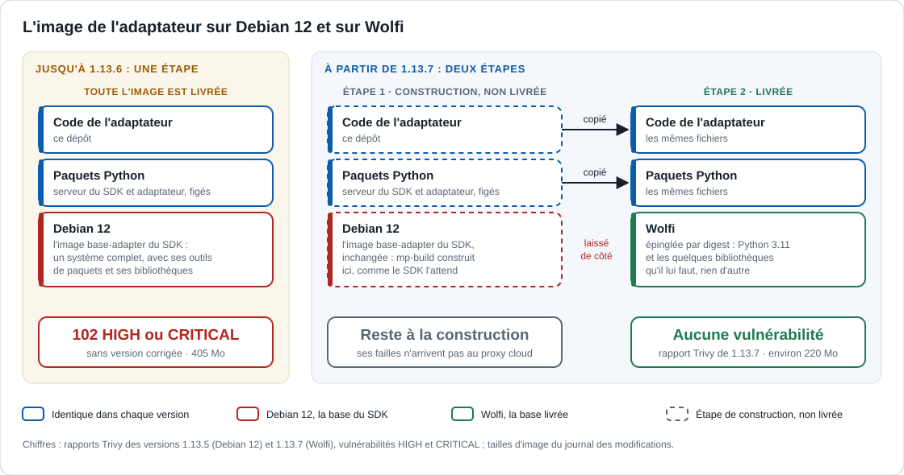
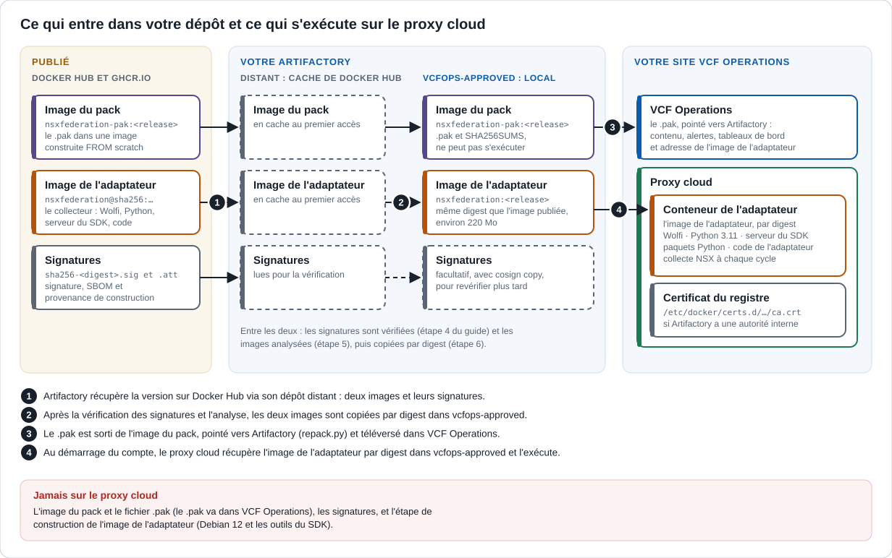

# La base de l'image de l'adaptateur : Debian 12 et Wolfi

English version: [BASE-IMAGE.md](BASE-IMAGE.md).

L'adaptateur est une image de conteneur que le proxy cloud exécute. Sous le code de l'adaptateur et ses paquets
Python, cette image contient une couche de système d'exploitation : sa base. Jusqu'à la version 1.13.6, la base
était Debian 12. À partir de la version 1.13.7, c'est Wolfi.

Le code de l'adaptateur, le contenu du pack, les étapes d'installation et la vérification des signatures sont
les mêmes sur les deux bases.

## Debian et Wolfi

Debian est un système d'exploitation complet, conçu pour faire tourner des serveurs pendant des années. Wolfi est
un petit ensemble de paquets conçu uniquement pour constituer l'intérieur d'un conteneur. Chainguard le
maintient.

| | Debian 12 | Wolfi |
| --- | --- | --- |
| Conçu pour | Serveurs, postes de travail et conteneurs | Conteneurs uniquement |
| Versions | Une version numérotée, puis figée | Aucune : les paquets sont toujours les paquets courants |
| Correctifs de sécurité | Appliqués à la version figée de chaque paquet. Certains arrivent tard, d'autres jamais | Chaque paquet est reconstruit à partir de la version amont courante |
| Dans l'image | Un système de base complet, avec ses outils de paquets et ses bibliothèques système | Ce que l'image demande : ici Python 3.11 et les bibliothèques dont il a besoin |
| Dans le temps | Le même comportement pendant des années | Les versions changent à chaque reconstruction de la base |

Une analyse de l'image de l'adaptateur montre cette différence de deux façons. Les vulnérabilités de l'image
Debian 12 se trouvaient dans ses paquets système, et l'image Wolfi contient beaucoup moins de paquets. Ceux
qu'elle contient sont à jour, alors que les vulnérabilités sans version corrigée dans Debian 12 viennent de
paquets maintenus à leur version figée.

## Les deux étapes de la construction

`pack/Dockerfile` décrit deux images, l'une après l'autre. `mp-build` construit les deux en une seule exécution.
Docker garde la dernière comme résultat : c'est l'image de l'adaptateur que `mp-build` pousse vers le registre.
La première est un espace de travail qui reste sur l'hôte de construction.

### Étape 1 : la construction du SDK (non livrée)

Cette étape est la construction des versions précédentes.

- Elle part de l'image `base-adapter` du SDK : Debian 12, Python 3.11 et le serveur du SDK. `mp-build` construit
  cette image à partir d'un modèle contenu dans le SDK.
- Elle ajoute les paquets Python de l'adaptateur, à leurs versions verrouillées, et le code de l'adaptateur.
  Elle retire `pip`, inutile à l'exécution.
- Le résultat est un adaptateur complet sur Debian 12, comme celui que livraient les versions jusqu'à 1.13.6.

L'étape est conservée parce que le SDK ne construit que sur sa propre base. Grâce à elle, rien n'est remplacé
dans le SDK.

### Étape 2 : l'image livrée

- Elle part de la base Wolfi, épinglée par digest. Cette base est presque vide.
- Elle ajoute Python 3.11, pris dans le dépôt de paquets Wolfi, et l'utilisateur sous lequel l'adaptateur
  s'exécute.
- Elle copie deux dossiers de l'étape 1 : les paquets Python (ceux du serveur du SDK et ceux de l'adaptateur),
  et le dossier personnel de l'adaptateur, avec le serveur du SDK, `commands.cfg` et le code de l'adaptateur.
- Elle laisse de côté tout Debian 12 : les paquets système, les outils de paquets et le Python de l'étape 1.
- Elle démarre comme l'image du SDK : même utilisateur, mêmes ports et même commande, le serveur du SDK.

### Ce que contient chaque étape

| | Étape 1 | Étape 2 |
| --- | --- | --- |
| Couche de système d'exploitation | Debian 12 | Wolfi |
| Python | 3.11, de l'image du SDK | 3.11, du paquet Wolfi |
| Serveur du SDK et paquets Python | installés ici | copiés de l'étape 1 |
| Code de l'adaptateur | ajouté ici | copié de l'étape 1 |
| Va dans le registre et sur le proxy cloud | non | oui |

### Pourquoi la copie fonctionne

Les deux étapes utilisent Python 3.11 : les paquets installés à l'étape 1 se chargent donc tels quels à
l'étape 2. Si un SDK ultérieur passait sa base à une autre version de Python, l'étape 2 devrait suivre.

`commands.cfg` appelle `/usr/local/bin/python`, l'emplacement de Python dans l'image du SDK. L'étape 2 relie ce
chemin à son propre Python.

## Ce qui arrive dans votre dépôt et sur le proxy cloud

Chaque version publie deux images, avec les mêmes digests sur Docker Hub et sur `ghcr.io`, et leurs signatures.
[INSTALL-ENTERPRISE.fr.md](INSTALL-ENTERPRISE.fr.md) donne les commandes de chaque étape.

| Élément | Dans votre dépôt | Sur le proxy cloud |
| --- | --- | --- |
| Image de l'adaptateur : Wolfi, Python 3.11, le serveur du SDK, les paquets Python et le code de l'adaptateur | Oui, copiée par digest dans le dépôt des images approuvées | Oui : récupérée par digest au démarrage du compte, puis exécutée comme conteneur |
| Image du pack : le `.pak` et `SHA256SUMS`, dans une image construite `FROM scratch` | Oui | Non. Le `.pak` en est sorti, pointé vers votre dépôt et installé dans VCF Operations |
| Signatures, SBOM et provenance de construction | Lus via le dépôt distant lors de la vérification des signatures. Copiés seulement s'il faut les vérifier de nouveau plus tard | Non |
| Le certificat de l'autorité de votre dépôt | Non | Seulement si le dépôt utilise une autorité interne |
| Étape de construction : Debian 12 et les outils du SDK | Non | Non. Elle reste sur l'hôte de construction du workflow de publication |

De ce pack, le proxy cloud n'exécute que l'image de l'adaptateur que le `.pak` désigne par son digest. Un digest
désigne une image exacte : le proxy cloud exécute donc l'image dont la signature a été vérifiée et qui a été
analysée, quel que soit l'endroit d'où il la récupère.

## Pourquoi Wolfi

- **L'analyse.** Le rapport Trivy de la version 1.13.5 liste 102 vulnérabilités HIGH ou CRITICAL dans des
  paquets Debian 12 qui n'y ont pas de version corrigée. Elles viennent avec l'image de base du SDK et ne
  changeraient qu'avec un nouveau SDK. Le rapport Trivy de la version 1.13.7 n'en liste aucune.
- **Le SDK n'est pas touché.** La construction se fait toujours sur la base du SDK : rien n'y est remplacé ni
  corrigé.
- **Python 3.11 est disponible.** Wolfi a un paquet `python-3.11`, la même version mineure que l'image du SDK.
  Les paquets sont donc copiés tels quels et les versions verrouillées restent les mêmes.
- **Une image plus petite.** Environ 220 Mo, contre 405 Mo pour l'image Debian 12.

Un scanner signale les vulnérabilités connues des paquets qu'il reconnaît. Un rapport vide ne dit rien des
failles encore inconnues.

## Ce que coûte Wolfi

- **La base se met à jour à la main.** La base Wolfi est épinglée par digest : l'image ne change que lorsque ce
  digest change. Dependabot ne propose pas ce changement. [RELEASE.md](RELEASE.md#each-release) (en anglais)
  indique quand le faire. Une image qui n'est pas reconstruite ne reçoit aucun nouveau correctif.
- **Les versions bougent.** Wolfi n'a pas de version figée. L'image de la 1.13.7 a OpenSSL 4, là où l'image
  Debian 12 avait OpenSSL 3.
- **Wolfi est moins connu.** Une organisation qui tient une liste d'images de base approuvées peut ne pas y
  avoir Wolfi.
- **La construction doit joindre deux hôtes de plus.** L'hôte de construction télécharge la base Wolfi depuis
  `cgr.dev` et son paquet Python depuis le dépôt de paquets Wolfi.

## Tests

Les deux bases ont été installées et collectées dans le lab : Debian 12 avec la version 1.13.5, et Wolfi avec
une construction en lab du Dockerfile de la 1.13.7, sur VCF Operations 9.1.2.0. L'image Wolfi a donné la même
définition d'adaptateur et les mêmes objets dans un cycle de collecte.

Les versions jusqu'à 1.13.6 gardent la base Debian 12 et restent publiées.

## Autres bases examinées

- **Debian 13.** Non construite. Analysée le 27 novembre 2026, l'image `python:3.11-slim-trixie` seule, avant
  l'ajout du serveur du SDK et de l'adaptateur, portait 53 vulnérabilités HIGH sans version corrigée. Il
  faudrait aussi construire une copie de l'image de base du SDK en dehors du SDK.
- **Ubuntu.** Non construite. Ubuntu 22.04 fournit Python 3.10 et Ubuntu 24.04 Python 3.12 : les paquets de
  l'étape du SDK ne pourraient pas être copiés tels quels, il faudrait les verrouiller et les tester de nouveau
  pour une autre version de Python.
