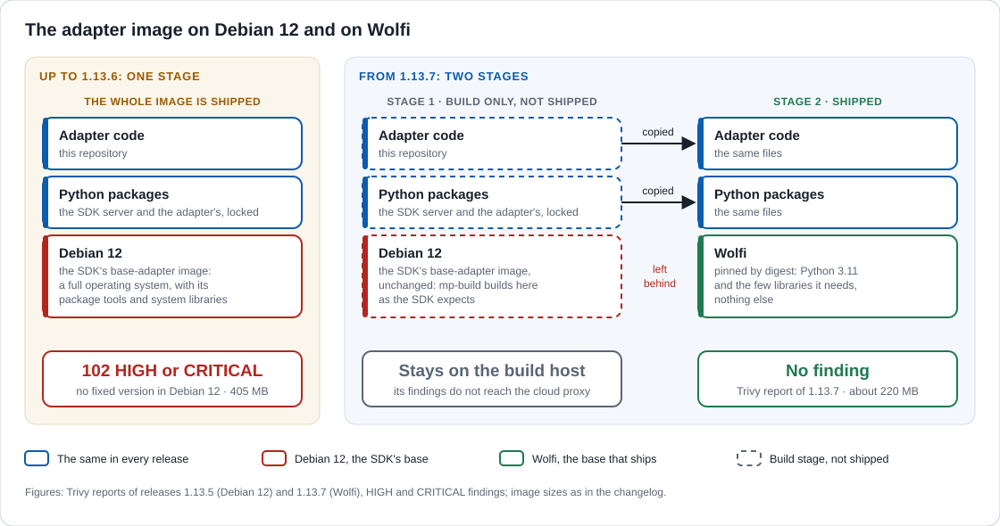
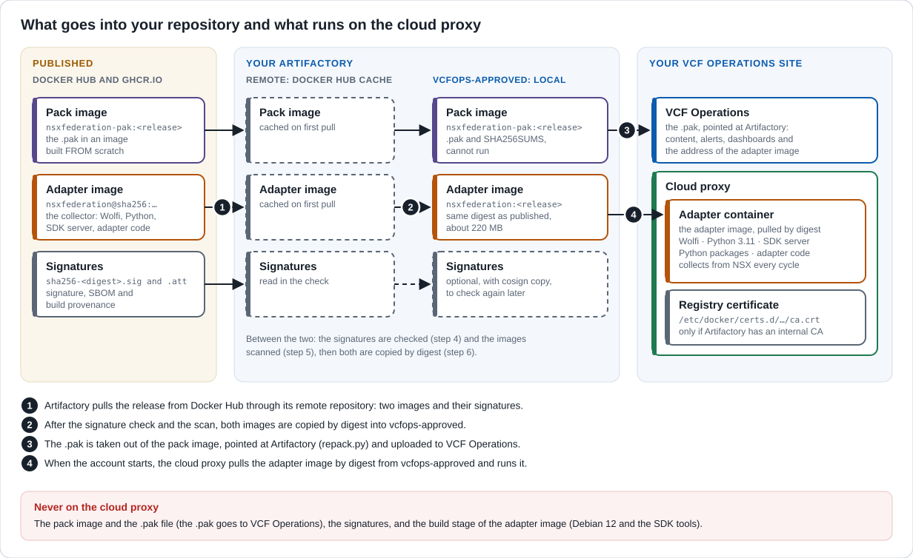

# The base of the adapter image: Debian 12 and Wolfi

Version française : [BASE-IMAGE.fr.md](BASE-IMAGE.fr.md).

The adapter is a container image that the cloud proxy runs. Under the adapter code and its Python packages,
that image holds an operating system layer: its base. Up to release 1.13.6 the base was Debian 12. From release
1.13.7 it is Wolfi.

The adapter code, the content of the pack, the install steps and the signature checks are the same on both
bases.

## Debian and Wolfi

Debian is a complete operating system, made to run servers for years. Wolfi is a small set of packages made
only to be the inside of a container. Chainguard maintains it.

| | Debian 12 | Wolfi |
| --- | --- | --- |
| Made for | Servers, desktops and containers | Containers only |
| Releases | A numbered release, then frozen | None: the packages are always the current ones |
| Security fixes | Applied to the frozen version of each package. Some come late, some never | Each package is rebuilt from the current upstream version |
| In the image | A full base system, with its package tools and system libraries | What the image asks for: here Python 3.11 and the libraries it needs |
| Over time | The same behaviour for years | Versions move with every rebuild of the base |

A scan of the adapter image shows that difference in two ways. The findings on the Debian 12 image were in its
system packages, and the Wolfi image holds far fewer packages. The packages it does hold are current, where the
findings without a fixed version in Debian 12 come from packages kept at their frozen version.

## The two stages of the build

`pack/Dockerfile` describes two images, one after the other. `mp-build` builds both in one run. Docker keeps
the last one as the result: that is the adapter image `mp-build` pushes to the registry. The first one is a
workspace that stays on the build host.

### Stage 1: the SDK build (not shipped)

This stage is the build of the earlier releases.

- It starts from the SDK's `base-adapter` image: Debian 12, Python 3.11 and the SDK server. `mp-build` builds
  that image from a template inside the SDK.
- It adds the adapter's Python packages, at their locked versions, and the adapter code. It removes `pip`,
  which is not needed at run time.
- The result is a complete adapter on Debian 12, of the kind releases up to 1.13.6 shipped.

The stage is kept because the SDK only builds on its own base. With it, nothing in the SDK is replaced.

### Stage 2: the image that ships

- It starts from the Wolfi base, pinned by digest. That base is almost empty.
- It adds Python 3.11 from the Wolfi package repository, and the user the adapter runs as.
- It copies two folders from stage 1: the Python packages (the SDK server's and the adapter's), and the home
  folder of the adapter, with the SDK server, `commands.cfg` and the adapter code.
- It leaves behind all of Debian 12: the system packages, the package tools and the Python of stage 1.
- It starts the same way as the SDK image: the same user, the same ports and the same command, the SDK server.

### What each stage holds

| | Stage 1 | Stage 2 |
| --- | --- | --- |
| Operating system layer | Debian 12 | Wolfi |
| Python | 3.11, from the SDK image | 3.11, from the Wolfi package |
| SDK server and Python packages | installed here | copied from stage 1 |
| Adapter code | added here | copied from stage 1 |
| Goes to the registry and the cloud proxy | no | yes |

### Why the copy works

Both stages run Python 3.11, so the packages installed in stage 1 load unchanged in stage 2. If a later SDK
moved its base to another Python version, stage 2 would have to follow.

`commands.cfg` calls `/usr/local/bin/python`, where the SDK image has Python. Stage 2 links that path to its own
Python.

## What reaches your repository and the cloud proxy

Each release publishes two images, with the same digests on Docker Hub and on `ghcr.io`, and their signatures.
[INSTALL-ENTERPRISE.md](INSTALL-ENTERPRISE.md) gives the commands of each step.

| Item | In your repository | On the cloud proxy |
| --- | --- | --- |
| Adapter image: Wolfi, Python 3.11, the SDK server, the Python packages and the adapter code | Yes, copied by digest into the approved repository | Yes: pulled by digest when the account starts, and run as a container |
| Pack image: the `.pak` and `SHA256SUMS`, in an image built `FROM scratch` | Yes | No. The `.pak` is taken out, pointed at your repository and installed in VCF Operations |
| Signatures, SBOM and build provenance | Read through the remote repository when the signatures are checked. Copied only if they are to be checked again later | No |
| The certificate of your repository's CA | No | Only if the repository uses an internal CA |
| Build stage: Debian 12 and the SDK tools | No | No. It stays on the build host of the release workflow |

From this pack, the cloud proxy runs only the adapter image that the `.pak` names by digest. A digest names one
exact image, so the cloud proxy runs the image whose signature was checked and that was scanned, wherever it is
pulled from.

## Why Wolfi

- **The scan.** The Trivy report of release 1.13.5 lists 102 HIGH or CRITICAL findings in Debian 12 packages
  that have no fixed version there. They come with the SDK's base image and would only change with a new SDK.
  The Trivy report of release 1.13.7 lists no finding.
- **The SDK is left alone.** The build still runs on the SDK's own base, so nothing in the SDK is replaced or
  patched.
- **Python 3.11 is available.** Wolfi has a `python-3.11` package, the same minor version as the SDK image, so
  the packages are copied as they are and the locked versions stay the same.
- **A smaller image.** About 220 MB where the Debian 12 image was 405 MB.

A scanner reports the known vulnerabilities of the packages it recognises. A report without findings says
nothing about flaws that are not yet known.

## What Wolfi costs

- **The base has to be moved by hand.** The Wolfi base is pinned by digest, so the image changes only when that
  digest does. Dependabot does not propose it. [RELEASE.md](RELEASE.md#each-release) says when to move it.
  An image that is not rebuilt gets no new fix.
- **Versions move.** Wolfi has no frozen release. The image of 1.13.7 has OpenSSL 4 where the Debian 12 image
  had OpenSSL 3.
- **It is less known.** An organisation with a list of approved base images may not have Wolfi on it.
- **The build reaches two more hosts.** The build host downloads the Wolfi base from `cgr.dev` and its Python
  package from the Wolfi package repository.

## Tested

Both bases were installed and collected in the lab: Debian 12 with release 1.13.5, and Wolfi with a lab build
of the 1.13.7 Dockerfile on VCF Operations 9.1.2.0. The Wolfi image gave the same adapter definition and the
same objects in a collection cycle.

Releases up to 1.13.6 keep the Debian 12 base and stay published.

## Other bases looked at

- **Debian 13.** Not built. Scanned on 27 November 2026, the `python:3.11-slim-trixie` image alone, before the
  SDK server and the adapter are added, had 53 HIGH findings without a fixed version. It would also mean
  building a copy of the SDK's base image outside the SDK.
- **Ubuntu.** Not built. Ubuntu 22.04 ships Python 3.10 and Ubuntu 24.04 Python 3.12, so the packages of the
  SDK stage could not be copied unchanged: they would have to be locked and tested again for another Python
  version.
