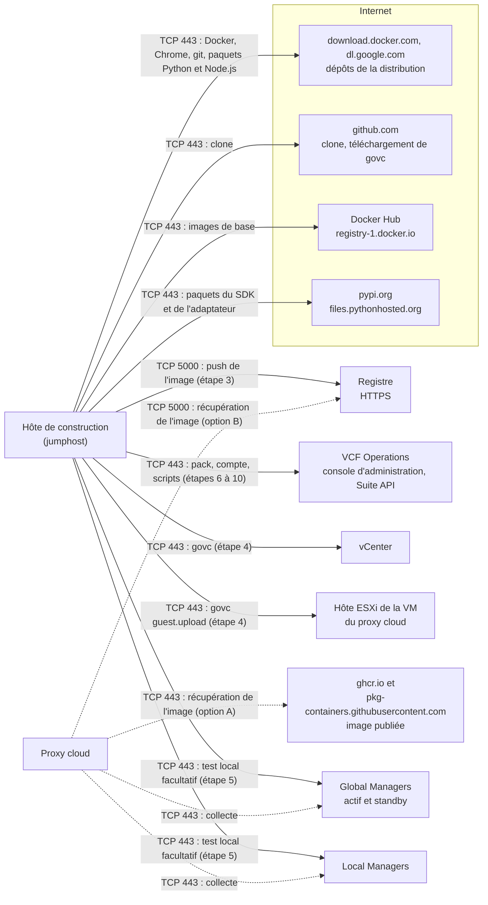

# Guide de construction

Comment construire le pack NSX Federation à partir des sources et faire le push de l'image de son adaptateur
vers votre propre registre, avec la machine sur laquelle chaque commande s'exécute. C'est l'option B de
[INSTALL.fr.md](INSTALL.fr.md#choisir-un-mode-dinstallation). Les étapes 1 à 5 sont dans ce fichier. Les étapes 6 à
10 (installer le pack non signé, créer le compte, vérifier la collecte, groupe facultatif, alertes facultatives)
sont les mêmes pour tous les modes et se trouvent dans [INSTALL.fr.md](INSTALL.fr.md#6-installer-le-pack-non-signé).
[Où chaque élément s'exécute](INSTALL.fr.md#où-chaque-élément-sexécute) décrit les machines.

English version: [BUILD.md](BUILD.md).

## Liste de contrôle

Les étapes 1 à 5 sont dans ce fichier, les étapes 6 à 10 dans [INSTALL.fr.md](INSTALL.fr.md).

- [ ] 1. Prérequis vérifiés, outils de l'hôte de construction installés, fichier de paramètres rempli
- [ ] 2. Registre servi en HTTPS
- [ ] 3. Pack construit, push de l'image fait, adresse du registre vérifiée dans le pack
- [ ] 4. Le proxy cloud fait confiance au certificat du registre
- [ ] 5. Facultatif : collecte testée sans VCF Operations
- [ ] 6. Pack non signé installé, option à nouveau désactivée
- [ ] 7. Compte créé, certificats acceptés
- [ ] 8. Compte à l'état « Collecting », métriques présentes après trois cycles
- [ ] 9. Facultatif : groupe par fédération
- [ ] 10. Facultatif : alertes envoyées par e-mail, à un webhook ou à un outil de tickets

## Accès réseau

Ouvrir ces flux avant de commencer : un flux bloqué se révèle tard, par un build qui ne peut pas télécharger un
paquet ou par un compte qui reste `FAILED`. Le schéma montre ce que l'hôte de construction (le jumphost dans le
lab) doit joindre, et les flux du proxy cloud dont dépend l'installation. Les traits pleins partent de l'hôte de
construction ; les pointillés sont ceux du proxy cloud. [INSTALL.fr.md, Accès réseau](INSTALL.fr.md#accès-réseau)
couvre l'option A et sa variante.



| Depuis | Vers | Port | Usage |
| --- | --- | --- | --- |
| Hôte de construction | Internet (dépôts Docker, Google Chrome et de la distribution, GitHub, Docker Hub, PyPI) | TCP 443 | Installation des outils, clone du dépôt, build des images d'outillage et de l'adaptateur. Via un proxy si le site en utilise un |
| Hôte de construction | Registre | TCP 5000, ou le port du registre | Push de l'image de l'adaptateur. En local quand le registre tourne sur l'hôte de construction, comme dans le lab |
| Hôte de construction | VCF Operations | TCP 443 | Console d'administration et interface du produit dans un navigateur, Suite API pour les scripts des étapes 6 à 10 |
| Hôte de construction | vCenter de la VM du proxy cloud | TCP 443 | Opérations invité `govc` de l'étape 4. Inutile si le certificat est copié par SSH |
| Hôte de construction | Hôte ESXi de la VM du proxy cloud | TCP 443 | `govc guest.upload` envoie le fichier à l'hôte ESXi, pas au vCenter |
| Hôte de construction | Global Managers et Local Managers | TCP 443 | Seulement pour le test facultatif de l'étape 5 |
| Proxy cloud | Registre | TCP 5000, ou le port du registre | Option B et variante avec registre interne : récupération de l'image de l'adaptateur |
| Proxy cloud | Global Managers et Local Managers | TCP 443 | Collecte |

## 1. Prérequis

Les étapes 1 à 5 préparent un hôte de construction, un registre et un pack
construit à partir des sources.

- [ ] VCF Operations 9.1.1 avec au moins un proxy cloud à l'état `UP`.
- [ ] NSX 9.1 Federation. Un compte NSX en lecture seule sur chaque Global Manager et chaque Local Manager ;
      le compte intégré `audit` convient. Un identifiant distinct pour les Local Managers est facultatif.
- [ ] Réseau : du proxy cloud vers chaque manager NSX en TCP 443, du proxy cloud vers le registre sur son port,
      de l'hôte de construction vers le registre.
- [ ] Mot de passe admin de VCF Operations : l'option des packs non signés se trouve dans la console
      d'administration.
- [ ] Une approbation de changement pour activer « Allow unsigned PAK installation » le temps de
      l'installation, si l'organisation l'exige. Le pack n'est pas signé par Broadcom (KB 415279).
- [ ] Outils de l'hôte de construction : Docker Engine, `git`, `unzip` et Python 3 avec `requests`, installés
      comme ci-dessous. Pour certaines étapes, également `govc` (étape 4), Node.js 22 ou ultérieur et Google
      Chrome (installation par script de l'étape 6).
- [ ] Le fichier de paramètres `~/fedmp.env`, rempli comme ci-dessous.

### Outils de l'hôte de construction

*À exécuter sur : l'hôte de construction.* Docker construit l'image d'outillage et l'image de l'adaptateur, et
fait tourner le registre de l'étape 2. `git` clone le dépôt, `unzip` lit le pack, et les scripts d'installation
sont écrits en Python avec le module `requests`. Docker vient du dépôt Docker plutôt que des paquets de la
distribution, afin que `docker build` utilise BuildKit.

Ubuntu ou Debian (sur Debian, remplacer `ubuntu` par `debian` dans les deux URL). Le bloc installe les paquets
de base, ajoute la clé de signature et la source de paquets de Docker, puis installe Docker depuis cette
source :

```bash
sudo apt-get update
sudo apt-get install -y ca-certificates curl git unzip python3 python3-requests
sudo install -m 0755 -d /etc/apt/keyrings
sudo curl -fsSL https://download.docker.com/linux/ubuntu/gpg -o /etc/apt/keyrings/docker.asc
sudo chmod a+r /etc/apt/keyrings/docker.asc
echo "deb [arch=$(dpkg --print-architecture) signed-by=/etc/apt/keyrings/docker.asc] \
https://download.docker.com/linux/ubuntu $(. /etc/os-release && echo "$VERSION_CODENAME") stable" \
  | sudo tee /etc/apt/sources.list.d/docker.list > /dev/null
sudo apt-get update
sudo apt-get install -y docker-ce docker-ce-cli containerd.io docker-buildx-plugin
```

RHEL, Rocky Linux ou AlmaLinux 8 et versions ultérieures :

```bash
sudo dnf install -y dnf-plugins-core git unzip python3 python3-requests
sudo dnf config-manager --add-repo https://download.docker.com/linux/rhel/docker-ce.repo
sudo dnf install -y docker-ce docker-ce-cli containerd.io docker-buildx-plugin
```

Dans les deux cas, démarrer Docker et l'activer à chaque démarrage du système. Les commandes `docker` de ce
guide sont préfixées par `sudo` : l'utilisateur de construction n'a donc pas besoin d'être membre du groupe
`docker`.

```bash
sudo systemctl enable --now docker
```

Vérification. La première commande récupère une image de test sur Docker Hub et l'exécute, ce qui prouve que
Docker fonctionne et accède à Internet ; elle affiche « Hello from Docker! ». La dernière n'affiche rien quand
`requests` est installé :

```bash
sudo docker run --rm hello-world
git --version
python3 --version         # 3.8 ou ultérieure
python3 -c "import requests"
```

### Outils pour certaines étapes

`govc` est le client en ligne de commande de vCenter. L'étape 4 s'en sert pour copier le certificat du registre
dans la VM du proxy cloud. L'ignorer quand cette copie passe par SSH. La dernière ligne affiche la version :

```bash
curl -fsSL "https://github.com/vmware/govmomi/releases/latest/download/govc_$(uname -s)_$(uname -m).tar.gz" \
  | sudo tar -C /usr/local/bin -xzf - govc
govc version
```

Node.js 22 ou ultérieur et Google Chrome servent à l'installation par script de l'étape 6 : les scripts
pilotent un Chrome headless depuis Node.js, et ils utilisent le client WebSocket intégré à Node.js à partir de
la version 22. Les ignorer pour l'installation à la main. Ubuntu 26.04 fournit Node.js 22 ; sur une version plus
ancienne, prendre Node.js 22 sur [nodejs.org](https://nodejs.org/en/download) :

```bash
sudo apt-get install -y nodejs
curl -fsSLO https://dl.google.com/linux/direct/google-chrome-stable_current_amd64.deb
sudo apt-get install -y ./google-chrome-stable_current_amd64.deb && rm google-chrome-stable_current_amd64.deb
node --version            # v22 ou ultérieure
google-chrome --version
```

RHEL, Rocky Linux ou AlmaLinux 9 :

```bash
sudo dnf module install -y nodejs:22
sudo dnf install -y https://dl.google.com/linux/direct/google-chrome-stable_current_x86_64.rpm
```

### Le fichier de paramètres

Les adresses, les noms et les mots de passe dont les commandes ont besoin sont dans un seul fichier,
`~/fedmp.env`. Les commandes de ce guide ne contiennent alors ni adresse ni mot de passe, et se collent telles
quelles. Cloner le dépôt, copier l'exemple, le remplir, et le rendre lisible par son seul propriétaire :

```bash
cd ~
git clone https://github.com/sorinplaton/vcf-ops-nsx-federation-mp.git
cp vcf-ops-nsx-federation-mp/install/fedmp.env.example ~/fedmp.env && chmod 600 ~/fedmp.env
nano ~/fedmp.env
```

| Variable | Usage |
| --- | --- |
| `IP` | L'adresse de l'hôte de construction que le proxy cloud utilise pour joindre le registre (étapes 2 à 4) |
| `VERSION` | La version du pack, comme dans `pack/manifest.txt` |
| `OPS_HOST`, `OPS_PW` | VCF Operations et son mot de passe admin (étapes 6 à 10) |
| `OPS_INSECURE` ou `OPS_CA` | Seulement quand VCF Operations présente un certificat auquel l'hôte de construction ne fait pas confiance : `OPS_CA` désigne le fichier de l'autorité ; `OPS_INSECURE=1` désactive la vérification (lab seulement). Sans l'un des deux, les scripts des étapes 6, 9 et 10 s'arrêtent sur `CERTIFICATE_VERIFY_FAILED` |
| `GOVC_URL`, `GOVC_USERNAME`, `GOVC_PASSWORD` | Le vCenter qui héberge la VM du proxy cloud (étape 4) |
| `PROXY_VM`, `PROXY_ROOT_PW` | Le nom de la VM du proxy cloud et son mot de passe root (étape 4) |
| `GM_HOSTS`, `NSX_USER`, `NSX_PASSWORD` | Les Global Managers et le compte NSX en lecture seule (étape 5) |
| `HARBOR`, `HARBOR_PROJECT`, `HARBOR_USER`, `HARBOR_PW` | Seulement pour la variante Harbor et la variante avec registre interne. En commentaire dans l'exemple : retirer le `#` pour s'en servir |

Chaque bloc de commandes qui a besoin de ces valeurs commence par la ligne qui charge le fichier et les
exporte :

```bash
set -a; source ~/fedmp.env; set +a
```

`set -a` demande au shell d'exporter toute variable définie à partir de ce point, `source` lit le fichier, et
`set +a` arrête l'export. Sans l'export, les valeurs restent dans le shell, et les scripts et les
conteneurs lancés par les commandes ne les voient pas. Les valeurs durent autant que le shell : un nouveau
terminal demande de relancer la ligne, et un bloc collé sans elle s'exécute avec des adresses vides.

Le fichier contient des mots de passe. Le tenir hors de Git (`fedmp.env` est dans `.gitignore`), et le
supprimer ou le déplacer dans un coffre une fois l'installation terminée.

## 2. Registre en HTTPS

Le proxy cloud a besoin d'un registre où récupérer l'image de l'adaptateur, et il ne la récupère qu'en HTTPS.
Cette étape démarre un petit registre sur l'hôte de construction, avec un certificat créé pour lui. Avec un
registre Harbor existant, passer les étapes 2 à 4 et suivre
[Variante : un registre Harbor existant](#variante--un-registre-harbor-existant).

*À exécuter sur : l'hôte de construction.* Un conteneur `registry:2` avec un certificat autosigné. La commande
`openssl` crée la clé et un certificat valable 825 jours, qui porte l'adresse de `IP`. La commande `docker run`
démarre le registre avec ce certificat sur le port 5000, garde les images dans le volume Docker
`registry-data`, et relance le conteneur après un redémarrage de l'hôte :

```bash
set -a; source ~/fedmp.env; set +a
mkdir -p ~/fedmp-registry/certs && cd ~/fedmp-registry
openssl req -x509 -newkey rsa:2048 -nodes -days 825 \
  -keyout certs/registry.key -out certs/registry.crt -subj "/CN=fedmp-registry" \
  -addext "subjectAltName=IP:$IP,IP:127.0.0.1,DNS:localhost"

sudo docker run -d --name fedmp-registry --restart unless-stopped \
  -p $IP:5000:5000 -p 127.0.0.1:5000:5000 \
  -v registry-data:/var/lib/registry -v $PWD/certs:/certs:ro \
  -e REGISTRY_HTTP_TLS_CERTIFICATE=/certs/registry.crt \
  -e REGISTRY_HTTP_TLS_KEY=/certs/registry.key registry:2
```

Le certificat contient aussi `127.0.0.1` et `localhost`, et le registre écoute également sur l'adresse locale,
parce que l'étape 3 fait le push de l'image vers `localhost:5000`.

Vérification. La commande appelle le registre sur l'adresse que le proxy cloud utilisera et n'accepte que le
certificat qui vient d'être créé : une réponse prouve donc à la fois l'écoute et le certificat. Un registre neuf
répond `{"repositories":[]}` jusqu'au premier push :

```bash
set -a; source ~/fedmp.env; set +a
curl --cacert ~/fedmp-registry/certs/registry.crt https://$IP:5000/v2/_catalog
```

## 3. Construire le pack

*À exécuter sur : l'hôte de construction.* Le premier `docker build` crée `fedmp-tooling`, une image qui
contient les outils du SDK. Le `docker run` lance ensuite `mp-build` depuis cette image : il construit l'image
de l'adaptateur avec le Docker de l'hôte (par le socket monté), en fait le push vers le registre de l'étape 2
et écrit le `.pak`. Le conteneur tourne avec l'ID de l'utilisateur courant et l'ID du groupe `docker` : il peut
ainsi utiliser le socket, et les fichiers qu'il écrit dans le clone appartiennent à l'utilisateur de
construction. Le build télécharge les images de base depuis Docker Hub et les paquets Python depuis PyPI.

```bash
set -a; source ~/fedmp.env; set +a
cd ~/vcf-ops-nsx-federation-mp
sudo docker build -t fedmp-tooling tooling

sudo docker run --rm --network host -u $(id -u):$(getent group docker | cut -d: -f3) -e HOME=$PWD/.sdkhome \
  -v /var/run/docker.sock:/var/run/docker.sock -v $(which docker):/usr/bin/docker -v $PWD:$PWD -w $PWD/pack \
  fedmp-tooling mp-build --no-ttl -r localhost:5000/nsxfederation \
  --registry-username lab --registry-password lab
```

Le résultat est `pack/build/NSXFederation_$VERSION.pak`.

`mp-build` démarre l'adaptateur pour un test sur `127.0.0.1:8080`. Si ce port est pris sur l'hôte de
construction, il échoue avec `Bind for 127.0.0.1:8080 failed: port is already allocated` : ajouter `-P 18080`
(n'importe quel port libre) aux options de `mp-build`. Seul le port de test change ; le pack utilise toujours le
port 443 sur le proxy cloud.

Le push de l'image se fait vers `localhost:5000`. Docker accepte le certificat autosigné d'un registre joint par
l'adresse locale : l'hôte de construction n'a donc pas besoin de son propre dossier de certificat. Le registre
de l'étape 2 ne demande aucune authentification. `mp-build` demande quand même un utilisateur et un mot de
passe, et n'importe quelle valeur convient.

Quand le registre est donné sous la forme `host:port` sans domaine, `mp-build` écrit Docker Hub dans le pack.
Le proxy cloud chercherait alors l'image sur Docker Hub, et le compte échouerait. `repack.py` ouvre le pack et
réécrit deux lignes de la configuration de l'adaptateur, `REGISTRY` et `REPOSITORY`, dans le fichier même ; rien
d'autre ne change. Inscrire dans le pack l'adresse que le proxy cloud utilise, avant l'installation :

```bash
set -a; source ~/fedmp.env; set +a
cd ~/vcf-ops-nsx-federation-mp
python3 tools/repack.py pack/build/NSXFederation_$VERSION.pak $IP:5000 nsxfederation
```

Vérifier l'adresse du registre dans le pack. Les deux lignes extraient la configuration de l'adaptateur et
affichent l'adresse où le proxy cloud ira chercher l'image :

```bash
set -a; source ~/fedmp.env; set +a
cd ~/vcf-ops-nsx-federation-mp
unzip -p pack/build/NSXFederation_$VERSION.pak adapter.zip > /tmp/adapter.zip
unzip -p /tmp/adapter.zip '*.conf' | grep -E '^(REGISTRY|REPOSITORY)='
```

Résultat attendu : `REGISTRY=<IP>:5000`, avec la valeur de `IP`, et `REPOSITORY=/nsxfederation`.

Vérifier que l'image est dans le registre. La réponse donne le dépôt `nsxfederation` et ses tags :

```bash
set -a; source ~/fedmp.env; set +a
curl --cacert ~/fedmp-registry/certs/registry.crt https://$IP:5000/v2/nsxfederation/tags/list
```

## 4. Le proxy cloud fait confiance au certificat du registre

Le certificat de l'étape 2 est autosigné : le proxy cloud le refuse tant qu'on ne lui a pas dit de lui faire
confiance. Sans cette étape, la récupération de l'image échoue et le compte reste `FAILED` (étape 8). Docker,
sur le proxy cloud, fait confiance à un registre privé dont le certificat se trouve dans un dossier qui porte
le nom du registre, port compris. Avec le registre de l'étape 2, c'est :

```
/etc/docker/certs.d/$IP:5000/ca.crt
```

*À exécuter sur : l'hôte de construction*, qui détient le fichier de paramètres et le certificat. Il lui faut
`govc` ([Outils pour certaines étapes](#outils-pour-certaines-étapes)) et l'accès au vCenter qui héberge la VM
du proxy cloud. SSH peut rester désactivé sur le proxy cloud : les opérations d'invité de vCenter écrivent le
fichier avec le compte root de l'appliance. La première commande crée le dossier dans la VM, la seconde y
dépose le certificat sous le nom `ca.crt` :

```bash
set -a; source ~/fedmp.env; set +a
govc guest.mkdir -vm "$PROXY_VM" -l "root:$PROXY_ROOT_PW" -p /etc/docker/certs.d/$IP:5000
govc guest.upload -vm "$PROXY_VM" -l "root:$PROXY_ROOT_PW" -f ~/fedmp-registry/certs/registry.crt \
  /etc/docker/certs.d/$IP:5000/ca.crt
```

*Ou à exécuter sur : le proxy cloud*, si SSH y est activé : créer le dossier et y copier `registry.crt` sous le
nom `ca.crt`.

La preuve que le proxy cloud fait confiance au registre arrive à l'étape 8, quand le compte passe à l'état
« Collecting ».

Une mise à niveau ou un redéploiement du proxy cloud peut supprimer le fichier. Refaire cette étape après
l'un ou l'autre.

Un registre déplacé vers une autre adresse demande un nouveau certificat (étape 2), un pack réécrit (étape 3)
et un nouveau dossier sur le proxy cloud.

Sans Harbor, sauter la section suivante et continuer à l'étape 5, qui est facultative, ou à
l'[étape 6 dans INSTALL.fr.md](INSTALL.fr.md#6-installer-le-pack-non-signé).

## Variante : un registre Harbor existant

À utiliser à la place des étapes 2 à 4 quand l'environnement dispose déjà de Harbor. Le pack se construit comme
à l'étape 3, et l'image part dans Harbor.

Dans Harbor, une seule fois :

- [ ] Un projet pour l'image, par exemple `nsxfederation`, en accès public. Le proxy cloud récupère l'image
      sans s'authentifier : l'image d'un projet privé ne peut donc pas être récupérée.
- [ ] Un compte qui a le droit de push dans le projet : un compte robot avec le droit push, ou un utilisateur
      avec le rôle Developer.
- [ ] Réseau : de l'hôte de construction et du proxy cloud vers Harbor en TCP 443.

Dans `~/fedmp.env`, retirer le `#` devant les quatre lignes `HARBOR` et les remplir avec l'adresse de Harbor, le
projet et le compte de push.

*À exécuter sur : l'hôte de construction.* Son Docker doit faire confiance au certificat de Harbor, sinon le
push échoue sur une erreur de certificat. Quand le certificat vient d'une autorité interne, ou qu'il est
autosigné, copier d'abord le certificat de l'autorité. `harbor-ca.crt` est ce certificat au format PEM : le
demander à l'équipe qui exploite Harbor et le placer dans le dossier courant.

```bash
set -a; source ~/fedmp.env; set +a
sudo mkdir -p /etc/docker/certs.d/$HARBOR
sudo cp harbor-ca.crt /etc/docker/certs.d/$HARBOR/ca.crt
```

Construire le pack et faire le push de l'image. `mp-build` s'authentifie auprès de Harbor avec le compte donné
sur la ligne de commande. Le nom d'un compte robot contient un `$` : conserver les apostrophes qui l'entourent
dans `fedmp.env`.

```bash
set -a; source ~/fedmp.env; set +a
cd ~/vcf-ops-nsx-federation-mp
sudo docker build -t fedmp-tooling tooling

sudo docker run --rm --network host -u $(id -u):$(getent group docker | cut -d: -f3) -e HOME=$PWD/.sdkhome \
  -v /var/run/docker.sock:/var/run/docker.sock -v $(which docker):/usr/bin/docker -v $PWD:$PWD -w $PWD/pack \
  fedmp-tooling mp-build --no-ttl -r $HARBOR/$HARBOR_PROJECT/nsxfederation \
  --registry-username "$HARBOR_USER" --registry-password "$HARBOR_PW"
```

Vérifier l'adresse inscrite dans le pack. Le registre a ici un nom de domaine : `repack.py` ne devrait donc pas
être nécessaire.

```bash
set -a; source ~/fedmp.env; set +a
cd ~/vcf-ops-nsx-federation-mp
unzip -p pack/build/NSXFederation_$VERSION.pak adapter.zip > /tmp/adapter.zip
unzip -p /tmp/adapter.zip '*.conf' | grep -E '^(REGISTRY|REPOSITORY)='
```

Résultat attendu : `REGISTRY=harbor.example.com` et `REPOSITORY=/nsxfederation/nsxfederation`. Si le pack
désigne Docker Hub, le réécrire :

```bash
set -a; source ~/fedmp.env; set +a
cd ~/vcf-ops-nsx-federation-mp
python3 tools/repack.py pack/build/NSXFederation_$VERSION.pak $HARBOR $HARBOR_PROJECT/nsxfederation
```

Le proxy cloud doit lui aussi faire confiance au certificat de Harbor. Avec un certificat émis par une autorité
qu'il approuve déjà, il n'y a rien d'autre à faire. Sinon, copier le certificat de l'autorité de Harbor sur le
proxy cloud, comme l'étape 4 le fait pour le registre de l'étape 2. Le dossier est
`/etc/docker/certs.d/harbor.example.com/` (ajouter `:<port>` au nom du dossier quand Harbor n'écoute pas sur le
port 443) :

```bash
set -a; source ~/fedmp.env; set +a
govc guest.mkdir -vm "$PROXY_VM" -l "root:$PROXY_ROOT_PW" -p /etc/docker/certs.d/$HARBOR
govc guest.upload -vm "$PROXY_VM" -l "root:$PROXY_ROOT_PW" -f harbor-ca.crt \
  /etc/docker/certs.d/$HARBOR/ca.crt
```

Continuer ensuite à l'étape 5 ou à l'[étape 6 dans INSTALL.fr.md](INSTALL.fr.md#6-installer-le-pack-non-signé).

## 5. Facultatif : tester une collecte sans VCF Operations

Ce test exécute une fois le code de l'adaptateur sur l'hôte de construction, face aux vrais managers NSX, et
affiche ce qu'il enverrait à VCF Operations. Il révèle en une minute une mauvaise adresse, un mauvais mot de
passe ou un port bloqué, avant l'installation du pack. Il ne fait que lire dans NSX.

*À exécuter sur : l'hôte de construction.* Il doit pouvoir joindre les managers NSX en TCP 443. `sudo` vide
l'environnement : `--preserve-env` nomme donc les trois variables à conserver, et chaque `-e NOM` sans valeur
transmet cette variable au conteneur :

```bash
set -a; source ~/fedmp.env; set +a
cd ~/vcf-ops-nsx-federation-mp
sudo --preserve-env=GM_HOSTS,NSX_USER,NSX_PASSWORD docker run --rm --network host -v $PWD:/work \
  -e PYTHONDONTWRITEBYTECODE=1 -e GM_HOSTS -e NSX_USER -e NSX_PASSWORD fedmp-tooling python tools/localrun.py
```

La commande affiche les objets et les métriques d'un cycle. Une exécution réussie montre `error: None`, puis
une ligne `objects:` avec un décompte par type (fédération, Global Managers, emplacements, etc.), puis chaque
objet avec ses métriques et ses propriétés. Un appel en échec se voit ici avant d'apparaître dans VCF
Operations.

## Continuer avec INSTALL.fr.md

Continuer avec l'[étape 6 de INSTALL.fr.md](INSTALL.fr.md#6-installer-le-pack-non-signé) : installer le pack non
signé, puis l'étape 7 (créer le compte), l'étape 8 (vérifier la collecte), et les étapes facultatives 9 (groupe
par fédération) et 10 (envoyer les alertes). Utiliser la ligne `PAK` de l'option B dans l'installation par script
de l'étape 6. Pour une nouvelle version, voir [Mise à niveau](INSTALL.fr.md#mise-à-niveau).

## Ce qui a été testé

- L'option B est le mode utilisé dans le lab, avec le registre de l'étape 2 sur le jumphost.
- Les commandes Ubuntu de [Outils de l'hôte de construction](#outils-de-lhôte-de-construction), sur un hôte
  Ubuntu 26.04 vierge.

Pas testé dans le lab :

- Les commandes RHEL de [Outils de l'hôte de construction](#outils-de-lhôte-de-construction).
- La [variante Harbor](#variante--un-registre-harbor-existant). Le lab utilise le registre de l'étape 2.
