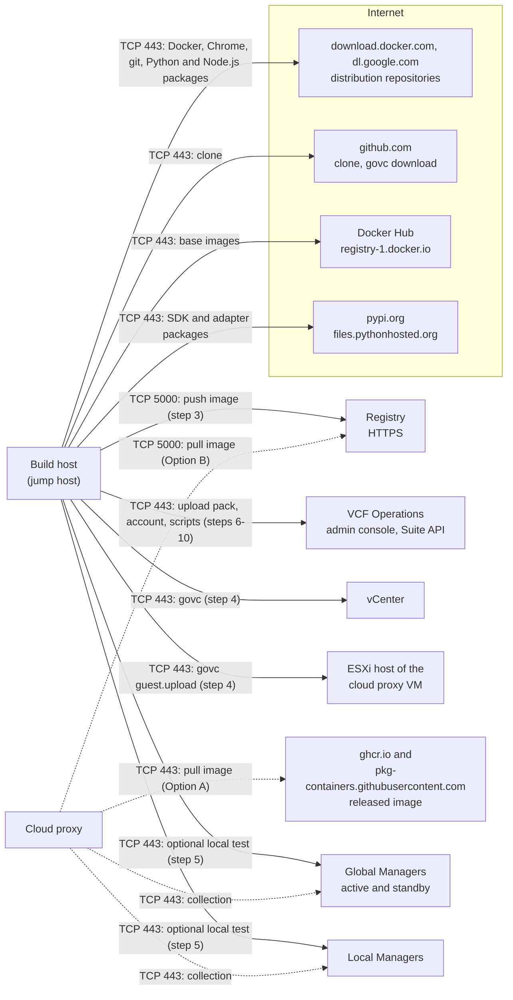

# Build guide

How to build the NSX Federation pack from source and push its adapter image to a registry of your own, with the
machine each command runs on. This is Option B of [INSTALL.md](INSTALL.md#choose-a-path). Steps 1 to 5 are in
this file. Steps 6 to 10 (install the unsigned pack, create the account, check the collection, optional group,
optional alerts) are the same for every path and are in [INSTALL.md](INSTALL.md#6-install-the-unsigned-pack).
[Where things run](INSTALL.md#where-things-run) describes the machines.

Version française : [BUILD.fr.md](BUILD.fr.md).

## Checklist

Steps 1 to 5 are in this file, steps 6 to 10 in [INSTALL.md](INSTALL.md).

- [ ] 1. Prerequisites checked, build host tools installed, settings file filled in
- [ ] 2. Registry serves HTTPS
- [ ] 3. Pack built, image pushed, registry address in the pack checked
- [ ] 4. Cloud proxy trusts the registry certificate
- [ ] 5. Optional: collection tested without VCF Operations
- [ ] 6. Unsigned pack installed, switch turned off again
- [ ] 7. Account created, certificates accepted
- [ ] 8. Account "Collecting", metrics after three cycles
- [ ] 9. Optional: group per federation
- [ ] 10. Optional: alerts sent to email, a webhook or a ticketing tool

## Network access

Open these flows before starting: a blocked one shows up late, as a build that cannot download a package or as
an account that stays `FAILED`. The drawing shows what the build host (the jump host in the lab) must reach, and
the flows of the cloud proxy that the install depends on. Solid lines start at the build host; dashed lines are
the cloud proxy's. [INSTALL.md, Network access](INSTALL.md#network-access) covers Option A and its mirror
variant.



| From | To | Port | Used for |
| --- | --- | --- | --- |
| Build host | Internet (Docker, Google Chrome and distribution repositories, GitHub, Docker Hub, PyPI) | TCP 443 | Installing the tools, cloning the repository, building the tooling and adapter images. Through a proxy if the site uses one |
| Build host | Registry | TCP 5000, or the registry port | Pushing the adapter image. Local when the registry runs on the build host, as in the lab |
| Build host | VCF Operations | TCP 443 | Admin console and product UI in a browser, and the Suite API for the scripts of steps 6 to 10 |
| Build host | vCenter of the cloud proxy VM | TCP 443 | `govc` guest operations of step 4. Not needed when the certificate is copied over SSH |
| Build host | ESXi host of the cloud proxy VM | TCP 443 | `govc guest.upload` sends the file to the ESXi host, not to vCenter |
| Build host | Global Managers and Local Managers | TCP 443 | Only for the optional test of step 5 |
| Cloud proxy | Registry | TCP 5000, or the registry port | Option B and the mirror variant: pulling the adapter image |
| Cloud proxy | Global Managers and Local Managers | TCP 443 | Collection |

## 1. Prerequisites

Steps 1 to 5 prepare a build host, a registry and a pack built from the source.

- [ ] VCF Operations 9.1.1 with at least one cloud proxy in state `UP`.
- [ ] NSX 9.1 Federation. A read-only NSX account on every Global Manager and Local Manager; the built-in
      `audit` account works. A separate credential for the Local Managers is optional.
- [ ] Network: cloud proxy to every NSX manager on TCP 443, cloud proxy to the registry on its port, build
      host to the registry.
- [ ] Admin password of VCF Operations: the unsigned-pack switch is in the admin console.
- [ ] A change approval to turn on "Allow unsigned PAK installation" for the length of the install, if the
      organisation requires one. The pack is not signed by Broadcom (KB 415279).
- [ ] Build host tools: Docker Engine, `git`, `unzip` and Python 3 with `requests`, installed as below. For
      some steps, also `govc` (step 4), Node.js 22 or later and Google Chrome (scripted install of step 6).
- [ ] The settings file `~/fedmp.env`, filled in as below.

### Build host tools

*Run on: the build host.* Docker builds the tooling image and the adapter image, and runs the registry of
step 2. `git` clones the repository, `unzip` reads the pack, and the install scripts are written in Python with
the `requests` module. Docker comes from the Docker repository rather than the distribution packages, so that
`docker build` uses BuildKit.

Ubuntu or Debian (on Debian, replace `ubuntu` with `debian` in both URLs). The block installs the base
packages, adds the signing key and the package source of Docker, then installs Docker from it:

```bash
sudo apt-get update
sudo apt-get install -y ca-certificates curl git unzip python3 python3-requests
sudo install -m 0755 -d /etc/apt/keyrings
sudo curl -fsSL https://download.docker.com/linux/ubuntu/gpg -o /etc/apt/keyrings/docker.asc
sudo chmod a+r /etc/apt/keyrings/docker.asc
echo "deb [arch=$(dpkg --print-architecture) signed-by=/etc/apt/keyrings/docker.asc] \
https://download.docker.com/linux/ubuntu $(. /etc/os-release && echo "$VERSION_CODENAME") stable" \
  | sudo tee /etc/apt/sources.list.d/docker.list > /dev/null
sudo apt-get update
sudo apt-get install -y docker-ce docker-ce-cli containerd.io docker-buildx-plugin
```

RHEL, Rocky Linux or AlmaLinux 8 and later:

```bash
sudo dnf install -y dnf-plugins-core git unzip python3 python3-requests
sudo dnf config-manager --add-repo https://download.docker.com/linux/rhel/docker-ce.repo
sudo dnf install -y docker-ce docker-ce-cli containerd.io docker-buildx-plugin
```

On both, start Docker and have it start at every boot. The `docker` commands of this guide carry `sudo`, so the
build user does not have to be in the `docker` group.

```bash
sudo systemctl enable --now docker
```

Check. The first command pulls a test image from Docker Hub and runs it, which proves that Docker works and
reaches the internet; it prints "Hello from Docker!". The last one prints nothing when `requests` is installed:

```bash
sudo docker run --rm hello-world
git --version
python3 --version         # 3.8 or later
python3 -c "import requests"
```

### Tools for some steps

`govc` is the command-line client for vCenter. Step 4 uses it to copy the registry certificate into the cloud
proxy VM. Skip it when that copy goes over SSH. The last line prints the version:

```bash
curl -fsSL "https://github.com/vmware/govmomi/releases/latest/download/govc_$(uname -s)_$(uname -m).tar.gz" \
  | sudo tar -C /usr/local/bin -xzf - govc
govc version
```

Node.js 22 or later and Google Chrome run the scripted install of step 6: the scripts drive a headless Chrome
from Node.js, and they use the WebSocket client that Node.js has built in from version 22. Skip both for the
install by hand. Ubuntu 26.04 ships Node.js 22; on an older release, take Node.js 22 from
[nodejs.org](https://nodejs.org/en/download):

```bash
sudo apt-get install -y nodejs
curl -fsSLO https://dl.google.com/linux/direct/google-chrome-stable_current_amd64.deb
sudo apt-get install -y ./google-chrome-stable_current_amd64.deb && rm google-chrome-stable_current_amd64.deb
node --version            # v22 or later
google-chrome --version
```

RHEL, Rocky Linux or AlmaLinux 9:

```bash
sudo dnf module install -y nodejs:22
sudo dnf install -y https://dl.google.com/linux/direct/google-chrome-stable_current_x86_64.rpm
```

### The settings file

The addresses, the names and the passwords the commands need are in one file, `~/fedmp.env`. The commands of
this guide then carry no address and no password, and can be pasted as they are. Clone the repository, copy the
example, fill it in, and make it readable by its owner only:

```bash
cd ~
git clone https://github.com/sorinplaton/vcf-ops-nsx-federation-mp.git
cp vcf-ops-nsx-federation-mp/install/fedmp.env.example ~/fedmp.env && chmod 600 ~/fedmp.env
nano ~/fedmp.env
```

| Variable | Used for |
| --- | --- |
| `IP` | The address of the build host that the cloud proxy uses to reach the registry (steps 2 to 4) |
| `VERSION` | The pack version, as in `pack/manifest.txt` |
| `OPS_HOST`, `OPS_PW` | VCF Operations and its admin password (steps 6 to 10) |
| `OPS_INSECURE` or `OPS_CA` | Only when VCF Operations has a certificate that the build host does not trust: `OPS_CA` names the CA file; `OPS_INSECURE=1` skips the check (lab only). Without either, the scripts of steps 6, 9 and 10 stop with `CERTIFICATE_VERIFY_FAILED` |
| `GOVC_URL`, `GOVC_USERNAME`, `GOVC_PASSWORD` | The vCenter that runs the cloud proxy VM (step 4) |
| `PROXY_VM`, `PROXY_ROOT_PW` | The name of the cloud proxy VM and its root password (step 4) |
| `GM_HOSTS`, `NSX_USER`, `NSX_PASSWORD` | The Global Managers and the read-only NSX account (step 5) |
| `HARBOR`, `HARBOR_PROJECT`, `HARBOR_USER`, `HARBOR_PW` | Only for the Harbor variant and the mirror variant. Commented out in the example: remove the `#` to use them |

Each command block that needs these values starts with the line that loads the file and exports them:

```bash
set -a; source ~/fedmp.env; set +a
```

`set -a` tells the shell to export every variable it sets from that point, `source` reads the file, and
`set +a` turns the export off again. Without the export, the values stay in the shell, and the
scripts and containers the commands start do not see them. The values last as long as the shell, so a new
terminal needs the line again, and a block pasted without it runs with empty addresses.

The file holds passwords. Keep it out of Git (`fedmp.env` is in `.gitignore`), and delete it or move it to a
vault once the install is done.

## 2. Registry over HTTPS

The cloud proxy needs a registry to pull the adapter image from, and it only pulls over HTTPS. This step starts
a small registry on the build host, with a certificate made for it. With an existing Harbor registry, skip
steps 2 to 4 and follow [Variant: an existing Harbor registry](#variant-an-existing-harbor-registry).

*Run on: the build host.* A `registry:2` container with a self-signed certificate. The `openssl` command
creates the key and a certificate valid for 825 days that names the address in `IP`. The `docker run` command
starts the registry with that certificate on port 5000, keeps the images in the Docker volume `registry-data`,
and restarts the container after a reboot:

```bash
set -a; source ~/fedmp.env; set +a
mkdir -p ~/fedmp-registry/certs && cd ~/fedmp-registry
openssl req -x509 -newkey rsa:2048 -nodes -days 825 \
  -keyout certs/registry.key -out certs/registry.crt -subj "/CN=fedmp-registry" \
  -addext "subjectAltName=IP:$IP,IP:127.0.0.1,DNS:localhost"

sudo docker run -d --name fedmp-registry --restart unless-stopped \
  -p $IP:5000:5000 -p 127.0.0.1:5000:5000 \
  -v registry-data:/var/lib/registry -v $PWD/certs:/certs:ro \
  -e REGISTRY_HTTP_TLS_CERTIFICATE=/certs/registry.crt \
  -e REGISTRY_HTTP_TLS_KEY=/certs/registry.key registry:2
```

The certificate also names `127.0.0.1` and `localhost`, and the registry also listens on the local address,
because step 3 pushes the image to `localhost:5000`.

Check. The command calls the registry on the address the cloud proxy will use and accepts only the certificate
just created, so an answer proves both the listener and the certificate. A new registry answers
`{"repositories":[]}` until the first push:

```bash
set -a; source ~/fedmp.env; set +a
curl --cacert ~/fedmp-registry/certs/registry.crt https://$IP:5000/v2/_catalog
```

## 3. Build the pack

*Run on: the build host.* The first `docker build` makes `fedmp-tooling`, an image that holds the SDK tools.
The `docker run` then starts `mp-build` from it: it builds the adapter image with the Docker of the host
(through the mounted socket), pushes it to the registry of step 2 and writes the `.pak`. The container runs
with the ID of the current user and the group ID of `docker`, so it can use the socket and the files it writes
in the clone belong to the build user. The build downloads the base images from Docker Hub and the Python
packages from PyPI.

```bash
set -a; source ~/fedmp.env; set +a
cd ~/vcf-ops-nsx-federation-mp
sudo docker build -t fedmp-tooling tooling

sudo docker run --rm --network host -u $(id -u):$(getent group docker | cut -d: -f3) -e HOME=$PWD/.sdkhome \
  -v /var/run/docker.sock:/var/run/docker.sock -v $(which docker):/usr/bin/docker -v $PWD:$PWD -w $PWD/pack \
  fedmp-tooling mp-build --no-ttl -r localhost:5000/nsxfederation \
  --registry-username lab --registry-password lab
```

The result is `pack/build/NSXFederation_$VERSION.pak`.

`mp-build` starts the adapter for a test on `127.0.0.1:8080`. If that port is taken on the build host, it fails
with `Bind for 127.0.0.1:8080 failed: port is already allocated`: add `-P 18080` (any free port) to the
`mp-build` options. It moves only the test port; the pack still uses port 443 on the cloud proxy.

The image is pushed to `localhost:5000`. Docker accepts the self-signed certificate of a registry on the local
address, so the build host needs no certificate folder of its own. The registry of step 2 has no login.
`mp-build` still asks for a user and a password, and any value works.

When the registry is given as `host:port` without a domain, `mp-build` writes Docker Hub into the pack. The
cloud proxy would then look for the image on Docker Hub and the account would fail. `repack.py` opens the pack
and rewrites two lines of the adapter configuration, `REGISTRY` and `REPOSITORY`, in place; nothing else
changes. Write the address the cloud proxy uses into the pack before the install:

```bash
set -a; source ~/fedmp.env; set +a
cd ~/vcf-ops-nsx-federation-mp
python3 tools/repack.py pack/build/NSXFederation_$VERSION.pak $IP:5000 nsxfederation
```

Check the registry address in the pack. The two lines extract the adapter configuration and print the address
the cloud proxy will pull from:

```bash
set -a; source ~/fedmp.env; set +a
cd ~/vcf-ops-nsx-federation-mp
unzip -p pack/build/NSXFederation_$VERSION.pak adapter.zip > /tmp/adapter.zip
unzip -p /tmp/adapter.zip '*.conf' | grep -E '^(REGISTRY|REPOSITORY)='
```

Expected: `REGISTRY=<IP>:5000`, with the value of `IP`, and `REPOSITORY=/nsxfederation`.

Check that the image is in the registry. The answer names the repository `nsxfederation` and its tags:

```bash
set -a; source ~/fedmp.env; set +a
curl --cacert ~/fedmp-registry/certs/registry.crt https://$IP:5000/v2/nsxfederation/tags/list
```

## 4. Cloud proxy trusts the registry certificate

The certificate of step 2 is self-signed, so the cloud proxy refuses it until it is told to trust it. Without
this step the pull fails and the account stays `FAILED` (step 8). Docker on the cloud proxy trusts a private
registry whose certificate is in a folder named after the registry, port included. With the registry of
step 2, that is:

```
/etc/docker/certs.d/$IP:5000/ca.crt
```

*Run on: the build host*, which has the settings file and the certificate. It needs `govc`
([Tools for some steps](#tools-for-some-steps)) and access to the vCenter that runs the cloud proxy VM. SSH on
the cloud proxy can stay disabled: vCenter guest operations write the file with the appliance root account.
The first command creates the folder in the VM, the second uploads the certificate as `ca.crt`:

```bash
set -a; source ~/fedmp.env; set +a
govc guest.mkdir -vm "$PROXY_VM" -l "root:$PROXY_ROOT_PW" -p /etc/docker/certs.d/$IP:5000
govc guest.upload -vm "$PROXY_VM" -l "root:$PROXY_ROOT_PW" -f ~/fedmp-registry/certs/registry.crt \
  /etc/docker/certs.d/$IP:5000/ca.crt
```

*Or run on: the cloud proxy*, if SSH is enabled there: create the folder and copy `registry.crt` as `ca.crt`.

The proof that the cloud proxy trusts the registry comes in step 8, when the account reaches "Collecting".

An upgrade or a redeploy of the cloud proxy can remove the file. Repeat this step after either one.

A registry moved to another address needs a new certificate (step 2), a rewritten pack (step 3) and a new
folder on the cloud proxy.

Without Harbor, skip the next section and continue with step 5, which is optional, or with
[step 6 in INSTALL.md](INSTALL.md#6-install-the-unsigned-pack).

## Variant: an existing Harbor registry

Use this in place of steps 2 to 4 when the environment already has Harbor. The pack is built as in step 3, and
the image goes to Harbor.

On Harbor, once:

- [ ] A project for the image, for example `nsxfederation`, set to public. The cloud proxy pulls the image
      without a login, so the image of a private project cannot be pulled.
- [ ] An account that can push to the project: a robot account with the push permission, or a user with the
      Developer role.
- [ ] Network: build host and cloud proxy to Harbor on TCP 443.

In `~/fedmp.env`, remove the `#` in front of the four `HARBOR` lines and fill them in with the address of
Harbor, the project and the push account.

*Run on: the build host.* Its Docker must trust the certificate of Harbor, or the push fails with a
certificate error. When the certificate comes from an internal CA, or is self-signed, copy the CA certificate
first. `harbor-ca.crt` is that CA certificate in PEM format: get it from the team that runs Harbor and put it
in the current folder.

```bash
set -a; source ~/fedmp.env; set +a
sudo mkdir -p /etc/docker/certs.d/$HARBOR
sudo cp harbor-ca.crt /etc/docker/certs.d/$HARBOR/ca.crt
```

Build the pack and push the image. `mp-build` logs in to Harbor with the account given on the command line. The
name of a robot account contains a `$`, so keep the single quotes around it in `fedmp.env`:

```bash
set -a; source ~/fedmp.env; set +a
cd ~/vcf-ops-nsx-federation-mp
sudo docker build -t fedmp-tooling tooling

sudo docker run --rm --network host -u $(id -u):$(getent group docker | cut -d: -f3) -e HOME=$PWD/.sdkhome \
  -v /var/run/docker.sock:/var/run/docker.sock -v $(which docker):/usr/bin/docker -v $PWD:$PWD -w $PWD/pack \
  fedmp-tooling mp-build --no-ttl -r $HARBOR/$HARBOR_PROJECT/nsxfederation \
  --registry-username "$HARBOR_USER" --registry-password "$HARBOR_PW"
```

Check the address in the pack. The registry has a domain name here, so `repack.py` should not be needed:

```bash
set -a; source ~/fedmp.env; set +a
cd ~/vcf-ops-nsx-federation-mp
unzip -p pack/build/NSXFederation_$VERSION.pak adapter.zip > /tmp/adapter.zip
unzip -p /tmp/adapter.zip '*.conf' | grep -E '^(REGISTRY|REPOSITORY)='
```

Expected: `REGISTRY=harbor.example.com` and `REPOSITORY=/nsxfederation/nsxfederation`. If the pack names Docker
Hub instead, rewrite it:

```bash
set -a; source ~/fedmp.env; set +a
cd ~/vcf-ops-nsx-federation-mp
python3 tools/repack.py pack/build/NSXFederation_$VERSION.pak $HARBOR $HARBOR_PROJECT/nsxfederation
```

The cloud proxy must trust the certificate of Harbor too. With a certificate from an authority it already
trusts, nothing more is needed. Otherwise copy the CA certificate of Harbor to the cloud proxy, as step 4 does
for the registry of step 2. The folder is `/etc/docker/certs.d/harbor.example.com/` (add `:<port>` to the folder
name when Harbor does not listen on 443):

```bash
set -a; source ~/fedmp.env; set +a
govc guest.mkdir -vm "$PROXY_VM" -l "root:$PROXY_ROOT_PW" -p /etc/docker/certs.d/$HARBOR
govc guest.upload -vm "$PROXY_VM" -l "root:$PROXY_ROOT_PW" -f harbor-ca.crt \
  /etc/docker/certs.d/$HARBOR/ca.crt
```

Then continue with step 5 or with [step 6 in INSTALL.md](INSTALL.md#6-install-the-unsigned-pack).

## 5. Optional: test a collection without VCF Operations

This test runs the adapter code once on the build host, against the real NSX managers, and prints what it
would send to VCF Operations. It finds a wrong address, a wrong password or a blocked port in a minute, before
the pack is installed. It only reads from NSX.

*Run on: the build host.* It needs to reach the NSX managers on TCP 443. `sudo` clears the environment, so
`--preserve-env` names the three variables it must keep, and each `-e NAME` without a value passes that
variable into the container:

```bash
set -a; source ~/fedmp.env; set +a
cd ~/vcf-ops-nsx-federation-mp
sudo --preserve-env=GM_HOSTS,NSX_USER,NSX_PASSWORD docker run --rm --network host -v $PWD:/work \
  -e PYTHONDONTWRITEBYTECODE=1 -e GM_HOSTS -e NSX_USER -e NSX_PASSWORD fedmp-tooling python tools/localrun.py
```

It prints the objects and metrics of one cycle. A good run shows `error: None`, then a line `objects:` with a
count per kind (federation, Global Managers, locations and so on), then each object with its metrics and
properties. A failed call shows up here before it does in VCF Operations.

## Continue with INSTALL.md

Continue with [INSTALL.md, step 6](INSTALL.md#6-install-the-unsigned-pack): install the unsigned pack, then
step 7 (create the account), step 8 (check the collection), and the optional steps 9 (group per federation) and
10 (send the alerts). Use the `PAK` line for Option B in the scripted install of step 6. For a new version, see
[Upgrade](INSTALL.md#upgrade).

## What was tested

- Option B is the path used in the lab, with the registry of step 2 on the jump host.
- The Ubuntu commands of [Build host tools](#build-host-tools), on a clean Ubuntu 26.04 host.

Not tested in the lab:

- The RHEL commands of [Build host tools](#build-host-tools).
- The [Harbor variant](#variant-an-existing-harbor-registry). The lab uses the registry of step 2.
