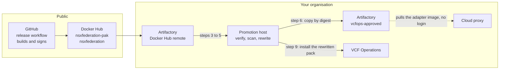

# Pack de gestion NSX Federation : installation via JFrog Artifactory

Ce guide installe le pack de gestion NSX Federation dans VCF Operations 9.1.1, dans une organisation où chaque
image passe par JFrog Artifactory. Le pack et l'image de son adaptateur sont récupérés sur Docker Hub via
Artifactory, vérifiés, analysés, copiés dans un dépôt d'images approuvées, et installés depuis ce dépôt. Seuls
Artifactory et un hôte de promotion joignent Internet.

English version: [CUSTOMER-INSTALL.md](CUSTOMER-INSTALL.md).

| | |
| --- | --- |
| Pack | Pack de gestion NSX Federation, licence MIT, projet communautaire (pas un produit Broadcom) |
| Versions prises en charge | VCF Operations 9.1.1, NSX 9.1 Federation. Les autres versions n'ont pas été testées |
| Sources et versions publiées | https://github.com/sorinplaton/vcf-ops-nsx-federation-mp |
| Images sur Docker Hub | `sorinplaton/nsxfederation-pak` (le fichier `.pak`), `sorinplaton/nsxfederation` (l'adaptateur) |
| Ce que fait le pack dans NSX | Lecture seule : des requêtes GET avec un compte en lecture seule |
| Support | Aucun SLA. Issues sur GitHub ; vulnérabilités par l'onglet Security du dépôt |

Sommaire :

1. [Fonctionnement](#fonctionnement)
2. [Avant de commencer : demandes et approbations](#avant-de-commencer--demandes-et-approbations)
3. [Accès réseau](#accès-réseau)
4. [Procédure](#procédure), étapes 1 à 11
5. [Mise à niveau, retour arrière, désinstallation](#mise-à-niveau-retour-arrière-désinstallation)
6. [Dépannage](#dépannage)
7. Annexes : [Docker au lieu de skopeo et cosign](#annexe-a--docker-au-lieu-de-skopeo-et-cosign),
   [sites sans accès à Internet](#annexe-b--sites-sans-accès-à-internet), [état de la validation](#annexe-c--état-de-la-validation)

## Fonctionnement



Deux images sont publiées pour chaque version :

- **L'image du pack** (`nsxfederation-pak`) transporte le fichier `.pak` et un fichier de somme de contrôle. Elle
  est construite `FROM scratch` : ni système d'exploitation, ni shell, elle ne peut pas s'exécuter.
- **L'image de l'adaptateur** (`nsxfederation`) est le collecteur que le proxy cloud exécute. Le `.pak` la désigne
  par son digest, le SHA-256 de l'image.

Dans le `.pak`, trois lignes indiquent où se trouve l'image de l'adaptateur. Telles que publiées, elles désignent
la copie du projet sur le registre de GitHub, qui a le même digest que la copie sur Docker Hub :

```
REGISTRY=ghcr.io
REPOSITORY=/sorinplaton/nsxfederation
DIGEST=sha256:...
```

L'étape 7 change les deux premières lignes pour que le proxy cloud récupère l'image depuis votre Artifactory. La
ligne `DIGEST` ne change pas : le proxy cloud ne peut donc exécuter que l'image que vous avez vérifiée et analysée.

Chaque étape copie et vérifie les images par leur digest, jamais par leur seul tag : un tag peut être déplacé vers
une autre image, un digest ne le peut pas.

**Numéro de version publiée et version du pack.** La version publiée (par exemple `1.13.6`, le tag Git) change à
chaque publication. La version du pack (`1.13.0`, dans le nom de fichier `NSXFederation_1.13.0.pak`) ne change que
lorsque le contenu du pack change. Identifier un pack par son SHA-256 et le digest d'adaptateur qu'il désigne, tels
que les donnent les notes de version, et non par son nom de fichier.

## Avant de commencer : demandes et approbations

### Qui fait quoi

| Rôle | Où | Étapes |
| --- | --- | --- |
| Administrateur Artifactory | Interface d'Artifactory | 1, une seule fois |
| Ingénieur plateforme ou sécurité | Hôte de promotion : une machine Linux qui joint Artifactory | 2 à 7, à chaque version |
| Administrateur VMware | Proxy cloud, interface et console d'administration de VCF Operations | 8 à 11 |

Une seule personne peut tenir les trois rôles. Une image devient utilisable en production à l'étape 6, quand elle
est copiée dans `vcfops-approved` ; c'est le point d'approbation naturel.

### Demandes par équipe

Copier chaque liste dans un ticket. Les valeurs entre chevrons sont celles que vous choisissez.

**Administrateurs Artifactory**

- Un dépôt distant Docker de Docker Hub (`https://registry-1.docker.io/`, authentification par jeton activée), ou
  la clé du dépôt existant. Un compte Docker Hub sur ce dépôt si le site récupère beaucoup d'images sur Docker Hub.
- Un dépôt Docker local `vcfops-approved`, API Docker V2.
- L'accès anonyme activé, et une permission : utilisateur `anonymous`, Read, sur `vcfops-approved` seulement.
- Un compte de service `<svc-vcfops-promote>` avec Read sur le dépôt distant et Read, Annotate et Deploy sur
  `vcfops-approved`, et un jeton d'identité pour ce compte.
- Facultatif : un dépôt local générique pour les packs réécrits, par exemple `vcfops-generic-local`.
- La méthode d'accès Docker de l'instance (Repository Path ou Subdomain), et le certificat de l'autorité qui a émis
  son certificat HTTPS, si cette autorité est interne.

**Réseau et pare-feu**

- Les règles de [Accès réseau](#accès-réseau).

**Ingénierie plateforme ou sécurité**

- Un hôte de promotion Linux avec les outils de l'étape 2, ou l'autorisation de les exécuter en conteneurs avec
  Docker.
- La politique d'analyse des deux images (par exemple JFrog Xray sur `vcfops-approved`) et la personne qui valide.
- Un endroit où enregistrer, pour chaque version, les deux digests d'images (étapes 3 et 4) et le SHA-256 du pack
  réécrit (étape 7).

**Administrateurs VMware**

- Le mot de passe admin de VCF Operations, pour l'installation et l'option des packs non signés.
- Root sur chaque proxy cloud qui exécutera le compte, pour l'étape 8 : une fenêtre SSH, ou les opérations
  d'invité de vCenter.
- Un compte NSX en lecture seule sur chaque Global Manager et Local Manager ; le compte intégré `audit` convient.

**Comité des changements**

- L'approbation d'activer « Allow unsigned PAK installation » le temps de l'installation, avec la justification
  ci-dessous.

### Justification de l'option des packs non signés

VCF Operations n'installe un pack sans cette option que s'il est signé par Broadcom (KB Broadcom 415279). Pour tout
autre pack, un administrateur active « Allow unsigned PAK installation » dans la console d'administration,
installe, puis désactive l'option.

- **Pourquoi il n'y a pas de signature Broadcom.** Il s'agit d'un pack communautaire sous licence MIT, publié sur
  GitHub. Ce n'est pas un produit Broadcom : Broadcom ne le signe pas, et aucun tiers ne peut obtenir cette
  signature.
- **Combien de temps l'option reste activée.** Le temps du téléversement et de l'installation seulement.
  L'administrateur l'active juste avant le téléversement, la désactive juste après (étape 9) et vérifie que la
  console d'administration l'affiche désactivée.
- **Ce qui remplace la signature Broadcom.** Trois vérifications, toutes faites par votre organisation :
  1. Étape 4 : `cosign` vérifie les signatures de l'image du pack et de l'image de l'adaptateur. Elles doivent
     nommer le dépôt du projet, son workflow de publication et le tag de la version, et figurer dans le journal de
     transparence public de Sigstore. Facultatif : le SBOM signé et la provenance de construction SLSA.
  2. Étape 6 : les deux images sont copiées par leur digest dans `vcfops-approved`. Le pack désigne l'image de
     l'adaptateur par son digest : le proxy cloud ne peut donc exécuter que l'image qui a été vérifiée et analysée.
  3. Étape 7 : vous enregistrez le SHA-256 du pack réécrit. L'étape 9 vérifie le fichier par rapport à cette
     valeur avant d'activer l'option.
- **Ce que change la réécriture.** Deux lignes du pack, `REGISTRY` et `REPOSITORY`, pour que le proxy cloud
  récupère l'image depuis Artifactory. La ligne `DIGEST`, qui décide de ce qui s'exécute, reste telle qu'elle a été
  signée. L'étape 7 affiche les trois lignes pour l'enregistrement.
- **Risque résiduel.** Tant que l'option est activée, un administrateur pourrait installer n'importe quel pack non
  signé. Garder la fenêtre courte, et faire toutes les vérifications avant d'activer l'option.

## Accès réseau

| Depuis | Vers | Port | Usage |
| --- | --- | --- | --- |
| Artifactory | `registry-1.docker.io`, `auth.docker.io`, `production.cloudflare.docker.com` | TCP 443 | Le dépôt distant Docker Hub. La plupart des instances Artifactory l'ont déjà |
| Hôte de promotion | Artifactory | TCP 443 | Récupération depuis le dépôt distant, push vers `vcfops-approved` |
| Hôte de promotion | `tuf-repo-cdn.sigstore.dev`, `rekor.sigstore.dev` | TCP 443 | La vérification des signatures de l'étape 4 : la racine de confiance de Sigstore et le journal de transparence |
| Hôte de promotion | `api.github.com` | TCP 443 | Facultatif : la vérification de la provenance de construction de l'étape 4 |
| Hôte de promotion | `github.com`, `raw.githubusercontent.com` | TCP 443 | Une seule fois, pour télécharger `cosign` et `repack.py` (étape 2). Ils peuvent aussi passer par un dépôt distant générique d'Artifactory |
| Poste d'administration | VCF Operations | TCP 443 | Installation et compte (étapes 9 à 11) |
| Proxy cloud | Artifactory | TCP 443 | Récupération de l'image de l'adaptateur depuis `vcfops-approved`, sans authentification |
| Proxy cloud | Global Managers et Local Managers | TCP 443 | Collecte |

Le proxy cloud n'a besoin d'aucun accès à Internet. Si l'hôte de promotion ne peut pas non plus joindre Internet,
voir l'[annexe B](#annexe-b--sites-sans-accès-à-internet).

## Procédure

Liste de contrôle :

- [ ] 1. Artifactory : dépôt distant Docker Hub, `vcfops-approved`, lecture anonyme sur ce dépôt, compte de promotion
- [ ] 2. Hôte de promotion : outils et paramètres
- [ ] 3. Image du pack récupérée via Artifactory, `.pak` extrait, somme de contrôle OK
- [ ] 4. Signatures des deux images vérifiées
- [ ] 5. Les deux images analysées
- [ ] 6. Les deux images copiées par leur digest dans `vcfops-approved`
- [ ] 7. Pack pointant vers `vcfops-approved`, SHA-256 enregistré
- [ ] 8. Le proxy cloud fait confiance à Artifactory et récupère l'image de l'adaptateur sans authentification
- [ ] 9. Pack installé dans VCF Operations, option à nouveau désactivée
- [ ] 10. Compte créé
- [ ] 11. Collecte vérifiée

### 1. Préparer Artifactory (une seule fois)

*À exécuter dans : l'interface d'Artifactory, en tant qu'administrateur.* Les noms de menu sont ceux de
l'interface JFrog Platform 7.x.

1. **Dépôt distant Docker Hub.** La plupart des sites en ont déjà un, souvent appelé `docker-remote` ou
   `dockerhub-remote` ; le réutiliser. Pour en créer un : Administration, Repositories, Create a Repository,
   Remote, Docker. URL `https://registry-1.docker.io/`, « Enable Token Authentication » activé. Ajouter un
   utilisateur et un jeton Docker Hub dans les paramètres du dépôt si le site récupère beaucoup d'images sur Docker
   Hub : les récupérations anonymes sont limitées par adresse IP.
2. **Dépôt des images approuvées.** Create a Repository, Local, Docker, clé `vcfops-approved`, version de l'API
   Docker V2. Seules les images promues y vont.
3. **Lecture anonyme sur ce seul dépôt.** Le proxy cloud récupère l'image sans identifiant, parce que VCF
   Operations n'a aucun réglage pour l'authentification auprès d'un registre. Administration, User Management,
   Settings : « Allow Anonymous Access » activé. Puis Permissions, New Permission : ressource `vcfops-approved`
   seulement, utilisateur `anonymous`, action Read. Tous les autres dépôts restent fermés aux utilisateurs
   anonymes.
4. **Compte de promotion.** Un utilisateur ou un compte de service avec Read sur le dépôt distant Docker Hub, et
   Read, Annotate et Deploy sur `vcfops-approved`. Lui créer un jeton d'identité (Edit Profile, Generate an
   Identity Token) : les commandes ci-dessous utilisent ce jeton comme mot de passe.

L'adresse d'une image dépend de la méthode d'accès Docker d'Artifactory. Avec la méthode par défaut, Repository
Path, une image est `<artifactory>/<repository key>/<image>`. Avec la méthode Subdomain, elle est
`<repository key>.<artifactory>/<image>` : adapter les paramètres de l'étape 2.

### 2. Préparer l'hôte de promotion

*À exécuter sur : l'hôte de promotion.* Installer les outils depuis les paquets de la distribution et la version
publiée de cosign. Si l'hôte n'est autorisé qu'à exécuter Docker, suivre plutôt
l'[annexe A](#annexe-a--docker-au-lieu-de-skopeo-et-cosign).

```bash
# Ubuntu ou Debian
sudo apt-get install -y skopeo python3 unzip curl
curl -LO https://github.com/sigstore/cosign/releases/download/v2.4.1/cosign_2.4.1_amd64.deb
sudo dpkg -i cosign_2.4.1_amd64.deb

# RHEL, Rocky Linux ou AlmaLinux
sudo dnf install -y skopeo python3 unzip curl
sudo rpm -ivh https://github.com/sigstore/cosign/releases/download/v2.4.1/cosign-2.4.1-1.x86_64.rpm
```

Si Artifactory utilise un certificat émis par une autorité interne, donner l'autorité à skopeo et à cosign :

```bash
sudo mkdir -p /etc/containers/certs.d/artifactory.example.com
sudo cp internal-ca.crt /etc/containers/certs.d/artifactory.example.com/ca.crt
sudo cp internal-ca.crt /usr/local/share/ca-certificates/ && sudo update-ca-certificates   # RHEL : /etc/pki/ca-trust/source/anchors/ + update-ca-trust
```

Paramètres de toutes les commandes suivantes. Les définir dans chaque nouveau shell ; le jeton est saisi, pas
enregistré :

```bash
ART=artifactory.example.com          # nom d'hôte d'Artifactory, avec :port s'il n'écoute pas sur 443
HUB=dockerhub-remote                 # clé du dépôt distant Docker Hub
APPROVED=vcfops-approved             # clé du dépôt local de l'étape 1
RELEASE=1.13.6                       # version à installer : le tag de la version GitHub sans le v
ART_USER=svc-vcfops-promote
read -rs ART_TOKEN                   # jeton d'identité du compte de promotion
SIGNER="https://github.com/sorinplaton/vcf-ops-nsx-federation-mp/.github/workflows/release.yml@refs/tags/v$RELEASE"
ISSUER=https://token.actions.githubusercontent.com
curl -LO https://raw.githubusercontent.com/sorinplaton/vcf-ops-nsx-federation-mp/v$RELEASE/tools/repack.py
```

`SIGNER` et `ISSUER` sont ce que les signatures doivent indiquer : construit par le workflow de publication du
projet, à partir du tag de cette version, sur GitHub Actions. Les notes de version donnent les mêmes deux valeurs.
`repack.py` est le seul fichier du dépôt dont cette procédure a besoin (étape 7) ; le lire avant de l'utiliser, il
fait 23 lignes de Python.

### 3. Récupérer le pack via Artifactory

*À exécuter sur : l'hôte de promotion.* La première commande résout le tag en digest ; toutes les commandes
suivantes utilisent le digest. La seconde copie l'image du pack dans un dossier local, et les lignes Python
extraient son unique couche :

```bash
PAK_DIGEST=$(skopeo inspect --creds "$ART_USER:$ART_TOKEN" --format '{{.Digest}}' \
  docker://$ART/$HUB/sorinplaton/nsxfederation-pak:$RELEASE)
echo "$PAK_DIGEST"

rm -rf pakimg && skopeo copy --all --src-creds "$ART_USER:$ART_TOKEN" \
  docker://$ART/$HUB/sorinplaton/nsxfederation-pak@$PAK_DIGEST oci:pakimg:pak
python3 - <<'EOF'
import json, tarfile
blob = lambda d: json.load(open("pakimg/blobs/sha256/" + d.split(":")[1]))
man = blob(json.load(open("pakimg/index.json"))["manifests"][0]["digest"])
while "manifests" in man:                      # une liste d'images : prendre l'image qu'elle contient
    man = blob(man["manifests"][0]["digest"])
tarfile.open("pakimg/blobs/sha256/" + man["layers"][0]["digest"].split(":")[1]).extractall(".")
EOF
ls pak/ && (cd pak && sha256sum -c SHA256SUMS)
```

Résultat attendu : `pak/NSXFederation_<version>.pak` et `pak/SHA256SUMS`, puis `NSXFederation_<version>.pak: OK`.
Comparer `PAK_DIGEST` avec le digest de l'image du pack donné dans les notes de version.

### 4. Vérifier les signatures

*À exécuter sur : l'hôte de promotion.* cosign lit la signature stockée à côté de chaque image, et Artifactory la
sert depuis Docker Hub comme n'importe quel autre tag.

L'image du pack. Son digest couvre chaque octet du `.pak` : cette vérification couvre donc aussi le fichier de
l'étape 3 :

```bash
cosign login $ART -u "$ART_USER" -p "$ART_TOKEN"
cosign verify --certificate-identity "$SIGNER" --certificate-oidc-issuer "$ISSUER" \
  $ART/$HUB/sorinplaton/nsxfederation-pak@$PAK_DIGEST > /dev/null && echo "pack image: verified"
```

L'image de l'adaptateur que désigne le pack. Les deux premières lignes lisent son digest dans le pack :

```bash
unzip -p pak/NSXFederation_*.pak adapter.zip > adapter.zip
AD_DIGEST=$(unzip -p adapter.zip '*.conf' | sed -n 's/^DIGEST=//p'); echo "$AD_DIGEST"
cosign verify --certificate-identity "$SIGNER" --certificate-oidc-issuer "$ISSUER" \
  $ART/$HUB/sorinplaton/nsxfederation@$AD_DIGEST > /dev/null && echo "adapter image: verified"
```

Les deux lignes doivent se terminer par `verified`, et `AD_DIGEST` doit correspondre au digest de l'adaptateur
donné dans les notes de version. Un échec signifie que l'image n'est pas celle que le workflow de publication a
construite pour ce tag : s'arrêter et ne pas la promouvoir.

Facultatif, pour la revue de sécurité. Le SBOM de l'image de l'adaptateur est une attestation signée ; cosign la
vérifie et l'écrit dans un fichier pour l'outil d'analyse de l'étape 5. La provenance de construction (SLSA)
indique quel commit et quelle exécution du workflow ont construit l'image ; la CLI GitHub (`gh`, depuis
https://cli.github.com) la vérifie par digest :

```bash
cosign verify-attestation --type cyclonedx --certificate-identity "$SIGNER" --certificate-oidc-issuer "$ISSUER" \
  $ART/$HUB/sorinplaton/nsxfederation@$AD_DIGEST | jq -r '.payload' | base64 -d | jq '.predicate' > adapter.sbom.cdx.json
gh attestation verify oci://docker.io/sorinplaton/nsxfederation@$AD_DIGEST -R sorinplaton/vcf-ops-nsx-federation-mp \
  --signer-workflow sorinplaton/vcf-ops-nsx-federation-mp/.github/workflows/release.yml
```

### 5. Analyser

*À exécuter dans : votre outil d'analyse*, par exemple JFrog Xray sur le dépôt distant ou sur `vcfops-approved`.
Ce qu'il faut attendre :

- L'image du pack contient deux fichiers et aucun système d'exploitation. Un outil d'analyse n'y trouve aucun
  paquet.
- L'image de l'adaptateur est une base Debian 12 avec Python et les paquets du VCF Operations Integration SDK. La
  construction de la version s'arrête sur toute vulnérabilité CRITICAL qui a un correctif. Les problèmes restants
  concernent des paquets Debian sans version corrigée dans Debian 12 ; ils sont listés dans le `SECURITY.md` du
  projet et dans le rapport Trivy joint à chaque version (`NSXFederation_<version>.trivy.txt`).

### 6. Promouvoir : copier dans le dépôt des images approuvées

*À exécuter sur : l'hôte de promotion.* Copier les deux images par leur digest. `--all` copie chaque image
exactement telle qu'elle a été publiée ; `--preserve-digests` fait s'arrêter skopeo plutôt que de changer un
digest :

```bash
C="--all --preserve-digests --src-creds $ART_USER:$ART_TOKEN --dest-creds $ART_USER:$ART_TOKEN"
skopeo copy $C docker://$ART/$HUB/sorinplaton/nsxfederation@$AD_DIGEST       docker://$ART/$APPROVED/nsxfederation:$RELEASE
skopeo copy $C docker://$ART/$HUB/sorinplaton/nsxfederation-pak@$PAK_DIGEST  docker://$ART/$APPROVED/nsxfederation-pak:$RELEASE

for i in nsxfederation nsxfederation-pak; do
  skopeo inspect --creds "$ART_USER:$ART_TOKEN" --format "$i {{.Digest}}" docker://$ART/$APPROVED/$i:$RELEASE
done
```

Résultat attendu : les deux digests des étapes 3 et 4. Pour pouvoir vérifier les images plus tard depuis
`vcfops-approved`, copier aussi leurs signatures :

```bash
cosign copy $ART/$HUB/sorinplaton/nsxfederation@$AD_DIGEST $ART/$APPROVED/nsxfederation
cosign copy $ART/$HUB/sorinplaton/nsxfederation-pak@$PAK_DIGEST $ART/$APPROVED/nsxfederation-pak
```

### 7. Faire pointer le pack vers le dépôt des images approuvées

*À exécuter sur : l'hôte de promotion.* `repack.py` réécrit les lignes `REGISTRY` et `REPOSITORY` à l'intérieur
du pack et affiche le résultat. Travailler sur une copie, pour que l'original reste tel qu'il a été signé :

```bash
V=$(ls pak/NSXFederation_*.pak | sed 's/.*NSXFederation_\(.*\)\.pak/\1/')
cp pak/NSXFederation_$V.pak NSXFederation_${V}_site.pak
python3 repack.py NSXFederation_${V}_site.pak $ART $APPROVED/nsxfederation | grep -E '^(REGISTRY|REPOSITORY|DIGEST)='
sha256sum NSXFederation_${V}_site.pak | tee NSXFederation_${V}_site.pak.sha256
```

Résultat attendu :

```
REGISTRY=artifactory.example.com
REPOSITORY=/vcfops-approved/nsxfederation
DIGEST=sha256:...          # le même que AD_DIGEST
```

Enregistrer le SHA-256 de `NSXFederation_<version>_site.pak` avec `PAK_DIGEST` et `AD_DIGEST`. Il diffère de la
somme de contrôle publiée, parce que deux lignes ont changé. Ranger le pack là où les personnes qui installent
prennent les fichiers approuvés, par exemple dans un dépôt générique :

```bash
curl -fS -u "$ART_USER:$ART_TOKEN" -T NSXFederation_${V}_site.pak \
  -H "X-Checksum-Sha256: $(cut -d' ' -f1 NSXFederation_${V}_site.pak.sha256)" \
  "https://$ART/artifactory/vcfops-generic-local/nsx-federation/$RELEASE/NSXFederation_${V}_site.pak"
```

### 8. Proxy cloud : faire confiance à Artifactory et tester la récupération

*À exécuter sur : chaque proxy cloud qui exécutera le compte, en tant que root.* SSH est désactivé par défaut sur
un proxy cloud : l'activer le temps de l'étape, ou écrire les fichiers par les opérations d'invité de vCenter (par
exemple `govc guest.mkdir` et `govc guest.upload` avec le compte root de l'appliance).

Si Artifactory utilise une autorité interne, Docker sur le proxy cloud en a besoin, dans un dossier qui porte
exactement le nom de la valeur `REGISTRY` de l'étape 7, avec `:port` s'il y en a un :

```bash
mkdir -p /etc/docker/certs.d/artifactory.example.com
cp internal-ca.crt /etc/docker/certs.d/artifactory.example.com/ca.crt
```

Récupérer ensuite l'image de l'adaptateur comme le fera VCF Operations, sans authentification :

```bash
docker logout artifactory.example.com 2>/dev/null
docker pull artifactory.example.com/vcfops-approved/nsxfederation@sha256:...   # AD_DIGEST
```

| Résultat | Signification |
| --- | --- |
| `Status: Downloaded newer image` ou `Image is up to date` | Prêt. L'image reste aussi en cache sur le proxy cloud |
| `unauthorized` ou `authentication required` | La lecture anonyme manque sur `vcfops-approved` (étape 1, point 3) |
| `x509: certificate signed by unknown authority` | L'autorité manque, ou le nom de son dossier ne correspond pas à `REGISTRY` |
| `manifest unknown` | L'image n'est pas dans `vcfops-approved` sous ce digest : l'étape 6 a été sautée, ou faite sans `--all` |

Une mise à niveau ou un redéploiement du proxy cloud supprime le dossier du certificat ; le vérifier après l'un ou
l'autre.

### 9. Installer le pack dans VCF Operations

*À exécuter sur : le poste d'administration et dans un navigateur.*

1. Vérifier le fichier que vous allez téléverser par rapport au SHA-256 enregistré à l'étape 7 :

   ```bash
   sha256sum NSXFederation_<version>_site.pak     # doit afficher la valeur enregistrée
   ```

   Ne pas continuer s'il diffère.
2. Console d'administration `https://<vcf-operations>/admin`, Administrator Settings, Security Settings : activer
   « Allow unsigned PAK installation ».
3. Interface produit `https://<vcf-operations>/` : Administration, Integrations, Repository, Add.
4. Sélectionner `NSXFederation_<version>_site.pak`. Cocher « Install the PAK file even if it is already
   installed » et « Ignore the PAK file signature checking ».
5. Téléverser, accepter l'avertissement sur le fichier non signé, et attendre la fin de l'installation.
6. Console d'administration : désactiver « Allow unsigned PAK installation ». La console refuse le changement tant
   qu'une installation est en cours ; réessayer une fois qu'elle est terminée. Vérifier que le réglage apparaît
   désactivé.

Vérification : Administration, Integrations, Repository liste le pack NSX Federation avec la nouvelle version.

### 10. Créer le compte

*À exécuter dans : l'interface produit de VCF Operations*, Administration, Integrations, Accounts, Add Account,
type NSX Federation. Un compte par fédération.

- **Adresses des Global Managers :** `<gm1>,<gm2>`, l'adresse de cluster du Global Manager actif et celle du
  Standby Global Manager.
- **Identifiant :** le compte NSX en lecture seule. N'ajouter un identifiant de Local Manager que s'il est
  différent.
- **Collecteur :** un proxy cloud préparé à l'étape 8.
- **Confiance des certificats :** garder `enforce`, ou choisir `ca` quand les managers ont des certificats signés
  par une autorité interne. Avec `ca`, coller les certificats des autorités dans « Trusted CA certificates (PEM) »
  et utiliser des adresses que les certificats nomment.
- **Validate Connection**, et accepter les certificats des Global Managers. Avec `enforce`, un compte sans
  certificat accepté ne collecte rien.
- Les autres réglages peuvent garder leurs valeurs par défaut. Le `OPERATIONS.md` du projet décrit chacun d'eux.

### 11. Vérifier la collecte

*À exécuter dans : l'interface produit de VCF Operations.*

- Le compte atteint « Collecting » dans l'onglet Accounts. S'il reste `FAILED` avec un message vide, le proxy
  cloud n'a pas pu récupérer l'image de l'adaptateur : y lancer la récupération de l'étape 8.
- Avec un intervalle de 5 minutes, les données arrivent sur trois cycles : d'abord les objets et les relations,
  puis les propriétés et les événements, puis les métriques après une dizaine de minutes. Les taux demandent un
  cycle de plus.
- L'objet de la fédération n'indique aucun appel en échec.

Le `INSTALL.md` du projet décrit deux scripts facultatifs pour plus tard : un groupe par fédération, et une règle
de notification pour les alertes du pack.

## Mise à niveau, retour arrière, désinstallation

### Mise à niveau vers une nouvelle version

Refaire les étapes 3 à 9 avec la nouvelle valeur de `RELEASE`, puis arrêter et démarrer le compte et vérifier
qu'il atteint « Collecting ». Rien ne change dans Artifactory : le dépôt distant récupère le nouveau tag sur Docker
Hub la première fois qu'il lui est demandé. Garder les images précédentes dans `vcfops-approved` et le pack
`_site` précédent avec son SHA-256 jusqu'à ce que la nouvelle version tourne, pour pouvoir revenir en arrière.

Une installation ajoute et met à jour les définitions d'alertes, de symptômes et de recommandations du pack, mais
ne supprime pas celles qu'une nouvelle version ne livre plus. Le script `install/cleanup_content.py` du projet les
liste et, avec `--delete`, les supprime par l'API Suite de VCF Operations.

### Revenir à la version précédente

1. Vérifier que l'image précédente de l'adaptateur est toujours dans `vcfops-approved`, par le digest que son pack
   désigne : `skopeo inspect docker://$ART/$APPROVED/nsxfederation@<previous AD_DIGEST>`. Si elle a été supprimée,
   la promouvoir à nouveau avec les étapes 3 à 6 de la version précédente ; son digest et ses signatures ne
   changent pas.
2. Installer le pack `_site` précédent comme à l'étape 9, avec son propre SHA-256 enregistré. La case « Install
   the PAK file even if it is already installed » permet à VCF Operations d'accepter la version plus ancienne.
3. Arrêter puis démarrer le compte, et vérifier qu'il atteint « Collecting ».

Les objets et leur historique restent. Les définitions que seule la version plus récente livrait restent jusqu'à
l'exécution de `cleanup_content.py --delete` avec le pack précédent.

### Désinstaller

Dans cet ordre, pour que rien ne collecte avec un pack qui n'existe plus :

1. VCF Operations, Administration, Integrations, Accounts : arrêter les comptes NSX Federation, puis les supprimer.
2. Administration, Integrations, Repository : sélectionner le pack NSX Federation et le désinstaller. Vérifier dans
   l'inventaire qu'il ne reste aucun objet du type d'adaptateur NSX Federation ; supprimer ceux qui restent, avec
   leur historique.
3. Sur chaque proxy cloud qui a exécuté le compte, en tant que root : `docker rmi <artifactory>/vcfops-approved/nsxfederation@<AD_DIGEST>`,
   et supprimer `/etc/docker/certs.d/<artifactory>` si rien d'autre ne récupère d'images depuis Artifactory.
4. Artifactory, quand plus aucune instance de VCF Operations n'utilise le pack : supprimer `nsxfederation` et
   `nsxfederation-pak` de `vcfops-approved`, et la permission Read anonyme si le dépôt ne contient rien d'autre.

## Dépannage

| Symptôme | Cause et correction |
| --- | --- |
| Le digest dans `vcfops-approved` diffère de celui des étapes 3 et 4 | Copie faite sans `--all`. Supprimer le tag et refaire la copie avec la commande de l'étape 6 |
| `cosign verify` : `no signatures found` | Le tag de la signature n'est pas passé. Vérifier que le dépôt distant liste `sha256-<digest>.sig` pour l'image, ou vérifier directement face à `docker.io/sorinplaton/...` depuis une machine qui accède à Internet |
| `cosign verify` : `none of the expected identities matched` | `SIGNER` nomme un autre tag que celui à partir duquel l'image a été construite, ou l'image n'a pas été construite par le workflow de publication. Comparer avec les notes de version |
| `toomanyrequests` depuis Artifactory | Limite de Docker Hub sur les récupérations anonymes. Ajouter un compte Docker Hub au dépôt distant |
| Le téléversement de l'étape 9 est refusé car non signé | « Allow unsigned PAK installation » n'est pas activé, ou « Ignore the PAK file signature checking » n'a pas été coché |
| Compte `FAILED` après l'installation, message vide | Le proxy cloud n'a pas pu récupérer l'image de l'adaptateur. Y lancer la récupération de l'étape 8 |
| Le compte ne collecte rien, message sur un certificat | Avec `enforce`, les certificats des Global Managers n'ont pas été acceptés. Modifier le compte, Validate Connection, accepter |

Pour une demande de support, ouvrir une issue sur GitHub avec les versions de NSX et de VCF Operations et la
sortie du script `install/diagnostics.py` du projet (il ne fait que lire). Signaler une vulnérabilité en privé par
l'onglet Security du dépôt.

## Annexe A : Docker au lieu de skopeo et cosign

Si l'hôte de promotion peut exécuter Docker mais pas installer d'autres paquets, exécuter skopeo et cosign en
conteneurs. Préparer les fichiers des autorités et définir deux fonctions dans le shell ; toutes les commandes des
étapes 3 à 7 restent alors telles qu'écrites. `certs/ca.crt` est l'autorité interne d'Artifactory, `bundle.pem` les
autorités publiques plus cette autorité, et `dc/config.json` un fichier de connexion à Artifactory que seul cosign
lit :

```bash
mkdir -p certs dc && cp internal-ca.crt certs/ca.crt && chmod 700 dc
cat /etc/ssl/certs/ca-certificates.crt certs/ca.crt > bundle.pem     # RHEL : /etc/pki/tls/certs/ca-bundle.crt
skopeo() { docker run --rm --network host -u "$(id -u)" -v "$PWD:/w" -w /w -v "$PWD/certs:/certs:ro" \
             quay.io/skopeo/stable:v1.25.1 "$@"; }
cosign() { docker run --rm --network host -u "$(id -u)" -e HOME=/tmp -e SSL_CERT_FILE=/w/bundle.pem \
             -e DOCKER_CONFIG=/w/dc -v "$PWD:/w" -w /w ghcr.io/sigstore/cosign/cosign:v2.4.1 "$@"; }
```

Après les paramètres de l'étape 2, écrire le fichier de connexion, et supprimer le dossier `dc` à la fin :

```bash
printf '{"auths":{"%s":{"auth":"%s"}}}' "$ART" "$(printf '%s:%s' "$ART_USER" "$ART_TOKEN" | base64 -w0)" > dc/config.json
chmod 600 dc/config.json
```

Dans le conteneur, skopeo ne voit pas `/etc/containers/certs.d` : ajouter `--cert-dir /certs` à `skopeo inspect`,
et `--src-cert-dir /certs --dest-cert-dir /certs` à `skopeo copy`.

L'étape 6 peut aussi utiliser Docker lui-même, parce que les deux images sont des manifestes simples. Le digest ne
se conserve que si Docker garde les couches telles qu'il les a reçues, ce que fait le magasin d'images containerd
(`docker info` affiche `driver-type io.containerd.snapshotter.v1`). Vérifier le digest après chaque push :

```bash
docker login $ART -u "$ART_USER" --password-stdin <<< "$ART_TOKEN"
for i in "nsxfederation@$AD_DIGEST" "nsxfederation-pak@$PAK_DIGEST"; do
  docker pull $ART/$HUB/sorinplaton/$i
  docker tag  $ART/$HUB/sorinplaton/$i $ART/$APPROVED/${i%@*}:$RELEASE
  docker push $ART/$APPROVED/${i%@*}:$RELEASE | tail -1      # la ligne "digest: sha256:..." doit afficher le digest des étapes 3 et 4
done
docker logout $ART
```

Si un digest diffère, supprimer ce tag de `vcfops-approved` et copier avec skopeo.

## Annexe B : sites sans accès à Internet

Quand Artifactory ne peut pas joindre Docker Hub et que l'hôte de promotion ne peut pas joindre Sigstore, vérifier
sur un hôte connecté, transférer les images sous forme de fichiers, et vérifier à l'intérieur que les digests sont
toujours ceux qui ont été vérifiés.

1. **Hôte connecté.** Les étapes 3 et 4 directement face à `docker.io/sorinplaton/...`, sans Artifactory. Garder la
   sortie de `cosign verify`, les deux digests et les notes de version avec le transfert.
2. **Export.** Copier les deux images dans des dossiers avec le transport `dir:`, qui conserve chaque manifeste
   octet pour octet, puis les regrouper dans un seul fichier :

   ```bash
   skopeo copy --all --preserve-digests docker://docker.io/sorinplaton/nsxfederation@$AD_DIGEST      dir:transfer/nsxfederation
   skopeo copy --all --preserve-digests docker://docker.io/sorinplaton/nsxfederation-pak@$PAK_DIGEST dir:transfer/nsxfederation-pak
   tar -cf nsxfederation-$RELEASE.tar -C transfer . && sha256sum nsxfederation-$RELEASE.tar
   ```

   Ne pas utiliser `oci-archive:` : il convertit l'image du pack dans un autre format de manifeste, et son digest
   change.
3. **Intérieur.** Vérifier le SHA-256 du fichier tar, le décompresser, et pousser les deux dossiers dans
   `vcfops-approved` avec `skopeo copy --all --preserve-digests dir:<folder> docker://$ART/$APPROVED/<image>:$RELEASE`.
   Vérifier ensuite les digests comme à l'étape 6 : ils doivent correspondre à ceux enregistrés sur l'hôte
   connecté. Même digest, mêmes octets : la vérification des signatures reste donc valable.
4. Les étapes 7 à 11 telles qu'écrites. La vérification de la somme de contrôle de l'étape 9 n'a besoin d'aucun
   réseau.

## Annexe C : état de la validation

Validé dans le lab du mainteneur, avec JFrog Container Registry 7.161.26 (l'édition gratuite d'Artifactory) servi
en HTTPS avec une autorité interne, et la version `v1.13.6` :

- Étapes 2 à 7, avec skopeo et cosign exécutés en conteneurs comme dans l'annexe A : récupération via un dépôt
  distant Docker Hub, signatures keyless des deux images, attestation SBOM et provenance de construction
  vérifiées, promotion avec des digests inchangés, réécriture du pack avec le digest de l'adaptateur inchangé.
- Annexe A : promotion avec Docker seul, avec Docker Engine 29.6.2 et le magasin d'images containerd, digests
  conservés.
- Annexe B : transfert par des dossiers `dir:` et un fichier tar, digests conservés.

Pas encore validé : la lecture anonyme sur `vcfops-approved` et la récupération par un proxy cloud depuis
Artifactory (étapes 1.3 et 8), l'installation depuis Artifactory et le compte (étapes 9 à 11), le retour arrière,
la désinstallation, JFrog Xray, l'API de promotion d'Artifactory Pro et la méthode d'accès Subdomain. Les étapes
d'installation, de compte et de collecte sont elles-mêmes celles utilisées avec les autres modes d'installation du
projet.
