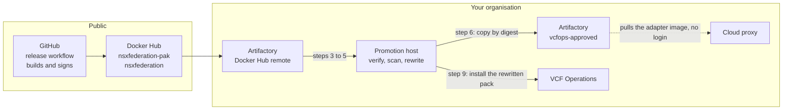

# NSX Federation management pack: install through JFrog Artifactory

This guide installs the NSX Federation management pack in VCF Operations 9.1.1, in an organisation where every
image comes through JFrog Artifactory. The pack and its adapter image are pulled from Docker Hub through
Artifactory, verified, scanned, copied into a repository of approved images, and installed from there. Only
Artifactory and one promotion host reach the internet.

Version française : [CUSTOMER-INSTALL.fr.md](CUSTOMER-INSTALL.fr.md).

| | |
| --- | --- |
| Pack | NSX Federation management pack, MIT licence, community project (not a Broadcom product) |
| Supported versions | VCF Operations 9.1.1, NSX 9.1 Federation. Other versions have not been tested |
| Source and releases | https://github.com/sorinplaton/vcf-ops-nsx-federation-mp |
| Images on Docker Hub | `sorinplaton/nsxfederation-pak` (the `.pak` file), `sorinplaton/nsxfederation` (the adapter) |
| What the pack does in NSX | Read only: GET requests with a read-only account |
| Support | No SLA. Issues on GitHub; vulnerabilities through the repository's Security tab |

Contents:

1. [How it works](#how-it-works)
2. [Before you start: requests and approvals](#before-you-start-requests-and-approvals)
3. [Network access](#network-access)
4. [Procedure](#procedure), steps 1 to 11
5. [Upgrade, roll back, uninstall](#upgrade-roll-back-uninstall)
6. [Troubleshooting](#troubleshooting)
7. Appendices: [Docker instead of skopeo and cosign](#appendix-a-docker-instead-of-skopeo-and-cosign),
   [air-gapped sites](#appendix-b-air-gapped-sites), [validation status](#appendix-c-validation-status)

## How it works



Two images are published for each release:

- **The pack image** (`nsxfederation-pak`) carries the `.pak` file and a checksum file. It is built
  `FROM scratch`: no operating system, no shell, it cannot run.
- **The adapter image** (`nsxfederation`) is the collector that the cloud proxy runs. The `.pak` names it by its
  digest, the SHA-256 of the image.

Inside the `.pak`, three lines say where the adapter image is. As published, they name the project's copy on
GitHub's registry, which has the same digest as the copy on Docker Hub:

```
REGISTRY=ghcr.io
REPOSITORY=/sorinplaton/nsxfederation
DIGEST=sha256:...
```

Step 7 changes the first two lines so that the cloud proxy pulls from your Artifactory. The `DIGEST` line does
not change, so the cloud proxy can only run the image that you verified and scanned.

Every step copies and checks images by digest, never by tag alone: a tag can be moved to another image, a digest
cannot.

**Release number and pack version.** The release (for example `1.13.6`, the Git tag) changes with every
publication. The pack version (`1.13.0`, in the file name `NSXFederation_1.13.0.pak`) changes only when the
content of the pack changes. Identify a pack by its SHA-256 and the adapter digest it names, as listed in the
release notes, not by its file name.

## Before you start: requests and approvals

### Who does what

| Role | Where | Steps |
| --- | --- | --- |
| Artifactory administrator | Artifactory UI | 1, once |
| Platform or security engineer | Promotion host: a Linux machine that reaches Artifactory | 2 to 7, for each release |
| VMware administrator | Cloud proxy, VCF Operations UI and admin console | 8 to 11 |

One person can hold all three roles. An image becomes usable in production at step 6, when it is copied into
`vcfops-approved`; that is the natural approval point.

### Requests per team

Copy each list into a ticket. Values in angle brackets are yours to choose.

**Artifactory administrators**

- A Docker remote repository of Docker Hub (`https://registry-1.docker.io/`, token authentication on), or the
  key of the existing one. A Docker Hub account on it if the site pulls a lot from Docker Hub.
- A local Docker repository `vcfops-approved`, Docker API V2.
- Anonymous access on, with one permission: user `anonymous`, Read, on `vcfops-approved` only.
- A service account `<svc-vcfops-promote>` with Read on the remote repository and Read, Annotate and Deploy on
  `vcfops-approved`, and an identity token for it.
- Optional: a generic local repository for the rewritten packs, for example `vcfops-generic-local`.
- The Docker access method of the instance (Repository Path or Subdomain), and the CA certificate of its HTTPS
  certificate if that CA is internal.

**Network and firewall**

- The rules of [Network access](#network-access).

**Platform or security engineering**

- A Linux promotion host with the tools of step 2, or permission to run them as containers with Docker.
- The scan policy for the two images (for example JFrog Xray on `vcfops-approved`) and who signs off.
- A place to record, for each release, the two image digests (steps 3 and 4) and the SHA-256 of the rewritten
  pack (step 7).

**VMware administrators**

- The admin password of VCF Operations, for the install and the unsigned-pack switch.
- Root on each cloud proxy that will run the account, for step 8: an SSH window, or vCenter guest operations.
- A read-only NSX account on every Global Manager and Local Manager; the built-in `audit` account works.

**Change advisory board**

- Approval to turn on "Allow unsigned PAK installation" for the length of the install, with the justification
  below.

### Justification of the unsigned-pack switch

VCF Operations installs a pack without a switch only when Broadcom signed it (Broadcom KB 415279). For any other
pack, an administrator turns on "Allow unsigned PAK installation" in the admin console, installs, and turns it
off again.

- **Why there is no Broadcom signature.** This is a community pack under the MIT licence, published on GitHub. It
  is not a Broadcom product, so Broadcom does not sign it, and no third party can obtain that signature.
- **How long the switch stays on.** For the upload and the install only. The administrator turns it on right
  before the upload, turns it off right after (step 9) and checks that the admin console shows it off.
- **What replaces the Broadcom signature.** Three checks, all made by your organisation:
  1. Step 4: `cosign` verifies the signatures of the pack image and of the adapter image. They must name the
     project's repository, its release workflow and the release tag, and appear in the public Sigstore
     transparency log. Optional: the signed SBOM and the SLSA build provenance.
  2. Step 6: both images are copied into `vcfops-approved` by digest. The pack names the adapter image by digest,
     so the cloud proxy can only run the image that was verified and scanned.
  3. Step 7: you record the SHA-256 of the rewritten pack. Step 9 checks the file against it before the switch
     goes on.
- **What the rewrite changes.** Two lines of the pack, `REGISTRY` and `REPOSITORY`, so that the cloud proxy pulls
  from Artifactory. The `DIGEST` line, which decides what runs, stays as signed. Step 7 prints the three lines
  for the record.
- **Residual risk.** While the switch is on, an administrator could install any unsigned pack. Keep the window
  short, and run every check before turning the switch on.

## Network access

| From | To | Port | Used for |
| --- | --- | --- | --- |
| Artifactory | `registry-1.docker.io`, `auth.docker.io`, `production.cloudflare.docker.com` | TCP 443 | The Docker Hub remote repository. Most Artifactory instances have this already |
| Promotion host | Artifactory | TCP 443 | Pull from the remote repository, push to `vcfops-approved` |
| Promotion host | `tuf-repo-cdn.sigstore.dev`, `rekor.sigstore.dev` | TCP 443 | The signature check of step 4: Sigstore trust root and transparency log |
| Promotion host | `api.github.com` | TCP 443 | Optional: the build provenance check of step 4 |
| Promotion host | `github.com`, `raw.githubusercontent.com` | TCP 443 | Once, to fetch `cosign` and `repack.py` (step 2). They can also come through an Artifactory generic remote |
| Administrator workstation | VCF Operations | TCP 443 | Install and account (steps 9 to 11) |
| Cloud proxy | Artifactory | TCP 443 | Pull the adapter image from `vcfops-approved`, without a login |
| Cloud proxy | Global Managers and Local Managers | TCP 443 | Collection |

The cloud proxy needs no internet access. If the promotion host cannot reach the internet either, see
[Appendix B](#appendix-b-air-gapped-sites).

## Procedure

Checklist:

- [ ] 1. Artifactory: Docker Hub remote, `vcfops-approved`, anonymous read on it, promotion account
- [ ] 2. Promotion host: tools and settings
- [ ] 3. Pack image pulled through Artifactory, `.pak` taken out, checksum OK
- [ ] 4. Signatures of both images verified
- [ ] 5. Both images scanned
- [ ] 6. Both images copied by digest into `vcfops-approved`
- [ ] 7. Pack pointed at `vcfops-approved`, SHA-256 recorded
- [ ] 8. Cloud proxy trusts Artifactory and pulls the adapter image without a login
- [ ] 9. Pack installed in VCF Operations, switch off again
- [ ] 10. Account created
- [ ] 11. Collection checked

### 1. Prepare Artifactory (once)

*Run in: the Artifactory UI, as an administrator.* Menu names are from the JFrog Platform 7.x UI.

1. **Docker Hub remote repository.** Most sites have one already, often called `docker-remote` or
   `dockerhub-remote`; reuse it. To create one: Administration, Repositories, Create a Repository, Remote,
   Docker. URL `https://registry-1.docker.io/`, "Enable Token Authentication" on. Add a Docker Hub user and token
   in the repository settings if the site pulls a lot from Docker Hub: anonymous pulls are rate limited per IP
   address.
2. **Repository of approved images.** Create a Repository, Local, Docker, key `vcfops-approved`, Docker API
   version V2. Only promoted images go there.
3. **Anonymous read on that repository only.** The cloud proxy pulls without credentials, because VCF Operations
   has no setting for a registry login. Administration, User Management, Settings: "Allow Anonymous Access" on.
   Then Permissions, New Permission: resource `vcfops-approved` only, user `anonymous`, action Read. Every other
   repository stays closed to anonymous users.
4. **Promotion account.** A user or service account with Read on the Docker Hub remote and Read, Annotate and
   Deploy on `vcfops-approved`. Create an identity token for it (Edit Profile, Generate an Identity Token): the
   commands below use the token as the password.

The image address depends on the Docker access method of Artifactory. With the default, Repository Path, an
image is `<artifactory>/<repository key>/<image>`. With the Subdomain method it is
`<repository key>.<artifactory>/<image>`: adapt the settings of step 2.

### 2. Prepare the promotion host

*Run on: the promotion host.* Install the tools from the distribution packages and the cosign release. If the
host may only run Docker, use [Appendix A](#appendix-a-docker-instead-of-skopeo-and-cosign) instead.

```bash
# Ubuntu or Debian
sudo apt-get install -y skopeo python3 unzip curl
curl -LO https://github.com/sigstore/cosign/releases/download/v2.4.1/cosign_2.4.1_amd64.deb
sudo dpkg -i cosign_2.4.1_amd64.deb

# RHEL, Rocky Linux or AlmaLinux
sudo dnf install -y skopeo python3 unzip curl
sudo rpm -ivh https://github.com/sigstore/cosign/releases/download/v2.4.1/cosign-2.4.1-1.x86_64.rpm
```

If Artifactory uses a certificate from an internal CA, give the CA to skopeo and cosign:

```bash
sudo mkdir -p /etc/containers/certs.d/artifactory.example.com
sudo cp internal-ca.crt /etc/containers/certs.d/artifactory.example.com/ca.crt
sudo cp internal-ca.crt /usr/local/share/ca-certificates/ && sudo update-ca-certificates   # RHEL: /etc/pki/ca-trust/source/anchors/ + update-ca-trust
```

Settings for every later command. Set them in each new shell; the token is typed, not stored:

```bash
ART=artifactory.example.com          # Artifactory host name, with :port if it is not 443
HUB=dockerhub-remote                 # key of the Docker Hub remote repository
APPROVED=vcfops-approved             # key of the local repository of step 1
RELEASE=1.13.6                       # release to install: the GitHub release tag without the v
ART_USER=svc-vcfops-promote
read -rs ART_TOKEN                   # identity token of the promotion account
SIGNER="https://github.com/sorinplaton/vcf-ops-nsx-federation-mp/.github/workflows/release.yml@refs/tags/v$RELEASE"
ISSUER=https://token.actions.githubusercontent.com
curl -LO https://raw.githubusercontent.com/sorinplaton/vcf-ops-nsx-federation-mp/v$RELEASE/tools/repack.py
```

`SIGNER` and `ISSUER` are what the signatures must say: built by the release workflow of the project, from the
tag of this release, on GitHub Actions. The release notes show the same two values. `repack.py` is the one file
of the repository this procedure needs (step 7); read it before use, it is 23 lines of Python.

### 3. Get the pack through Artifactory

*Run on: the promotion host.* The first command resolves the tag to a digest; every later command uses the
digest. The second copies the pack image into a local folder, and the Python lines unpack its single layer:

```bash
PAK_DIGEST=$(skopeo inspect --creds "$ART_USER:$ART_TOKEN" --format '{{.Digest}}' \
  docker://$ART/$HUB/sorinplaton/nsxfederation-pak:$RELEASE)
echo "$PAK_DIGEST"

rm -rf pakimg && skopeo copy --all --src-creds "$ART_USER:$ART_TOKEN" \
  docker://$ART/$HUB/sorinplaton/nsxfederation-pak@$PAK_DIGEST oci:pakimg:pak
python3 - <<'EOF'
import json, tarfile
blob = lambda d: json.load(open("pakimg/blobs/sha256/" + d.split(":")[1]))
man = blob(json.load(open("pakimg/index.json"))["manifests"][0]["digest"])
while "manifests" in man:                      # an image list: take the image it holds
    man = blob(man["manifests"][0]["digest"])
tarfile.open("pakimg/blobs/sha256/" + man["layers"][0]["digest"].split(":")[1]).extractall(".")
EOF
ls pak/ && (cd pak && sha256sum -c SHA256SUMS)
```

Expected: `pak/NSXFederation_<version>.pak` and `pak/SHA256SUMS`, then `NSXFederation_<version>.pak: OK`. Compare
`PAK_DIGEST` with the pack image digest in the release notes.

### 4. Verify the signatures

*Run on: the promotion host.* cosign reads the signature stored next to each image, and Artifactory serves it
from Docker Hub like any other tag.

The pack image. Its digest covers every byte of the `.pak`, so this check also covers the file of step 3:

```bash
cosign login $ART -u "$ART_USER" -p "$ART_TOKEN"
cosign verify --certificate-identity "$SIGNER" --certificate-oidc-issuer "$ISSUER" \
  $ART/$HUB/sorinplaton/nsxfederation-pak@$PAK_DIGEST > /dev/null && echo "pack image: verified"
```

The adapter image that the pack names. The first two lines read its digest from the pack:

```bash
unzip -p pak/NSXFederation_*.pak adapter.zip > adapter.zip
AD_DIGEST=$(unzip -p adapter.zip '*.conf' | sed -n 's/^DIGEST=//p'); echo "$AD_DIGEST"
cosign verify --certificate-identity "$SIGNER" --certificate-oidc-issuer "$ISSUER" \
  $ART/$HUB/sorinplaton/nsxfederation@$AD_DIGEST > /dev/null && echo "adapter image: verified"
```

Both lines must end with `verified`, and `AD_DIGEST` must match the adapter digest of the release notes. A
failure means the image is not the one the release workflow built for that tag: stop and do not promote it.

Optional, for the security review. The SBOM of the adapter image is a signed attestation; cosign checks it and
writes it out for the scanner of step 5. The build provenance (SLSA) says which commit and which workflow run
built the image; the GitHub CLI (`gh`, from https://cli.github.com) checks it by digest:

```bash
cosign verify-attestation --type cyclonedx --certificate-identity "$SIGNER" --certificate-oidc-issuer "$ISSUER" \
  $ART/$HUB/sorinplaton/nsxfederation@$AD_DIGEST | jq -r '.payload' | base64 -d | jq '.predicate' > adapter.sbom.cdx.json
gh attestation verify oci://docker.io/sorinplaton/nsxfederation@$AD_DIGEST -R sorinplaton/vcf-ops-nsx-federation-mp \
  --signer-workflow sorinplaton/vcf-ops-nsx-federation-mp/.github/workflows/release.yml
```

### 5. Scan

*Run in: your scanner*, for example JFrog Xray on the remote repository or on `vcfops-approved`. What to expect:

- The pack image holds two files and no operating system. A scanner finds no package in it.
- The adapter image is a Debian 12 base with Python and the packages of the VCF Operations Integration SDK. The
  release build stops on any CRITICAL vulnerability that has a fix. What remains are findings in Debian packages
  that have no fixed version in Debian 12; they are listed in the project's `SECURITY.md` and in the Trivy report
  attached to each release (`NSXFederation_<version>.trivy.txt`).

### 6. Promote: copy into the approved repository

*Run on: the promotion host.* Copy both images by digest. `--all` copies each image exactly as published;
`--preserve-digests` makes skopeo stop rather than change a digest:

```bash
C="--all --preserve-digests --src-creds $ART_USER:$ART_TOKEN --dest-creds $ART_USER:$ART_TOKEN"
skopeo copy $C docker://$ART/$HUB/sorinplaton/nsxfederation@$AD_DIGEST       docker://$ART/$APPROVED/nsxfederation:$RELEASE
skopeo copy $C docker://$ART/$HUB/sorinplaton/nsxfederation-pak@$PAK_DIGEST  docker://$ART/$APPROVED/nsxfederation-pak:$RELEASE

for i in nsxfederation nsxfederation-pak; do
  skopeo inspect --creds "$ART_USER:$ART_TOKEN" --format "$i {{.Digest}}" docker://$ART/$APPROVED/$i:$RELEASE
done
```

Expected: the two digests of steps 3 and 4. To verify the images again later from `vcfops-approved`, copy their
signatures too:

```bash
cosign copy $ART/$HUB/sorinplaton/nsxfederation@$AD_DIGEST $ART/$APPROVED/nsxfederation
cosign copy $ART/$HUB/sorinplaton/nsxfederation-pak@$PAK_DIGEST $ART/$APPROVED/nsxfederation-pak
```

### 7. Point the pack at the approved repository

*Run on: the promotion host.* `repack.py` rewrites the `REGISTRY` and `REPOSITORY` lines inside the pack and
prints the result. Work on a copy, so the original stays as it was signed:

```bash
V=$(ls pak/NSXFederation_*.pak | sed 's/.*NSXFederation_\(.*\)\.pak/\1/')
cp pak/NSXFederation_$V.pak NSXFederation_${V}_site.pak
python3 repack.py NSXFederation_${V}_site.pak $ART $APPROVED/nsxfederation | grep -E '^(REGISTRY|REPOSITORY|DIGEST)='
sha256sum NSXFederation_${V}_site.pak | tee NSXFederation_${V}_site.pak.sha256
```

Expected:

```
REGISTRY=artifactory.example.com
REPOSITORY=/vcfops-approved/nsxfederation
DIGEST=sha256:...          # the same as AD_DIGEST
```

Record the SHA-256 of `NSXFederation_<version>_site.pak` with `PAK_DIGEST` and `AD_DIGEST`. It differs from the
published checksum, because two lines changed. Store the pack where installers take approved files, for example
in a generic repository:

```bash
curl -fS -u "$ART_USER:$ART_TOKEN" -T NSXFederation_${V}_site.pak \
  -H "X-Checksum-Sha256: $(cut -d' ' -f1 NSXFederation_${V}_site.pak.sha256)" \
  "https://$ART/artifactory/vcfops-generic-local/nsx-federation/$RELEASE/NSXFederation_${V}_site.pak"
```

### 8. Cloud proxy: trust Artifactory and test the pull

*Run on: each cloud proxy that will run the account, as root.* SSH is off on a cloud proxy by default: enable it
for this step, or write the files through vCenter guest operations (for example `govc guest.mkdir` and
`govc guest.upload` with the appliance root account).

If Artifactory uses an internal CA, Docker on the cloud proxy needs it, in a folder named exactly like the
`REGISTRY` value of step 7, with `:port` if there is one:

```bash
mkdir -p /etc/docker/certs.d/artifactory.example.com
cp internal-ca.crt /etc/docker/certs.d/artifactory.example.com/ca.crt
```

Then pull the adapter image the way VCF Operations will, without a login:

```bash
docker logout artifactory.example.com 2>/dev/null
docker pull artifactory.example.com/vcfops-approved/nsxfederation@sha256:...   # AD_DIGEST
```

| Result | Meaning |
| --- | --- |
| `Status: Downloaded newer image` or `Image is up to date` | Ready. The image also stays cached on the cloud proxy |
| `unauthorized` or `authentication required` | Anonymous read is missing on `vcfops-approved` (step 1, item 3) |
| `x509: certificate signed by unknown authority` | The CA is missing, or its folder name does not match `REGISTRY` |
| `manifest unknown` | The image is not in `vcfops-approved` under that digest: step 6 was skipped, or done without `--all` |

A cloud proxy upgrade or redeploy removes the certificate folder; check it after each one.

### 9. Install the pack in VCF Operations

*Run on: the administrator workstation and in a browser.*

1. Check the file you are about to upload against the SHA-256 recorded at step 7:

   ```bash
   sha256sum NSXFederation_<version>_site.pak     # must print the recorded value
   ```

   Do not go on if it differs.
2. Admin console `https://<vcf-operations>/admin`, Administrator Settings, Security Settings: activate "Allow
   unsigned PAK installation".
3. Product UI `https://<vcf-operations>/`: Administration, Integrations, Repository, Add.
4. Select `NSXFederation_<version>_site.pak`. Tick "Install the PAK file even if it is already installed" and
   "Ignore the PAK file signature checking".
5. Upload, accept the warning about the unsigned file, and wait until the install has finished.
6. Admin console: deactivate "Allow unsigned PAK installation". The console refuses the change while an install
   is still running; try again once it has finished. Check that the setting shows as off.

Check: Administration, Integrations, Repository lists the NSX Federation pack with the new version.

### 10. Create the account

*Run in: the VCF Operations product UI*, Administration, Integrations, Accounts, Add Account, type NSX
Federation. One account per federation.

- **Global Manager addresses:** `<gm1>,<gm2>`, the cluster address of the active and of the standby Global
  Manager.
- **Credential:** the read-only NSX account. Add a Local Manager credential only if it differs.
- **Collector:** a cloud proxy prepared in step 8.
- **Certificate trust:** keep `enforce`, or choose `ca` when the managers have certificates signed by an
  internal CA. With `ca`, paste the CA certificates in "Trusted CA certificates (PEM)" and use addresses that the
  certificates name.
- **Validate Connection**, and accept the Global Manager certificates. With `enforce`, an account without an
  accepted certificate collects nothing.
- The other settings can keep their defaults. The project's `OPERATIONS.md` describes each one.

### 11. Check the collection

*Run in: the VCF Operations product UI.*

- The account reaches "Collecting" on the Accounts tab. If it stays `FAILED` with an empty message, the cloud
  proxy could not pull the adapter image: run the pull of step 8 on it.
- With a 5-minute interval, data arrives over three cycles: objects and relationships first, then properties and
  events, then metrics after about ten minutes. Rates need one more cycle.
- The federation object lists no failed calls.

The project's `INSTALL.md` describes two optional scripts for later: one group per federation, and a
notification rule for the alerts of the pack.

## Upgrade, roll back, uninstall

### Upgrade to a new release

Repeat steps 3 to 9 with the new `RELEASE`, then stop and start the account and check that it reaches
"Collecting". Nothing in Artifactory changes: the remote repository fetches the new tag from Docker Hub the
first time it is asked for it. Keep the previous images in `vcfops-approved` and the previous `_site` pack with
its SHA-256 until the new version runs, so that you can roll back.

An install adds and updates the alert, symptom and recommendation definitions of the pack, but it does not delete
the ones a new version no longer ships. The project's `install/cleanup_content.py` reports them and, with
`--delete`, removes them through the VCF Operations Suite API.

### Roll back to the previous release

1. Check that the previous adapter image is still in `vcfops-approved`, by the digest its pack names:
   `skopeo inspect docker://$ART/$APPROVED/nsxfederation@<previous AD_DIGEST>`. If it was deleted, promote it
   again with steps 3 to 6 of the previous release; its digest and signatures do not change.
2. Install the previous `_site` pack as in step 9, with its own recorded SHA-256. The box "Install the PAK file
   even if it is already installed" lets VCF Operations accept the older version.
3. Stop and start the account, and check that it reaches "Collecting".

Objects and their history stay. Definitions that only the newer version shipped stay until
`cleanup_content.py --delete` is run with the previous pack.

### Uninstall

In this order, so that nothing collects against a pack that is gone:

1. VCF Operations, Administration, Integrations, Accounts: stop the NSX Federation accounts, then delete them.
2. Administration, Integrations, Repository: select the NSX Federation pack and uninstall it. Check in the
   inventory that no object of the NSX Federation adapter type is left; delete any that remain, with their
   history.
3. Each cloud proxy that ran the account, as root: `docker rmi <artifactory>/vcfops-approved/nsxfederation@<AD_DIGEST>`,
   and remove `/etc/docker/certs.d/<artifactory>` if nothing else pulls from Artifactory.
4. Artifactory, once no VCF Operations instance uses the pack: delete `nsxfederation` and `nsxfederation-pak`
   from `vcfops-approved`, and the anonymous Read permission if the repository holds nothing else.

## Troubleshooting

| Symptom | Cause and fix |
| --- | --- |
| The digest in `vcfops-approved` differs from the one of steps 3 and 4 | Copied without `--all`. Delete the tag and copy again with the command of step 6 |
| `cosign verify`: `no signatures found` | The signature tag did not come through. Check that the remote repository lists `sha256-<digest>.sig` for the image, or verify against `docker.io/sorinplaton/...` from a machine with internet access |
| `cosign verify`: `none of the expected identities matched` | `SIGNER` names another tag than the image was built from, or the image was not built by the release workflow. Compare with the release notes |
| `toomanyrequests` from Artifactory | Docker Hub rate limit on anonymous pulls. Add a Docker Hub account to the remote repository |
| The upload in step 9 is refused as unsigned | "Allow unsigned PAK installation" is not on, or "Ignore the PAK file signature checking" was not ticked |
| Account `FAILED` after the install, empty message | The cloud proxy could not pull the adapter image. Run the pull of step 8 on it |
| Account collects nothing, certificate message | With `enforce`, the Global Manager certificates were not accepted. Edit the account, Validate Connection, accept |

For a support request, open an issue on GitHub with the versions of NSX and VCF Operations and the output of the
project's `install/diagnostics.py` (it only reads). Report a vulnerability privately through the repository's
Security tab.

## Appendix A: Docker instead of skopeo and cosign

If the promotion host may run Docker but not install other packages, run skopeo and cosign as containers.
Prepare the CA files and define two shell functions; every command of steps 3 to 7 then stays as written.
`certs/ca.crt` is the internal CA of Artifactory, `bundle.pem` the public CAs plus that CA, and `dc/config.json` a
login file for Artifactory that only cosign reads:

```bash
mkdir -p certs dc && cp internal-ca.crt certs/ca.crt && chmod 700 dc
cat /etc/ssl/certs/ca-certificates.crt certs/ca.crt > bundle.pem     # RHEL: /etc/pki/tls/certs/ca-bundle.crt
skopeo() { docker run --rm --network host -u "$(id -u)" -v "$PWD:/w" -w /w -v "$PWD/certs:/certs:ro" \
             quay.io/skopeo/stable:v1.25.1 "$@"; }
cosign() { docker run --rm --network host -u "$(id -u)" -e HOME=/tmp -e SSL_CERT_FILE=/w/bundle.pem \
             -e DOCKER_CONFIG=/w/dc -v "$PWD:/w" -w /w ghcr.io/sigstore/cosign/cosign:v2.4.1 "$@"; }
```

After the settings of step 2, write the login file, and remove the `dc` folder when you are done:

```bash
printf '{"auths":{"%s":{"auth":"%s"}}}' "$ART" "$(printf '%s:%s' "$ART_USER" "$ART_TOKEN" | base64 -w0)" > dc/config.json
chmod 600 dc/config.json
```

Inside the container, skopeo does not see `/etc/containers/certs.d`: add `--cert-dir /certs` to `skopeo inspect`,
and `--src-cert-dir /certs --dest-cert-dir /certs` to `skopeo copy`.

Step 6 can also use Docker itself, because both images are single manifests. The digest survives only when Docker
keeps the layers as it received them, which the containerd image store does (`docker info` shows
`driver-type io.containerd.snapshotter.v1`). Check the digest after every push:

```bash
docker login $ART -u "$ART_USER" --password-stdin <<< "$ART_TOKEN"
for i in "nsxfederation@$AD_DIGEST" "nsxfederation-pak@$PAK_DIGEST"; do
  docker pull $ART/$HUB/sorinplaton/$i
  docker tag  $ART/$HUB/sorinplaton/$i $ART/$APPROVED/${i%@*}:$RELEASE
  docker push $ART/$APPROVED/${i%@*}:$RELEASE | tail -1      # "digest: sha256:..." must show the digest of steps 3 and 4
done
docker logout $ART
```

If a digest differs, delete that tag from `vcfops-approved` and copy with skopeo.

## Appendix B: air-gapped sites

When Artifactory cannot reach Docker Hub and the promotion host cannot reach Sigstore, verify on a connected host,
carry the images across as files, and check on the inside that the digests are still the ones verified.

1. **Connected host.** Steps 3 and 4 against `docker.io/sorinplaton/...` directly, without Artifactory. Keep the
   output of `cosign verify`, the two digests and the release notes with the transfer.
2. **Export.** Copy both images into folders with the `dir:` transport, which keeps each manifest byte for byte,
   and pack them into one file:

   ```bash
   skopeo copy --all --preserve-digests docker://docker.io/sorinplaton/nsxfederation@$AD_DIGEST      dir:transfer/nsxfederation
   skopeo copy --all --preserve-digests docker://docker.io/sorinplaton/nsxfederation-pak@$PAK_DIGEST dir:transfer/nsxfederation-pak
   tar -cf nsxfederation-$RELEASE.tar -C transfer . && sha256sum nsxfederation-$RELEASE.tar
   ```

   Do not use `oci-archive:`: it converts the pack image to another manifest format, and its digest changes.
3. **Inside.** Check the SHA-256 of the tar file, unpack it, and push both folders into `vcfops-approved` with
   `skopeo copy --all --preserve-digests dir:<folder> docker://$ART/$APPROVED/<image>:$RELEASE`. Check the digests
   as in step 6: they must match the ones recorded on the connected host. Same digest, same bytes, so the
   signature check carries across.
4. Steps 7 to 11 as written. The checksum check of step 9 needs no network.

## Appendix C: validation status

Validated in the maintainer's lab, against JFrog Container Registry 7.161.26 (the free edition of Artifactory)
behind HTTPS with an internal CA, with release `v1.13.6`:

- Steps 2 to 7, with skopeo and cosign run as containers as in Appendix A: pull through a Docker Hub remote repository, keyless signatures of both images, SBOM
  attestation and build provenance verified, promotion with unchanged digests, rewrite of the pack with the
  adapter digest unchanged.
- Appendix A: Docker-only promotion with Docker Engine 29.6.2 and the containerd image store, digests kept.
- Appendix B: transfer through `dir:` folders and a tar file, digests kept.

Not yet validated: anonymous read on `vcfops-approved` and the pull by a cloud proxy from Artifactory (steps 1.3
and 8), the install from Artifactory and the account (steps 9 to 11), roll back, uninstall, JFrog Xray, the
Artifactory Pro promotion API and the Subdomain access method. The install, account and collection steps
themselves are the ones used with the project's other install paths.
