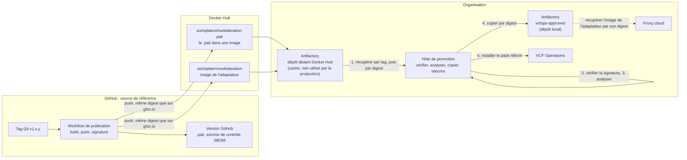
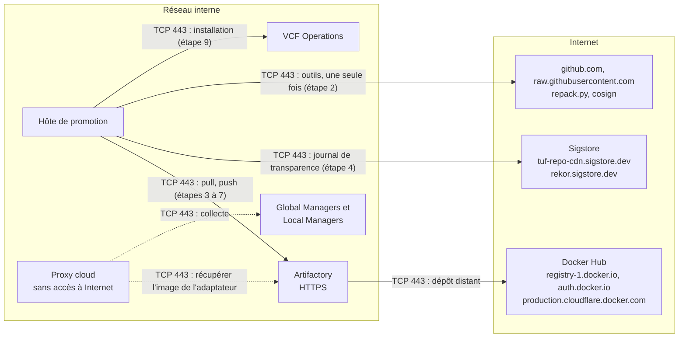

# Installation en entreprise : Docker Hub et Artifactory

Comment une organisation installe le pack NSX Federation quand tout ce qu'elle exécute doit passer par son propre
JFrog Artifactory, et qu'Artifactory prend les images publiques sur Docker Hub. Le pack et l'image de son
adaptateur sont publiés sur Docker Hub par le workflow de publication du projet. L'organisation les récupère via
Artifactory, vérifie leurs signatures, les analyse, les copie dans un dépôt d'images approuvées, et installe depuis
ce dépôt. Aucune machine de l'organisation n'a besoin de joindre GitHub ou Docker Hub, à part Artifactory lui-même
et l'hôte de promotion, qui télécharge ses outils sur GitHub une seule fois (étape 2) et joint Sigstore pour la
vérification des signatures (étape 4).

Les étapes 2 à 7 ont été testées le 2026-11-26 avec les versions `v1.13.3`, `v1.13.5` et `v1.13.6`, avec JFrog Container
Registry 7.161.26 (l'édition gratuite d'Artifactory) servi en HTTPS avec une autorité interne. Ce mode a ensuite été exécuté de bout en bout le 2026-11-27 avec la version `v1.13.5` : lecture anonyme sur
`vcfops-approved`, récupération par le proxy cloud, installation depuis Artifactory, compte, et retour arrière vers
`v1.13.3`. La désinstallation et JFrog Xray restent à tester. [Ce qui a été testé](#ce-qui-a-été-testé) détaille
chaque étape.

Pour les autres modes d'installation (téléchargement depuis GitHub, build par vos soins, Harbor), voir
[INSTALL.fr.md](INSTALL.fr.md). English version: [INSTALL-ENTERPRISE.md](INSTALL-ENTERPRISE.md).

## Comment une version parvient à l'organisation

GitHub est la seule source de référence. Personne ne fait de push vers Docker Hub à la main : un tag Git démarre
le workflow de publication, qui construit le pack et l'image de l'adaptateur à partir de ce tag, publie les deux et
les signe. La signature nomme le dépôt, le workflow et le tag : une image qui ne vient pas de ce workflow échoue à
la vérification, même si quelqu'un en a fait le push avec un jeton volé.



Trois éléments sont publiés pour chaque version :

| Élément | Emplacement | Contenu |
| --- | --- | --- |
| Image du pack | `docker.io/sorinplaton/nsxfederation-pak:<release>` | Le fichier `.pak` et un fichier `SHA256SUMS`, dans une image construite `FROM scratch` : ni système d'exploitation, ni shell. Elle ne peut pas s'exécuter ; elle ne fait que transporter le fichier |
| Image de l'adaptateur | `docker.io/sorinplaton/nsxfederation@sha256:<digest>` | Le collecteur que le proxy cloud exécute. Le pack la désigne par son digest |
| Version GitHub | `github.com/sorinplaton/vcf-ops-nsx-federation-mp/releases` | Le même `.pak`, sa somme de contrôle, son bundle de signature et un SBOM de l'image de l'adaptateur. Inutile dans ce mode |

Les deux images sont octet pour octet celles de `ghcr.io/sorinplaton/`, avec les mêmes digests.

**Numéro de version publiée et version du pack.** Ce sont deux numéros distincts. La version publiée (`1.13.7`, le
tag Git) change à chaque publication ; la version du pack (`1.13.0`, dans `pack/manifest.txt` et dans le nom de
fichier `NSXFederation_1.13.0.pak`) ne change que lorsque le contenu du pack change : modèle d'objets, alertes,
tableaux de bord, code de l'adaptateur. Les versions `1.13.1` à `1.13.7` ont changé la construction, la signature
et la documentation : elles livrent donc toutes un pack qui indique 1.13.0. Le fichier n'est pas le même dans
chacune d'elles : `1.13.5` a reconstruit l'image de l'adaptateur avec des dépendances vérifiées par empreinte, et
son pack désigne donc un autre digest d'adaptateur que le pack de `1.13.3`. Identifier un pack par son SHA-256 et
le digest d'adaptateur qu'il désigne, comme dans les notes de version, et non par son nom de fichier.

Deux images sont nécessaires parce que le `.pak` contient le contenu du pack (modèle d'objets, alertes, tableaux
de bord) et l'adresse de l'image de l'adaptateur, mais pas l'adaptateur lui-même. Dans le pack, `adapter.zip`
contient `NSXFederation.conf` :

```
REGISTRY=ghcr.io
REPOSITORY=/sorinplaton/nsxfederation
DIGEST=sha256:...
```

Au démarrage du compte, le proxy cloud lance un `docker pull` de `REGISTRY` + `REPOSITORY` + `@DIGEST`. L'étape 7
réécrit les deux premières lignes pour qu'il récupère l'image depuis Artifactory. Le digest ne change pas : le
proxy cloud exécute donc toujours exactement l'image qui a été signée et analysée.

Chaque étape ci-dessous copie et vérifie les images par leur digest. Un tag comme `1.13.3` est une étiquette qui
peut être déplacée vers une autre image ; un digest est le SHA-256 de l'image elle-même et ne peut pas l'être.

## Qui fait quoi

| Rôle | Machine | Étapes |
| --- | --- | --- |
| Administrateur Artifactory | Interface d'Artifactory | 1, une seule fois |
| Ingénieur plateforme ou sécurité | Hôte de promotion : une machine Linux qui joint Artifactory, avec `python3`, `unzip` et soit `skopeo` et `cosign`, soit Docker seul ([étape 2](#2-préparer-lhôte-de-promotion)) | 2 à 7, à chaque version |
| Administrateur VMware | Hôte de promotion ou n'importe quelle machine dont le navigateur joint VCF Operations | 8 et 9 |

Une seule personne peut tenir les trois rôles. La séparation aide là où des approbations sont exigées : une image
devient utilisable en production à l'étape 6, quand elle est copiée dans `vcfops-approved`.

## Demandes à envoyer avant la première installation

Chaque équipe reçoit sa propre liste. Copier les listes telles quelles dans les tickets ; les valeurs entre
chevrons sont celles que choisit l'organisation.

**Administrateurs Artifactory**

- Un dépôt distant Docker de Docker Hub (`https://registry-1.docker.io/`, authentification par jeton activée), ou
  la clé du dépôt existant. Un compte Docker Hub sur ce dépôt si le site récupère beaucoup d'images sur Docker Hub.
- Un dépôt Docker local `vcfops-approved`, API Docker V2.
- L'accès anonyme activé, et une permission : utilisateur `anonymous`, Read, sur `vcfops-approved` seulement.
- Un compte de service `<svc-vcfops-promote>` avec Read sur le dépôt distant et Read, Annotate et Deploy sur
  `vcfops-approved`, et un jeton d'identité pour ce compte.
- Facultatif : un dépôt local générique pour les packs réécrits, par exemple `vcfops-generic-local`, avec Deploy
  pour le même compte et Read pour les administrateurs VMware.
- La méthode d'accès Docker de l'instance (Repository Path ou Subdomain) et le certificat de l'autorité qui a émis
  son certificat HTTPS, si cette autorité est interne.

**Réseau et pare-feu**

- Les lignes de [Accès réseau](#accès-réseau) ci-dessous. Sur un site sans accès à Internet, voir plutôt
  [Sites sans accès à Internet](#sites-sans-accès-à-internet).

**Ingénierie plateforme ou sécurité**

- Un hôte de promotion (Linux) et les outils de l'étape 2, ou l'autorisation de les exécuter en conteneurs.
- La politique d'analyse des deux images (par exemple Xray sur `vcfops-approved`) et la personne qui valide le
  résultat.
- Un emplacement où enregistrer, pour chaque version, les deux digests d'images (étapes 3 et 4) et le SHA-256 du pack
  réécrit (étape 7).

**Administrateurs VMware**

- Le mot de passe admin de VCF Operations, pour l'installation et l'option des packs non signés.
- Root sur chaque proxy cloud qui exécutera le compte, pour l'étape 8 : une fenêtre SSH, ou les opérations
  d'invité de vCenter.
- Un compte NSX en lecture seule sur chaque Global Manager et Local Manager ; le compte intégré `audit` convient.

**Comité des changements**

- L'approbation d'activer « Allow unsigned PAK installation » le temps de l'installation. La justification se
  trouve dans la section suivante.

## L'option des packs non signés : justification pour le comité des changements

VCF Operations n'installe un pack sans cette option que s'il est signé par Broadcom (KB 415279). Pour tout autre
pack, un administrateur active « Allow unsigned PAK installation » dans la console d'administration, installe, puis
désactive l'option.

- **Pourquoi il n'y a pas de signature Broadcom.** Il s'agit d'un pack communautaire sous licence MIT, publié sur
  GitHub. Ce n'est pas un produit Broadcom : Broadcom ne le signe pas, et aucun tiers ne peut obtenir cette
  signature.
- **Combien de temps l'option reste activée.** Le temps du téléversement et de l'installation seulement.
  `install/upi.sh enableUPI` l'active juste avant l'installation, et `install/install_unsigned.sh` la désactive
  quelle que soit l'issue de l'installation : succès, échec, Ctrl-C ou terminal perdu. Il réessaie pendant dix
  minutes au plus tant que l'installation est encore en cours, et se termine avec un code différent de 0 si
  l'option est toujours activée. L'option s'applique à toute l'instance : l'administrateur vérifie donc à la fin
  que la console d'administration l'affiche désactivée.
- **Ce qui remplace la signature Broadcom.** Trois vérifications, toutes faites par l'organisation :
  1. Étape 4 : `cosign` vérifie les signatures de l'image du pack et de l'image de l'adaptateur. Elles doivent
     nommer ce dépôt, son workflow de publication et le tag de la version, et figurer dans le journal de
     transparence public de Sigstore. Facultatif : le SBOM signé et la provenance de construction SLSA.
  2. Étape 6 : les deux images sont copiées par leur digest dans `vcfops-approved`. Le pack désigne l'image de
     l'adaptateur par son digest : le proxy cloud ne peut donc exécuter que l'image qui a été vérifiée et analysée.
  3. Étape 7 : l'organisation enregistre le SHA-256 du pack `_site` réécrit. L'étape 9 le donne au script
     d'installation (`FEDMP_PAK_SHA256`), qui refuse tout autre fichier avant tout téléversement.
- **Ce que change la réécriture.** `repack.py` change deux lignes du pack, `REGISTRY` et `REPOSITORY`, pour que le
  proxy cloud récupère l'image depuis Artifactory. La ligne `DIGEST`, qui décide de ce qui s'exécute, reste telle
  qu'elle a été signée. L'étape 7 affiche les trois lignes pour l'enregistrement.
- **Risque résiduel.** Tant que l'option est activée, un administrateur pourrait installer n'importe quel pack non
  signé. Garder la fenêtre courte, et faire les vérifications avant d'activer l'option (l'étape 9 montre l'ordre).

## Accès réseau



| Depuis | Vers | Port | Usage |
| --- | --- | --- | --- |
| Artifactory | `registry-1.docker.io`, `auth.docker.io`, `production.cloudflare.docker.com` | TCP 443 | Le dépôt distant Docker Hub. La plupart des instances Artifactory l'ont déjà |
| Hôte de promotion | Artifactory | TCP 443 | Récupération depuis le dépôt distant, push vers `vcfops-approved` |
| Hôte de promotion | `tuf-repo-cdn.sigstore.dev`, `rekor.sigstore.dev` | TCP 443 | La vérification des signatures de l'étape 4 : la racine de confiance de Sigstore et le journal de transparence public |
| Hôte de promotion | `api.github.com` | TCP 443 | Facultatif : la vérification de la provenance de construction de l'étape 4 (`gh attestation verify`) |
| Hôte de promotion | `github.com`, `raw.githubusercontent.com` | TCP 443 | Une seule fois, pour télécharger `cosign` et `repack.py` (étape 2). Ils peuvent aussi passer par un dépôt distant générique d'Artifactory |
| Hôte de promotion | `quay.io`, `ghcr.io` et les hôtes vers lesquels ils renvoient le téléchargement des couches | TCP 443 | Seulement avec la variante Docker de l'étape 2, qui exécute skopeo et cosign à partir de leurs images, et quand `install/verify_pak.sh` ne trouve pas `cosign` installé. Les images peuvent aussi passer par des dépôts distants d'Artifactory |
| Hôte de promotion ou poste d'administration | VCF Operations | TCP 443 | Installation du pack et création du compte (étape 9) |
| Proxy cloud | Artifactory | TCP 443 | Récupération de l'image de l'adaptateur depuis `vcfops-approved`, sans authentification |
| Proxy cloud | Global Managers et Local Managers | TCP 443 | Collecte |

Dans ce mode, le proxy cloud n'a besoin d'aucun accès à Internet. La collecte reste entre le proxy cloud, les
managers NSX et VCF Operations.

## Liste de contrôle

- [ ] 1. Artifactory : dépôt distant Docker Hub, `vcfops-approved`, lecture anonyme sur ce dépôt, compte de promotion
- [ ] 2. Hôte de promotion : outils, paramètres
- [ ] 3. Image du pack récupérée via Artifactory, pack extrait, somme de contrôle OK
- [ ] 4. Signatures de l'image du pack et de l'image de l'adaptateur vérifiées
- [ ] 5. Les deux images analysées, si l'organisation l'exige
- [ ] 6. Les deux images copiées par leur digest dans `vcfops-approved`
- [ ] 7. Pack pointant vers `vcfops-approved`, mis à disposition des personnes qui installent
- [ ] 8. Le proxy cloud fait confiance à Artifactory et récupère l'image de l'adaptateur sans authentification
- [ ] 9. Pack installé et compte créé ([INSTALL.fr.md](INSTALL.fr.md), étapes 6 à 10)

## 1. Préparer Artifactory (une seule fois)

*À exécuter dans : l'interface d'Artifactory, en tant qu'administrateur.* Les noms de menu sont ceux de
l'interface JFrog Platform 7.x.

1. **Dépôt distant Docker Hub.** La plupart des sites en ont déjà un, souvent appelé `docker-remote` ou
   `dockerhub-remote` ; le réutiliser. Pour en créer un : Administration, Repositories, Create a Repository,
   Remote, Docker. URL `https://registry-1.docker.io/`, « Enable Token Authentication » activé. Ajouter un
   utilisateur et un jeton Docker Hub dans les paramètres du dépôt si le site récupère beaucoup d'images sur Docker
   Hub : les récupérations anonymes sont limitées par adresse IP, et le cache d'Artifactory n'aide qu'après la
   première récupération.
2. **Dépôt des images approuvées.** Create a Repository, Local, Docker, clé `vcfops-approved`, version de l'API
   Docker V2. Seules les images promues y vont.
3. **Lecture anonyme sur ce seul dépôt.** Le proxy cloud récupère l'image sans identifiant : VCF Operations n'a
   aucun réglage pour l'authentification auprès d'un registre. Administration, User Management, Settings :
   « Allow Anonymous Access » activé. Puis Permissions, New Permission : ressource `vcfops-approved` seulement,
   utilisateur `anonymous`, action Read. Le dépôt distant et tous les autres dépôts restent fermés aux
   utilisateurs anonymes. Un site qui n'autorise aucun accès anonyme peut sauter ce point et suivre
   [Sans lecture anonyme](#sans-lecture-anonyme) à l'étape 8.
4. **Compte de promotion.** Un utilisateur ou un compte de service avec Read sur le dépôt distant Docker Hub, et
   Read, Annotate et Deploy sur `vcfops-approved`. Lui créer un jeton d'identité (Edit Profile, Generate an
   Identity Token) : les commandes ci-dessous utilisent ce jeton comme mot de passe.

L'adresse d'une image dépend de la méthode d'accès Docker de l'instance Artifactory. Avec la méthode par défaut,
Repository Path, une image est `<artifactory>/<repository key>/<image>`. Avec la méthode Subdomain, elle est
`<repository key>.<artifactory>/<image>` : adapter les variables de l'étape 2 en conséquence.

## 2. Préparer l'hôte de promotion

*À exécuter sur : l'hôte de promotion.* Installer les outils depuis les paquets de la distribution et la version
publiée de cosign :

```bash
# Ubuntu ou Debian
sudo apt-get install -y skopeo python3 unzip curl
curl -LO https://github.com/sigstore/cosign/releases/download/v2.4.1/cosign_2.4.1_amd64.deb
sudo dpkg -i cosign_2.4.1_amd64.deb

# RHEL, Rocky Linux ou AlmaLinux
sudo dnf install -y skopeo python3 unzip curl
sudo rpm -ivh https://github.com/sigstore/cosign/releases/download/v2.4.1/cosign-2.4.1-1.x86_64.rpm

# repack.py, le seul fichier du dépôt dont ce mode a besoin, depuis le tag de la version
curl -LO https://raw.githubusercontent.com/sorinplaton/vcf-ops-nsx-federation-mp/v1.13.7/tools/repack.py
```

**Docker au lieu de skopeo et cosign.** Beaucoup de sites autorisent Docker sur un hôte mais pas de paquets
supplémentaires. skopeo et cosign s'exécutent alors en conteneurs, et rien d'autre n'est installé. Définir les deux
fonctions dans le shell et garder toutes les commandes des étapes 3 à 7 telles quelles ; c'est ainsi que le runbook
du lab les a exécutées. `certs/ca.crt` est l'autorité interne d'Artifactory, `bundle.pem` les autorités publiques
plus cette autorité, et `dc/config.json` un fichier de connexion Docker pour Artifactory que seul cosign lit :

```bash
mkdir -p certs dc && cp internal-ca.crt certs/ca.crt && chmod 700 dc
cat /etc/ssl/certs/ca-certificates.crt certs/ca.crt > bundle.pem     # RHEL : /etc/pki/tls/certs/ca-bundle.crt
skopeo() { docker run --rm --network host -u "$(id -u)" -v "$PWD:/w" -w /w -v "$PWD/certs:/certs:ro" \
             quay.io/skopeo/stable:v1.25.1 "$@"; }
cosign() { docker run --rm --network host -u "$(id -u)" -e HOME=/tmp -e SSL_CERT_FILE=/w/bundle.pem \
             -e DOCKER_CONFIG=/w/dc -v "$PWD:/w" -w /w ghcr.io/sigstore/cosign/cosign:v2.4.1 "$@"; }
```

Dans le conteneur, skopeo ne voit pas `/etc/containers/certs.d` : ajouter `--cert-dir /certs` à `skopeo inspect`,
et `--src-cert-dir /certs --dest-cert-dir /certs` à `skopeo copy`. Écrire `dc/config.json` après les paramètres
ci-dessous, puis supprimer le dossier `dc` à la fin :

```bash
printf '{"auths":{"%s":{"auth":"%s"}}}' "$ART" "$(printf '%s:%s' "$ART_USER" "$ART_TOKEN" | base64 -w0)" > dc/config.json
chmod 600 dc/config.json
```

L'étape 6 peut aussi utiliser Docker lui-même, voir [Docker seul](#docker-seul).

Si Artifactory utilise un certificat émis par une autorité interne, le donner à skopeo et à cosign. skopeo lit un
dossier qui porte le nom du registre ; cosign lit le magasin de confiance du système, où il faut donc aussi
ajouter l'autorité :

```bash
sudo mkdir -p /etc/containers/certs.d/artifactory.example.com
sudo cp internal-ca.crt /etc/containers/certs.d/artifactory.example.com/ca.crt
sudo cp internal-ca.crt /usr/local/share/ca-certificates/ && sudo update-ca-certificates   # RHEL : /etc/pki/ca-trust/source/anchors/ + update-ca-trust
```

Paramètres des commandes ci-dessous. Les définir dans chaque nouveau shell ; le jeton est saisi, pas enregistré :

```bash
ART=artifactory.example.com          # nom d'hôte d'Artifactory, avec :port s'il n'écoute pas sur 443
HUB=dockerhub-remote                 # clé du dépôt distant Docker Hub
APPROVED=vcfops-approved             # clé du dépôt local de l'étape 1
RELEASE=1.13.7                       # version à installer : le tag de la version GitHub sans le v
ART_USER=svc-vcfops-promote
read -rs ART_TOKEN                   # jeton d'identité du compte de promotion
SIGNER="https://github.com/sorinplaton/vcf-ops-nsx-federation-mp/.github/workflows/release.yml@refs/tags/v$RELEASE"
ISSUER=https://token.actions.githubusercontent.com
```

`SIGNER` et `ISSUER` sont ce que la signature doit indiquer : construit par le workflow de publication de ce
dépôt, à partir du tag de cette version, sur GitHub Actions. Les notes de version sur GitHub donnent les mêmes
deux valeurs.

Un site qui n'accepte pas la base Wolfi de la version 1.13.7 (étape 5) définit `RELEASE=1.13.6`, soit la même
version de pack et le même code d'adaptateur sur la base Debian 12 ; rien d'autre ne change dans ce guide.

## 3. Récupérer le pack via Artifactory

*À exécuter sur : l'hôte de promotion.* La première commande résout le tag en digest ; toutes les commandes
suivantes utilisent le digest, et un tag déplacé entre-temps ne change donc rien. La seconde copie l'image du pack
depuis Artifactory vers un dossier local au format OCI, et les lignes Python extraient son unique couche :

```bash
PAK_DIGEST=$(skopeo inspect --creds "$ART_USER:$ART_TOKEN" --format '{{.Digest}}' \
  docker://$ART/$HUB/sorinplaton/nsxfederation-pak:$RELEASE)
echo "$PAK_DIGEST"

rm -rf pakimg && skopeo copy --all --src-creds "$ART_USER:$ART_TOKEN" \
  docker://$ART/$HUB/sorinplaton/nsxfederation-pak@$PAK_DIGEST oci:pakimg:pak
python3 - <<'EOF'
import json, tarfile
blob = lambda d: json.load(open("pakimg/blobs/sha256/" + d.split(":")[1]))
man = blob(json.load(open("pakimg/index.json"))["manifests"][0]["digest"])
while "manifests" in man:                      # une liste d'images : prendre l'image qu'elle contient
    man = blob(man["manifests"][0]["digest"])
tarfile.open("pakimg/blobs/sha256/" + man["layers"][0]["digest"].split(":")[1]).extractall(".")
EOF
ls pak/ && (cd pak && sha256sum -c SHA256SUMS)
```

Résultat attendu : `pak/NSXFederation_<version>.pak` et `pak/SHA256SUMS`, puis `NSXFederation_<version>.pak: OK`.
La version du pack peut différer du numéro de la version publiée : une version qui ne change que la documentation
garde la version de pack de la précédente.

Sur une machine avec Docker qui fait confiance à Artifactory, le même fichier s'obtient avec `docker pull`,
`docker create --name pak <image>`, `docker cp pak:/pak/. ./` et `docker rm pak`.

## 4. Vérifier les signatures

*À exécuter sur : l'hôte de promotion.* Deux vérifications, toutes deux via Artifactory : cosign lit la signature
stockée à côté de chaque image (tag `sha256-<digest>.sig`), et Artifactory la sert depuis Docker Hub comme
n'importe quel autre tag.

L'image du pack. Son digest couvre chaque octet du `.pak` et de `SHA256SUMS` : cette vérification couvre donc
aussi le fichier de l'étape 3 :

```bash
cosign login $ART -u "$ART_USER" -p "$ART_TOKEN"
cosign verify --certificate-identity "$SIGNER" --certificate-oidc-issuer "$ISSUER" \
  $ART/$HUB/sorinplaton/nsxfederation-pak@$PAK_DIGEST > /dev/null && echo "pack image: verified"
```

L'image de l'adaptateur que désigne le pack. Les deux premières lignes lisent son digest dans le pack :

```bash
unzip -p pak/NSXFederation_*.pak adapter.zip > /tmp/adapter.zip
AD_DIGEST=$(unzip -p /tmp/adapter.zip '*.conf' | sed -n 's/^DIGEST=//p'); echo "$AD_DIGEST"
cosign verify --certificate-identity "$SIGNER" --certificate-oidc-issuer "$ISSUER" \
  $ART/$HUB/sorinplaton/nsxfederation@$AD_DIGEST > /dev/null && echo "adapter image: verified"
```

Les deux lignes doivent se terminer par `verified`. cosign affiche les contrôles qu'il a faits : la signature, le
certificat qui nomme `SIGNER`, et l'entrée dans le journal de transparence public. Un échec signifie que l'image
n'est pas celle que le workflow de publication a construite pour ce tag : s'arrêter et ne pas la promouvoir.

À partir de `v1.13.5`, deux autres vérifications sont disponibles. Le SBOM de l'image de l'adaptateur accompagne
l'image sous forme d'attestation signée (tag `sha256-<digest>.att`, servi par Artifactory comme la signature) ;
cosign la vérifie et peut l'écrire dans un fichier pour l'outil d'analyse de l'étape 5. La provenance de
construction (SLSA) indique quel commit et quelle exécution du workflow ont construit chaque image ; la CLI GitHub
la vérifie auprès de `api.github.com`, par digest, et elle s'applique donc aussi à la copie dans Artifactory :

```bash
cosign verify-attestation --type cyclonedx --certificate-identity "$SIGNER" --certificate-oidc-issuer "$ISSUER" \
  $ART/$HUB/sorinplaton/nsxfederation@$AD_DIGEST | jq -r '.payload' | base64 -d | jq '.predicate' > adapter.sbom.cdx.json
gh attestation verify oci://docker.io/sorinplaton/nsxfederation@$AD_DIGEST -R sorinplaton/vcf-ops-nsx-federation-mp \
  --signer-workflow sorinplaton/vcf-ops-nsx-federation-mp/.github/workflows/release.yml
```

`jq` vient des paquets de la distribution et `gh` de https://cli.github.com. Testé avec `v1.13.5`, la première
version qui porte ces attestations.

Les versions jusqu'à `v1.13.2` sont signées avec la clé du projet, et leurs images ne sont que sur `ghcr.io`. Pour
celles-ci, [INSTALL.fr.md](INSTALL.fr.md#vérifier-les-signatures-recommandé) donne les commandes avec `cosign.pub`.

## 5. Analyser

*À exécuter sur : Artifactory ou l'outil d'analyse de l'organisation.* Analyser les deux images là où
l'organisation analyse ses images, par exemple avec JFrog Xray sur le dépôt distant ou sur `vcfops-approved`.
Résultats attendus :

- L'image du pack contient deux fichiers et aucun système d'exploitation. Un outil d'analyse n'y trouve aucun
  paquet.
- L'image de l'adaptateur est une base Wolfi avec Python 3.11 et les paquets du SDK (Debian 12 jusqu'à la version
  1.13.6). Son SBOM accompagne l'image sous forme d'attestation signée (étape 4) et figure en fichier dans la
  version GitHub
  (`NSXFederation_<version>.sbom.cdx.json`). La version contient aussi le rapport Trivy du projet
  (`NSXFederation_<version>.trivy.txt`) : la construction de la version s'arrête sur une vulnérabilité CRITICAL
  qui a un correctif. L'analyse du build 1.13.7 n'a trouvé aucune vulnérabilité ; les versions jusqu'à 1.13.6
  portent une centaine de vulnérabilités HIGH ou CRITICAL de la base Debian sans version corrigée, comme l'explique
  [SECURITY.md](../SECURITY.md).

## 6. Promouvoir : copier dans le dépôt des images approuvées

*À exécuter sur : l'hôte de promotion.* Copier les deux images par leur digest. `--all` copie l'image exactement
telle qu'elle a été publiée, liste comprise ; sans cette option, skopeo peut ne copier que la partie d'une seule
plateforme, qui a un autre digest, et la vérification des signatures de l'étape 4 ne s'appliquerait plus à ce qui
se trouve dans `vcfops-approved`. `--preserve-digests` fait s'arrêter skopeo plutôt que de changer un digest :

```bash
C="--all --preserve-digests --src-creds $ART_USER:$ART_TOKEN --dest-creds $ART_USER:$ART_TOKEN"
skopeo copy $C docker://$ART/$HUB/sorinplaton/nsxfederation@$AD_DIGEST       docker://$ART/$APPROVED/nsxfederation:$RELEASE
skopeo copy $C docker://$ART/$HUB/sorinplaton/nsxfederation-pak@$PAK_DIGEST  docker://$ART/$APPROVED/nsxfederation-pak:$RELEASE

for i in nsxfederation nsxfederation-pak; do
  skopeo inspect --creds "$ART_USER:$ART_TOKEN" --format "$i {{.Digest}}" docker://$ART/$APPROVED/$i:$RELEASE
done
```

Résultat attendu : les deux digests des étapes 3 et 4. Pour pouvoir vérifier les images plus tard depuis
`vcfops-approved`, copier aussi leurs signatures :
`cosign copy $ART/$HUB/sorinplaton/nsxfederation@$AD_DIGEST $ART/$APPROVED/nsxfederation`, et de même pour
l'image du pack.

Avec Artifactory Pro, l'API de promotion Docker ou `jf rt docker-promote` peut faire cette copie à l'intérieur
d'Artifactory. Ce cas n'a pas été testé ici ; vérifier ensuite les digests de la même façon.

### Docker seul

Les deux images sont des manifestes simples, pas des listes : `docker pull`, `docker tag` et `docker push` peuvent
donc les promouvoir. Le digest ne se conserve que si Docker garde les couches exactement telles qu'il les a reçues,
ce que fait le magasin d'images containerd : `docker info` affiche alors `driver-type
io.containerd.snapshotter.v1`. Avec l'ancien magasin (`overlay2` seul), Docker peut recompresser les couches et
pousser une image avec un autre digest. Vérifier le digest après le push, à chaque fois :

```bash
docker login $ART -u "$ART_USER" --password-stdin <<< "$ART_TOKEN"
for i in "nsxfederation@$AD_DIGEST" "nsxfederation-pak@$PAK_DIGEST"; do
  docker pull $ART/$HUB/sorinplaton/$i
  docker tag  $ART/$HUB/sorinplaton/$i $ART/$APPROVED/${i%@*}:$RELEASE
  docker push $ART/$APPROVED/${i%@*}:$RELEASE | tail -1      # la ligne "digest: sha256:..." doit afficher le digest des étapes 3 et 4
done
docker logout $ART
```

Si un digest diffère, supprimer ce tag de `vcfops-approved` et copier avec skopeo, installé ou en conteneur.

## 7. Faire pointer le pack vers le dépôt des images approuvées

*À exécuter sur : l'hôte de promotion.* `repack.py` réécrit les lignes `REGISTRY` et `REPOSITORY` à l'intérieur
du pack, dans le fichier même, et affiche le fichier `.conf` réécrit. Travailler sur une copie, pour que l'original reste
tel qu'il a été signé :

```bash
V=$(ls pak/NSXFederation_*.pak | sed 's/.*NSXFederation_\(.*\)\.pak/\1/')
cp pak/NSXFederation_$V.pak NSXFederation_${V}_site.pak
python3 repack.py NSXFederation_${V}_site.pak $ART $APPROVED/nsxfederation | grep -E '^(REGISTRY|REPOSITORY|DIGEST)='
```

Résultat attendu :

```
REGISTRY=artifactory.example.com
REPOSITORY=/vcfops-approved/nsxfederation
DIGEST=sha256:...          # le même que AD_DIGEST
```

Le pack réécrit est celui que l'organisation installe. Sa somme de contrôle ne correspond plus à celle publiée,
parce que deux lignes ont changé ; la ligne du digest, qui décide de ce qui s'exécute, n'a pas changé. Enregistrer
son SHA-256 avec les deux digests des étapes 3 et 4 : la personne qui installe le vérifie à l'étape 9.

```bash
sha256sum NSXFederation_${V}_site.pak | tee NSXFederation_${V}_site.pak.sha256
```

Ranger le pack là où les personnes qui installent prennent les fichiers approuvés, par exemple dans un dépôt
générique :

```bash
curl -fS -u "$ART_USER:$ART_TOKEN" -T NSXFederation_${V}_site.pak \
  -H "X-Checksum-Sha256: $(sha256sum NSXFederation_${V}_site.pak | cut -d' ' -f1)" \
  "https://$ART/artifactory/vcfops-generic-local/nsx-federation/$RELEASE/NSXFederation_${V}_site.pak"
```

## 8. Proxy cloud : faire confiance à Artifactory et tester la récupération

*À exécuter sur : le proxy cloud, en tant que root.* SSH est désactivé par défaut sur un proxy cloud. L'activer le
temps de l'étape, ou exécuter les commandes par les opérations d'invité de vCenter, comme dans
[INSTALL.fr.md, étape 4](INSTALL.fr.md#4-le-proxy-cloud-fait-confiance-au-certificat-du-registre).

Si Artifactory utilise une autorité interne, Docker sur le proxy cloud en a besoin, dans un dossier qui porte
exactement le nom de la valeur `REGISTRY` de l'étape 7, avec `:port` s'il y en a un :

```bash
mkdir -p /etc/docker/certs.d/artifactory.example.com
cp internal-ca.crt /etc/docker/certs.d/artifactory.example.com/ca.crt
```

Récupérer ensuite l'image de l'adaptateur comme le fera VCF Operations, sans authentification :

```bash
docker logout artifactory.example.com 2>/dev/null
docker pull artifactory.example.com/vcfops-approved/nsxfederation@sha256:...   # AD_DIGEST
```

| Résultat | Signification |
| --- | --- |
| `Status: Downloaded newer image` ou `Image is up to date` | Prêt. L'image reste aussi en cache sur le proxy cloud |
| `unauthorized` ou `authentication required` | La lecture anonyme manque sur `vcfops-approved` (étape 1, point 3) |
| `x509: certificate signed by unknown authority` | L'autorité manque, ou le nom de son dossier ne correspond pas à `REGISTRY` |
| `manifest unknown` | L'image n'est pas dans `vcfops-approved` sous ce digest : l'étape 6 a été sautée, ou faite sans `--all` |

Une mise à niveau ou un redéploiement du proxy cloud supprime le dossier du certificat ; le vérifier après l'un
ou l'autre.

### Sans lecture anonyme

L'adaptateur démarre à partir d'une image déjà présente sur le proxy cloud, même quand le registre refuse la
récupération. Sur un site qui interdit l'accès anonyme, un administrateur récupère l'image une fois avec un
identifiant, en root sur chaque proxy cloud qui exécute le compte, puis se déconnecte. Aucun identifiant ne reste
sur le proxy cloud :

```bash
docker login artifactory.example.com -u <compte avec Read sur vcfops-approved>
docker pull artifactory.example.com/vcfops-approved/nsxfederation@sha256:...   # AD_DIGEST
docker logout artifactory.example.com
```

Recommencer pour chaque nouvelle version, avant l'installation de l'étape 9, et après tout ce qui vide le magasin
d'images du proxy cloud (un redéploiement, une mise à niveau, un `docker image prune`). Sans l'image, le compte
échoue avec `Failed to download image` dans `collector.log`. Un identifiant enregistré pour l'utilisateur du
collecteur, pour que le proxy cloud récupère l'image lui-même, n'a pas été testé.

## 9. Installer

Installer `NSXFederation_<version>_site.pak` avec [INSTALL.fr.md](INSTALL.fr.md), étapes 6 à 10 : option des packs
non signés, installation, compte, vérification de la collecte, groupe et alertes facultatifs. Sans l'option des
packs non signés, VCF Operations n'accepte que les packs signés par Broadcom (KB 415279). Les signatures cosign de
l'étape 4 sont celles du projet, et VCF Operations ne les lit pas : c'est donc le script d'installation qui les
vérifie (`install/verify_pak.sh`).

Donner au script le SHA-256 enregistré à l'étape 7. Il refuse alors tout autre fichier. Pour qu'il vérifie aussi la
signature de l'image de l'adaptateur via Artifactory, définir `FEDMP_VERIFY=1` et `FEDMP_IMAGE_REPO`, après y avoir
copié les signatures (`cosign copy`, étape 6). Lancer d'abord la vérification seule, avant d'activer l'option :

```bash
export FEDMP_PAK_SHA256=<the SHA-256 of step 7>
export FEDMP_VERIFY=1 FEDMP_IMAGE_REPO=$ART/$APPROVED/nsxfederation    # seulement après le cosign copy de l'étape 6
install/verify_pak.sh NSXFederation_${V}_site.pak                     # doit se terminer sans erreur
install/upi.sh enableUPI
install/install_unsigned.sh NSXFederation_${V}_site.pak               # vérifie à nouveau, installe, désactive l'option
```

Si ni `FEDMP_PAK_SHA256` ni `FEDMP_VERIFY=1` ne sont définis, rien n'est vérifié : le pack réécrit n'a pas de
bundle de signature à côté de lui, et il est installé avec un avertissement.

## Mise à niveau vers une nouvelle version

Refaire les étapes 3 à 9 avec la nouvelle valeur de `RELEASE`. Rien ne change dans Artifactory : le dépôt distant
récupère le nouveau tag sur Docker Hub la première fois qu'il lui est demandé. Garder les images précédentes dans
`vcfops-approved` jusqu'à ce que la nouvelle version tourne, pour pouvoir réinstaller le pack précédent.

## Revenir à la version précédente

Un retour arrière réinstalle le pack précédent par-dessus le pack actuel. Testé le 2026-11-27 de `v1.13.5` vers
`v1.13.3`, deux versions avec la même version de pack ; un retour vers une version de pack inférieure n'a pas été
testé. Il fonctionne tant que les images précédentes sont encore dans `vcfops-approved`, raison pour laquelle
[Mise à niveau](#mise-à-niveau-vers-une-nouvelle-version) demande de les garder, et que le pack `_site` précédent
et son SHA-256 enregistré sont conservés.

1. Vérifier que l'image précédente de l'adaptateur est toujours là, par le digest que son pack désigne :
   `skopeo inspect docker://$ART/$APPROVED/nsxfederation@<previous AD_DIGEST>`.
2. Installer le pack `_site` précédent comme à l'étape 9, avec son propre `FEDMP_PAK_SHA256`. L'installation par
   script téléverse avec « install even if already installed », l'option qui permet à VCF Operations d'installer
   un pack qui n'est pas plus récent que le pack installé ; à la main, cocher cette case. Le test a réinstallé la
   même version de pack ; une version inférieure n'a pas été testée.
3. `install_unsigned.sh` supprime ensuite les définitions d'alertes, de symptômes et de recommandations que le pack
   précédent ne livre pas, celles que la version plus récente a ajoutées. Les objets et leur historique restent.
4. Arrêter puis démarrer le compte, et vérifier qu'il atteint « Collecting » (INSTALL.fr.md, étape 8).

Si les images précédentes ont été supprimées de `vcfops-approved`, les promouvoir à nouveau depuis le dépôt distant
avec les étapes 3 à 6 de la version précédente ; leurs digests et leurs signatures ne changent pas.

## Désinstaller

Pas encore testé. Dans cet ordre, pour que rien ne collecte avec un pack qui n'existe plus :

1. VCF Operations, Administration, Integrations, Accounts : arrêter les comptes NSX Federation, puis les supprimer.
2. Facultatif : supprimer ce que le pack a créé en dehors du pack lui-même : les groupes par fédération
   (INSTALL.fr.md, étape 9) et les règles de notification (étape 10).
3. Administration, Integrations, Repository : sélectionner le pack NSX Federation et le désinstaller. Vérifier dans
   Inventory qu'il ne reste aucun objet du type d'adaptateur NSX Federation ; supprimer ceux qui restent, avec leur
   historique.
4. Sur chaque proxy cloud qui a exécuté le compte, en tant que root :
   `docker rmi $ART/$APPROVED/nsxfederation@<AD_DIGEST>`, et supprimer `/etc/docker/certs.d/<artifactory>` si rien
   d'autre ne récupère d'images depuis Artifactory.
5. Artifactory, quand plus aucune instance de VCF Operations n'utilise le pack : supprimer `nsxfederation` et
   `nsxfederation-pak` de `vcfops-approved`, et la permission de lecture anonyme si le dépôt ne contient rien
   d'autre.

## Sites sans accès à Internet

Sur un site sans aucun accès à Internet, Artifactory ne peut pas joindre Docker Hub, et `cosign` ne peut pas
joindre Sigstore depuis l'intérieur. Vérifier sur un hôte connecté, transférer les images sous forme de fichiers, et
vérifier à l'intérieur que les digests sont toujours ceux qui ont été vérifiés :

1. **Hôte connecté.** Les étapes 3 et 4 directement face à `docker.io/sorinplaton/...`, sans Artifactory. Garder la
   sortie de `cosign verify`, les deux digests et les notes de version avec le transfert.
2. **Export.** Copier les deux images dans des dossiers avec le transport `dir:`, qui conserve chaque manifeste
   octet pour octet, puis les regrouper dans un seul fichier pour le transfert :

   ```bash
   skopeo copy --all --preserve-digests docker://docker.io/sorinplaton/nsxfederation@$AD_DIGEST      dir:transfer/nsxfederation
   skopeo copy --all --preserve-digests docker://docker.io/sorinplaton/nsxfederation-pak@$PAK_DIGEST dir:transfer/nsxfederation-pak
   tar -cf nsxfederation-$RELEASE.tar -C transfer . && sha256sum nsxfederation-$RELEASE.tar
   ```

   Ne pas utiliser `oci-archive:` : il convertit l'image du pack, un manifeste Docker, en manifeste OCI, et son
   digest change (`sha256:eb35...` est devenu `sha256:00a9...` pendant le test).
3. **Intérieur.** Vérifier le SHA-256 du fichier tar, le décompresser, et pousser les deux dossiers dans
   `vcfops-approved` avec `skopeo copy --all --preserve-digests dir:<folder> docker://$ART/$APPROVED/<image>:$RELEASE`.
   Vérifier ensuite les digests comme à l'étape 6 : ils doivent correspondre à ceux enregistrés sur l'hôte connecté.
   Des images de mêmes digests sont les octets dont les signatures y ont été vérifiées.
4. Les étapes 7 à 9 telles qu'écrites. `FEDMP_PAK_SHA256` n'a besoin d'aucun réseau. Laisser `FEDMP_VERIFY` non
   défini ou à `0` à l'intérieur, puisque cosign ne peut pas y joindre Sigstore.

Un site qui n'accepte aucun binaire venu de l'extérieur peut construire le pack et son image à partir des sources
(option B de [INSTALL.fr.md](INSTALL.fr.md)), après avoir relu les sources.

## Dépannage

| Symptôme | Cause et correction |
| --- | --- |
| Le digest dans `vcfops-approved` diffère de celui des étapes 3 et 4 | Copie faite sans `--all`. Refaire la copie avec la commande de l'étape 6 |
| `cosign verify` : `no signatures found` | Le tag de la signature n'est pas passé. Vérifier que le dépôt distant liste `sha256-<digest>.sig` pour l'image, ou vérifier directement face à `docker.io/sorinplaton/...` depuis une machine qui accède à Internet |
| `cosign verify` : `none of the expected identities matched` | `SIGNER` nomme un autre tag que celui à partir duquel l'image a été construite, ou l'image n'a pas été construite par le workflow de publication. Comparer avec les notes de version |
| `toomanyrequests` depuis Artifactory | Limite de Docker Hub sur les récupérations anonymes. Ajouter un compte Docker Hub au dépôt distant |
| Compte `FAILED` après l'installation, message vide | Le proxy cloud n'a pas pu récupérer l'image. Y lancer la récupération de l'étape 8 |

## Ce qui a été testé

Le 2026-11-26, sur un JFrog Container Registry 7.161.26 avec PostgreSQL, derrière nginx avec un certificat émis
par une autorité de test, avec skopeo 1.25.1 et cosign 2.4.1 :

- Une image Docker Hub récupérée via un dépôt distant Docker Hub : même digest que sur Docker Hub.
- L'image publiée de l'adaptateur `v1.13.1` récupérée via un dépôt distant (de `ghcr.io`, le seul emplacement où elle
  était publiée à ce moment), et sa signature vérifiée via Artifactory, avec la clé de cette version.
- La version `v1.13.3`, la première publiée sur Docker Hub, passée par les étapes 3, 4, 6 et 7 telles qu'écrites :
  image du pack récupérée via le dépôt distant Docker Hub et pack extrait (somme de contrôle OK), signatures sans
  clé de l'image du pack et de l'image de l'adaptateur vérifiées via Artifactory, les deux images promues avec les
  mêmes digests (`nsxfederation-pak` `sha256:1ff264cf...`, `nsxfederation` `sha256:bd533626...`), pack réécrit
  vers le dépôt des images approuvées avec le digest de l'adaptateur inchangé.
- Les deux images copiées dans un dépôt local avec `skopeo copy --all --preserve-digests` : mêmes digests. Sans
  `--all`, l'image du pack est sortie avec un autre digest ; c'est pourquoi l'étape 6 l'utilise.
- Le pack extrait de l'image du pack dans Artifactory, somme de contrôle OK, et réécrit avec `repack.py` vers le
  dépôt local.
- La version `v1.13.5`, la première avec des attestations, via l'Artifactory du lab (JFrog Container Registry
  7.161.26 sur `https://10.0.6.28`, dépôt distant Docker Hub) : signatures sans clé des deux images et attestation
  SBOM signée (46 composants) vérifiées via Artifactory, et provenance de construction de la copie Docker Hub
  vérifiée avec `gh attestation verify`.
- Docker seul, avec Docker Engine 29.6.2 et le magasin d'images containerd : les deux images `v1.13.5` récupérées
  sur Docker Hub par digest, taguées et poussées vers un registre de test ont gardé leurs digests. Le pack extrait
  avec `docker create` et `docker cp` a passé sa somme de contrôle.
- Le transfert sans accès à Internet : les deux images `v1.13.5` passées par des dossiers `dir:` et un fichier tar
  vers un registre de test, mêmes digests. Via `oci-archive:`, l'image du pack est sortie avec un autre digest.
- `verify_pak.sh` avec `FEDMP_PAK_SHA256` : la bonne valeur passe, toute autre valeur arrête l'installation, avec
  et sans `FEDMP_VERIFY`.
- La version `v1.13.6` via l'Artifactory du lab, étapes 2 à 7 telles qu'écrites : image du pack `sha256:e241b3f2...`
  et image de l'adaptateur `sha256:15cd0535...`, les deux signatures sans clé, l'attestation SBOM et la provenance
  vérifiées, les deux images promues avec les mêmes digests, pack réécrit avec le digest de l'adaptateur
  inchangé. Puis la vérification de l'étape 9 avant l'activation de l'option : signatures copiées dans
  `vcfops-approved` avec `cosign copy`, et `verify_pak.sh` avec `FEDMP_PAK_SHA256`, `FEDMP_VERIFY=1` et
  `FEDMP_IMAGE_REPO` pointant vers `vcfops-approved` a réussi ; avec la somme de contrôle d'un autre fichier, il a
  refusé le pack.

Le 2026-11-27, avec VCF Operations 9.1.2.0 et Docker seul sur l'hôte de promotion (Docker Engine 29.6.2, sans
skopeo) :

- La version `v1.13.5` de bout en bout : Read anonyme sur `vcfops-approved` réglé dans l'interface (l'édition
  gratuite n'a pas d'API pour cela), récupération par le proxy cloud sans identifiant, installation du pack
  `_site`, et compte en collecte depuis `vcfops-approved` avec des métriques sur chaque objet.
- Retour arrière de `v1.13.5` vers `v1.13.3` via Artifactory : installation terminée, le proxy cloud a récupéré
  lui-même l'image précédente après l'arrêt et le démarrage du compte, et la collecte a repris. Puis `v1.13.5` de
  nouveau.
- Sans lecture anonyme : avec le pack pointant vers un dépôt qui refuse les récupérations anonymes, le compte a
  échoué (`Failed to download image`) ; après une récupération avec un identifiant en root sur le proxy cloud,
  puis une déconnexion, il a démarré et collecté.
- Version `v1.13.7`, la première sur la base Wolfi, via l'Artifactory du lab avec Docker seul : les deux signatures
  vérifiées, les deux images promues avec les mêmes digests, récupération par le proxy cloud sans identifiant,
  installation du pack `_site`, et compte en collecte depuis `vcfops-approved` avec des métriques sur chaque objet.

Pas encore testé :

- La désinstallation, et un retour arrière vers une version de pack inférieure.
- Un identifiant de registre enregistré sur le proxy cloud pour l'utilisateur du collecteur.
- JFrog Xray, l'API de promotion d'Artifactory Pro et la méthode d'accès Subdomain.
- La promotion avec Docker seul ([Docker seul](#docker-seul)) sur un Docker Engine antérieur à la version 29 ou
  avec le magasin d'images classique.
