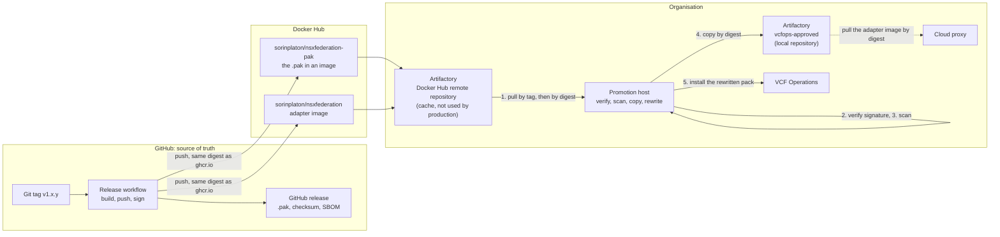
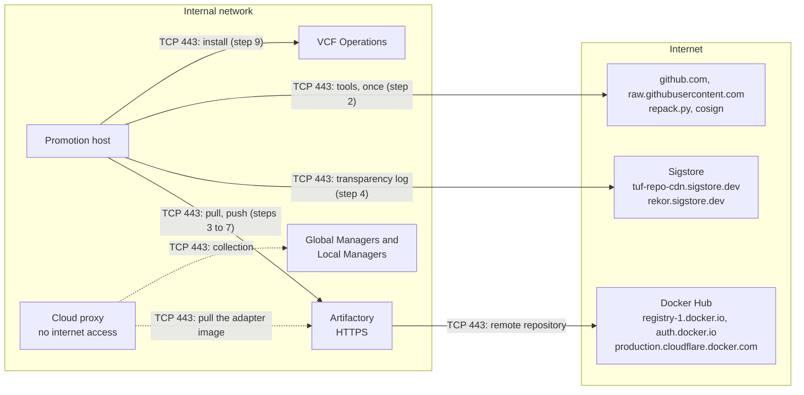

# Enterprise install: Docker Hub and Artifactory

This guide installs the NSX Federation pack in an organisation where everything that runs must come through its own
JFrog Artifactory, and where Artifactory gets public images from Docker Hub. The pack and its adapter image are
published on Docker Hub by the project's release workflow. The organisation pulls them through Artifactory, checks
their signatures, scans them, copies them into a repository of approved images, and installs from there. Only
Artifactory and the promotion host need to reach GitHub or Docker Hub. The promotion host fetches its tools from
GitHub once (step 2) and reaches Sigstore for the signature check (step 4).

Steps 2 to 7 were tested on 2026-11-26 with releases `v1.13.3`, `v1.13.5` and `v1.13.6`, against JFrog Container
Registry 7.161.26 (the free edition of Artifactory) behind HTTPS with an internal CA. The path then ran end to end
on 2026-11-27 with release `v1.13.5`: anonymous read on `vcfops-approved`, the pull by the cloud proxy, the install
from Artifactory, the account, and a rollback to `v1.13.3`. Release `v1.13.7` ran the same path the same day,
without the rollback. Uninstall and JFrog Xray are still to be tested. [What
was tested](#what-was-tested) lists each step.

For the other install paths (download from GitHub, a build of your own, Harbor), see
[INSTALL.md](INSTALL.md). Version française : [INSTALL-ENTERPRISE.fr.md](INSTALL-ENTERPRISE.fr.md).

## How a release reaches the organisation

GitHub is the single source of truth. Nobody pushes to Docker Hub by hand: a Git tag starts the release
workflow, which builds the pack and the adapter image from that tag, publishes both, and signs them. The
signature names the repository, the workflow and the tag, so an image that did not come from that workflow
fails the check, even if someone pushed it with a stolen token.



Three things are published for each release:

| Item | Where | What it is |
| --- | --- | --- |
| Pack image | `docker.io/sorinplaton/nsxfederation-pak:<release>` | The `.pak` file and a `SHA256SUMS` file, in an image built `FROM scratch`: no operating system, no shell. It cannot run; it only carries the file |
| Adapter image | `docker.io/sorinplaton/nsxfederation@sha256:<digest>` | The collector that the cloud proxy runs. The pack names it by digest |
| GitHub release | `github.com/sorinplaton/vcf-ops-nsx-federation-mp/releases` | The same `.pak`, its checksum, its signature bundle and an SBOM of the adapter image. Not needed on this path |

The two images are the same bytes as on `ghcr.io/sorinplaton/`, with the same digests.

**Release number and pack version.** The two are different numbers. The release (`1.13.7`, the Git tag) changes
with every publication; the pack version (`1.13.0`, in `pack/manifest.txt` and in the file name
`NSXFederation_1.13.0.pak`) changes only when the content of the pack changes: object model, alerts, dashboards,
adapter code. Releases `1.13.1` to `1.13.7` changed the build, the signing and the documentation, so they all ship
a pack that reports 1.13.0. The file is not the same in each of them: `1.13.5` rebuilt the adapter image with
hashed dependencies, so its pack names a different adapter digest from the pack of `1.13.3`. Identify a pack by its
SHA-256 and the adapter digest it names, as in the release notes, not by its file name.

Two images are needed because the `.pak` holds the content of the pack (object model, alerts, dashboards) and the
address of the adapter image, not the adapter itself. Inside the pack, `adapter.zip` holds `NSXFederation.conf`:

```
REGISTRY=ghcr.io
REPOSITORY=/sorinplaton/nsxfederation
DIGEST=sha256:...
```

When the account starts, the cloud proxy runs a `docker pull` of `REGISTRY` + `REPOSITORY` + `@DIGEST`. Step 7
rewrites the first two lines so that the pull goes to Artifactory instead. The digest does not change, so the cloud
proxy still runs exactly the image that was signed and scanned.

Every step below copies and checks images by digest. A tag such as `1.13.3` is a label that can be moved to
another image; a digest is the SHA-256 of the image itself and cannot.

## Who does what

| Role | Machine | Steps |
| --- | --- | --- |
| Artifactory administrator | Artifactory UI | 1, once |
| Platform or security engineer | Promotion host: a Linux machine that reaches Artifactory, with `python3`, `unzip` and either `skopeo` and `cosign` or Docker alone ([step 2](#2-prepare-the-promotion-host)) | 2 to 7, at each release |
| VMware administrator | Promotion host or any machine with a browser that reaches VCF Operations | 8 and 9 |

One person can hold all three roles. The split helps where approvals are required: an image becomes usable in
production at step 6, when it is copied into `vcfops-approved`.

## Requests to send before the first install

Each team gets its own list. Copy the lists into the tickets as they are; the values in angle brackets are the
ones the organisation chooses.

**Artifactory administrators**

- A Docker remote repository of Docker Hub (`https://registry-1.docker.io/`, token authentication on), or the key
  of the existing one. A Docker Hub account on it if the site pulls many images from Docker Hub.
- A local Docker repository `vcfops-approved`, Docker API V2.
- Anonymous access on, and one permission: user `anonymous`, Read, on `vcfops-approved` only.
- A service account `<svc-vcfops-promote>` with Read on the remote repository and Read, Annotate and Deploy on
  `vcfops-approved`, and an identity token for it.
- Optional: a generic local repository for the rewritten packs, for example `vcfops-generic-local`, with Deploy
  for the same account and Read for the VMware administrators.
- The Docker access method of the instance (Repository Path or Subdomain) and the certificate of the CA that issued
  its HTTPS certificate, if that CA is internal.

**Network and firewall**

- The rows of [Network access](#network-access) below. On an air-gapped site, see [Air-gapped sites](#air-gapped-sites)
  instead.

**Platform or security engineering**

- A promotion host (Linux) and the tools of step 2, or permission to run them as containers.
- The scan policy for the two images (for example Xray on `vcfops-approved`) and who signs off on the result.
- A place to record, for each release, the two image digests (steps 3 and 4) and the SHA-256 of the rewritten
  pack (step 7).

**VMware administrators**

- The admin password of VCF Operations, for the install and the unsigned-pack switch.
- Root on each cloud proxy that will run the account, for step 8: an SSH window, or vCenter guest operations.
- A read-only NSX account on every Global Manager and Local Manager; the built-in `audit` account works.

**Change advisory board**

- Approval to turn on "Allow unsigned PAK installation" for the length of the install. The justification is in
  the next section.

## The unsigned-pack switch: justification for the change board

VCF Operations installs a pack without a switch only when Broadcom signed it (KB 415279). For any other pack, an
administrator turns on "Allow unsigned PAK installation" in the admin console, installs, and turns it off.

- **Why there is no Broadcom signature.** This is a community pack under the MIT licence, published on GitHub. It
  is not a Broadcom product, so Broadcom does not sign it, and no third party can obtain that signature.
- **How long the switch stays on.** For the length of the upload and install only. `install/upi.sh enableUPI` turns
  it on immediately before the install, and `install/install_unsigned.sh` turns it off however the install ends:
  success, failure, Ctrl-C or a dropped terminal. The script retries for up to ten minutes while the install is
  still running, and it exits with a code other than 0 if the switch is still on. The switch applies to the whole
  instance, so the administrator checks at the end that the admin console shows it off.
- **What replaces the Broadcom signature.** Three checks, all made by the organisation:
  1. Step 4: `cosign` verifies the signatures of the pack image and of the adapter image. They must name this
     repository, its release workflow and the release tag, and appear in the public Sigstore transparency log.
     Optional: the signed SBOM and the SLSA build provenance.
  2. Step 6: both images are copied into `vcfops-approved` by digest. The pack names the adapter image by digest,
     so the cloud proxy can only run the image that was verified and scanned.
  3. Step 7: the organisation records the SHA-256 of the rewritten `_site` pack. Step 9 gives it to the install
     script (`FEDMP_PAK_SHA256`), which refuses any other file before anything is uploaded.
- **What the rewrite changes.** `repack.py` changes two lines of the pack, `REGISTRY` and `REPOSITORY`, so that
  the cloud proxy pulls from Artifactory. The `DIGEST` line, which decides what runs, stays as signed. Step 7
  prints the three lines for the record.
- **Residual risk.** While the switch is on, an administrator could install any unsigned pack. Keep the window
  short, and run the checks before turning the switch on (step 9 shows the order).

## Network access



| From | To | Port | Used for |
| --- | --- | --- | --- |
| Artifactory | `registry-1.docker.io`, `auth.docker.io`, `production.cloudflare.docker.com` | TCP 443 | The Docker Hub remote repository. Most Artifactory instances have this already |
| Promotion host | Artifactory | TCP 443 | Pulling from the remote repository, pushing to `vcfops-approved` |
| Promotion host | `tuf-repo-cdn.sigstore.dev`, `rekor.sigstore.dev` | TCP 443 | The signature check of step 4: the Sigstore trust root and the public transparency log |
| Promotion host | `api.github.com` | TCP 443 | Optional: the build provenance check of step 4 (`gh attestation verify`) |
| Promotion host | `github.com`, `raw.githubusercontent.com` | TCP 443 | Once, to fetch `cosign` and `repack.py` (step 2). They can also come through an Artifactory generic remote |
| Promotion host | `quay.io`, `ghcr.io` and the hosts they send layer downloads to | TCP 443 | Only with the Docker variant of step 2, which runs skopeo and cosign from their images, and when `install/verify_pak.sh` finds no `cosign` installed. The images can also come through Artifactory remote repositories |
| Promotion host or workstation | VCF Operations | TCP 443 | Installing the pack and creating the account (step 9) |
| Cloud proxy | Artifactory | TCP 443 | Pulling the adapter image from `vcfops-approved`, without a login |
| Cloud proxy | Global Managers and Local Managers | TCP 443 | Collection |

The cloud proxy needs no internet access on this path. Collection stays between the cloud proxy, the NSX
managers and VCF Operations.

## Checklist

- [ ] 1. Artifactory: Docker Hub remote, `vcfops-approved`, anonymous read on it, promotion account
- [ ] 2. Promotion host: tools, settings
- [ ] 3. Pack image pulled through Artifactory, pack taken out, checksum OK
- [ ] 4. Signatures of the pack image and the adapter image verified
- [ ] 5. Both images scanned, if the organisation requires it
- [ ] 6. Both images copied by digest into `vcfops-approved`
- [ ] 7. Pack pointed at `vcfops-approved`, stored for the installers
- [ ] 8. Cloud proxy trusts Artifactory and pulls the adapter image without a login
- [ ] 9. Pack installed and account created ([INSTALL.md](INSTALL.md), steps 6 to 10)

## 1. Prepare Artifactory (once)

*Run on: the Artifactory UI, as an administrator.* Menu names are from the JFrog Platform 7.x UI.

1. **Docker Hub remote repository.** Most sites have one already, often called `docker-remote` or
   `dockerhub-remote`; reuse it. To create one: Administration, Repositories, Create a Repository, Remote, Docker.
   URL `https://registry-1.docker.io/`, "Enable Token Authentication" on. Add a Docker Hub user and token in the
   repository settings if the site pulls many images from Docker Hub: anonymous pulls are rate limited per IP
   address, and Artifactory's cache only helps after the first pull.
2. **Repository of approved images.** Create a Repository, Local, Docker, key `vcfops-approved`, Docker API
   version V2. Only promoted images go there.
3. **Anonymous read on that repository only.** The cloud proxy pulls without credentials: VCF Operations has no
   setting for a registry login. Administration, User Management, Settings: "Allow Anonymous Access" on. Then
   Permissions, New Permission: resource `vcfops-approved` only, user `anonymous`, action Read. The remote
   repository and every other repository stay closed to anonymous users. A site that does not allow anonymous
   access at all can skip this item and follow [Without anonymous read](#without-anonymous-read) at step 8.
4. **Promotion account.** A user or service account with Read on the Docker Hub remote and Read, Annotate and
   Deploy on `vcfops-approved`. Create an identity token for it (Edit Profile, Generate an Identity Token): the
   commands below use the token as the password.

The image address depends on the Docker access method of the Artifactory instance. With the default,
Repository Path, an image is `<artifactory>/<repository key>/<image>`. With the Subdomain method it is
`<repository key>.<artifactory>/<image>`: change the variables of step 2 to match.

## 2. Prepare the promotion host

*Run on: the promotion host.* Install the tools from the distribution packages and the cosign release:

```bash
# Ubuntu or Debian
sudo apt-get install -y skopeo python3 unzip curl
curl -LO https://github.com/sigstore/cosign/releases/download/v2.4.1/cosign_2.4.1_amd64.deb
sudo dpkg -i cosign_2.4.1_amd64.deb

# RHEL, Rocky Linux or AlmaLinux
sudo dnf install -y skopeo python3 unzip curl
sudo rpm -ivh https://github.com/sigstore/cosign/releases/download/v2.4.1/cosign-2.4.1-1.x86_64.rpm

# repack.py, the one file of the repository this path needs, from the tag of the release
curl -LO https://raw.githubusercontent.com/sorinplaton/vcf-ops-nsx-federation-mp/v1.13.7/tools/repack.py
```

**Docker instead of skopeo and cosign.** Many sites allow Docker on a host but not extra packages. skopeo and
cosign then run as containers, and nothing else is installed. Define the two functions below in the shell and keep
every command of steps 3 to 7 as it is; this is how the lab runbook ran them. `certs/ca.crt` is the internal CA of
Artifactory, `bundle.pem` the public CAs plus that CA, and `dc/config.json` a Docker login file for Artifactory
that only cosign reads:

```bash
mkdir -p certs dc && cp internal-ca.crt certs/ca.crt && chmod 700 dc
cat /etc/ssl/certs/ca-certificates.crt certs/ca.crt > bundle.pem     # RHEL: /etc/pki/tls/certs/ca-bundle.crt
skopeo() { docker run --rm --network host -u "$(id -u)" -v "$PWD:/w" -w /w -v "$PWD/certs:/certs:ro" \
             quay.io/skopeo/stable:v1.25.1 "$@"; }
cosign() { docker run --rm --network host -u "$(id -u)" -e HOME=/tmp -e SSL_CERT_FILE=/w/bundle.pem \
             -e DOCKER_CONFIG=/w/dc -v "$PWD:/w" -w /w ghcr.io/sigstore/cosign/cosign:v2.4.1 "$@"; }
```

Inside the container, skopeo does not see `/etc/containers/certs.d`: add `--cert-dir /certs` to `skopeo inspect`,
and `--src-cert-dir /certs --dest-cert-dir /certs` to `skopeo copy`. Remove the `dc` folder at the end. Write
`dc/config.json` once the settings below are defined, because it uses `ART`, `ART_USER` and `ART_TOKEN`:

```bash
printf '{"auths":{"%s":{"auth":"%s"}}}' "$ART" "$(printf '%s:%s' "$ART_USER" "$ART_TOKEN" | base64 -w0)" > dc/config.json
chmod 600 dc/config.json
```

Step 6 can also use Docker itself: see [Docker only](#docker-only).

If Artifactory uses a certificate from an internal CA, give that CA to skopeo and cosign. skopeo reads a folder
named after the registry; cosign reads the system trust store, so add the CA there too:

```bash
sudo mkdir -p /etc/containers/certs.d/artifactory.example.com
sudo cp internal-ca.crt /etc/containers/certs.d/artifactory.example.com/ca.crt
sudo cp internal-ca.crt /usr/local/share/ca-certificates/ && sudo update-ca-certificates   # RHEL: /etc/pki/ca-trust/source/anchors/ + update-ca-trust
```

The commands below use these settings. Set them in each new shell; the token is typed, not stored:

```bash
ART=artifactory.example.com          # Artifactory host name, with :port if it is not 443
HUB=dockerhub-remote                 # key of the Docker Hub remote repository
APPROVED=vcfops-approved             # key of the local repository of step 1
RELEASE=1.13.7                       # release to install: the GitHub release tag without the v
ART_USER=svc-vcfops-promote
read -rs ART_TOKEN                   # identity token of the promotion account
SIGNER="https://github.com/sorinplaton/vcf-ops-nsx-federation-mp/.github/workflows/release.yml@refs/tags/v$RELEASE"
ISSUER=https://token.actions.githubusercontent.com
```

`SIGNER` and `ISSUER` are what the signature must say: built by the release workflow of this repository, from
the tag of this release, on GitHub Actions. The release notes on GitHub show the same two values.

A site that does not accept the Wolfi base of release 1.13.7 (step 5) sets `RELEASE=1.13.6`, which has the same
pack version and adapter code on the Debian 12 base. Nothing else in this guide changes.

## 3. Get the pack through Artifactory

*Run on: the promotion host.* The first command resolves the tag to a digest; every later command uses the
digest, so a tag moved in the meantime changes nothing. The second copies the pack image out of Artifactory into
a local folder in OCI layout, and the Python lines unpack its single layer:

```bash
PAK_DIGEST=$(skopeo inspect --creds "$ART_USER:$ART_TOKEN" --format '{{.Digest}}' \
  docker://$ART/$HUB/sorinplaton/nsxfederation-pak:$RELEASE)
echo "$PAK_DIGEST"

rm -rf pakimg && skopeo copy --all --src-creds "$ART_USER:$ART_TOKEN" \
  docker://$ART/$HUB/sorinplaton/nsxfederation-pak@$PAK_DIGEST oci:pakimg:pak
python3 - <<'EOF'
import json, tarfile
blob = lambda d: json.load(open("pakimg/blobs/sha256/" + d.split(":")[1]))
man = blob(json.load(open("pakimg/index.json"))["manifests"][0]["digest"])
while "manifests" in man:                      # an image list: take the image it holds
    man = blob(man["manifests"][0]["digest"])
tarfile.open("pakimg/blobs/sha256/" + man["layers"][0]["digest"].split(":")[1]).extractall(".")
EOF
ls pak/ && (cd pak && sha256sum -c SHA256SUMS)
```

Expected: `pak/NSXFederation_<version>.pak` and `pak/SHA256SUMS`, then `NSXFederation_<version>.pak: OK`. The
pack version can differ from the release number: a release that changes only the documentation keeps the pack
version of the previous one.

On a machine with Docker that trusts Artifactory, the same file comes out with
`docker pull`, `docker create --name pak <image>`, `docker cp pak:/pak/. ./` and `docker rm pak`.

## 4. Verify the signatures

*Run on: the promotion host.* Both checks go through Artifactory: cosign reads the signature stored next to each
image (tag `sha256-<digest>.sig`), and Artifactory serves it from Docker Hub like any other tag.

The first check is on the pack image. Its digest covers every byte of the `.pak` and of `SHA256SUMS`, so this check
also covers the file of step 3:

```bash
cosign login $ART -u "$ART_USER" -p "$ART_TOKEN"
cosign verify --certificate-identity "$SIGNER" --certificate-oidc-issuer "$ISSUER" \
  $ART/$HUB/sorinplaton/nsxfederation-pak@$PAK_DIGEST > /dev/null && echo "pack image: verified"
```

The second check is on the adapter image that the pack names. The first two lines read its digest from the pack:

```bash
unzip -p pak/NSXFederation_*.pak adapter.zip > /tmp/adapter.zip
AD_DIGEST=$(unzip -p /tmp/adapter.zip '*.conf' | sed -n 's/^DIGEST=//p'); echo "$AD_DIGEST"
cosign verify --certificate-identity "$SIGNER" --certificate-oidc-issuer "$ISSUER" \
  $ART/$HUB/sorinplaton/nsxfederation@$AD_DIGEST > /dev/null && echo "adapter image: verified"
```

Both commands must print a line that ends with `verified`. cosign prints the checks it made: the signature, the
certificate that names `SIGNER`, and the entry in the public transparency log. A failure means the image is not the
one the release workflow built for that tag: stop and do not promote it.

From `v1.13.5`, two more checks are available. The SBOM of the adapter image travels with the image as a signed
attestation (tag `sha256-<digest>.att`, served by Artifactory like the signature). cosign checks the attestation
and can write the SBOM to a file for the scanner of step 5. The build provenance (SLSA) says which commit and which
workflow run built each image. The GitHub CLI checks it against `api.github.com`, by digest, so the check applies
to the copy in Artifactory too:

```bash
cosign verify-attestation --type cyclonedx --certificate-identity "$SIGNER" --certificate-oidc-issuer "$ISSUER" \
  $ART/$HUB/sorinplaton/nsxfederation@$AD_DIGEST | jq -r '.payload' | base64 -d | jq '.predicate' > adapter.sbom.cdx.json
gh attestation verify oci://docker.io/sorinplaton/nsxfederation@$AD_DIGEST -R sorinplaton/vcf-ops-nsx-federation-mp \
  --signer-workflow sorinplaton/vcf-ops-nsx-federation-mp/.github/workflows/release.yml
```

`jq` comes from the distribution packages and `gh` from https://cli.github.com. Both checks were tested with
`v1.13.5`, the first release with these attestations.

Releases up to `v1.13.2` are signed with the project key instead, and their images are on `ghcr.io` only. For
those, [INSTALL.md](INSTALL.md#verify-the-signatures-recommended) gives the commands with `cosign.pub`.

## 5. Scan

*Run on: Artifactory or the scanner of the organisation.* Scan both images where the organisation scans images,
for example JFrog Xray on the remote repository or on `vcfops-approved`. What to expect:

- The pack image holds two files and no operating system. A scanner finds no package in it.
- The adapter image is a Wolfi base with Python 3.11 and the packages of the SDK (Debian 12 up to release 1.13.6).
  Its SBOM comes with the image as a signed attestation (step 4) and as a file on the GitHub release
  (`NSXFederation_<version>.sbom.cdx.json`). The release also carries the project's own Trivy report
  (`NSXFederation_<version>.trivy.txt`): the release build stops on a CRITICAL vulnerability that has a fix. The
  scan of the 1.13.7 build found no vulnerability; releases up to 1.13.6 carry about a hundred HIGH or CRITICAL
  findings of the Debian base without a fixed version, as [SECURITY.md](../SECURITY.md) explains.

## 6. Promote: copy into the approved repository

*Run on: the promotion host.* Copy both images by digest. `--all` copies the image exactly as published. Both
images are single manifests today, yet in the lab the pack image came out with another digest when it was copied
without `--all`. With another digest, the signature check of step 4 no longer applies to what is in
`vcfops-approved`. `--preserve-digests` makes skopeo stop
rather than change a digest:

```bash
C="--all --preserve-digests --src-creds $ART_USER:$ART_TOKEN --dest-creds $ART_USER:$ART_TOKEN"
skopeo copy $C docker://$ART/$HUB/sorinplaton/nsxfederation@$AD_DIGEST       docker://$ART/$APPROVED/nsxfederation:$RELEASE
skopeo copy $C docker://$ART/$HUB/sorinplaton/nsxfederation-pak@$PAK_DIGEST  docker://$ART/$APPROVED/nsxfederation-pak:$RELEASE

for i in nsxfederation nsxfederation-pak; do
  skopeo inspect --creds "$ART_USER:$ART_TOKEN" --format "$i {{.Digest}}" docker://$ART/$APPROVED/$i:$RELEASE
done
```

Expected: the two digests of steps 3 and 4. To verify the images again later from `vcfops-approved`, copy their
signatures too: `cosign copy $ART/$HUB/sorinplaton/nsxfederation@$AD_DIGEST $ART/$APPROVED/nsxfederation`, and the
same for the pack image.

With Artifactory Pro, the Docker promotion API or `jf rt docker-promote` can do this copy inside Artifactory. This
route was not tested; check the digests afterwards the same way.

### Docker only

Both images are single manifests, not lists, so `docker pull`, `docker tag` and `docker push` can promote them.
The digest only survives when Docker keeps the layers exactly as it received them, which the containerd image
store does: `docker info` then shows `driver-type io.containerd.snapshotter.v1`. With the older store (`overlay2`
alone), Docker can compress the layers again and push an image with another digest. Check the digest after the
push, every time:

```bash
docker login $ART -u "$ART_USER" --password-stdin <<< "$ART_TOKEN"
for i in "nsxfederation@$AD_DIGEST" "nsxfederation-pak@$PAK_DIGEST"; do
  docker pull $ART/$HUB/sorinplaton/$i
  docker tag  $ART/$HUB/sorinplaton/$i $ART/$APPROVED/${i%@*}:$RELEASE
  docker push $ART/$APPROVED/${i%@*}:$RELEASE | tail -1      # the line "digest: sha256:..." must show the digest of steps 3 and 4
done
docker logout $ART
```

If a digest differs, delete that tag from `vcfops-approved` and copy with skopeo, installed or as a container.

## 7. Point the pack at the approved repository

*Run on: the promotion host.* `repack.py` rewrites the `REGISTRY` and `REPOSITORY` lines inside the pack, in
place, and prints the rewritten `.conf` file. Work on a copy, so the original stays as it was signed:

```bash
V=$(ls pak/NSXFederation_*.pak | sed 's/.*NSXFederation_\(.*\)\.pak/\1/')
cp pak/NSXFederation_$V.pak NSXFederation_${V}_site.pak
python3 repack.py NSXFederation_${V}_site.pak $ART $APPROVED/nsxfederation | grep -E '^(REGISTRY|REPOSITORY|DIGEST)='
```

Expected:

```
REGISTRY=artifactory.example.com
REPOSITORY=/vcfops-approved/nsxfederation
DIGEST=sha256:...          # the same as AD_DIGEST
```

The rewritten pack is what the organisation installs. Its checksum no longer matches the published one, because
two lines changed; the digest line, which decides what runs, did not. Record its SHA-256 with the two digests of
steps 3 and 4: the installer checks it at step 9.

```bash
sha256sum NSXFederation_${V}_site.pak | tee NSXFederation_${V}_site.pak.sha256
```

Keep the pack where installers take approved files, for example in a generic repository:

```bash
curl -fS -u "$ART_USER:$ART_TOKEN" -T NSXFederation_${V}_site.pak \
  -H "X-Checksum-Sha256: $(sha256sum NSXFederation_${V}_site.pak | cut -d' ' -f1)" \
  "https://$ART/artifactory/vcfops-generic-local/nsx-federation/$RELEASE/NSXFederation_${V}_site.pak"
```

## 8. Cloud proxy: trust Artifactory and test the pull

*Run on: the cloud proxy, as root.* SSH is off on a cloud proxy by default. Enable it for the length of the step,
or run the commands through vCenter guest operations as in [INSTALL.md, step 4](INSTALL.md#4-cloud-proxy-trusts-the-registry-certificate).

If Artifactory uses an internal CA, Docker on the cloud proxy needs the certificate of that CA, in a folder named
exactly like the `REGISTRY` value of step 7, with `:port` if there is one:

```bash
mkdir -p /etc/docker/certs.d/artifactory.example.com
cp internal-ca.crt /etc/docker/certs.d/artifactory.example.com/ca.crt
```

Then pull the adapter image the way VCF Operations will, without a login:

```bash
docker logout artifactory.example.com 2>/dev/null
docker pull artifactory.example.com/vcfops-approved/nsxfederation@sha256:...   # AD_DIGEST
```

| Result | Meaning |
| --- | --- |
| `Status: Downloaded newer image` or `Image is up to date` | Ready. The image also stays cached on the cloud proxy |
| `unauthorized` or `authentication required` | Anonymous read is missing on `vcfops-approved` (step 1, item 3) |
| `x509: certificate signed by unknown authority` | The CA is missing, or its folder name does not match `REGISTRY` |
| `manifest unknown` | The image is not in `vcfops-approved` under that digest: step 6 was skipped, or the copy changed the digest (done without `--all`) |

A cloud proxy upgrade or redeploy removes the certificate folder; check it after each one.

### Without anonymous read

The adapter starts from an image that is already on the cloud proxy, even when the registry refuses the pull. On a
site that forbids anonymous access, an administrator pulls the image once with a login, as root on each cloud
proxy that runs the account, and logs out again. No credential stays on the cloud proxy:

```bash
docker login artifactory.example.com -u <account with Read on vcfops-approved>
docker pull artifactory.example.com/vcfops-approved/nsxfederation@sha256:...   # AD_DIGEST
docker logout artifactory.example.com
```

Repeat the pull for every new release, before the install of step 9, and after anything that empties the image
store of the cloud proxy (a redeploy, an upgrade, a `docker image prune`). Without the image, the account fails
with `Failed to download image` in `collector.log`. A login stored for the collector user, so that the cloud proxy
pulls by itself, was not tested.

## 9. Install

Install `NSXFederation_<version>_site.pak` with [INSTALL.md](INSTALL.md), steps 6 to 10: unsigned-pack switch,
install, account, collection check, optional group and alerts. Without that switch, VCF Operations accepts only
packs signed by Broadcom (KB 415279). The cosign signatures of step 4 are the project's, and VCF Operations does
not read them, so the install script checks them instead (`install/verify_pak.sh`).

Give the script the SHA-256 recorded at step 7. It then refuses any other file. To make it also check the adapter
image signature through Artifactory, set `FEDMP_VERIFY=1` and `FEDMP_IMAGE_REPO`, after copying the signatures into
`vcfops-approved` (`cosign copy`, step 6). Run the check on its own first, before the switch goes on:

```bash
export FEDMP_PAK_SHA256=<the SHA-256 of step 7>
export FEDMP_VERIFY=1 FEDMP_IMAGE_REPO=$ART/$APPROVED/nsxfederation    # only after the cosign copy of step 6
install/verify_pak.sh NSXFederation_${V}_site.pak                     # must end without an error
install/upi.sh enableUPI
install/install_unsigned.sh NSXFederation_${V}_site.pak               # checks again, installs, switches off
```

With neither `FEDMP_PAK_SHA256` nor `FEDMP_VERIFY=1` set, nothing is checked: the rewritten pack has no signature
bundle next to it, and it is installed with a notice.

## Upgrade to a new release

Repeat steps 3 to 9 with the new `RELEASE`. Nothing in Artifactory needs to change: the remote repository
fetches the new tag from Docker Hub the first time it is asked for it. Keep the previous images in
`vcfops-approved` until the new version runs, to be able to install the previous pack again.

## Roll back to the previous release

A rollback installs the previous pack again over the current one. It was tested on 2026-11-27 from `v1.13.5` back
to `v1.13.3`, two releases with the same pack version; a rollback to a lower pack version was not tested. It needs
three things from the previous release: its images still in `vcfops-approved` (the reason
[Upgrade](#upgrade-to-a-new-release) says to keep them), its `_site` pack, and the recorded SHA-256 of that pack.

1. Check that the previous adapter image is still there, by the digest its pack names:
   `skopeo inspect docker://$ART/$APPROVED/nsxfederation@<previous AD_DIGEST>`.
2. Install the previous `_site` pack as in step 9, with its own `FEDMP_PAK_SHA256`. The scripted install uploads
   with "install even if already installed", the option that lets VCF Operations install a pack that is not newer
   than the installed one; by hand, tick that box. The test reinstalled the same pack version; a lower one was
   not tested.
3. `install_unsigned.sh` then deletes the alert, symptom and recommendation definitions that the previous pack does
   not ship, the ones the newer version added. Objects and their history stay.
4. Stop and start the account, and check that it reaches "Collecting" (INSTALL.md, step 8).

If the previous images were deleted from `vcfops-approved`, promote them again from the remote repository with
steps 3 to 6 of the previous release; their digests and signatures do not change.

## Uninstall

The uninstall is not tested yet. Follow this order, so that nothing collects against a pack that is gone:

1. VCF Operations, Administration, Integrations, Accounts: stop the NSX Federation accounts, then delete them.
2. Optional: delete what the pack created outside the pack itself, namely the per-federation groups (INSTALL.md,
   step 9) and the notification rules (step 10).
3. Administration, Integrations, Repository: select the NSX Federation pack and uninstall it. Check under
   Inventory that no object of the NSX Federation adapter type is left; delete any that remain, with their history.
4. Each cloud proxy that ran the account, as root: `docker rmi $ART/$APPROVED/nsxfederation@<AD_DIGEST>`, and remove
   `/etc/docker/certs.d/<artifactory>` if nothing else pulls from Artifactory.
5. Artifactory, once no VCF Operations instance uses the pack: delete `nsxfederation` and `nsxfederation-pak` from
   `vcfops-approved`, and the anonymous Read permission if the repository holds nothing else.

## Air-gapped sites

On a site with no internet access at all, Artifactory cannot reach Docker Hub, and `cosign` cannot reach Sigstore
from the inside. Verify on a connected host, carry the images across as files, and check on the inside that the
digests are still the ones verified:

1. **Connected host.** Run steps 3 and 4 against `docker.io/sorinplaton/...` directly, without Artifactory. Keep
   the output of `cosign verify`, the two digests and the release notes with the transfer.
2. **Export.** Copy both images into folders with the `dir:` transport, which keeps each manifest byte for byte,
   then pack them into one file for the transfer:

   ```bash
   skopeo copy --all --preserve-digests docker://docker.io/sorinplaton/nsxfederation@$AD_DIGEST      dir:transfer/nsxfederation
   skopeo copy --all --preserve-digests docker://docker.io/sorinplaton/nsxfederation-pak@$PAK_DIGEST dir:transfer/nsxfederation-pak
   tar -cf nsxfederation-$RELEASE.tar -C transfer . && sha256sum nsxfederation-$RELEASE.tar
   ```

   Do not use `oci-archive:`: it converts the pack image, a Docker manifest, to an OCI manifest, and its digest
   changes (`sha256:eb35...` became `sha256:00a9...` in the test).
3. **Inside.** Check the SHA-256 of the tar file, unpack it, and push both folders into `vcfops-approved` with
   `skopeo copy --all --preserve-digests dir:<folder> docker://$ART/$APPROVED/<image>:$RELEASE`. Then check the
   digests as in step 6: they must match the ones recorded on the connected host. Images with the same
   digests are the bytes whose signatures were verified there.
4. Run steps 7 to 9 as written. The `FEDMP_PAK_SHA256` check needs no network. Leave `FEDMP_VERIFY` unset or `0` on
   the inside, since cosign cannot reach Sigstore there.

A site that accepts no outside binary at all can build the pack and its image from the source instead (Option B of
[INSTALL.md](INSTALL.md)), after reviewing the source.

## Troubleshooting

| Symptom | Cause and fix |
| --- | --- |
| The digest in `vcfops-approved` differs from the one of steps 3 and 4 | The copy rewrote the image, as a copy without `--all` did in the lab. Copy again with the command of step 6 |
| `cosign verify`: `no signatures found` | The signature tag did not come through. Check that the remote repository lists `sha256-<digest>.sig` for the image, or verify against `docker.io/sorinplaton/...` directly from a machine with internet access |
| `cosign verify`: `none of the expected identities matched` | `SIGNER` names another tag than the image was built from, or the image was not built by the release workflow. Compare with the release notes |
| `toomanyrequests` from Artifactory | Docker Hub rate limit on anonymous pulls. Add a Docker Hub account to the remote repository |
| Account `FAILED` after the install, empty message | The cloud proxy could not pull the image. Run the pull of step 8 on it |

## What was tested

On 2026-11-26, on a JFrog Container Registry 7.161.26 with PostgreSQL, behind nginx with a certificate from a
test CA, with skopeo 1.25.1 and cosign 2.4.1:

- A Docker Hub image pulled through a Docker Hub remote repository: same digest as on Docker Hub.
- The released adapter image `v1.13.1` pulled through a remote repository (of `ghcr.io`, the only place it was
  published then), and its signature verified through Artifactory, with the key of that release.
- Release `v1.13.3`, the first one on Docker Hub, run through steps 3, 4, 6 and 7 as written: pack image pulled
  through the Docker Hub remote repository and pack taken out (checksum OK), keyless signatures of the pack image
  and of the adapter image verified through Artifactory, both images promoted with the same digests
  (`nsxfederation-pak` `sha256:1ff264cf...`, `nsxfederation` `sha256:bd533626...`), pack rewritten to the
  approved repository with the adapter digest unchanged.
- Both images copied into a local repository with `skopeo copy --all --preserve-digests`: same digests. Without
  `--all`, the pack image came out with another digest; that is why step 6 uses it.
- The pack taken out of the pack image in Artifactory, checksum OK, and rewritten with `repack.py` to the local
  repository.
- Release `v1.13.5`, the first with attestations, through the lab Artifactory (JFrog Container Registry
  7.161.26 at `https://10.0.6.28`, Docker Hub remote repository): keyless signatures of both images and the
  signed SBOM attestation (46 components) verified through Artifactory, and the build provenance of the Docker Hub
  copy verified with `gh attestation verify`.
- Docker only, with Docker Engine 29.6.2 and the containerd image store: both `v1.13.5` images pulled from Docker
  Hub by digest, tagged and pushed to a test registry kept their digests. The pack taken out with
  `docker create` and `docker cp` passed its checksum.
- The air-gapped transfer: both `v1.13.5` images through `dir:` folders and a tar file into a test registry, same
  digests. Through `oci-archive:`, the pack image came out with another digest.
- `verify_pak.sh` with `FEDMP_PAK_SHA256`: the right value passes, any other value stops the install, with and
  without `FEDMP_VERIFY`.
- Release `v1.13.6` through the lab Artifactory, steps 2 to 7 as written: pack image `sha256:e241b3f2...` and
  adapter image `sha256:15cd0535...`, both keyless signatures, the SBOM attestation and the provenance verified,
  both images promoted with the same digests, pack rewritten with the adapter digest unchanged. Then the check of
  step 9 before the switch: signatures copied into `vcfops-approved` with `cosign copy`, and `verify_pak.sh` with
  `FEDMP_PAK_SHA256`, `FEDMP_VERIFY=1` and `FEDMP_IMAGE_REPO` pointing at `vcfops-approved` passed; with the
  checksum of another file it refused the pack.

On 2026-11-27, with VCF Operations 9.1.2.0 and Docker only on the promotion host (Docker Engine 29.6.2, no
skopeo):

- Release `v1.13.5` end to end: anonymous Read on `vcfops-approved` set in the UI (the free edition has no API for
  it), the pull by the cloud proxy without a login, the install of the `_site` pack, and the account collecting
  from `vcfops-approved` with metrics on every object.
- Rollback from `v1.13.5` to `v1.13.3` through Artifactory: install completed, the cloud proxy pulled the previous
  image by itself after the stop and start of the account, and collection resumed. Then `v1.13.5` again.
- Without anonymous read: with the pack pointing at a repository that refuses anonymous pulls, the account failed
  (`Failed to download image`); after one pull with a login as root on the cloud proxy, and a logout, it started
  and collected.
- Release `v1.13.7`, the first on the Wolfi base, through the lab Artifactory with Docker only: both signatures
  verified, both images promoted with the same digests, the pull by the cloud proxy without a login, the install
  of the `_site` pack, and the account collecting from `vcfops-approved` with metrics on every object.

Not tested yet:

- The uninstall, and a rollback to a lower pack version.
- A registry login stored on the cloud proxy for the collector user.
- JFrog Xray, the Artifactory Pro promotion API, and the Subdomain access method.
- Promotion with Docker only ([Docker only](#docker-only)) on a Docker Engine older than 29 or with the classic
  image store.
