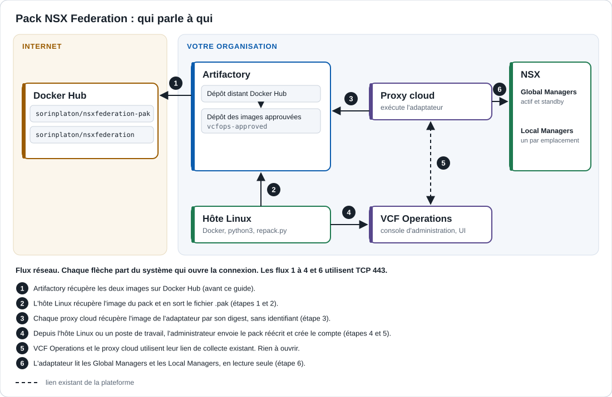

# Installation rapide, une fois les images dans votre Artifactory

La version courte du [guide d'installation en entreprise](INSTALL-ENTERPRISE.fr.md), pour la personne qui installe
une fois les images approuvées. English version: [INSTALL-QUICK.md](INSTALL-QUICK.md).

Ce guide suppose que les deux images de la version choisie sont dans votre dépôt des images approuvées, sous les
digests indiqués dans les notes de cette [version](https://github.com/sorinplaton/vcf-ops-nsx-federation-mp/releases) :

- `artifactory.example.com/vcfops-approved/nsxfederation-pak`, qui transporte le fichier du pack ;
- `artifactory.example.com/vcfops-approved/nsxfederation`, l'image de l'adaptateur que le proxy cloud exécute.

Remplacez `artifactory.example.com` et `vcfops-approved` par vos propres noms dans chaque commande.



## Ce qu'il vous faut

- Un hôte Linux avec Docker, `python3`, `unzip` et `curl`, connecté à Artifactory.
- Un accès root à chaque proxy cloud qui exécutera le compte.
- Le changement approuvé pour l'option des packs non signés dans VCF Operations.
- Un compte NSX en lecture seule, valable sur les Global Managers et les Local Managers.

## 1. Sortir le pack de son image

*Où : l'hôte Linux.*

```bash
ART=artifactory.example.com
APPROVED=vcfops-approved
RELEASE=1.13.7                       # ou 1.13.6

docker pull $ART/$APPROVED/nsxfederation-pak:$RELEASE
docker create --name pak $ART/$APPROVED/nsxfederation-pak:$RELEASE
rm -rf pak && docker cp pak:/pak/. ./pak && docker rm pak
(cd pak && sha256sum -c SHA256SUMS)
```

Résultat attendu : `NSXFederation_1.13.0.pak: OK`. Le digest affiché par `docker pull` doit être le digest de
l'image du pack indiqué dans les notes de version.

## 2. Faire pointer le pack vers votre Artifactory

*Où : l'hôte Linux.*

Le pack publié indique au proxy cloud de récupérer l'image de l'adaptateur sur `ghcr.io`. `repack.py` remplace
cette adresse par celle de votre dépôt et laisse le digest de l'image tel quel.

```bash
curl -LO https://raw.githubusercontent.com/sorinplaton/vcf-ops-nsx-federation-mp/v1.13.7/tools/repack.py
cp pak/NSXFederation_1.13.0.pak NSXFederation_1.13.0_site.pak
python3 repack.py NSXFederation_1.13.0_site.pak $ART $APPROVED/nsxfederation
sha256sum NSXFederation_1.13.0_site.pak      # à enregistrer avec le changement
```

Résultat attendu : `REGISTRY=artifactory.example.com`, `REPOSITORY=/vcfops-approved/nsxfederation`, et une ligne
`DIGEST` égale au digest de l'image de l'adaptateur indiqué dans les notes de version. `NSXFederation_1.13.0_site.pak` est le
fichier à installer.

## 3. Permettre au proxy cloud de récupérer l'image

*Où : chaque proxy cloud qui exécutera le compte, en root.*

```bash
mkdir -p /etc/docker/certs.d/artifactory.example.com
cp internal-ca.crt /etc/docker/certs.d/artifactory.example.com/ca.crt     # seulement si Artifactory utilise une autorité interne
docker pull artifactory.example.com/vcfops-approved/nsxfederation@sha256:...   # le digest de l'image de l'adaptateur
```

Résultat attendu : `Status: Downloaded newer image`.

Le proxy cloud récupère l'image sans identifiant : l'utilisateur `anonymous` a donc besoin de la permission Read
sur `vcfops-approved`. Si votre site n'autorise pas l'accès anonyme, lancez `docker login artifactory.example.com`
avant la récupération et `docker logout` après. Le compte démarre alors à partir de la copie présente sur le
proxy cloud. Refaites la récupération à chaque nouvelle version.

Une mise à niveau ou un redéploiement du proxy cloud supprime le dossier du certificat et l'image. Refaites
cette étape après l'un ou l'autre.

## 4. Installer le pack

*Où : un navigateur.*

1. Ouvrez la console d'administration, `https://<vcf-operations>/admin`. Sous Administrator Settings, Security
   Settings, activez « Allow unsigned PAK installation ».
2. Ouvrez l'interface du produit. Sous Administration, Integrations, Repository, ajoutez un pack.
3. Lancez `sha256sum` sur `NSXFederation_1.13.0_site.pak` et comparez le résultat à la valeur enregistrée à
   l'étape 2. Choisissez ensuite ce fichier. Cochez « install even if already installed » et « Ignore the PAK
   file signature checking ».
4. Envoyez le fichier, acceptez l'avertissement sur le fichier non signé et attendez la fin de l'installation.
5. Revenez à la console d'administration et désactivez « Allow unsigned PAK installation ». La console refuse le
   changement tant que l'installation est en cours : réessayez une fois qu'elle est terminée.

## 5. Créer le compte

*Où : l'interface du produit.*

1. Sous Administration, Integrations, Accounts, ajoutez un compte de type NSX Federation.
2. Saisissez l'adresse de cluster du Global Manager actif et celle du Standby Global Manager, séparées par une
   virgule.
3. Saisissez l'identifiant NSX en lecture seule, et choisissez comme collecteur le proxy cloud de l'étape 3.
4. Validez la connexion, acceptez les certificats des Global Managers et enregistrez. Avec la confiance de
   certificat par défaut, le compte ne collecte rien tant que les certificats ne sont pas acceptés.

## 6. Vérifier la collecte

Le compte passe à « Collecting ». Les objets apparaissent d'abord, puis les métriques au bout d'une dizaine de
minutes. Les tableaux de bord NSX Federation affichent alors des données.

Si le compte reste en échec avec un message vide, le proxy cloud n'a pas pu récupérer l'image. Relancez la
récupération de l'étape 3 et lisez son erreur.

## Mises à niveau et retour arrière

Pour une nouvelle version, refaites les étapes 1 à 4 avec le nouveau numéro de version, puis arrêtez et
redémarrez le compte. Pour revenir en arrière, installez de la même façon le fichier `_site` précédent.
Conservez les images précédentes dans `vcfops-approved` jusqu'à ce que la nouvelle version fonctionne.
