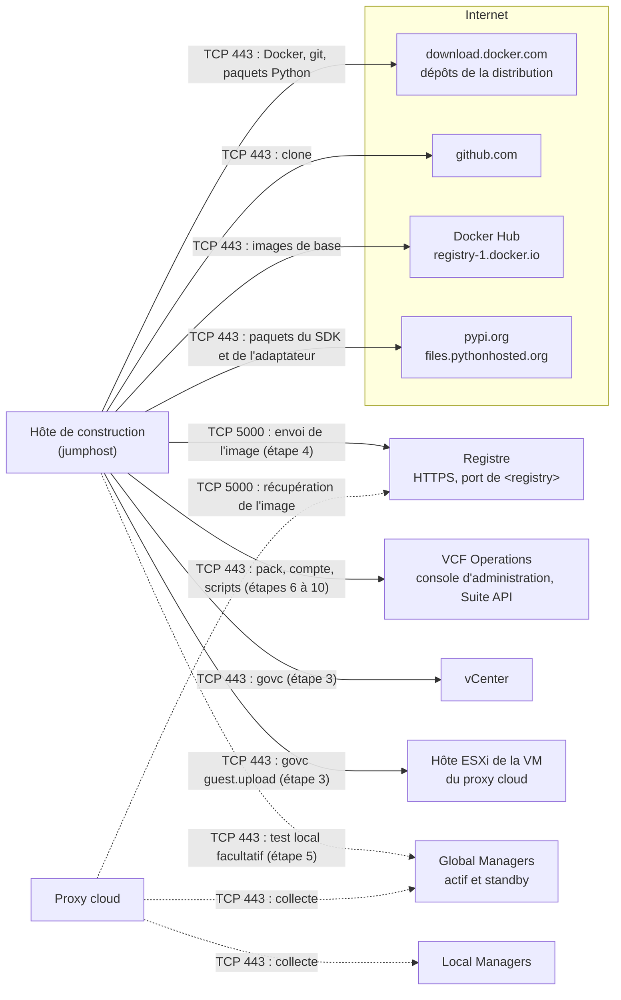

# Guide d'installation

Comment construire le pack NSX Federation et l'installer dans VCF Operations 9.1.1, avec la machine sur
laquelle chaque commande s'exécute. Ce sont les étapes suivies dans le lab. La partie 2 du
[blog](https://sorinplaton.github.io/fr/posts/nsx-federation-management-pack-install/) les montre avec des
captures d'écran.

English version: [INSTALL.md](INSTALL.md).

## Où chaque élément s'exécute

| Machine | Rôle |
| --- | --- |
| Hôte de construction | Un hôte Linux avec Docker, `git` et Python 3. Il construit le pack et envoie l'image de l'adaptateur au registre. Dans le lab, c'est le jumphost, qui héberge aussi le registre |
| Registre | Un registre d'images servi en HTTPS, joignable par le proxy cloud. Le proxy cloud ne se replie pas sur HTTP |
| Proxy cloud | Le collecteur VCF Operations qui exécute le conteneur de l'adaptateur. Il récupère l'image depuis le registre |
| VCF Operations | Console d'administration (`https://<ops>/admin`) et interface du produit (`https://<ops>/`) |
| NSX | Les Global Managers (actif et standby) et les Local Managers d'une fédération |

## Accès réseau

Ce que l'hôte de construction (le jumphost dans le lab) doit joindre, et les deux flux du proxy cloud dont
dépend l'installation. Les traits pleins partent de l'hôte de construction ; les pointillés sont ceux du proxy
cloud.



| Depuis | Vers | Port | Usage |
| --- | --- | --- | --- |
| Hôte de construction | Internet (dépôts Docker et de la distribution, GitHub, Docker Hub, PyPI) | TCP 443 | Installation des outils, clone du dépôt, construction des images d'outillage et de l'adaptateur. Via un proxy si le site en utilise un |
| Hôte de construction | Registre | TCP 5000, ou le port du registre | Envoi de l'image de l'adaptateur. En local quand le registre tourne sur l'hôte de construction, comme dans le lab |
| Hôte de construction | VCF Operations | TCP 443 | Console d'administration et interface du produit dans un navigateur, Suite API pour les scripts des étapes 6 à 10 |
| Hôte de construction | vCenter de la VM du proxy cloud | TCP 443 | Opérations invité `govc` de l'étape 3. Inutile si le certificat est copié par SSH |
| Hôte de construction | Hôte ESXi de la VM du proxy cloud | TCP 443 | `govc guest.upload` envoie le fichier à l'hôte ESXi, pas au vCenter |
| Hôte de construction | Global Managers | TCP 443 | Seulement pour le test facultatif de l'étape 5 |
| Proxy cloud | Registre | TCP 5000, ou le port du registre | Récupération de l'image de l'adaptateur |
| Proxy cloud | Global Managers et Local Managers | TCP 443 | Collecte |

Valeurs à remplacer :

| Valeur | Exemple |
| --- | --- |
| `<registry>` | `registry.example.com:5000` (hôte et port, sans `https://`) |
| `<repository>` | `nsxfederation` |
| `<ops>` | `ops.example.com` |
| `<gm1>`, `<gm2>` | adresse de cluster du Global Manager actif et du standby |
| `<version>` | `1.13.0` |

## Liste de contrôle

- [ ] 1. Prérequis vérifiés
- [ ] 2. Registre servi en HTTPS
- [ ] 3. Le proxy cloud fait confiance au certificat du registre
- [ ] 4. Pack construit, image envoyée, adresse du registre vérifiée dans le pack
- [ ] 5. Facultatif : collecte testée sans VCF Operations
- [ ] 6. Pack non signé installé, option à nouveau désactivée
- [ ] 7. Compte créé, certificats acceptés
- [ ] 8. Compte à l'état « Collecting », métriques présentes après trois cycles
- [ ] 9. Facultatif : groupe par fédération
- [ ] 10. Facultatif : alertes envoyées par e-mail, à un webhook ou à un outil de tickets

## 1. Prérequis

- [ ] VCF Operations 9.1.1 avec au moins un proxy cloud à l'état `UP`.
- [ ] NSX 9.1 Federation. Un compte NSX en lecture seule sur chaque Global Manager et chaque Local Manager ;
      le compte intégré `audit` convient. Un identifiant distinct pour les Local Managers est facultatif.
- [ ] Réseau : du proxy cloud vers chaque manager NSX en TCP 443, du proxy cloud vers le registre sur son port,
      de l'hôte de construction vers le registre.
- [ ] Mot de passe admin de VCF Operations : l'option des packs non signés se trouve dans la console
      d'administration.
- [ ] Une approbation de changement pour activer « Allow unsigned PAK installation » le temps de
      l'installation, si l'organisation l'exige. Le pack n'est pas signé par Broadcom (KB 415279).
- [ ] Outils de l'hôte de construction : Docker Engine, `git` et Python 3 avec `requests`, installés comme
      ci-dessous.

### Outils de l'hôte de construction

*À exécuter sur : l'hôte de construction.* Docker vient du dépôt Docker plutôt que des paquets de la
distribution, afin que `docker build` utilise BuildKit.

Ubuntu ou Debian (sur Debian, remplacer `ubuntu` par `debian` dans les deux URL) :

```bash
sudo apt-get update
sudo apt-get install -y ca-certificates curl git python3 python3-requests
sudo install -m 0755 -d /etc/apt/keyrings
sudo curl -fsSL https://download.docker.com/linux/ubuntu/gpg -o /etc/apt/keyrings/docker.asc
sudo chmod a+r /etc/apt/keyrings/docker.asc
echo "deb [arch=$(dpkg --print-architecture) signed-by=/etc/apt/keyrings/docker.asc] \
https://download.docker.com/linux/ubuntu $(. /etc/os-release && echo "$VERSION_CODENAME") stable" \
  | sudo tee /etc/apt/sources.list.d/docker.list > /dev/null
sudo apt-get update
sudo apt-get install -y docker-ce docker-ce-cli containerd.io docker-buildx-plugin
```

RHEL, Rocky Linux ou AlmaLinux 8 et versions ultérieures :

```bash
sudo dnf install -y dnf-plugins-core git python3 python3-requests
sudo dnf config-manager --add-repo https://download.docker.com/linux/rhel/docker-ce.repo
sudo dnf install -y docker-ce docker-ce-cli containerd.io docker-buildx-plugin
```

Dans les deux cas, démarrer Docker et ajouter l'utilisateur de construction au groupe `docker`. La commande
de construction de l'étape 4 s'exécute avec ce groupe : se déconnecter et se reconnecter avant de la lancer.

```bash
sudo systemctl enable --now docker
sudo usermod -aG docker $USER
```

Vérification, après la reconnexion :

```bash
docker version            # affiche une section Client et une section Server, sans sudo
docker run --rm hello-world
git --version
python3 --version         # 3.8 ou ultérieure
python3 -c "import requests"
```

## 2. Registre en HTTPS

Passer cette étape et l'étape 3 si un registre (Harbor ou autre) existe déjà avec un certificat émis par une
autorité à laquelle le proxy cloud fait confiance.

*À exécuter sur : l'hôte du registre.* Un conteneur `registry:2` avec un certificat autosigné :

```bash
mkdir -p certs
openssl req -x509 -newkey rsa:2048 -nodes -days 825 \
  -keyout certs/registry.key -out certs/registry.crt -subj "/CN=fedmp-registry" \
  -addext "subjectAltName=IP:<registry-ip>"          # ou DNS:<registry-fqdn>

docker run -d --name fedmp-registry --restart unless-stopped -p <registry-ip>:5000:5000 \
  -v registry-data:/var/lib/registry -v $PWD/certs:/certs:ro \
  -e REGISTRY_HTTP_TLS_CERTIFICATE=/certs/registry.crt \
  -e REGISTRY_HTTP_TLS_KEY=/certs/registry.key registry:2
```

Vérification, depuis l'hôte de construction :

```bash
curl --cacert certs/registry.crt https://<registry>/v2/     # répond {}
```

## 3. Le proxy cloud fait confiance au certificat du registre

Docker, sur le proxy cloud, fait confiance à un registre privé dont le certificat se trouve dans un dossier
qui porte le nom du registre, port compris :

```
/etc/docker/certs.d/<registry>/ca.crt
```

*À exécuter sur : tout hôte équipé de `govc` qui accède au vCenter hébergeant la VM du proxy cloud.* SSH peut
rester désactivé sur le proxy cloud : les opérations d'invité de vCenter écrivent le fichier avec le compte
root de l'appliance.

```bash
export GOVC_URL=<vcenter> GOVC_USERNAME=<user> GOVC_PASSWORD=<password> GOVC_INSECURE=1
VM=<cloud-proxy-vm-name>
govc guest.mkdir -vm "$VM" -l "root:<proxy-root-password>" -p "/etc/docker/certs.d/<registry>"
govc guest.upload -vm "$VM" -l "root:<proxy-root-password>" -f certs/registry.crt \
  "/etc/docker/certs.d/<registry>/ca.crt"
```

*Ou à exécuter sur : le proxy cloud*, si SSH y est activé : créer le dossier et y copier `registry.crt` sous le
nom `ca.crt`.

Une mise à niveau ou un redéploiement du proxy cloud peut supprimer le fichier. Refaire cette étape après
l'un ou l'autre.

## 4. Construire le pack

*À exécuter sur : l'hôte de construction*, dans un clone de ce dépôt.

```bash
git clone https://github.com/sorinplaton/vcf-ops-nsx-federation-mp.git
cd vcf-ops-nsx-federation-mp
docker build -t fedmp-tooling tooling
```

Le Docker de l'hôte de construction doit lui aussi faire confiance à un registre autosigné avant de pouvoir y
envoyer une image. Copier le même `registry.crt` dans `/etc/docker/certs.d/<registry>/ca.crt` sur l'hôte de
construction (droits root nécessaires).

Construire le pack et envoyer l'image de l'adaptateur :

```bash
docker run --rm --network host -u $(id -u):$(getent group docker | cut -d: -f3) -e HOME=$PWD/.sdkhome \
  -v /var/run/docker.sock:/var/run/docker.sock -v $(which docker):/usr/bin/docker -v $PWD:$PWD -w $PWD/pack \
  fedmp-tooling mp-build --no-ttl -r <registry>/<repository> \
  --registry-username <user> --registry-password <password>
```

Le résultat est `pack/build/NSXFederation_<version>.pak`.

Quand le registre est donné sous la forme `host:port` sans domaine, `mp-build` écrit Docker Hub dans le pack.
Corriger l'adresse avant l'installation :

```bash
python3 tools/repack.py pack/build/NSXFederation_<version>.pak <registry> <repository>
```

Vérifier que l'image est dans le registre :

```bash
curl --cacert certs/registry.crt https://<registry>/v2/<repository>/tags/list
```

## 5. Facultatif : tester une collecte sans VCF Operations

*À exécuter sur : l'hôte de construction.* Il doit pouvoir joindre les managers NSX en TCP 443.

```bash
docker run --rm --network host -v $PWD:/work -e GM_HOSTS=<gm1>,<gm2> \
  -e NSX_USER=audit -e NSX_PASSWORD='<password>' fedmp-tooling python tools/localrun.py
```

La commande affiche les objets et les métriques d'un cycle. Un appel en échec se voit ici avant
d'apparaître dans VCF Operations.

## 6. Installer le pack non signé

Les deux méthodes activent « Allow unsigned PAK installation » pour l'envoi et le désactivent ensuite.
L'option s'applique à toute l'instance VCF Operations.

### À la main

*À exécuter dans : un navigateur.*

1. Console d'administration `https://<ops>/admin`, Administrator Settings, Security Settings : activer
   « unsigned PAK installation ».
2. Interface du produit : Administration, Integrations, Repository, ajouter un pack.
3. Choisir `NSXFederation_<version>.pak`, cocher « install even if already installed » et « Ignore the PAK file
   signature checking ».
4. Envoyer le fichier, accepter l'avertissement sur le fichier non signé et attendre la fin de l'installation.
5. Console d'administration : désactiver l'installation des PAK non signés. La console refuse le changement tant que
   l'installation est en cours ; réessayer une fois l'installation terminée.

### Par script

*À exécuter sur : l'hôte de construction*, avec `google-chrome`, `node` et le module Python `requests` installés.
Les scripts pilotent un Chrome headless via des appels internes à l'interface de VCF Operations. Ces appels
ne sont pas pris en charge et peuvent changer à chaque version.

```bash
export OPS_HOST=<ops> OPS_PW='<admin password>'
install/upi.sh enableUPI
install/install_unsigned.sh pack/build/NSXFederation_<version>.pak
```

Lancer `install_unsigned.sh` après `upi.sh` : la connexion à la console d'administration ferme la session de
l'interface du produit, et le script d'installation se reconnecte. Il désactive l'option quelle que soit
l'issue. Le code de sortie 0 signifie que l'installation est terminée et que l'option est désactivée.

Vérification : Administration, Integrations, Repository affiche le pack NSX Federation dans sa nouvelle
version.

## 7. Créer le compte

*À exécuter dans : l'interface du produit VCF Operations*, Administration, Integrations, Accounts, ajouter un
compte de type NSX Federation.

- [ ] Adresses des Global Managers : `<gm1>,<gm2>`, l'adresse de cluster de l'actif et celle du standby. Un
      compte par fédération.
- [ ] Identifiant : le compte NSX en lecture seule. N'ajouter l'identifiant des Local Managers que s'il est
      différent.
- [ ] Collecteur : le proxy cloud qui fait confiance au registre (étape 3).
- [ ] Confiance des certificats : garder `enforce`, ou choisir `ca` quand les managers ont des certificats signés
      par une autorité de certification interne. Avec `ca`, coller les certificats de l'autorité dans « Trusted CA
      certificates (PEM) » et utiliser des adresses que les certificats nomment.
- [ ] Valider la connexion et accepter les certificats des Global Managers. Sans certificat accepté, `enforce`
      ne collecte rien. Un compte créé via l'API n'a aucun certificat accepté ; le modifier dans
      l'interface, puis valider et accepter, ou utiliser `ca`.
- [ ] Les autres réglages peuvent garder leur valeur par défaut. [OPERATIONS.md](OPERATIONS.md) (en anglais)
      décrit chacun d'eux.

## 8. Vérifier la collecte

*À exécuter dans : l'interface du produit VCF Operations.*

- [ ] Onglet Accounts : le compte passe à l'état « Collecting ». S'il reste `FAILED` avec un message vide, le proxy
      cloud n'a pas pu récupérer l'image : vérifier les étapes 2 et 3, et chercher `tls: bad certificate` dans le
      journal du registre.
- [ ] Avec un intervalle de 5 minutes, les données arrivent en trois cycles : d'abord les objets et les
      relations, puis les propriétés et les événements, puis les métriques après une dizaine de minutes. Les
      taux demandent un cycle de plus.
- [ ] L'objet fédération ne liste aucun appel en échec.

## 9. Facultatif : groupe par fédération

*À exécuter sur : l'hôte de construction, à la racine du dépôt.*

```bash
export OPS_HOST=<ops> OPS_PW='<admin password>'
python3 install/federation_groups.py                     # « NSX Federation - <fédération> » pour chaque fédération
python3 install/federation_groups.py --federation '<fédération>' --policy '<politique>'   # et affecter une politique
```

- [ ] Le groupe « NSX Federation - <fédération> » liste les objets de cette fédération (Environment, Custom Groups).
      Le script nécessite une collecte par la version 1.13.0 ou ultérieure ; le relancer met les groupes à jour.

## 10. Facultatif : envoyer les alertes

*À exécuter sur : l'hôte de construction, à la racine du dépôt.* Créer d'abord l'instance sortante (serveur de
messagerie, webhook, ServiceNow, Slack, SNMP ou fichier journal) sous Administration, Configurations, Outbound Settings.

```bash
python3 install/notification_rules.py --outbound '<instance sortante>'                    # immediate et critical
python3 install/notification_rules.py --outbound '<instance sortante>' --min-criticality warning \
        --group 'NSX Federation - <fédération>' --name 'NSX Federation - <fédération> warnings'
```

- [ ] La règle « NSX Federation - <instance sortante> » apparaît sous Alerts, Notifications. Elle envoie les
      alertes nouvelles, mises à jour et annulées : un ticket apprend aussi que l'alerte a disparu.

## Mise à niveau

1. Construire la nouvelle version (étape 4) et l'installer (étape 6).
2. Arrêter puis démarrer le compte. Vérifier qu'il passe à l'état « Collecting » ; le démarrer une seconde fois s'il
   reste arrêté.
3. Les métriques reviennent après trois cycles, les taux après quatre.

`install_unsigned.sh` supprime les définitions d'alertes, de symptômes et de recommandations que la nouvelle
version ne fournit plus. Après une installation manuelle, lancer `install/cleanup_content.py <pak> --delete`
(voir [OPERATIONS.md](OPERATIONS.md), Upgrade, en anglais).

Depuis une version antérieure à 1.9.0, les edge nodes, les tunnels RTEP et les canaux de synchronisation sont
recréés sous une clé fondée sur leur ID NSX, et les anciens objets ne reçoivent plus de données.
`cleanup_content.py <pak> --legacy-objects --delete` les supprime, avec leur historique.
