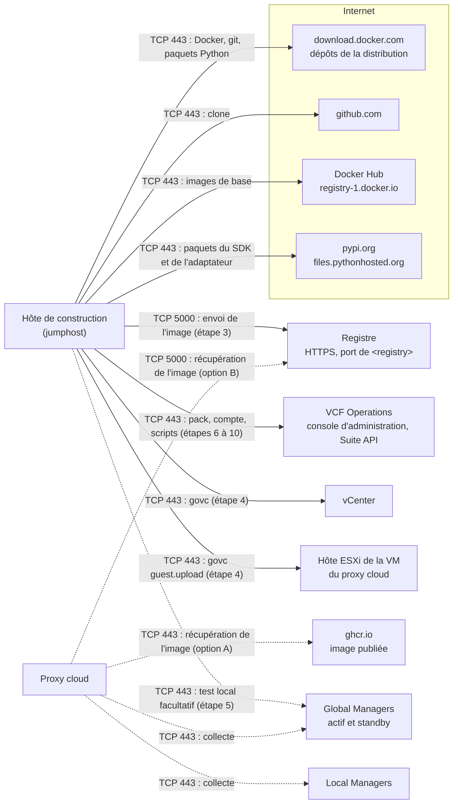

# Guide d'installation

Comment installer le pack NSX Federation dans VCF Operations 9.1.1, soit à partir du pack publié, soit à
partir de votre propre construction, avec la machine sur laquelle chaque commande s'exécute. Ce sont les étapes suivies dans le lab. La partie 2 du
[blog](https://sorinplaton.github.io/fr/posts/nsx-federation-management-pack-install/) les montre avec des
captures d'écran.

English version: [INSTALL.md](INSTALL.md).

## Choisir un mode d'installation

Le fichier `.pak` contient le contenu du pack (modèle d'objets, alertes, tableaux de bord) et l'adresse de
l'image de l'adaptateur. L'adaptateur lui-même est une image de conteneur que le proxy cloud récupère au
démarrage du compte. Les deux modes ne diffèrent que par l'origine de cette image.

| | Option A : télécharger le pack publié | Option B : construire le pack |
| --- | --- | --- |
| Image de l'adaptateur | Publique, sur `ghcr.io/sorinplaton/nsxfederation`, récupérée par son empreinte (digest) | Envoyée par vos soins vers votre propre registre |
| Prérequis | Le proxy cloud joint `ghcr.io` en TCP 443 | Un hôte de construction avec Docker, et un registre servi en HTTPS auquel le proxy cloud fait confiance |
| Étapes | [Option A](#option-a--télécharger-le-pack-publié), puis les étapes 6 à 10 | Étapes 1 à 10, ou la variante Harbor à la place des étapes 2 à 4 |
| Cas d'usage | Le proxy cloud a accès à Internet | Le proxy cloud n'a pas accès à Internet, les images doivent venir d'un registre interne, ou le pack est modifié |

Les deux modes installent le même pack et demandent l'option « Allow unsigned PAK installation » le temps de
l'installation.

## Où chaque élément s'exécute

| Machine | Rôle |
| --- | --- |
| Hôte de construction | Option B seulement. Un hôte Linux avec Docker, `git` et Python 3. Il construit le pack et envoie l'image de l'adaptateur au registre. Dans le lab, c'est le jumphost, qui héberge aussi le registre |
| Registre | Option A : `ghcr.io`, exploité par GitHub. Option B : un registre d'images servi en HTTPS, joignable par le proxy cloud. Le proxy cloud ne se replie pas sur HTTP |
| Proxy cloud | Le collecteur VCF Operations qui exécute le conteneur de l'adaptateur. Il récupère l'image depuis le registre |
| VCF Operations | Console d'administration (`https://<ops>/admin`) et interface du produit (`https://<ops>/`) |
| NSX | Les Global Managers (actif et standby) et les Local Managers d'une fédération |

## Accès réseau

Ce que l'hôte de construction (le jumphost dans le lab) doit joindre, et les flux du proxy cloud dont dépend
l'installation. Les traits pleins partent de l'hôte de construction et ne concernent que l'option B ; les
pointillés sont ceux du proxy cloud. Avec l'option A, seuls les flux du proxy cloud vers `ghcr.io` et vers NSX
sont nécessaires, plus un navigateur qui joint VCF Operations.



| Depuis | Vers | Port | Usage |
| --- | --- | --- | --- |
| Hôte de construction | Internet (dépôts Docker et de la distribution, GitHub, Docker Hub, PyPI) | TCP 443 | Installation des outils, clone du dépôt, construction des images d'outillage et de l'adaptateur. Via un proxy si le site en utilise un |
| Hôte de construction | Registre | TCP 5000, ou le port du registre | Envoi de l'image de l'adaptateur. En local quand le registre tourne sur l'hôte de construction, comme dans le lab |
| Hôte de construction | VCF Operations | TCP 443 | Console d'administration et interface du produit dans un navigateur, Suite API pour les scripts des étapes 6 à 10 |
| Hôte de construction | vCenter de la VM du proxy cloud | TCP 443 | Opérations invité `govc` de l'étape 4. Inutile si le certificat est copié par SSH |
| Hôte de construction | Hôte ESXi de la VM du proxy cloud | TCP 443 | `govc guest.upload` envoie le fichier à l'hôte ESXi, pas au vCenter |
| Hôte de construction | Global Managers | TCP 443 | Seulement pour le test facultatif de l'étape 5 |
| Proxy cloud | Registre | TCP 5000, ou le port du registre | Option B : récupération de l'image de l'adaptateur |
| Proxy cloud | `ghcr.io` | TCP 443 | Option A : récupération de l'image publiée de l'adaptateur. Via le proxy du site si le proxy cloud en utilise un |
| Proxy cloud | Global Managers et Local Managers | TCP 443 | Collecte |

Valeurs à remplacer :

| Valeur | Exemple |
| --- | --- |
| `$IP`, `$VERSION`, `$OPS_HOST` et les autres variables | Valeurs du fichier de paramètres `~/fedmp.env` (étape 1) |
| `<ops>` | Le nom d'hôte de VCF Operations, dans les étapes faites au navigateur |
| `<gm1>`, `<gm2>` | Adresse de cluster du Global Manager actif et du standby |

## Liste de contrôle

Option B. Avec l'option A, suivre la liste de contrôle de l'[option A](#option-a--télécharger-le-pack-publié).

- [ ] 1. Prérequis vérifiés
- [ ] 2. Registre servi en HTTPS
- [ ] 3. Pack construit, image envoyée, adresse du registre vérifiée dans le pack
- [ ] 4. Le proxy cloud fait confiance au certificat du registre
- [ ] 5. Facultatif : collecte testée sans VCF Operations
- [ ] 6. Pack non signé installé, option à nouveau désactivée
- [ ] 7. Compte créé, certificats acceptés
- [ ] 8. Compte à l'état « Collecting », métriques présentes après trois cycles
- [ ] 9. Facultatif : groupe par fédération
- [ ] 10. Facultatif : alertes envoyées par e-mail, à un webhook ou à un outil de tickets

## Option A : télécharger le pack publié

À utiliser à la place des étapes 1 à 5 quand le proxy cloud a accès à Internet. Ni hôte de construction, ni
Docker, ni registre à soi. Pas encore testée dans le lab, qui utilise l'option B.

- [ ] VCF Operations 9.1.1 avec au moins un proxy cloud à l'état `UP`, qui joint `ghcr.io` en TCP 443,
      directement ou via le proxy du site.
- [ ] NSX 9.1 Federation et un compte NSX en lecture seule, comme à l'étape 1.
- [ ] Le proxy cloud joint chaque manager NSX en TCP 443.
- [ ] Mot de passe admin de VCF Operations, et l'approbation de changement pour l'option des packs non signés
      si l'organisation l'exige.
- [ ] Pack téléchargé et somme de contrôle vérifiée.
- [ ] Puis les étapes 6 à 10.

*À exécuter sur : n'importe quelle machine dont le navigateur joint VCF Operations.* Télécharger le pack et sa
somme de contrôle depuis la [page des versions](https://github.com/sorinplaton/vcf-ops-nsx-federation-mp/releases/latest),
ou :

```bash
curl -LO https://github.com/sorinplaton/vcf-ops-nsx-federation-mp/releases/download/v1.13.1/NSXFederation_1.13.0.pak
curl -LO https://github.com/sorinplaton/vcf-ops-nsx-federation-mp/releases/download/v1.13.1/NSXFederation_1.13.0.pak.sha256
sha256sum -c NSXFederation_1.13.0.pak.sha256
```

Le pack désigne l'image `ghcr.io/sorinplaton/nsxfederation` par son empreinte : le proxy cloud exécute
toujours l'image avec laquelle le pack a été construit. L'image est publique : le proxy cloud la récupère sans
identifiant, et il fait déjà confiance au certificat de `ghcr.io`, sans étape 4.

Vérification facultative, *sur le proxy cloud* si SSH y est activé. La réponse `401` signifie que `ghcr.io` est
joignable :

```bash
curl -s -o /dev/null -w '%{http_code}\n' https://ghcr.io/v2/
```

Installer ensuite le pack avec l'étape 6, à la main ou par script (les scripts demandent un clone de ce dépôt et
le fichier de paramètres de l'étape 1), puis continuer avec les étapes 7 à 10.

## 1. Prérequis

- [ ] VCF Operations 9.1.1 avec au moins un proxy cloud à l'état `UP`.
- [ ] NSX 9.1 Federation. Un compte NSX en lecture seule sur chaque Global Manager et chaque Local Manager ;
      le compte intégré `audit` convient. Un identifiant distinct pour les Local Managers est facultatif.
- [ ] Réseau : du proxy cloud vers chaque manager NSX en TCP 443, du proxy cloud vers le registre sur son port,
      de l'hôte de construction vers le registre.
- [ ] Mot de passe admin de VCF Operations : l'option des packs non signés se trouve dans la console
      d'administration.
- [ ] Une approbation de changement pour activer « Allow unsigned PAK installation » le temps de
      l'installation, si l'organisation l'exige. Le pack n'est pas signé par Broadcom (KB 415279).
- [ ] Outils de l'hôte de construction : Docker Engine, `git` et Python 3 avec `requests`, installés comme
      ci-dessous.

### Outils de l'hôte de construction

*À exécuter sur : l'hôte de construction.* Docker vient du dépôt Docker plutôt que des paquets de la
distribution, afin que `docker build` utilise BuildKit.

Ubuntu ou Debian (sur Debian, remplacer `ubuntu` par `debian` dans les deux URL) :

```bash
sudo apt-get update
sudo apt-get install -y ca-certificates curl git python3 python3-requests
sudo install -m 0755 -d /etc/apt/keyrings
sudo curl -fsSL https://download.docker.com/linux/ubuntu/gpg -o /etc/apt/keyrings/docker.asc
sudo chmod a+r /etc/apt/keyrings/docker.asc
echo "deb [arch=$(dpkg --print-architecture) signed-by=/etc/apt/keyrings/docker.asc] \
https://download.docker.com/linux/ubuntu $(. /etc/os-release && echo "$VERSION_CODENAME") stable" \
  | sudo tee /etc/apt/sources.list.d/docker.list > /dev/null
sudo apt-get update
sudo apt-get install -y docker-ce docker-ce-cli containerd.io docker-buildx-plugin
```

RHEL, Rocky Linux ou AlmaLinux 8 et versions ultérieures :

```bash
sudo dnf install -y dnf-plugins-core git python3 python3-requests
sudo dnf config-manager --add-repo https://download.docker.com/linux/rhel/docker-ce.repo
sudo dnf install -y docker-ce docker-ce-cli containerd.io docker-buildx-plugin
```

Dans les deux cas, démarrer Docker. Les commandes `docker` de ce guide sont préfixées par `sudo` : l'utilisateur
de construction n'a donc pas besoin d'être membre du groupe `docker`.

```bash
sudo systemctl enable --now docker
```

Vérification :

```bash
sudo docker run --rm hello-world
git --version
python3 --version         # 3.8 ou ultérieure
python3 -c "import requests"
```

### Le fichier de paramètres

Les adresses, les noms et les mots de passe dont les commandes ont besoin sont dans un seul fichier,
`~/fedmp.env`. Les commandes de ce guide ne contiennent alors ni adresse ni mot de passe. Cloner le dépôt, copier
l'exemple, le remplir, et le rendre lisible par son seul propriétaire :

```bash
cd ~
git clone https://github.com/sorinplaton/vcf-ops-nsx-federation-mp.git
cp vcf-ops-nsx-federation-mp/install/fedmp.env.example ~/fedmp.env && chmod 600 ~/fedmp.env
nano ~/fedmp.env
```

| Variable | Usage |
| --- | --- |
| `IP` | L'adresse de l'hôte de construction que le proxy cloud utilise pour joindre le registre (étapes 2 à 4) |
| `VERSION` | La version du pack, comme dans `pack/manifest.txt` |
| `OPS_HOST`, `OPS_PW` | VCF Operations et son mot de passe admin (étapes 6 à 10) |
| `GOVC_URL`, `GOVC_USERNAME`, `GOVC_PASSWORD` | Le vCenter qui héberge la VM du proxy cloud (étape 4) |
| `PROXY_VM`, `PROXY_ROOT_PW` | Le nom de la VM du proxy cloud et son mot de passe root (étape 4) |
| `GM_HOSTS`, `NSX_USER`, `NSX_PASSWORD` | Les Global Managers et le compte NSX en lecture seule (étape 5) |
| `HARBOR`, `HARBOR_PROJECT`, `HARBOR_USER`, `HARBOR_PW` | Seulement pour la variante Harbor |

Chaque bloc de commandes commence par la ligne qui charge le fichier et exporte ses valeurs :

```bash
set -a; source ~/fedmp.env; set +a
```

Le fichier contient des mots de passe. Le tenir hors de Git (`fedmp.env` est dans `.gitignore`), et le
supprimer ou le déplacer dans un coffre une fois l'installation terminée.

## 2. Registre en HTTPS

Avec un registre Harbor existant, passer les étapes 2 à 4 et suivre
[Variante : un registre Harbor existant](#variante--un-registre-harbor-existant).

*À exécuter sur : l'hôte de construction.* Un conteneur `registry:2` avec un certificat autosigné :

```bash
set -a; source ~/fedmp.env; set +a
mkdir -p ~/fedmp-registry/certs && cd ~/fedmp-registry
openssl req -x509 -newkey rsa:2048 -nodes -days 825 \
  -keyout certs/registry.key -out certs/registry.crt -subj "/CN=fedmp-registry" \
  -addext "subjectAltName=IP:$IP,IP:127.0.0.1,DNS:localhost"

sudo docker run -d --name fedmp-registry --restart unless-stopped \
  -p $IP:5000:5000 -p 127.0.0.1:5000:5000 \
  -v registry-data:/var/lib/registry -v $PWD/certs:/certs:ro \
  -e REGISTRY_HTTP_TLS_CERTIFICATE=/certs/registry.crt \
  -e REGISTRY_HTTP_TLS_KEY=/certs/registry.key registry:2
```

Le certificat contient aussi `127.0.0.1` et `localhost`, et le registre écoute également sur l'adresse locale,
parce que l'étape 3 envoie l'image vers `localhost:5000`.

Vérification. Un registre neuf répond `{"repositories":[]}` jusqu'au premier envoi :

```bash
curl --cacert ~/fedmp-registry/certs/registry.crt https://$IP:5000/v2/_catalog
```

## 3. Construire le pack

*À exécuter sur : l'hôte de construction.*

```bash
set -a; source ~/fedmp.env; set +a
cd ~/vcf-ops-nsx-federation-mp
sudo docker build -t fedmp-tooling tooling

sudo docker run --rm --network host -u $(id -u):$(getent group docker | cut -d: -f3) -e HOME=$PWD/.sdkhome \
  -v /var/run/docker.sock:/var/run/docker.sock -v $(which docker):/usr/bin/docker -v $PWD:$PWD -w $PWD/pack \
  fedmp-tooling mp-build --no-ttl -r localhost:5000/nsxfederation \
  --registry-username lab --registry-password lab
```

Le résultat est `pack/build/NSXFederation_$VERSION.pak`.

L'image est envoyée vers `localhost:5000`. Docker accepte le certificat autosigné d'un registre joint par
l'adresse locale : l'hôte de construction n'a donc pas besoin de son propre dossier de certificat. Le registre
de l'étape 2 ne demande aucune authentification. `mp-build` demande quand même un utilisateur et un mot de
passe, et n'importe quelle valeur convient.

Quand le registre est donné sous la forme `host:port` sans domaine, `mp-build` écrit Docker Hub dans le pack.
Inscrire dans le pack l'adresse que le proxy cloud utilise, avant l'installation :

```bash
python3 tools/repack.py pack/build/NSXFederation_$VERSION.pak $IP:5000 nsxfederation
```

Vérifier que l'image est dans le registre :

```bash
curl --cacert ~/fedmp-registry/certs/registry.crt https://$IP:5000/v2/nsxfederation/tags/list
```

## 4. Le proxy cloud fait confiance au certificat du registre

Docker, sur le proxy cloud, fait confiance à un registre privé dont le certificat se trouve dans un dossier
qui porte le nom du registre, port compris :

```
/etc/docker/certs.d/10.x.x.x:5000/ca.crt
```

*À exécuter sur : tout hôte équipé de `govc` qui accède au vCenter hébergeant la VM du proxy cloud.* SSH peut
rester désactivé sur le proxy cloud : les opérations d'invité de vCenter écrivent le fichier avec le compte
root de l'appliance.

```bash
set -a; source ~/fedmp.env; set +a
govc guest.mkdir -vm "$PROXY_VM" -l "root:$PROXY_ROOT_PW" -p /etc/docker/certs.d/$IP:5000
govc guest.upload -vm "$PROXY_VM" -l "root:$PROXY_ROOT_PW" -f ~/fedmp-registry/certs/registry.crt \
  /etc/docker/certs.d/$IP:5000/ca.crt
```

*Ou à exécuter sur : le proxy cloud*, si SSH y est activé : créer le dossier et y copier `registry.crt` sous le
nom `ca.crt`.

Une mise à niveau ou un redéploiement du proxy cloud peut supprimer le fichier. Refaire cette étape après
l'un ou l'autre.

Un registre déplacé vers une autre adresse demande un nouveau certificat (étape 2), un pack réécrit (étape 3)
et un nouveau dossier sur le proxy cloud.

## Variante : un registre Harbor existant

À utiliser à la place des étapes 2 à 4 quand l'environnement dispose déjà de Harbor. Cette variante n'a pas été
testée dans le lab, qui utilise le registre de l'étape 2.

Dans Harbor, une seule fois :

- [ ] Un projet pour l'image, par exemple `nsxfederation`, en accès public. Le proxy cloud récupère l'image
      sans s'authentifier : l'image d'un projet privé ne peut donc pas être récupérée.
- [ ] Un compte autorisé à envoyer des images dans le projet : un compte robot avec le droit push, ou un
      utilisateur avec le rôle Developer.
- [ ] Réseau : de l'hôte de construction et du proxy cloud vers Harbor en TCP 443.

*À exécuter sur : l'hôte de construction.* Son Docker doit faire confiance au certificat de Harbor. Quand le
certificat vient d'une autorité interne, ou qu'il est autosigné, copier d'abord le certificat de l'autorité :

```bash
set -a; source ~/fedmp.env; set +a
sudo mkdir -p /etc/docker/certs.d/$HARBOR
sudo cp harbor-ca.crt /etc/docker/certs.d/$HARBOR/ca.crt
```

Construire le pack et envoyer l'image. `mp-build` s'authentifie auprès de Harbor avec le compte donné sur la
ligne de commande. Le nom d'un compte robot contient un `$` : conserver les apostrophes qui l'entourent dans `fedmp.env`.

```bash
set -a; source ~/fedmp.env; set +a
cd ~/vcf-ops-nsx-federation-mp
sudo docker build -t fedmp-tooling tooling

sudo docker run --rm --network host -u $(id -u):$(getent group docker | cut -d: -f3) -e HOME=$PWD/.sdkhome \
  -v /var/run/docker.sock:/var/run/docker.sock -v $(which docker):/usr/bin/docker -v $PWD:$PWD -w $PWD/pack \
  fedmp-tooling mp-build --no-ttl -r $HARBOR/$HARBOR_PROJECT/nsxfederation \
  --registry-username "$HARBOR_USER" --registry-password "$HARBOR_PW"
```

Vérifier l'adresse inscrite dans le pack. Le registre a ici un nom de domaine : `repack.py` ne devrait donc pas
être nécessaire.

```bash
unzip -p pack/build/NSXFederation_$VERSION.pak adapter.zip > /tmp/adapter.zip
unzip -p /tmp/adapter.zip '*.conf' | grep -E '^(REGISTRY|REPOSITORY)='
```

Résultat attendu : `REGISTRY=harbor.example.com` et `REPOSITORY=/nsxfederation/nsxfederation`. Si le pack
désigne Docker Hub, le réécrire :

```bash
python3 tools/repack.py pack/build/NSXFederation_$VERSION.pak $HARBOR $HARBOR_PROJECT/nsxfederation
```

Le proxy cloud doit lui aussi faire confiance au certificat de Harbor. Avec un certificat émis par une autorité
qu'il approuve déjà, il n'y a rien d'autre à faire. Sinon, appliquer l'étape 4 avec le certificat de l'autorité
de Harbor et le dossier `/etc/docker/certs.d/harbor.example.com/` (ajouter `:<port>` au nom du dossier quand
Harbor n'écoute pas sur le port 443).

Continuer ensuite à l'étape 5 ou à l'étape 6.

## 5. Facultatif : tester une collecte sans VCF Operations

*À exécuter sur : l'hôte de construction.* Il doit pouvoir joindre les managers NSX en TCP 443.

```bash
set -a; source ~/fedmp.env; set +a
cd ~/vcf-ops-nsx-federation-mp
sudo docker run --rm --network host -v $PWD:/work -e GM_HOSTS -e NSX_USER -e NSX_PASSWORD \
  fedmp-tooling python tools/localrun.py
```

La commande affiche les objets et les métriques d'un cycle. Un appel en échec se voit ici avant
d'apparaître dans VCF Operations.

## 6. Installer le pack non signé

Les deux méthodes activent « Allow unsigned PAK installation » pour l'envoi et le désactivent ensuite.
L'option s'applique à toute l'instance VCF Operations.

### À la main

*À exécuter dans : un navigateur.*

1. Console d'administration `https://<ops>/admin`, Administrator Settings, Security Settings : activer
   « unsigned PAK installation ».
2. Interface du produit : Administration, Integrations, Repository, ajouter un pack.
3. Choisir `NSXFederation_<version>.pak`, cocher « install even if already installed » et « Ignore the PAK file
   signature checking ».
4. Envoyer le fichier, accepter l'avertissement sur le fichier non signé et attendre la fin de l'installation.
5. Console d'administration : désactiver l'installation des PAK non signés. La console refuse le changement tant que
   l'installation est en cours ; réessayer une fois l'installation terminée.

### Par script

*À exécuter sur : l'hôte de construction*, avec `google-chrome`, `node` et le module Python `requests` installés.
Les scripts pilotent un Chrome headless via des appels internes à l'interface de VCF Operations. Ces appels
ne sont pas pris en charge et peuvent changer à chaque version.

```bash
set -a; source ~/fedmp.env; set +a
install/upi.sh enableUPI
install/install_unsigned.sh pack/build/NSXFederation_$VERSION.pak
```

Lancer `install_unsigned.sh` après `upi.sh` : la connexion à la console d'administration ferme la session de
l'interface du produit, et le script d'installation se reconnecte. Il désactive l'option quelle que soit
l'issue. Le code de sortie 0 signifie que l'installation est terminée et que l'option est désactivée.

Vérification : Administration, Integrations, Repository affiche le pack NSX Federation dans sa nouvelle
version.

## 7. Créer le compte

*À exécuter dans : l'interface du produit VCF Operations*, Administration, Integrations, Accounts, ajouter un
compte de type NSX Federation.

- [ ] Adresses des Global Managers : `<gm1>,<gm2>`, l'adresse de cluster de l'actif et celle du standby. Un
      compte par fédération.
- [ ] Identifiant : le compte NSX en lecture seule. N'ajouter l'identifiant des Local Managers que s'il est
      différent.
- [ ] Collecteur : avec l'option A, un proxy cloud qui joint `ghcr.io` ; avec l'option B, le proxy cloud
      qui fait confiance au registre (étape 4).
- [ ] Confiance des certificats : garder `enforce`, ou choisir `ca` quand les managers ont des certificats signés
      par une autorité de certification interne. Avec `ca`, coller les certificats de l'autorité dans « Trusted CA
      certificates (PEM) » et utiliser des adresses que les certificats nomment.
- [ ] Valider la connexion et accepter les certificats des Global Managers. Sans certificat accepté, `enforce`
      ne collecte rien. Un compte créé via l'API n'a aucun certificat accepté ; le modifier dans
      l'interface, puis valider et accepter, ou utiliser `ca`.
- [ ] Les autres réglages peuvent garder leur valeur par défaut. [OPERATIONS.md](OPERATIONS.md) (en anglais)
      décrit chacun d'eux.

## 8. Vérifier la collecte

*À exécuter dans : l'interface du produit VCF Operations.*

- [ ] Onglet Accounts : le compte passe à l'état « Collecting ». S'il reste `FAILED` avec un message vide, le proxy
      cloud n'a pas pu récupérer l'image. Option A : vérifier que le proxy cloud joint `ghcr.io`. Option B :
      vérifier les étapes 2 et 4, et chercher `tls: bad certificate` dans le journal du registre.
- [ ] Avec un intervalle de 5 minutes, les données arrivent en trois cycles : d'abord les objets et les
      relations, puis les propriétés et les événements, puis les métriques après une dizaine de minutes. Les
      taux demandent un cycle de plus.
- [ ] L'objet fédération ne liste aucun appel en échec.

## 9. Facultatif : groupe par fédération

*À exécuter sur : l'hôte de construction, à la racine du dépôt.*

```bash
set -a; source ~/fedmp.env; set +a
python3 install/federation_groups.py                     # « NSX Federation - <fédération> » pour chaque fédération
python3 install/federation_groups.py --federation '<fédération>' --policy '<politique>'   # et affecter une politique
```

- [ ] Le groupe « NSX Federation - <fédération> » liste les objets de cette fédération (Environment, Custom Groups).
      Le script nécessite une collecte par la version 1.13.0 ou ultérieure ; le relancer met les groupes à jour.

## 10. Facultatif : envoyer les alertes

*À exécuter sur : l'hôte de construction, à la racine du dépôt.* Créer d'abord l'instance sortante (serveur de
messagerie, webhook, ServiceNow, Slack, SNMP ou fichier journal) sous Administration, Configurations, Outbound Settings.

```bash
python3 install/notification_rules.py --outbound '<instance sortante>'                    # immediate et critical
python3 install/notification_rules.py --outbound '<instance sortante>' --min-criticality warning \
        --group 'NSX Federation - <fédération>' --name 'NSX Federation - <fédération> warnings'
```

- [ ] La règle « NSX Federation - <instance sortante> » apparaît sous Alerts, Notifications. Elle envoie les
      alertes nouvelles, mises à jour et annulées : un ticket apprend aussi que l'alerte a disparu.

## Mise à niveau

1. Option A : télécharger le pack de la nouvelle version. Option B : construire la nouvelle version (étape 3).
   Puis l'installer (étape 6).
2. Arrêter puis démarrer le compte. Vérifier qu'il passe à l'état « Collecting » ; le démarrer une seconde fois s'il
   reste arrêté.
3. Les métriques reviennent après trois cycles, les taux après quatre.

`install_unsigned.sh` supprime les définitions d'alertes, de symptômes et de recommandations que la nouvelle
version ne fournit plus. Après une installation manuelle, lancer `install/cleanup_content.py <pak> --delete`
(voir [OPERATIONS.md](OPERATIONS.md), Upgrade, en anglais).

Depuis une version antérieure à 1.9.0, les edge nodes, les tunnels RTEP et les canaux de synchronisation sont
recréés sous une clé fondée sur leur ID NSX, et les anciens objets ne reçoivent plus de données.
`cleanup_content.py <pak> --legacy-objects --delete` les supprime, avec leur historique.
