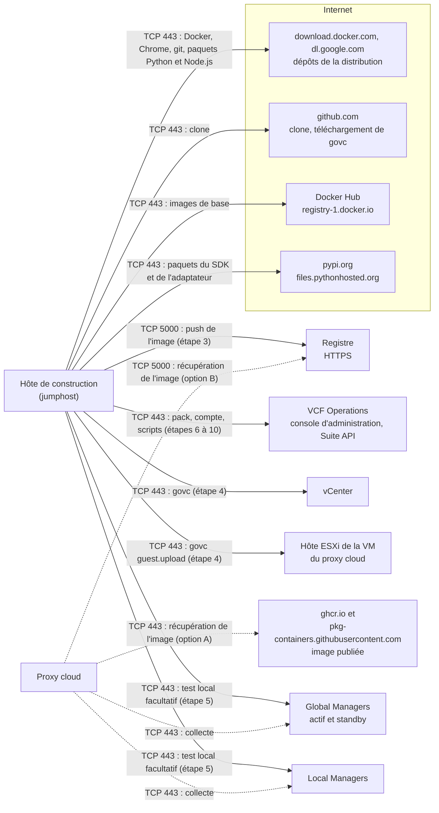
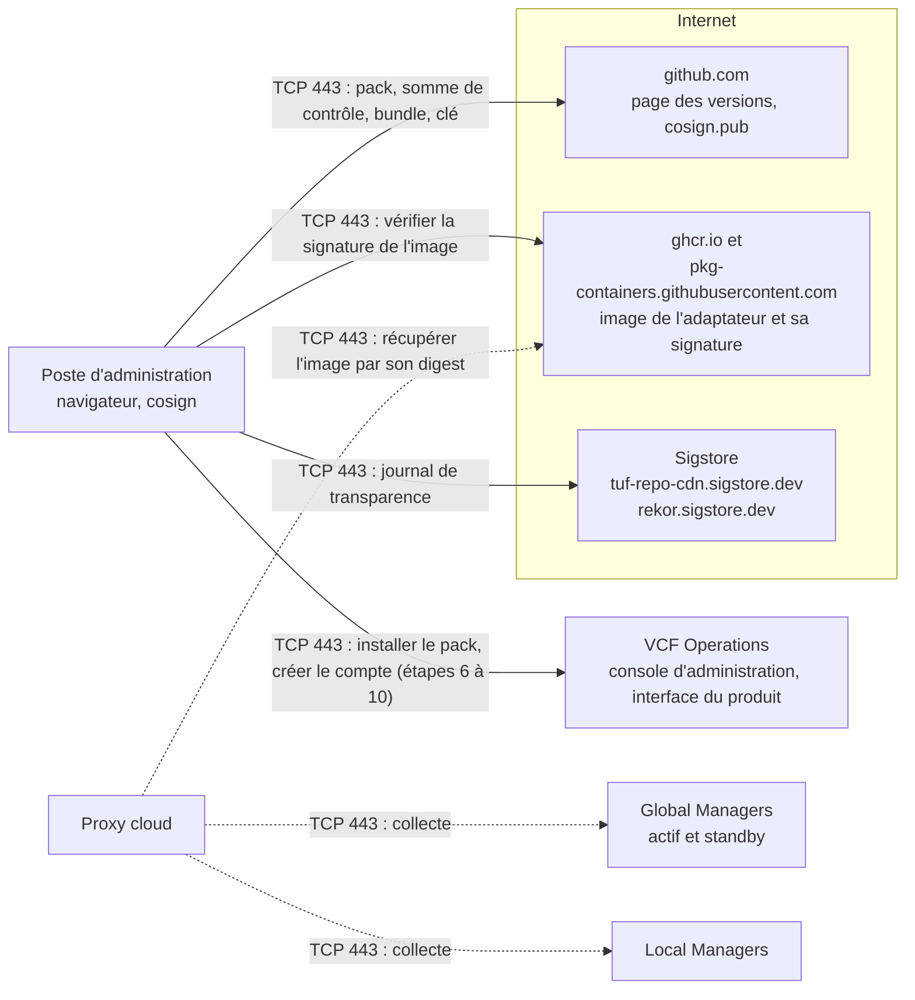
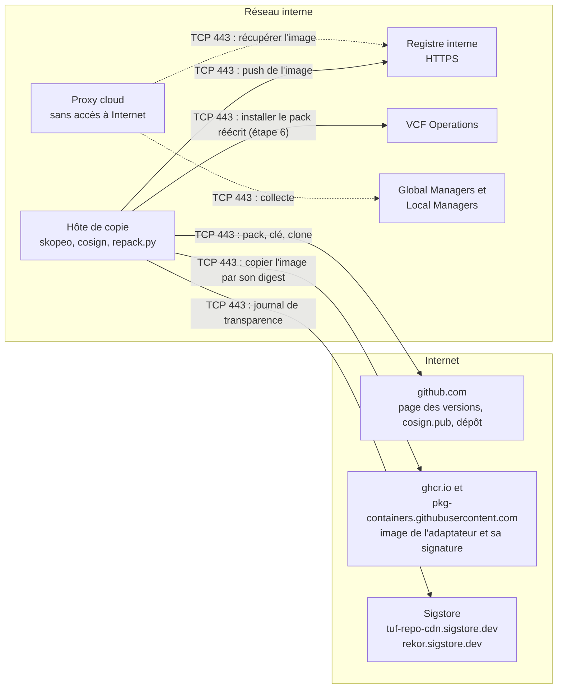

# Guide d'installation

Comment installer le pack NSX Federation dans VCF Operations 9.1.1, soit à partir du pack publié, soit à partir de
votre propre build, avec la machine sur laquelle chaque commande s'exécute. L'option B est le mode utilisé dans le
lab. Pour l'option A, les commandes de vérification des signatures ont été exécutées sur la version v1.13.6
publiée (par clé, sans clé, provenance et SBOM), et la variante avec registre interne a été testée avec un
registre local ; chaque section précise ce qui n'a pas été testé. La partie 2 du
[blog](https://sorinplaton.github.io/fr/posts/nsx-federation-management-pack-install/) montre les étapes avec des
captures d'écran.

English version: [INSTALL.md](INSTALL.md).

## Choisir un mode d'installation

Il existe cinq façons de mettre en place le pack et l'image de son adaptateur :

- [Option A, télécharger le pack publié](#option-a--télécharger-le-pack-publié) : la voie la plus rapide, pour
  un site dont le proxy cloud joint `ghcr.io`. Rien à construire.
- [Option A avec la variante registre interne](#variante--copier-limage-dans-un-registre-interne) : pour un site
  dont le proxy cloud n'a pas accès à Internet, ou dont les images doivent être analysées et servies par un
  registre interne. Toujours aucun build.
- [Option B, construire le pack](#1-prérequis) : pour qui modifie le pack, veut le construire à partir des
  sources, ou exploite un lab avec son propre registre sur l'hôte de construction.
- [La variante Harbor de l'option B](#variante--un-registre-harbor-existant) : le même build, avec un push de
  l'image vers un Harbor existant à la place du petit registre de l'étape 2.
- [Installation en entreprise avec Docker Hub et Artifactory](INSTALL-ENTERPRISE.fr.md) : pour une organisation
  dont l'Artifactory récupère les images publiques sur Docker Hub. Le pack et l'image de son adaptateur viennent
  de Docker Hub via Artifactory, sont vérifiés, analysés et copiés dans un dépôt d'images approuvées. Ce mode a
  son propre guide.

Tous les modes installent le même pack et se rejoignent à l'étape 6.

Le fichier `.pak` contient le contenu du pack (modèle d'objets, alertes, tableaux de bord) et l'adresse de
l'image de l'adaptateur. L'adaptateur lui-même est une image de conteneur que le proxy cloud récupère au
démarrage du compte. L'image n'est pas dans le `.pak` : le proxy cloud la télécharge avec Docker depuis le
registre que désigne le pack. Ce registre doit donc être joignable par le proxy cloud, en HTTPS, avec un
certificat auquel le proxy cloud fait confiance. Si le téléchargement échoue, le pack s'installe quand même,
mais le compte ne collecte jamais (l'étape 8 décrit le symptôme). Les modes ne diffèrent que par l'origine de
cette image.

| | Option A : télécharger le pack publié | Option A, variante avec registre interne | Option B : construire le pack |
| --- | --- | --- | --- |
| Image de l'adaptateur | Publique, sur `ghcr.io/sorinplaton/nsxfederation`, récupérée par son digest | L'image publiée, copiée par vos soins dans un registre interne | Envoyée par vos soins (push) vers votre propre registre |
| Prérequis | Le proxy cloud joint `ghcr.io` et `pkg-containers.githubusercontent.com` en TCP 443 | Un hôte qui joint à la fois `ghcr.io` et le registre interne, et un registre interne servi en HTTPS auquel le proxy cloud fait confiance | Un hôte de construction avec Docker, et un registre servi en HTTPS auquel le proxy cloud fait confiance |
| Étapes | [Option A](#option-a--télécharger-le-pack-publié), puis les étapes 6 à 10 | [Option A](#option-a--télécharger-le-pack-publié) avec sa [variante](#variante--copier-limage-dans-un-registre-interne), puis les étapes 6 à 10 | Étapes 1 à 10, ou la variante Harbor à la place des étapes 2 à 4 |
| Cas d'usage | Le proxy cloud a accès à Internet | Le proxy cloud n'a pas accès à Internet, ou les images doivent être analysées et servies par un registre interne, et le pack publié est utilisé tel quel | Le pack est modifié ou doit être construit à partir des sources, ou un lab exploite son propre registre sur l'hôte de construction. Convient aussi à un proxy cloud sans accès à Internet |

Chaque mode demande l'option « Allow unsigned PAK installation » le temps de l'installation. VCF Operations
cherche une signature Broadcom dans un `.pak`, et ce pack n'en a pas (KB 415279).
Le pack publié est signé avec cosign par ce projet, ce qui est une autre signature : elle permet à la personne
qui installe de vérifier l'origine du fichier, et VCF Operations ne la lit pas. L'option reste donc nécessaire
même pour un pack dont la signature cosign a été vérifiée.

## Où chaque élément s'exécute

| Machine | Rôle |
| --- | --- |
| Hôte de construction | Option B seulement. Un hôte Linux avec Docker, `git` et Python 3. Il construit le pack et fait le push de l'image de l'adaptateur vers le registre. Dans le lab, c'est le jumphost, qui héberge aussi le registre |
| Registre | Option A : `ghcr.io`, exploité par GitHub. Variante avec registre interne : un registre interne. Option B : un registre d'images servi en HTTPS, joignable par le proxy cloud. Le proxy cloud ne se replie pas sur HTTP |
| Proxy cloud | Le collecteur VCF Operations qui exécute le conteneur de l'adaptateur. Il récupère l'image depuis le registre |
| VCF Operations | Console d'administration (`https://<ops>/admin`) et interface du produit (`https://<ops>/`) |
| NSX | Les Global Managers (actif et standby) et les Local Managers d'une fédération |

## Accès réseau

Ouvrir ces flux avant de commencer : un flux bloqué se révèle tard, par un build qui ne peut pas télécharger un
paquet ou par un compte qui reste `FAILED`. Le schéma ci-dessous est celui de l'option B : ce que l'hôte de
construction (le jumphost dans le lab) doit joindre, et les flux du proxy cloud dont dépend l'installation. Les
traits pleins partent de l'hôte de construction ; les pointillés sont ceux du proxy cloud. L'option A et sa
variante ont chacune leur schéma dans leur section, et le tableau couvre les trois cas.

Avec l'option A, seuls les flux du proxy cloud vers `ghcr.io`, `pkg-containers.githubusercontent.com` et NSX
sont nécessaires, plus un navigateur qui joint VCF Operations. Avec la variante, le proxy cloud joint le
registre interne et NSX, et seul l'hôte de copie accède à Internet.



| Depuis | Vers | Port | Usage |
| --- | --- | --- | --- |
| Hôte de construction | Internet (dépôts Docker, Google Chrome et de la distribution, GitHub, Docker Hub, PyPI) | TCP 443 | Installation des outils, clone du dépôt, build des images d'outillage et de l'adaptateur. Via un proxy si le site en utilise un |
| Hôte de construction | Registre | TCP 5000, ou le port du registre | Push de l'image de l'adaptateur. En local quand le registre tourne sur l'hôte de construction, comme dans le lab |
| Hôte de construction | VCF Operations | TCP 443 | Console d'administration et interface du produit dans un navigateur, Suite API pour les scripts des étapes 6 à 10 |
| Hôte de construction | vCenter de la VM du proxy cloud | TCP 443 | Opérations invité `govc` de l'étape 4. Inutile si le certificat est copié par SSH |
| Hôte de construction | Hôte ESXi de la VM du proxy cloud | TCP 443 | `govc guest.upload` envoie le fichier à l'hôte ESXi, pas au vCenter |
| Hôte de construction | Global Managers et Local Managers | TCP 443 | Seulement pour le test facultatif de l'étape 5 |
| Poste d'administration (option A) ou hôte de copie | `github.com` et `raw.githubusercontent.com` | TCP 443 | Téléchargement du pack, de sa somme de contrôle, de son bundle, de `cosign.pub` et de cosign. L'hôte de copie clone aussi le dépôt |
| Poste d'administration (option A) ou hôte de copie | `ghcr.io` et `pkg-containers.githubusercontent.com` | TCP 443 | Vérification de la signature de l'image. L'hôte de copie y prend aussi l'image |
| Poste d'administration (option A) ou hôte de copie | Sigstore (`tuf-repo-cdn.sigstore.dev`, `rekor.sigstore.dev`) | TCP 443 | Le journal de transparence, pour la vérification des signatures seulement |
| Poste d'administration (option A) ou hôte de copie | VCF Operations | TCP 443 | Installation du pack et création du compte (étapes 6 à 10) |
| Hôte de copie | Registre interne | TCP 443, ou le port du registre | Variante avec registre interne : push de l'image copiée |
| Proxy cloud | Registre | TCP 5000, ou le port du registre | Option B et variante avec registre interne : récupération de l'image de l'adaptateur |
| Proxy cloud | `ghcr.io` et `pkg-containers.githubusercontent.com` | TCP 443 | Option A : récupération de l'image publiée de l'adaptateur. `ghcr.io` répond aux appels du registre et redirige les couches de l'image vers `pkg-containers.githubusercontent.com`. Via le proxy du site si le proxy cloud en utilise un |
| Proxy cloud | Global Managers et Local Managers | TCP 443 | Collecte |

Valeurs à remplacer :

| Valeur | Exemple |
| --- | --- |
| `$IP`, `$VERSION`, `$OPS_HOST` et les autres variables | Valeurs du fichier de paramètres `~/fedmp.env` (étape 1) |
| `<ops>` | Le nom d'hôte de VCF Operations, dans les étapes faites au navigateur |
| `<gm1>`, `<gm2>` | Adresse de cluster du Global Manager actif et du standby |

## Liste de contrôle

Option B. Avec l'option A ou sa variante, suivre la liste de contrôle de
l'[option A](#option-a--télécharger-le-pack-publié).

- [ ] 1. Prérequis vérifiés, outils de l'hôte de construction installés, fichier de paramètres rempli
- [ ] 2. Registre servi en HTTPS
- [ ] 3. Pack construit, push de l'image fait, adresse du registre vérifiée dans le pack
- [ ] 4. Le proxy cloud fait confiance au certificat du registre
- [ ] 5. Facultatif : collecte testée sans VCF Operations
- [ ] 6. Pack non signé installé, option à nouveau désactivée
- [ ] 7. Compte créé, certificats acceptés
- [ ] 8. Compte à l'état « Collecting », métriques présentes après trois cycles
- [ ] 9. Facultatif : groupe par fédération
- [ ] 10. Facultatif : alertes envoyées par e-mail, à un webhook ou à un outil de tickets

## Option A : télécharger le pack publié

À utiliser à la place des étapes 1 à 5 quand le proxy cloud a accès à Internet. Ni hôte de construction, ni
Docker, ni registre à soi. Quand le proxy cloud n'a pas accès à Internet, ou que les images doivent venir d'un
registre interne, ajouter la [variante](#variante--copier-limage-dans-un-registre-interne) décrite à la fin de
cette section.

Testé à ce jour : le téléchargement et toutes les commandes de « Vérifier les signatures » ci-dessous, sur la
version v1.13.5 publiée. La récupération de l'image depuis `ghcr.io` par le proxy cloud n'est pas encore testée
dans le lab, qui utilise l'option B.

Flux réseau de ce mode. Les traits pleins partent du poste d'administration ; les traits pointillés sont ceux
du proxy cloud. Le flux vers Sigstore ne sert qu'à la vérification des signatures.



- [ ] VCF Operations 9.1.1 avec au moins un proxy cloud à l'état `UP`, qui joint `ghcr.io` et
      `pkg-containers.githubusercontent.com` en TCP 443, directement ou via le proxy du site. Les règles de
      pare-feu demandent les deux noms : les couches de l'image viennent du second. Avec la variante, le proxy
      cloud joint le registre interne à la place.
- [ ] NSX 9.1 Federation et un compte NSX en lecture seule, comme à l'étape 1.
- [ ] Le proxy cloud joint chaque manager NSX en TCP 443.
- [ ] Mot de passe admin de VCF Operations, et l'approbation de changement pour l'option des packs non signés
      si l'organisation l'exige.
- [ ] Pack téléchargé, somme de contrôle vérifiée, signatures vérifiées (recommandé).
- [ ] Variante seulement : image copiée dans le registre interne, pack pointant vers ce registre.
- [ ] Puis les étapes 6 à 10.

*À exécuter sur : n'importe quelle machine dont le navigateur joint VCF Operations.* Télécharger le pack et sa
somme de contrôle depuis la [page des versions](https://github.com/sorinplaton/vcf-ops-nsx-federation-mp/releases/latest),
ou avec les commandes ci-dessous. La dernière calcule le SHA-256 du fichier téléchargé et le compare à la
valeur publiée. Résultat attendu : `NSXFederation_1.13.0.pak: OK`. Toute autre réponse signifie que le
téléchargement est abîmé ou incomplet ; le refaire.

```bash
curl -LO https://github.com/sorinplaton/vcf-ops-nsx-federation-mp/releases/download/v1.13.7/NSXFederation_1.13.0.pak
curl -LO https://github.com/sorinplaton/vcf-ops-nsx-federation-mp/releases/download/v1.13.7/NSXFederation_1.13.0.pak.sha256
sha256sum -c NSXFederation_1.13.0.pak.sha256
```

Le pack désigne l'image `ghcr.io/sorinplaton/nsxfederation` par son digest : le proxy cloud exécute toujours
l'image avec laquelle le pack a été construit. L'image est publique : le proxy cloud la récupère sans
identifiant, et il fait déjà confiance au certificat de `ghcr.io`, sans étape 4.

Vérification facultative, *sur le proxy cloud* si SSH y est activé. Elle indique, avant l'installation, si le
proxy cloud peut joindre les deux hôtes d'où vient l'image. Tout code HTTP signifie que l'hôte est joignable
(`401` et `400` sont les réponses attendues) ; `000` signifie qu'il ne l'est pas, et le compte de l'étape 8
resterait `FAILED` :

```bash
curl -s -o /dev/null -w '%{http_code}\n' https://ghcr.io/v2/
curl -s -o /dev/null -w '%{http_code}\n' https://pkg-containers.githubusercontent.com/
```

### Pourquoi le proxy cloud accède à Internet

L'adaptateur est une image de conteneur que le proxy cloud récupère au démarrage du compte. Le `.pak` ne
contient que le contenu du pack et l'adresse de cette image, comme l'explique
[Choisir un mode d'installation](#choisir-un-mode-dinstallation). Avec l'option A, le pack désigne `ghcr.io`,
et le proxy cloud télécharge donc l'image depuis Internet.

Ce téléchargement est le seul trafic Internet du proxy cloud. Il va vers `ghcr.io` et
`pkg-containers.githubusercontent.com` en TCP 443 : `ghcr.io` répond aux appels du registre et redirige vers
le second hôte le téléchargement des couches de l'image. La collecte reste sur le réseau local, entre
l'adaptateur, les managers NSX et VCF Operations, et aucune donnée de supervision ne quitte le site. Les
vérifications de signature ci-dessous s'exécutent sur la machine qui a téléchargé le pack, pas sur le proxy
cloud.

Le proxy cloud récupère l'image au premier démarrage du compte, puis de nouveau après un redéploiement ou un
upgrade du proxy cloud, car sa copie locale a disparu. Un éventuel contact avec `ghcr.io` à chaque redémarrage
du compte, quand l'image est encore sur le disque, n'a pas été testé. Prévoir l'accès à chaque démarrage de
l'adaptateur.

Pour que le proxy cloud n'accède pas à Internet, utiliser la
[variante de copie](#variante--copier-limage-dans-un-registre-interne) : une machine qui accède à Internet
copie une fois l'image dans un registre interne, le pack est pointé vers ce registre, et le proxy cloud ne joint
alors que ce registre. L'[option B](#1-prérequis) donne le même résultat avec son propre build.

### Vérifier les signatures (recommandé)

À partir de la version `v1.13.3`, le workflow de publication sur GitHub signe le pack et les images sans clé
(« keyless ») : la signature porte un certificat qui nomme le workflow et le tag qui les ont construits, et la
vérification compare ce nom à la place d'une clé publique.
[Vérification sans clé](#vérification-sans-clé-versions-à-partir-de-v1133) ci-dessous donne les commandes. Les
versions jusqu'à `v1.13.2` sont signées avec la clé du projet, comme décrit d'abord.

Le pack et l'image de son adaptateur sont signés avec [cosign](https://docs.sigstore.dev/cosign/) (Sigstore). La
somme de contrôle prouve seulement que le téléchargement est complet ; elle se trouve à côté du pack, sur la
même page de version, et quiconque pourrait y remplacer le pack pourrait aussi remplacer la somme. Les
signatures prouvent que le pack et l'image ont été produits par le détenteur de la clé privée de ce projet, et
qu'ils n'ont pas changé depuis. Vérifier les deux avant l'installation, et de nouveau à chaque nouvelle version.

La clé publique est `cosign.pub`, à la racine de ce dépôt et sur la page de version. La prendre dans le dépôt
et garder cette copie pour les versions suivantes : une clé téléchargée au même endroit que le pack prouve moins.
La première commande ci-dessous récupère la clé, la seconde le bundle, qui est la signature du pack.

```bash
curl -LO https://raw.githubusercontent.com/sorinplaton/vcf-ops-nsx-federation-mp/main/cosign.pub
curl -LO https://github.com/sorinplaton/vcf-ops-nsx-federation-mp/releases/download/v1.13.7/NSXFederation_1.13.0.pak.bundle
```

**Installer cosign.** *À exécuter sur : la machine qui a téléchargé le pack (Linux, x86-64).* Choisir l'une des
trois méthodes ci-dessous ; la dernière ligne affiche la version et confirme que l'installation a réussi.

```bash
# Ubuntu ou Debian
curl -LO https://github.com/sigstore/cosign/releases/download/v2.4.1/cosign_2.4.1_amd64.deb
sudo dpkg -i cosign_2.4.1_amd64.deb

# RHEL, Rocky Linux ou AlmaLinux
curl -LO https://github.com/sigstore/cosign/releases/download/v2.4.1/cosign-2.4.1-1.x86_64.rpm
sudo rpm -ivh cosign-2.4.1-1.x86_64.rpm

# Tout Linux : le binaire seul
curl -LO https://github.com/sigstore/cosign/releases/download/v2.4.1/cosign-linux-amd64
sudo install -m 0755 cosign-linux-amd64 /usr/local/bin/cosign

cosign version
```

Les [versions de cosign](https://github.com/sigstore/cosign/releases) contiennent aussi les builds macOS et
Windows et un `cosign_checksums.txt` pour les téléchargements. Sans rien installer, Docker peut exécuter la même
version : `sudo docker run --rm -v $PWD:/w -w /w -u $(id -u) -e HOME=/tmp ghcr.io/sigstore/cosign/cosign:v2.4.1 <commande>`.

**Vérifier le pack.** Lancer la commande dans le dossier qui contient le pack, le bundle et la clé. cosign
contrôle la signature du bundle par rapport au fichier et à la clé publique. Résultat attendu : `Verified OK`.

```bash
cosign verify-blob --key cosign.pub --bundle NSXFederation_1.13.0.pak.bundle NSXFederation_1.13.0.pak
```

**Vérifier l'image que désigne le pack.** Le pack est un fichier zip qui en contient un second, `adapter.zip`,
dont le fichier `.conf` donne le registre, le dépôt et le digest de l'image. Les deux premières lignes y lisent
le digest, et la troisième demande à cosign de vérifier la signature stockée à côté de cette image sur
`ghcr.io`. Résultat attendu : « The signatures were verified against the specified public key ».

```bash
unzip -p NSXFederation_1.13.0.pak adapter.zip > /tmp/adapter.zip
DIGEST=$(unzip -p /tmp/adapter.zip '*.conf' | sed -n 's/^DIGEST=//p')
cosign verify --key cosign.pub ghcr.io/sorinplaton/nsxfederation@$DIGEST
```

Les deux commandes accèdent à Internet : `ghcr.io` pour la signature de l'image, et les serveurs Sigstore
(`tuf-repo-cdn.sigstore.dev`, `rekor.sigstore.dev`) pour le journal de transparence public où chaque signature est
enregistrée. Une vérification en échec signifie que le fichier ou l'image n'est pas celui qui a été signé : ne
pas l'installer.

#### Vérification sans clé (versions à partir de v1.13.3)

Les deux mêmes vérifications, avec l'identité du workflow de publication à la place de `cosign.pub`. Définir la
version une fois ; la signature doit nommer exactement ce dépôt, ce workflow et ce tag, avec GitHub Actions pour
émetteur. Les notes de version sur GitHub donnent les mêmes valeurs. Le bundle du pack est le fichier
`.sigstore.json` de la version.

```bash
RELEASE=1.13.7
SIGNER="https://github.com/sorinplaton/vcf-ops-nsx-federation-mp/.github/workflows/release.yml@refs/tags/v$RELEASE"
ISSUER=https://token.actions.githubusercontent.com
curl -LO https://github.com/sorinplaton/vcf-ops-nsx-federation-mp/releases/download/v$RELEASE/NSXFederation_1.13.0.pak.sigstore.json

cosign verify-blob --certificate-identity "$SIGNER" --certificate-oidc-issuer "$ISSUER" \
  --bundle NSXFederation_1.13.0.pak.sigstore.json NSXFederation_1.13.0.pak
unzip -p NSXFederation_1.13.0.pak adapter.zip > /tmp/adapter.zip
DIGEST=$(unzip -p /tmp/adapter.zip '*.conf' | sed -n 's/^DIGEST=//p')
cosign verify --certificate-identity "$SIGNER" --certificate-oidc-issuer "$ISSUER" ghcr.io/sorinplaton/nsxfederation@$DIGEST
```

Remplacer `1.13.0` par la version du pack dans les noms de fichiers de cette version. Résultat attendu :
`Verified OK`, puis la liste des contrôles faits par cosign. Les commandes joignent les mêmes hôtes que la
vérification par clé. Testé sur `v1.13.3`, la première version signée sans clé, le 2026-11-26.

#### Facultatif : provenance de construction et SBOM (versions à partir de v1.13.5)

À partir de `v1.13.5`, le pack et les deux images portent aussi une attestation de provenance de construction
SLSA : un enregistrement signé du commit, du workflow et du runner qui les ont construits. La CLI GitHub la
vérifie ; elle joint `api.github.com`. L'image de l'adaptateur porte aussi son SBOM sous forme d'attestation
signée, que cosign vérifie et affiche :

```bash
gh attestation verify NSXFederation_1.13.0.pak -R sorinplaton/vcf-ops-nsx-federation-mp \
  --signer-workflow sorinplaton/vcf-ops-nsx-federation-mp/.github/workflows/release.yml
gh attestation verify oci://ghcr.io/sorinplaton/nsxfederation@$DIGEST -R sorinplaton/vcf-ops-nsx-federation-mp
cosign verify-attestation --type cyclonedx --certificate-identity "$SIGNER" --certificate-oidc-issuer "$ISSUER" \
  ghcr.io/sorinplaton/nsxfederation@$DIGEST > /dev/null && echo "SBOM attestation: verified"
```

Résultat attendu : deux fois `Verification succeeded!`, puis `SBOM attestation: verified`. La version contient
aussi le rapport Trivy de l'image de l'adaptateur, `NSXFederation_<version>.trivy.txt`. Testé sur `v1.13.5`, la
première version qui les porte, le 2026-11-26.

Une fois la somme de contrôle et les deux signatures validées, installer le pack avec l'étape 6, à la main ou
par script, puis continuer avec les étapes 7 à 10. Les scripts demandent un hôte Linux avec un clone de ce
dépôt, le fichier de paramètres de l'étape 1 et les outils listés dans
[Outils pour certaines étapes](#outils-pour-certaines-étapes). Avec la variante, appliquer d'abord la variante
ci-dessous, avant l'étape 6.

### Variante : copier l'image dans un registre interne

Pour une entreprise qui ne laisse pas le proxy cloud accéder à Internet, ou qui analyse chaque image avant
usage : copier l'image publiée dans un registre interne et y faire pointer le pack publié. Ni hôte de
construction ni SDK, le proxy cloud ne dépend que du registre interne, et l'image peut y être analysée avant
usage. L'image est copiée à l'identique et garde son digest : c'est toujours l'image que le projet a signée.
Testée dans le lab avec un `registry:2` local ; pas testée avec Harbor.

Flux réseau de cette variante. Seul l'hôte de copie accède à Internet. Le proxy cloud ne parle qu'au registre
interne et à NSX.



*À exécuter sur : un hôte Linux qui joint à la fois `ghcr.io` et le registre interne*, appelé ici l'hôte de
copie. Il lui faut [skopeo](https://github.com/containers/skopeo) (`sudo apt-get install -y skopeo` ou `sudo dnf install -y skopeo`),
qui copie une image d'un registre à un autre, cosign (installé comme ci-dessus), ainsi que `git`, `python3` et
`unzip`, pris dans les paquets de la distribution. Le registre interne demande la même préparation que dans
[Variante : un registre Harbor existant](#variante--un-registre-harbor-existant) : un projet public, un compte
qui a le droit de push sur ce projet, et un certificat auquel le proxy cloud fait confiance.

Préparer l'hôte de copie une fois. Le clone apporte `tools/repack.py`, et le fichier de paramètres donne aux
commandes l'adresse du registre interne et le compte de push :

```bash
cd ~
git clone https://github.com/sorinplaton/vcf-ops-nsx-federation-mp.git
cp vcf-ops-nsx-federation-mp/install/fedmp.env.example ~/fedmp.env && chmod 600 ~/fedmp.env
nano ~/fedmp.env
```

Dans `~/fedmp.env`, retirer le `#` devant les quatre lignes `HARBOR` et les remplir : `HARBOR` est l'adresse du
registre interne, `HARBOR_PROJECT` le projet, `HARBOR_USER` et `HARBOR_PW` le compte qui a le droit de push. Les
variables portent le nom de Harbor, et les commandes s'en servent pour n'importe quel registre. Remplir aussi
`OPS_HOST` et `OPS_PW` si l'installation par script de l'étape 6 doit partir de cet hôte. Les autres lignes
peuvent garder leurs valeurs d'exemple. [Le fichier de paramètres](#le-fichier-de-paramètres) décrit le fichier
et la ligne qui le charge.

Ensuite, dans le dossier qui contient le pack téléchargé :

1. Vérifier les signatures du pack et de l'image, comme ci-dessus. Le faire d'abord : le point 3 modifie le
   pack, sa somme de contrôle et sa signature ne correspondent plus ensuite.
2. Copier l'image par son digest. Les premières lignes relisent le digest dans le pack, pour que le bloc
   fonctionne aussi dans un nouveau shell. `--all` copie l'image exactement telle qu'elle a été publiée, et
   `--preserve-digests` fait s'arrêter skopeo plutôt que de changer le digest que désigne le pack :

   ```bash
   set -a; source ~/fedmp.env; set +a
   unzip -p NSXFederation_1.13.0.pak adapter.zip > /tmp/adapter.zip
   DIGEST=$(unzip -p /tmp/adapter.zip '*.conf' | sed -n 's/^DIGEST=//p')
   skopeo copy --all --preserve-digests --dest-creds "$HARBOR_USER:$HARBOR_PW" \
     docker://ghcr.io/sorinplaton/nsxfederation@$DIGEST \
     docker://$HARBOR/$HARBOR_PROJECT/nsxfederation:1.13.0
   ```

   Pour pouvoir vérifier l'image plus tard depuis le registre interne, copier aussi sa signature, dans le même
   shell : `cosign copy ghcr.io/sorinplaton/nsxfederation@$DIGEST $HARBOR/$HARBOR_PROJECT/nsxfederation` (après
   `docker login $HARBOR`).
3. Faire pointer le pack vers le registre interne. `repack.py` réécrit les lignes `REGISTRY` et `REPOSITORY` à
   l'intérieur du pack, sans créer d'autre fichier. Seuls le registre et le dépôt changent ; le digest reste.
   Les deux lignes `unzip` affichent le résultat :

   ```bash
   set -a; source ~/fedmp.env; set +a
   python3 ~/vcf-ops-nsx-federation-mp/tools/repack.py NSXFederation_1.13.0.pak $HARBOR $HARBOR_PROJECT/nsxfederation
   unzip -p NSXFederation_1.13.0.pak adapter.zip > /tmp/adapter.zip
   unzip -p /tmp/adapter.zip '*.conf' | grep -E '^(REGISTRY|REPOSITORY|DIGEST)='
   ```

   Attendu : `REGISTRY` est le registre interne, `REPOSITORY` vaut `/<projet>/nsxfederation`, et `DIGEST` est la
   valeur du point 2.
4. Analyser l'image dans le registre interne si l'organisation l'exige, puis installer le pack réécrit avec
   l'étape 6 et continuer avec les étapes 7 à 10. Le proxy cloud n'a besoin que du registre interne, pas de
   `ghcr.io`.

## 1. Prérequis

Les étapes 1 à 5 concernent l'option B. Elles préparent un hôte de construction, un registre et un pack
construit à partir des sources.

- [ ] VCF Operations 9.1.1 avec au moins un proxy cloud à l'état `UP`.
- [ ] NSX 9.1 Federation. Un compte NSX en lecture seule sur chaque Global Manager et chaque Local Manager ;
      le compte intégré `audit` convient. Un identifiant distinct pour les Local Managers est facultatif.
- [ ] Réseau : du proxy cloud vers chaque manager NSX en TCP 443, du proxy cloud vers le registre sur son port,
      de l'hôte de construction vers le registre.
- [ ] Mot de passe admin de VCF Operations : l'option des packs non signés se trouve dans la console
      d'administration.
- [ ] Une approbation de changement pour activer « Allow unsigned PAK installation » le temps de
      l'installation, si l'organisation l'exige. Le pack n'est pas signé par Broadcom (KB 415279).
- [ ] Outils de l'hôte de construction : Docker Engine, `git`, `unzip` et Python 3 avec `requests`, installés
      comme ci-dessous. Pour certaines étapes, également `govc` (étape 4), Node.js 22 ou ultérieur et Google
      Chrome (installation par script de l'étape 6).
- [ ] Le fichier de paramètres `~/fedmp.env`, rempli comme ci-dessous.

### Outils de l'hôte de construction

*À exécuter sur : l'hôte de construction.* Docker construit l'image d'outillage et l'image de l'adaptateur, et
fait tourner le registre de l'étape 2. `git` clone le dépôt, `unzip` lit le pack, et les scripts d'installation
sont écrits en Python avec le module `requests`. Docker vient du dépôt Docker plutôt que des paquets de la
distribution, afin que `docker build` utilise BuildKit. Les commandes Ubuntu de cette section ont été exécutées
sur un hôte Ubuntu 26.04 vierge ; celles pour RHEL n'ont pas été testées dans le lab.

Ubuntu ou Debian (sur Debian, remplacer `ubuntu` par `debian` dans les deux URL). Le bloc installe les paquets
de base, ajoute la clé de signature et la source de paquets de Docker, puis installe Docker depuis cette
source :

```bash
sudo apt-get update
sudo apt-get install -y ca-certificates curl git unzip python3 python3-requests
sudo install -m 0755 -d /etc/apt/keyrings
sudo curl -fsSL https://download.docker.com/linux/ubuntu/gpg -o /etc/apt/keyrings/docker.asc
sudo chmod a+r /etc/apt/keyrings/docker.asc
echo "deb [arch=$(dpkg --print-architecture) signed-by=/etc/apt/keyrings/docker.asc] \
https://download.docker.com/linux/ubuntu $(. /etc/os-release && echo "$VERSION_CODENAME") stable" \
  | sudo tee /etc/apt/sources.list.d/docker.list > /dev/null
sudo apt-get update
sudo apt-get install -y docker-ce docker-ce-cli containerd.io docker-buildx-plugin
```

RHEL, Rocky Linux ou AlmaLinux 8 et versions ultérieures :

```bash
sudo dnf install -y dnf-plugins-core git unzip python3 python3-requests
sudo dnf config-manager --add-repo https://download.docker.com/linux/rhel/docker-ce.repo
sudo dnf install -y docker-ce docker-ce-cli containerd.io docker-buildx-plugin
```

Dans les deux cas, démarrer Docker et l'activer à chaque démarrage du système. Les commandes `docker` de ce
guide sont préfixées par `sudo` : l'utilisateur de construction n'a donc pas besoin d'être membre du groupe
`docker`.

```bash
sudo systemctl enable --now docker
```

Vérification. La première commande récupère une image de test sur Docker Hub et l'exécute, ce qui prouve que
Docker fonctionne et accède à Internet ; elle affiche « Hello from Docker! ». La dernière n'affiche rien quand
`requests` est installé :

```bash
sudo docker run --rm hello-world
git --version
python3 --version         # 3.8 ou ultérieure
python3 -c "import requests"
```

### Outils pour certaines étapes

`govc` est le client en ligne de commande de vCenter. L'étape 4 s'en sert pour copier le certificat du registre
dans la VM du proxy cloud. L'ignorer quand cette copie passe par SSH. La dernière ligne affiche la version :

```bash
curl -fsSL "https://github.com/vmware/govmomi/releases/latest/download/govc_$(uname -s)_$(uname -m).tar.gz" \
  | sudo tar -C /usr/local/bin -xzf - govc
govc version
```

Node.js 22 ou ultérieur et Google Chrome servent à l'installation par script de l'étape 6 : les scripts
pilotent un Chrome headless depuis Node.js, et ils utilisent le client WebSocket intégré à Node.js à partir de
la version 22. Les ignorer pour l'installation à la main. Ubuntu 26.04 fournit Node.js 22 ; sur une version plus
ancienne, prendre Node.js 22 sur [nodejs.org](https://nodejs.org/en/download) :

```bash
sudo apt-get install -y nodejs
curl -fsSLO https://dl.google.com/linux/direct/google-chrome-stable_current_amd64.deb
sudo apt-get install -y ./google-chrome-stable_current_amd64.deb && rm google-chrome-stable_current_amd64.deb
node --version            # v22 ou ultérieure
google-chrome --version
```

RHEL, Rocky Linux ou AlmaLinux 9 :

```bash
sudo dnf module install -y nodejs:22
sudo dnf install -y https://dl.google.com/linux/direct/google-chrome-stable_current_x86_64.rpm
```

### Le fichier de paramètres

Les adresses, les noms et les mots de passe dont les commandes ont besoin sont dans un seul fichier,
`~/fedmp.env`. Les commandes de ce guide ne contiennent alors ni adresse ni mot de passe, et se collent telles
quelles. Cloner le dépôt, copier l'exemple, le remplir, et le rendre lisible par son seul propriétaire :

```bash
cd ~
git clone https://github.com/sorinplaton/vcf-ops-nsx-federation-mp.git
cp vcf-ops-nsx-federation-mp/install/fedmp.env.example ~/fedmp.env && chmod 600 ~/fedmp.env
nano ~/fedmp.env
```

| Variable | Usage |
| --- | --- |
| `IP` | L'adresse de l'hôte de construction que le proxy cloud utilise pour joindre le registre (étapes 2 à 4) |
| `VERSION` | La version du pack, comme dans `pack/manifest.txt` |
| `OPS_HOST`, `OPS_PW` | VCF Operations et son mot de passe admin (étapes 6 à 10) |
| `OPS_INSECURE` ou `OPS_CA` | Seulement quand VCF Operations présente un certificat auquel l'hôte de construction ne fait pas confiance : `OPS_CA` désigne le fichier de l'autorité ; `OPS_INSECURE=1` désactive la vérification (lab seulement). Sans l'un des deux, les scripts des étapes 6, 9 et 10 s'arrêtent sur `CERTIFICATE_VERIFY_FAILED` |
| `GOVC_URL`, `GOVC_USERNAME`, `GOVC_PASSWORD` | Le vCenter qui héberge la VM du proxy cloud (étape 4) |
| `PROXY_VM`, `PROXY_ROOT_PW` | Le nom de la VM du proxy cloud et son mot de passe root (étape 4) |
| `GM_HOSTS`, `NSX_USER`, `NSX_PASSWORD` | Les Global Managers et le compte NSX en lecture seule (étape 5) |
| `HARBOR`, `HARBOR_PROJECT`, `HARBOR_USER`, `HARBOR_PW` | Seulement pour la variante Harbor et la variante avec registre interne. En commentaire dans l'exemple : retirer le `#` pour s'en servir |

Chaque bloc de commandes qui a besoin de ces valeurs commence par la ligne qui charge le fichier et les
exporte :

```bash
set -a; source ~/fedmp.env; set +a
```

`set -a` demande au shell d'exporter toute variable définie à partir de ce point, `source` lit le fichier, et
`set +a` arrête l'export. Sans l'export, les valeurs restent dans le shell, et les scripts et les
conteneurs lancés par les commandes ne les voient pas. Les valeurs durent autant que le shell : un nouveau
terminal demande de relancer la ligne, et un bloc collé sans elle s'exécute avec des adresses vides.

Le fichier contient des mots de passe. Le tenir hors de Git (`fedmp.env` est dans `.gitignore`), et le
supprimer ou le déplacer dans un coffre une fois l'installation terminée.

## 2. Registre en HTTPS

Le proxy cloud a besoin d'un registre où récupérer l'image de l'adaptateur, et il ne la récupère qu'en HTTPS.
Cette étape démarre un petit registre sur l'hôte de construction, avec un certificat créé pour lui. Avec un
registre Harbor existant, passer les étapes 2 à 4 et suivre
[Variante : un registre Harbor existant](#variante--un-registre-harbor-existant).

*À exécuter sur : l'hôte de construction.* Un conteneur `registry:2` avec un certificat autosigné. La commande
`openssl` crée la clé et un certificat valable 825 jours, qui porte l'adresse de `IP`. La commande `docker run`
démarre le registre avec ce certificat sur le port 5000, garde les images dans le volume Docker
`registry-data`, et relance le conteneur après un redémarrage de l'hôte :

```bash
set -a; source ~/fedmp.env; set +a
mkdir -p ~/fedmp-registry/certs && cd ~/fedmp-registry
openssl req -x509 -newkey rsa:2048 -nodes -days 825 \
  -keyout certs/registry.key -out certs/registry.crt -subj "/CN=fedmp-registry" \
  -addext "subjectAltName=IP:$IP,IP:127.0.0.1,DNS:localhost"

sudo docker run -d --name fedmp-registry --restart unless-stopped \
  -p $IP:5000:5000 -p 127.0.0.1:5000:5000 \
  -v registry-data:/var/lib/registry -v $PWD/certs:/certs:ro \
  -e REGISTRY_HTTP_TLS_CERTIFICATE=/certs/registry.crt \
  -e REGISTRY_HTTP_TLS_KEY=/certs/registry.key registry:2
```

Le certificat contient aussi `127.0.0.1` et `localhost`, et le registre écoute également sur l'adresse locale,
parce que l'étape 3 fait le push de l'image vers `localhost:5000`.

Vérification. La commande appelle le registre sur l'adresse que le proxy cloud utilisera et n'accepte que le
certificat qui vient d'être créé : une réponse prouve donc à la fois l'écoute et le certificat. Un registre neuf
répond `{"repositories":[]}` jusqu'au premier push :

```bash
set -a; source ~/fedmp.env; set +a
curl --cacert ~/fedmp-registry/certs/registry.crt https://$IP:5000/v2/_catalog
```

## 3. Construire le pack

*À exécuter sur : l'hôte de construction.* Le premier `docker build` crée `fedmp-tooling`, une image qui
contient les outils du SDK. Le `docker run` lance ensuite `mp-build` depuis cette image : il construit l'image
de l'adaptateur avec le Docker de l'hôte (par le socket monté), en fait le push vers le registre de l'étape 2
et écrit le `.pak`. Le conteneur tourne avec l'ID de l'utilisateur courant et l'ID du groupe `docker` : il peut
ainsi utiliser le socket, et les fichiers qu'il écrit dans le clone appartiennent à l'utilisateur de
construction. Le build télécharge les images de base depuis Docker Hub et les paquets Python depuis PyPI.

```bash
set -a; source ~/fedmp.env; set +a
cd ~/vcf-ops-nsx-federation-mp
sudo docker build -t fedmp-tooling tooling

sudo docker run --rm --network host -u $(id -u):$(getent group docker | cut -d: -f3) -e HOME=$PWD/.sdkhome \
  -v /var/run/docker.sock:/var/run/docker.sock -v $(which docker):/usr/bin/docker -v $PWD:$PWD -w $PWD/pack \
  fedmp-tooling mp-build --no-ttl -r localhost:5000/nsxfederation \
  --registry-username lab --registry-password lab
```

Le résultat est `pack/build/NSXFederation_$VERSION.pak`.

`mp-build` démarre l'adaptateur pour un test sur `127.0.0.1:8080`. Si ce port est pris sur l'hôte de
construction, il échoue avec `Bind for 127.0.0.1:8080 failed: port is already allocated` : ajouter `-P 18080`
(n'importe quel port libre) aux options de `mp-build`. Seul le port de test change ; le pack utilise toujours le
port 443 sur le proxy cloud.

Le push de l'image se fait vers `localhost:5000`. Docker accepte le certificat autosigné d'un registre joint par
l'adresse locale : l'hôte de construction n'a donc pas besoin de son propre dossier de certificat. Le registre
de l'étape 2 ne demande aucune authentification. `mp-build` demande quand même un utilisateur et un mot de
passe, et n'importe quelle valeur convient.

Quand le registre est donné sous la forme `host:port` sans domaine, `mp-build` écrit Docker Hub dans le pack.
Le proxy cloud chercherait alors l'image sur Docker Hub, et le compte échouerait. `repack.py` ouvre le pack et
réécrit deux lignes de la configuration de l'adaptateur, `REGISTRY` et `REPOSITORY`, dans le fichier même ; rien
d'autre ne change. Inscrire dans le pack l'adresse que le proxy cloud utilise, avant l'installation :

```bash
set -a; source ~/fedmp.env; set +a
cd ~/vcf-ops-nsx-federation-mp
python3 tools/repack.py pack/build/NSXFederation_$VERSION.pak $IP:5000 nsxfederation
```

Vérifier l'adresse du registre dans le pack. Les deux lignes extraient la configuration de l'adaptateur et
affichent l'adresse où le proxy cloud ira chercher l'image :

```bash
set -a; source ~/fedmp.env; set +a
cd ~/vcf-ops-nsx-federation-mp
unzip -p pack/build/NSXFederation_$VERSION.pak adapter.zip > /tmp/adapter.zip
unzip -p /tmp/adapter.zip '*.conf' | grep -E '^(REGISTRY|REPOSITORY)='
```

Résultat attendu : `REGISTRY=<IP>:5000`, avec la valeur de `IP`, et `REPOSITORY=/nsxfederation`.

Vérifier que l'image est dans le registre. La réponse donne le dépôt `nsxfederation` et ses tags :

```bash
set -a; source ~/fedmp.env; set +a
curl --cacert ~/fedmp-registry/certs/registry.crt https://$IP:5000/v2/nsxfederation/tags/list
```

## 4. Le proxy cloud fait confiance au certificat du registre

Le certificat de l'étape 2 est autosigné : le proxy cloud le refuse tant qu'on ne lui a pas dit de lui faire
confiance. Sans cette étape, la récupération de l'image échoue et le compte reste `FAILED` (étape 8). Docker,
sur le proxy cloud, fait confiance à un registre privé dont le certificat se trouve dans un dossier qui porte
le nom du registre, port compris. Avec le registre de l'étape 2, c'est :

```
/etc/docker/certs.d/$IP:5000/ca.crt
```

*À exécuter sur : l'hôte de construction*, qui détient le fichier de paramètres et le certificat. Il lui faut
`govc` ([Outils pour certaines étapes](#outils-pour-certaines-étapes)) et l'accès au vCenter qui héberge la VM
du proxy cloud. SSH peut rester désactivé sur le proxy cloud : les opérations d'invité de vCenter écrivent le
fichier avec le compte root de l'appliance. La première commande crée le dossier dans la VM, la seconde y
dépose le certificat sous le nom `ca.crt` :

```bash
set -a; source ~/fedmp.env; set +a
govc guest.mkdir -vm "$PROXY_VM" -l "root:$PROXY_ROOT_PW" -p /etc/docker/certs.d/$IP:5000
govc guest.upload -vm "$PROXY_VM" -l "root:$PROXY_ROOT_PW" -f ~/fedmp-registry/certs/registry.crt \
  /etc/docker/certs.d/$IP:5000/ca.crt
```

*Ou à exécuter sur : le proxy cloud*, si SSH y est activé : créer le dossier et y copier `registry.crt` sous le
nom `ca.crt`.

La preuve que le proxy cloud fait confiance au registre arrive à l'étape 8, quand le compte passe à l'état
« Collecting ».

Une mise à niveau ou un redéploiement du proxy cloud peut supprimer le fichier. Refaire cette étape après
l'un ou l'autre.

Un registre déplacé vers une autre adresse demande un nouveau certificat (étape 2), un pack réécrit (étape 3)
et un nouveau dossier sur le proxy cloud.

Sans Harbor, sauter la section suivante et continuer à l'étape 5, qui est facultative, ou à l'étape 6.

## Variante : un registre Harbor existant

À utiliser à la place des étapes 2 à 4 quand l'environnement dispose déjà de Harbor. Le pack se construit comme
à l'étape 3, et l'image part dans Harbor. Cette variante n'a pas été testée dans le lab, qui utilise le registre
de l'étape 2.

Dans Harbor, une seule fois :

- [ ] Un projet pour l'image, par exemple `nsxfederation`, en accès public. Le proxy cloud récupère l'image
      sans s'authentifier : l'image d'un projet privé ne peut donc pas être récupérée.
- [ ] Un compte qui a le droit de push dans le projet : un compte robot avec le droit push, ou un utilisateur
      avec le rôle Developer.
- [ ] Réseau : de l'hôte de construction et du proxy cloud vers Harbor en TCP 443.

Dans `~/fedmp.env`, retirer le `#` devant les quatre lignes `HARBOR` et les remplir avec l'adresse de Harbor, le
projet et le compte de push.

*À exécuter sur : l'hôte de construction.* Son Docker doit faire confiance au certificat de Harbor, sinon le
push échoue sur une erreur de certificat. Quand le certificat vient d'une autorité interne, ou qu'il est
autosigné, copier d'abord le certificat de l'autorité. `harbor-ca.crt` est ce certificat au format PEM : le
demander à l'équipe qui exploite Harbor et le placer dans le dossier courant.

```bash
set -a; source ~/fedmp.env; set +a
sudo mkdir -p /etc/docker/certs.d/$HARBOR
sudo cp harbor-ca.crt /etc/docker/certs.d/$HARBOR/ca.crt
```

Construire le pack et faire le push de l'image. `mp-build` s'authentifie auprès de Harbor avec le compte donné
sur la ligne de commande. Le nom d'un compte robot contient un `$` : conserver les apostrophes qui l'entourent
dans `fedmp.env`.

```bash
set -a; source ~/fedmp.env; set +a
cd ~/vcf-ops-nsx-federation-mp
sudo docker build -t fedmp-tooling tooling

sudo docker run --rm --network host -u $(id -u):$(getent group docker | cut -d: -f3) -e HOME=$PWD/.sdkhome \
  -v /var/run/docker.sock:/var/run/docker.sock -v $(which docker):/usr/bin/docker -v $PWD:$PWD -w $PWD/pack \
  fedmp-tooling mp-build --no-ttl -r $HARBOR/$HARBOR_PROJECT/nsxfederation \
  --registry-username "$HARBOR_USER" --registry-password "$HARBOR_PW"
```

Vérifier l'adresse inscrite dans le pack. Le registre a ici un nom de domaine : `repack.py` ne devrait donc pas
être nécessaire.

```bash
set -a; source ~/fedmp.env; set +a
cd ~/vcf-ops-nsx-federation-mp
unzip -p pack/build/NSXFederation_$VERSION.pak adapter.zip > /tmp/adapter.zip
unzip -p /tmp/adapter.zip '*.conf' | grep -E '^(REGISTRY|REPOSITORY)='
```

Résultat attendu : `REGISTRY=harbor.example.com` et `REPOSITORY=/nsxfederation/nsxfederation`. Si le pack
désigne Docker Hub, le réécrire :

```bash
set -a; source ~/fedmp.env; set +a
cd ~/vcf-ops-nsx-federation-mp
python3 tools/repack.py pack/build/NSXFederation_$VERSION.pak $HARBOR $HARBOR_PROJECT/nsxfederation
```

Le proxy cloud doit lui aussi faire confiance au certificat de Harbor. Avec un certificat émis par une autorité
qu'il approuve déjà, il n'y a rien d'autre à faire. Sinon, copier le certificat de l'autorité de Harbor sur le
proxy cloud, comme l'étape 4 le fait pour le registre de l'étape 2. Le dossier est
`/etc/docker/certs.d/harbor.example.com/` (ajouter `:<port>` au nom du dossier quand Harbor n'écoute pas sur le
port 443) :

```bash
set -a; source ~/fedmp.env; set +a
govc guest.mkdir -vm "$PROXY_VM" -l "root:$PROXY_ROOT_PW" -p /etc/docker/certs.d/$HARBOR
govc guest.upload -vm "$PROXY_VM" -l "root:$PROXY_ROOT_PW" -f harbor-ca.crt \
  /etc/docker/certs.d/$HARBOR/ca.crt
```

Continuer ensuite à l'étape 5 ou à l'étape 6.

## 5. Facultatif : tester une collecte sans VCF Operations

Ce test exécute une fois le code de l'adaptateur sur l'hôte de construction, face aux vrais managers NSX, et
affiche ce qu'il enverrait à VCF Operations. Il révèle en une minute une mauvaise adresse, un mauvais mot de
passe ou un port bloqué, avant l'installation du pack. Il ne fait que lire dans NSX.

*À exécuter sur : l'hôte de construction.* Il doit pouvoir joindre les managers NSX en TCP 443. `sudo` vide
l'environnement : `--preserve-env` nomme donc les trois variables à conserver, et chaque `-e NOM` sans valeur
transmet cette variable au conteneur :

```bash
set -a; source ~/fedmp.env; set +a
cd ~/vcf-ops-nsx-federation-mp
sudo --preserve-env=GM_HOSTS,NSX_USER,NSX_PASSWORD docker run --rm --network host -v $PWD:/work \
  -e PYTHONDONTWRITEBYTECODE=1 -e GM_HOSTS -e NSX_USER -e NSX_PASSWORD fedmp-tooling python tools/localrun.py
```

La commande affiche les objets et les métriques d'un cycle. Une exécution réussie montre `error: None`, puis
une ligne `objects:` avec un décompte par type (fédération, Global Managers, emplacements, etc.), puis chaque
objet avec ses métriques et ses propriétés. Un appel en échec se voit ici avant d'apparaître dans VCF
Operations.

## 6. Installer le pack non signé

Les deux méthodes activent « Allow unsigned PAK installation » pour l'envoi et le désactivent ensuite.
L'option s'applique à toute l'instance VCF Operations : tant qu'elle est active, n'importe quel pack non signé
peut être installé. Garder cette durée courte et vérifier à la fin que l'option est désactivée.

### À la main

*À exécuter dans : un navigateur.*

1. Console d'administration `https://<ops>/admin`, Administrator Settings, Security Settings : activer
   « unsigned PAK installation ».
2. Interface du produit : Administration, Integrations, Repository, ajouter un pack.
3. Choisir `NSXFederation_<version>.pak`, cocher « install even if already installed » et « Ignore the PAK file
   signature checking ».
4. Envoyer le fichier, accepter l'avertissement sur le fichier non signé et attendre la fin de l'installation.
5. Console d'administration : désactiver l'installation des PAK non signés. La console refuse le changement tant que
   l'installation est en cours ; réessayer une fois l'installation terminée.

### Par script

*À exécuter sur : l'hôte de construction.* Avec l'option A ou sa variante, n'importe quel hôte Linux avec un
clone de ce dépôt et `~/fedmp.env` ([Le fichier de paramètres](#le-fichier-de-paramètres)) convient. L'hôte a
besoin de Google Chrome, de Node.js 22 ou ultérieur ([Outils pour certaines étapes](#outils-pour-certaines-étapes))
et de Python 3 avec `requests`. Les scripts pilotent un Chrome headless via des appels internes à l'interface
de VCF Operations. Ces appels ne sont pas pris en charge et peuvent changer à chaque version. Ce Chrome accepte
le certificat de VCF Operations sans le vérifier : lancer les scripts sur un réseau de confiance.

`upi.sh enableUPI` se connecte à la console d'administration et active l'option. `install_unsigned.sh` envoie
le pack, attend la fin de l'installation, supprime les définitions d'alertes laissées par une version plus
ancienne, puis désactive l'option. Mettre dans `PAK` le fichier à installer : la ligne ci-dessous convient à
l'option B ; avec l'option A ou sa variante, donner le chemin complet du `.pak` téléchargé ou réécrit.

```bash
set -a; source ~/fedmp.env; set +a
cd ~/vcf-ops-nsx-federation-mp
PAK=pack/build/NSXFederation_$VERSION.pak     # option A : le chemin du .pak téléchargé
install/upi.sh enableUPI
install/install_unsigned.sh "$PAK"
```

`install_unsigned.sh` vérifie d'abord les signatures avec `install/verify_pak.sh`. Un pack publié accompagné de
son `.sigstore.json` doit être validé, sinon rien n'est installé ; pour cela, garder le bundle dans le dossier du
pack. Un pack sans bundle (une construction locale, ou un pack réécrit par la variante) est installé avec un
avertissement. `FEDMP_VERIFY=1` exige la vérification de l'image pour tout pack, et `FEDMP_VERIFY=0` désactive la
vérification. Celle-ci utilise `cosign` s'il est installé, sinon l'image cosign via Docker.
`FEDMP_PAK_SHA256=<sha256>` exige en plus que le fichier ait cette somme de contrôle, quelle que soit la valeur de
`FEDMP_VERIFY` : l'utiliser pour un pack réécrit, dont vous avez enregistré vous-même la somme de contrôle
([INSTALL-ENTERPRISE.fr.md](INSTALL-ENTERPRISE.fr.md), étape 7).

Lancer `install_unsigned.sh` après `upi.sh` : la connexion à la console d'administration ferme la session de
l'interface du produit, et le script d'installation se reconnecte. Il désactive l'option quelle que soit
l'issue, et arrête le Chrome headless. Le code de sortie 0 signifie que l'installation est terminée et que
l'option est désactivée. Une ligne `WARNING: orphan definitions were not all removed` signifie que seul le
nettoyage après l'installation a échoué, le plus souvent sur le certificat de VCF Operations (`OPS_CA` ou
`OPS_INSECURE` dans le fichier de paramètres) ; lancer `python3 install/cleanup_content.py "$PAK" --delete`
une fois ce réglage fait. Une ligne `WARNING: unsigned PAK installation is still enabled` signifie que le
script n'a pas pu désactiver l'option : le faire dans la console d'administration.

Pour lire l'option seule, `install/upi.sh getUPIStatus`, puis `install/chrome.sh stop` : `upi.sh` laisse tourner
le Chrome headless, qui détient la session de la console d'administration.

Vérification : Administration, Integrations, Repository affiche le pack NSX Federation dans sa nouvelle
version.

## 7. Créer le compte

Le pack installé ne collecte rien tout seul. Un compte indique à VCF Operations quelle fédération lire, avec
quel identifiant, et quel proxy cloud exécute l'adaptateur. Ce proxy cloud récupère l'image au démarrage du
compte.

*À exécuter dans : l'interface du produit VCF Operations*, Administration, Integrations, Accounts, ajouter un
compte de type NSX Federation.

- [ ] Adresses des Global Managers : `<gm1>,<gm2>`, l'adresse de cluster de l'actif et celle du standby. Un
      compte par fédération.
- [ ] Identifiant : le compte NSX en lecture seule. N'ajouter l'identifiant des Local Managers que s'il est
      différent.
- [ ] Collecteur : avec l'option A, un proxy cloud qui joint `ghcr.io` et
      `pkg-containers.githubusercontent.com` ; avec la variante, un proxy cloud qui fait confiance au registre
      interne ; avec l'option B, le proxy cloud qui fait confiance au registre (étape 4).
- [ ] Confiance des certificats : garder `enforce`, ou choisir `ca` quand les managers ont des certificats signés
      par une autorité de certification interne. Avec `ca`, coller les certificats de l'autorité dans « Trusted CA
      certificates (PEM) » et utiliser des adresses que les certificats nomment.
- [ ] Valider la connexion et accepter les certificats des Global Managers. Sans certificat accepté, `enforce`
      ne collecte rien. Un compte créé via l'API n'a aucun certificat accepté ; le modifier dans
      l'interface, puis valider et accepter, ou utiliser `ca`.
- [ ] Les autres réglages peuvent garder leur valeur par défaut. [OPERATIONS.md](OPERATIONS.md) (en anglais)
      décrit chacun d'eux.

## 8. Vérifier la collecte

C'est ici que se vérifie le travail des étapes précédentes sur le registre et le certificat : le proxy cloud
récupère l'image, démarre l'adaptateur et lit NSX.

*À exécuter dans : l'interface du produit VCF Operations.*

- [ ] Onglet Accounts : le compte passe à l'état « Collecting ». S'il reste `FAILED` avec un message vide, le proxy
      cloud n'a pas pu récupérer l'image. Option A : vérifier que le proxy cloud joint `ghcr.io` et
      `pkg-containers.githubusercontent.com`. Variante : vérifier que le proxy cloud joint le registre interne
      et fait confiance à son certificat, et que le projet est public. Option B : vérifier les étapes 2 et 4,
      et chercher `tls: bad certificate` dans le journal du registre.
- [ ] Avec un intervalle de 5 minutes, les données arrivent en trois cycles : d'abord les objets et les
      relations, puis les propriétés et les événements, puis les métriques après une dizaine de minutes. Les
      taux demandent un cycle de plus. Des objets sans métriques pendant les dix premières minutes sont
      normaux.
- [ ] L'objet fédération ne liste aucun appel en échec.

## 9. Facultatif : groupe par fédération

Le pack fournit des groupes par domaine, qui contiennent les objets de toutes les fédérations. Ce script ajoute
un groupe personnalisé par fédération : c'est ce qu'il faut pour appliquer une politique, une règle de
notification ou un tableau de bord à une seule fédération.

*À exécuter sur : l'hôte de construction.* Avec l'option A ou sa variante, utiliser l'hôte de l'installation
par script de l'étape 6. Le script lit les fédérations dans VCF Operations par la Suite API et crée les
groupes. Il n'en supprime jamais.

```bash
set -a; source ~/fedmp.env; set +a
cd ~/vcf-ops-nsx-federation-mp
python3 install/federation_groups.py                     # « NSX Federation - <fédération> » pour chaque fédération
python3 install/federation_groups.py --federation '<fédération>' --policy '<politique>'   # et affecter une politique
```

- [ ] Le groupe « NSX Federation - <fédération> » liste les objets de cette fédération (Environment, Custom Groups).
      Le script nécessite une collecte par la version 1.13.0 ou ultérieure ; le relancer met les groupes à jour.

## 10. Facultatif : envoyer les alertes

Les alertes restent dans VCF Operations tant qu'aucune règle de notification ne les envoie ailleurs. Ce script
crée cette règle pour les alertes du pack. Il ne détient aucun identifiant de messagerie ou d'outil de
tickets : ceux-ci appartiennent à l'instance sortante, qui doit exister avant.

*À exécuter sur : l'hôte de construction*, ou l'hôte de l'installation par script de l'étape 6. Créer d'abord
l'instance sortante (serveur de messagerie, webhook, ServiceNow, Slack, SNMP ou fichier journal) sous
Administration, Configurations, Outbound Settings. La première commande envoie les alertes de criticité
immediate et critical. La seconde ajoute une règle pour les alertes warning et au-dessus, limitée au groupe
d'une fédération créé à l'étape 9. Relancer une commande avec le même nom de règle met la règle à jour.

```bash
set -a; source ~/fedmp.env; set +a
cd ~/vcf-ops-nsx-federation-mp
python3 install/notification_rules.py --outbound '<instance sortante>'                    # immediate et critical
python3 install/notification_rules.py --outbound '<instance sortante>' --min-criticality warning \
        --group 'NSX Federation - <fédération>' --name 'NSX Federation - <fédération> warnings'
```

- [ ] La règle « NSX Federation - <instance sortante> » apparaît sous Alerts, Notifications. Elle envoie les
      alertes nouvelles, mises à jour et annulées : un ticket apprend aussi que l'alerte a disparu.

## Mise à niveau

Une mise à niveau est une nouvelle installation du pack par-dessus l'ancienne, suivie d'un arrêt et d'un
démarrage du compte.

1. Obtenir le nouveau pack, puis l'installer (étape 6).
   - Option A : télécharger le pack de la nouvelle version et vérifier ses signatures.
   - Variante avec registre interne : faire de même, puis refaire les points 2 et 3 de la variante. Le nouveau
     pack désigne une nouvelle image par son digest : il faut donc copier cette image et faire pointer le
     nouveau pack vers le registre interne.
   - Option B : mettre le clone à jour avec `cd ~/vcf-ops-nsx-federation-mp && git pull`, mettre dans `VERSION`
     de `~/fedmp.env` la nouvelle version (comme dans `pack/manifest.txt`), puis construire la nouvelle version
     (étape 3).
2. Arrêter puis démarrer le compte. Vérifier qu'il passe à l'état « Collecting » ; le démarrer une seconde fois s'il
   reste arrêté.
3. Les métriques reviennent après trois cycles, les taux après quatre.

`install_unsigned.sh` supprime les définitions d'alertes, de symptômes et de recommandations que la nouvelle
version ne fournit plus. Après une installation manuelle, lancer `install/cleanup_content.py <pak> --delete`
(voir [OPERATIONS.md](OPERATIONS.md), Upgrade, en anglais).

Depuis une version antérieure à 1.9.0, les edge nodes, les tunnels RTEP et les canaux de synchronisation sont
recréés sous une clé fondée sur leur ID NSX, et les anciens objets ne reçoivent plus de données.
`cleanup_content.py <pak> --legacy-objects --delete` les supprime, avec leur historique.
