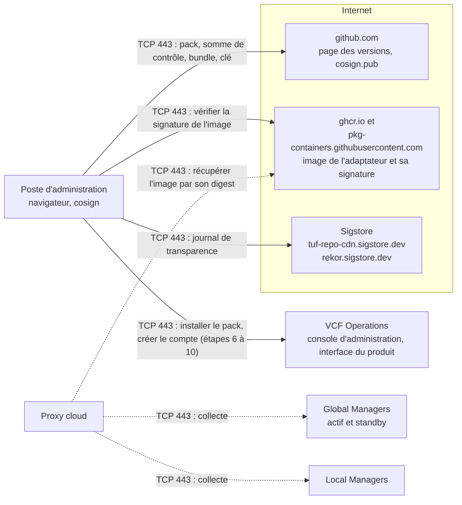
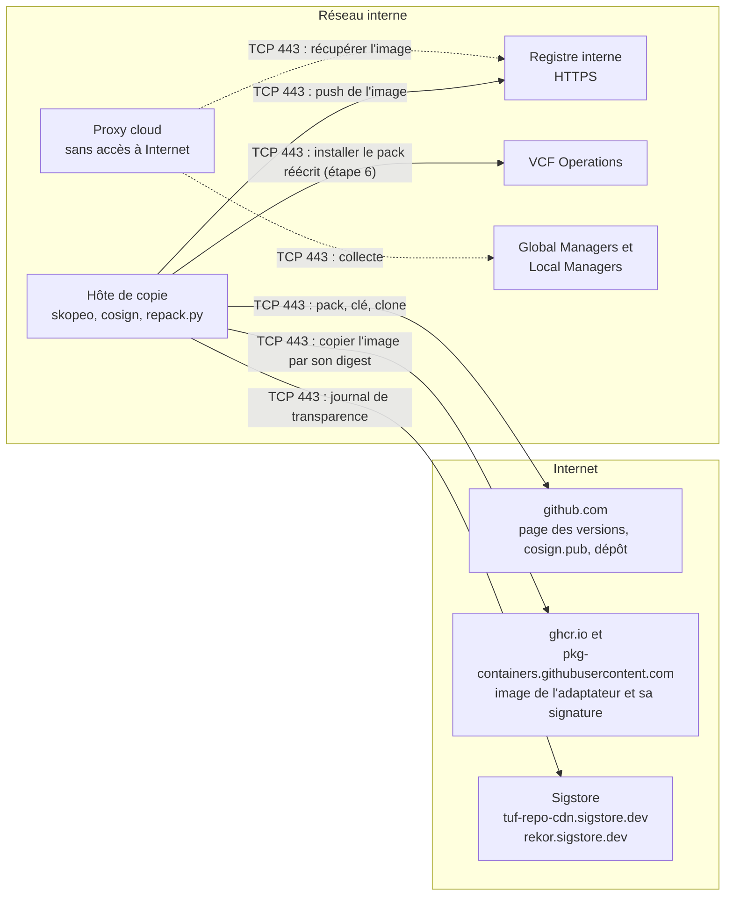

# Guide d'installation

Comment installer le pack NSX Federation publié dans VCF Operations 9.1.1, avec la machine sur laquelle chaque
commande s'exécute. Pour construire le pack à partir des sources, voir [BUILD.fr.md](BUILD.fr.md). La partie 2 du
[blog](https://sorinplaton.github.io/fr/posts/nsx-federation-management-pack-install/) montre les étapes avec des
captures d'écran.

English version: [INSTALL.md](INSTALL.md).

## Choisir un mode d'installation

| Mode | Cas d'usage | Prérequis | Étapes |
| --- | --- | --- | --- |
| [Option A : télécharger le pack publié](#option-a--télécharger-le-pack-publié) | Le proxy cloud a accès à Internet. La voie la plus rapide, rien à construire | Le proxy cloud joint `ghcr.io` et `pkg-containers.githubusercontent.com` en TCP 443 | Option A, puis les étapes 6 à 10 |
| [Option A, variante avec registre interne](#variante--copier-limage-dans-un-registre-interne) | Le proxy cloud n'a pas accès à Internet, ou les images doivent être analysées et servies par un registre interne, et le pack publié est utilisé tel quel. Aucun build | Un hôte qui joint à la fois `ghcr.io` et le registre interne, et un registre interne servi en HTTPS auquel le proxy cloud fait confiance | Option A avec sa variante, puis les étapes 6 à 10 |
| [Option B : construire le pack à partir des sources](BUILD.fr.md) | Le pack est modifié ou doit être construit à partir des sources, ou un lab exploite son propre registre sur l'hôte de construction. Convient aussi à un proxy cloud sans accès à Internet. La variante Harbor fait le push de l'image vers un Harbor existant à la place du petit registre de l'étape 2 | Un hôte de construction avec Docker, et un registre servi en HTTPS auquel le proxy cloud fait confiance | Étapes 1 à 5 dans [BUILD.fr.md](BUILD.fr.md), ou la variante Harbor à la place des étapes 2 à 4, puis les étapes 6 à 10 |

Les organisations qui utilisent JFrog Artifactory suivent [CUSTOMER-INSTALL.fr.md](CUSTOMER-INSTALL.fr.md).

Tous les modes installent le même pack et se rejoignent à l'étape 6.

Le fichier `.pak` contient le contenu du pack (modèle d'objets, alertes, tableaux de bord) et l'adresse de
l'image de l'adaptateur. L'adaptateur lui-même est une image de conteneur que le proxy cloud récupère au
démarrage du compte. L'image n'est pas dans le `.pak` : le proxy cloud la télécharge avec Docker depuis le
registre que désigne le pack. Ce registre doit donc être joignable par le proxy cloud, en HTTPS, avec un
certificat auquel le proxy cloud fait confiance. Si le téléchargement échoue, le pack s'installe quand même,
mais le compte ne collecte jamais (l'étape 8 décrit le symptôme). Les modes ne diffèrent que par l'origine de
cette image.

Chaque mode demande l'option « Allow unsigned PAK installation » le temps de l'installation. VCF Operations
cherche une signature Broadcom dans un `.pak`, et ce pack n'en a pas (KB 415279).
Le pack publié est signé avec cosign par ce projet, ce qui est une autre signature : elle permet à la personne
qui installe de vérifier l'origine du fichier, et VCF Operations ne la lit pas. L'option reste donc nécessaire
même pour un pack dont la signature cosign a été vérifiée.

## Où chaque élément s'exécute

| Machine | Rôle |
| --- | --- |
| Hôte de construction | Option B seulement. Un hôte Linux avec Docker, `git` et Python 3. Il construit le pack et fait le push de l'image de l'adaptateur vers le registre. Dans le lab, c'est le jumphost, qui héberge aussi le registre |
| Registre | Option A : `ghcr.io`, exploité par GitHub. Variante avec registre interne : un registre interne. Option B : un registre d'images servi en HTTPS, joignable par le proxy cloud. Le proxy cloud ne se replie pas sur HTTP |
| Proxy cloud | Le collecteur VCF Operations qui exécute le conteneur de l'adaptateur. Il récupère l'image depuis le registre |
| VCF Operations | Console d'administration (`https://<ops>/admin`) et interface du produit (`https://<ops>/`) |
| NSX | Les Global Managers (actif et standby) et les Local Managers d'une fédération |

## Accès réseau

Ouvrir ces flux avant de commencer : un flux bloqué se révèle tard, par un compte qui reste `FAILED`. L'option A
et sa variante ont chacune leur schéma dans leur section. Les flux de l'hôte de construction (option B) sont
dans [BUILD.fr.md, Accès réseau](BUILD.fr.md#accès-réseau).

Avec l'option A, seuls les flux du proxy cloud vers `ghcr.io`, `pkg-containers.githubusercontent.com` et NSX
sont nécessaires, plus un navigateur qui joint VCF Operations. Avec la variante, le proxy cloud joint le
registre interne et NSX, et seul l'hôte de copie accède à Internet.

| Depuis | Vers | Port | Usage |
| --- | --- | --- | --- |
| Poste d'administration (option A) ou hôte de copie | `github.com` et `raw.githubusercontent.com` | TCP 443 | Téléchargement du pack, de sa somme de contrôle, de son bundle, de `cosign.pub` et de cosign. L'hôte de copie clone aussi le dépôt |
| Poste d'administration (option A) ou hôte de copie | `ghcr.io` et `pkg-containers.githubusercontent.com` | TCP 443 | Vérification de la signature de l'image. L'hôte de copie y prend aussi l'image |
| Poste d'administration (option A) ou hôte de copie | Sigstore (`tuf-repo-cdn.sigstore.dev`, `rekor.sigstore.dev`) | TCP 443 | Le journal de transparence, pour la vérification des signatures seulement |
| Poste d'administration (option A) ou hôte de copie | VCF Operations | TCP 443 | Installation du pack et création du compte (étapes 6 à 10) |
| Hôte de copie | Registre interne | TCP 443, ou le port du registre | Variante avec registre interne : push de l'image copiée |
| Proxy cloud | Registre | TCP 5000, ou le port du registre | Option B et variante avec registre interne : récupération de l'image de l'adaptateur |
| Proxy cloud | `ghcr.io` et `pkg-containers.githubusercontent.com` | TCP 443 | Option A : récupération de l'image publiée de l'adaptateur. `ghcr.io` répond aux appels du registre et redirige les couches de l'image vers `pkg-containers.githubusercontent.com`. Via le proxy du site si le proxy cloud en utilise un |
| Proxy cloud | Global Managers et Local Managers | TCP 443 | Collecte |

Valeurs à remplacer :

| Valeur | Exemple |
| --- | --- |
| `$IP`, `$VERSION`, `$OPS_HOST` et les autres variables | Valeurs du fichier de paramètres `~/fedmp.env` ([Le fichier de paramètres](BUILD.fr.md#le-fichier-de-paramètres)) |
| `<ops>` | Le nom d'hôte de VCF Operations, dans les étapes faites au navigateur |
| `<gm1>`, `<gm2>` | Adresse de cluster du Global Manager actif et du standby |

## Option A : télécharger le pack publié

À utiliser à la place des étapes 1 à 5 de [BUILD.fr.md](BUILD.fr.md) quand le proxy cloud a accès à Internet.
Ni hôte de construction, ni Docker, ni registre à soi. Quand le proxy cloud n'a pas accès à Internet, ou que les
images doivent venir d'un registre interne, ajouter la
[variante](#variante--copier-limage-dans-un-registre-interne) après la vérification des signatures.

Flux réseau de ce mode. Les traits pleins partent du poste d'administration ; les traits pointillés sont ceux
du proxy cloud. Le flux vers Sigstore ne sert qu'à la vérification des signatures.



- [ ] VCF Operations 9.1.1 avec au moins un proxy cloud à l'état `UP`, qui joint `ghcr.io` et
      `pkg-containers.githubusercontent.com` en TCP 443, directement ou via le proxy du site. Les règles de
      pare-feu demandent les deux noms : les couches de l'image viennent du second. Avec la variante, le proxy
      cloud joint le registre interne à la place.
- [ ] NSX 9.1 Federation et un compte NSX en lecture seule, comme à
      l'[étape 1 de BUILD.fr.md](BUILD.fr.md#1-prérequis).
- [ ] Le proxy cloud joint chaque manager NSX en TCP 443.
- [ ] Mot de passe admin de VCF Operations, et l'approbation de changement pour l'option des packs non signés
      si l'organisation l'exige.
- [ ] Pack téléchargé, somme de contrôle vérifiée, signatures vérifiées (recommandé).
- [ ] Variante seulement : image copiée dans le registre interne, pack pointant vers ce registre.
- [ ] Puis les étapes 6 à 10.

*À exécuter sur : n'importe quelle machine dont le navigateur joint VCF Operations.* Télécharger le pack et sa
somme de contrôle depuis la [page des versions](https://github.com/sorinplaton/vcf-ops-nsx-federation-mp/releases/latest),
ou avec les commandes ci-dessous. La dernière calcule le SHA-256 du fichier téléchargé et le compare à la
valeur publiée. Résultat attendu : `NSXFederation_1.13.0.pak: OK`. Toute autre réponse signifie que le
téléchargement est abîmé ou incomplet ; le refaire.

```bash
curl -LO https://github.com/sorinplaton/vcf-ops-nsx-federation-mp/releases/download/v1.13.6/NSXFederation_1.13.0.pak
curl -LO https://github.com/sorinplaton/vcf-ops-nsx-federation-mp/releases/download/v1.13.6/NSXFederation_1.13.0.pak.sha256
sha256sum -c NSXFederation_1.13.0.pak.sha256
```

Le pack désigne l'image `ghcr.io/sorinplaton/nsxfederation` par son digest : le proxy cloud exécute toujours
l'image avec laquelle le pack a été construit. L'image est publique : le proxy cloud la récupère sans
identifiant, et il fait déjà confiance au certificat de `ghcr.io`, sans l'étape 4 de BUILD.fr.md.

Vérification facultative, *sur le proxy cloud* si SSH y est activé. Elle indique, avant l'installation, si le
proxy cloud peut joindre les deux hôtes d'où vient l'image. Tout code HTTP signifie que l'hôte est joignable
(`401` et `400` sont les réponses attendues) ; `000` signifie qu'il ne l'est pas, et le compte de l'étape 8
resterait `FAILED` :

```bash
curl -s -o /dev/null -w '%{http_code}\n' https://ghcr.io/v2/
curl -s -o /dev/null -w '%{http_code}\n' https://pkg-containers.githubusercontent.com/
```

### Pourquoi le proxy cloud accède à Internet

L'adaptateur est une image de conteneur que le proxy cloud récupère au démarrage du compte. Le `.pak` ne
contient que le contenu du pack et l'adresse de cette image, comme l'explique
[Choisir un mode d'installation](#choisir-un-mode-dinstallation). Avec l'option A, le pack désigne `ghcr.io`,
et le proxy cloud télécharge donc l'image depuis Internet.

Ce téléchargement est le seul trafic Internet du proxy cloud. Il va vers `ghcr.io` et
`pkg-containers.githubusercontent.com` en TCP 443 : `ghcr.io` répond aux appels du registre et redirige vers
le second hôte le téléchargement des couches de l'image. La collecte reste sur le réseau local, entre
l'adaptateur, les managers NSX et VCF Operations, et aucune donnée de supervision ne quitte le site. Les
vérifications de signature ci-dessous s'exécutent sur la machine qui a téléchargé le pack, pas sur le proxy
cloud.

Le proxy cloud récupère l'image au premier démarrage du compte, puis de nouveau après un redéploiement ou un
upgrade du proxy cloud, car sa copie locale a disparu. Prévoir l'accès à chaque démarrage de l'adaptateur.

Pour que le proxy cloud n'accède pas à Internet, utiliser la
[variante de copie](#variante--copier-limage-dans-un-registre-interne) : une machine qui accède à Internet
copie une fois l'image dans un registre interne, le pack est pointé vers ce registre, et le proxy cloud ne joint
alors que ce registre. L'[option B](BUILD.fr.md) donne le même résultat avec son propre build.

## Vérifier les signatures (recommandé)

Le pack et l'image de son adaptateur sont signés avec [cosign](https://docs.sigstore.dev/cosign/) (Sigstore). La
somme de contrôle prouve seulement que le téléchargement est complet ; elle se trouve à côté du pack, sur la
même page de version, et quiconque pourrait y remplacer le pack pourrait aussi remplacer la somme. Les
signatures prouvent que le pack et l'image viennent de ce projet, et qu'ils n'ont pas changé depuis. Vérifier
les deux avant l'installation, et de nouveau à chaque nouvelle version.

À partir de la version `v1.13.3`, le workflow de publication sur GitHub signe le pack et les images sans clé
(« keyless ») : la signature porte un certificat qui nomme le workflow et le tag qui les ont construits, et la
vérification compare ce nom à la place d'une clé publique. Utiliser la
[vérification sans clé](#vérification-sans-clé-versions-à-partir-de-v1133). Les versions jusqu'à `v1.13.2` sont
signées avec la clé du projet seulement : utiliser la
[vérification par clé](#vérification-par-clé-versions-jusquà-v1140).

**Installer cosign.** *À exécuter sur : la machine qui a téléchargé le pack (Linux, x86-64).* Choisir l'une des
trois méthodes ci-dessous ; la dernière ligne affiche la version et confirme que l'installation a réussi.

```bash
# Ubuntu ou Debian
curl -LO https://github.com/sigstore/cosign/releases/download/v2.4.1/cosign_2.4.1_amd64.deb
sudo dpkg -i cosign_2.4.1_amd64.deb

# RHEL, Rocky Linux ou AlmaLinux
curl -LO https://github.com/sigstore/cosign/releases/download/v2.4.1/cosign-2.4.1-1.x86_64.rpm
sudo rpm -ivh cosign-2.4.1-1.x86_64.rpm

# Tout Linux : le binaire seul
curl -LO https://github.com/sigstore/cosign/releases/download/v2.4.1/cosign-linux-amd64
sudo install -m 0755 cosign-linux-amd64 /usr/local/bin/cosign

cosign version
```

Les [versions de cosign](https://github.com/sigstore/cosign/releases) contiennent aussi les builds macOS et
Windows et un `cosign_checksums.txt` pour les téléchargements. Sans rien installer, Docker peut exécuter la même
version : `sudo docker run --rm -v $PWD:/w -w /w -u $(id -u) -e HOME=/tmp ghcr.io/sigstore/cosign/cosign:v2.4.1 <commande>`.

### Vérification sans clé (versions à partir de v1.13.3)

Deux vérifications : le pack, puis l'image que désigne le pack. Définir la version une fois ; la signature doit
nommer exactement ce dépôt, ce workflow et ce tag, avec GitHub Actions pour émetteur. Les notes de version sur
GitHub donnent les mêmes valeurs. Le bundle du pack est le fichier `.sigstore.json` de la version, que la ligne
`curl` télécharge.

Le pack est un fichier zip qui en contient un second, `adapter.zip`, dont le fichier `.conf` donne le registre,
le dépôt et le digest de l'image. Les deux lignes `unzip` y lisent le digest, et la dernière ligne demande à
cosign de vérifier la signature stockée à côté de cette image sur `ghcr.io`.

```bash
RELEASE=1.13.6
SIGNER="https://github.com/sorinplaton/vcf-ops-nsx-federation-mp/.github/workflows/release.yml@refs/tags/v$RELEASE"
ISSUER=https://token.actions.githubusercontent.com
curl -LO https://github.com/sorinplaton/vcf-ops-nsx-federation-mp/releases/download/v$RELEASE/NSXFederation_1.13.0.pak.sigstore.json

cosign verify-blob --certificate-identity "$SIGNER" --certificate-oidc-issuer "$ISSUER" \
  --bundle NSXFederation_1.13.0.pak.sigstore.json NSXFederation_1.13.0.pak
unzip -p NSXFederation_1.13.0.pak adapter.zip > /tmp/adapter.zip
DIGEST=$(unzip -p /tmp/adapter.zip '*.conf' | sed -n 's/^DIGEST=//p')
cosign verify --certificate-identity "$SIGNER" --certificate-oidc-issuer "$ISSUER" ghcr.io/sorinplaton/nsxfederation@$DIGEST
```

Remplacer `1.13.0` par la version du pack dans les noms de fichiers de cette version. Résultat attendu :
`Verified OK`, puis la liste des contrôles faits par cosign.

Les commandes accèdent à Internet : `ghcr.io` pour la signature de l'image, et les serveurs Sigstore
(`tuf-repo-cdn.sigstore.dev`, `rekor.sigstore.dev`) pour le journal de transparence public où chaque signature est
enregistrée. Une vérification en échec signifie que le fichier ou l'image n'est pas celui qui a été signé : ne
pas l'installer.

### Vérification par clé (versions jusqu'à v1.14.0)

Les versions jusqu'à `v1.13.2` sont signées avec la clé du projet seulement. De `v1.13.3` à `v1.14.0`, des
signatures par clé s'ajoutent aux signatures sans clé ([SECURITY.md](../SECURITY.md#supply-chain), en anglais).
Une signature par clé prouve que le pack et l'image ont été produits par le détenteur de la clé privée de ce
projet.

La clé publique est `cosign.pub`, à la racine de ce dépôt et sur la page de version. La prendre dans le dépôt
et garder cette copie pour les versions suivantes : une clé téléchargée au même endroit que le pack prouve moins.
La première commande ci-dessous récupère la clé, la seconde le bundle, qui est la signature du pack.

```bash
curl -LO https://raw.githubusercontent.com/sorinplaton/vcf-ops-nsx-federation-mp/main/cosign.pub
curl -LO https://github.com/sorinplaton/vcf-ops-nsx-federation-mp/releases/download/v1.13.6/NSXFederation_1.13.0.pak.bundle
```

**Vérifier le pack.** Lancer la commande dans le dossier qui contient le pack, le bundle et la clé. cosign
contrôle la signature du bundle par rapport au fichier et à la clé publique. Résultat attendu : `Verified OK`.

```bash
cosign verify-blob --key cosign.pub --bundle NSXFederation_1.13.0.pak.bundle NSXFederation_1.13.0.pak
```

**Vérifier l'image que désigne le pack.** Les deux premières lignes lisent le digest dans le pack, comme pour la
vérification sans clé, et la troisième demande à cosign de vérifier la signature stockée à côté de cette image
sur `ghcr.io`. Résultat attendu : « The signatures were verified against the specified public key ».

```bash
unzip -p NSXFederation_1.13.0.pak adapter.zip > /tmp/adapter.zip
DIGEST=$(unzip -p /tmp/adapter.zip '*.conf' | sed -n 's/^DIGEST=//p')
cosign verify --key cosign.pub ghcr.io/sorinplaton/nsxfederation@$DIGEST
```

Les commandes joignent les mêmes hôtes que la vérification sans clé. Une vérification en échec signifie que le
fichier ou l'image n'est pas celui qui a été signé : ne pas l'installer.

### Facultatif : provenance de construction et SBOM (versions à partir de v1.13.5)

À partir de `v1.13.5`, le pack et les deux images portent aussi une attestation de provenance de construction
SLSA : un enregistrement signé du commit, du workflow et du runner qui les ont construits. La CLI GitHub la
vérifie ; elle joint `api.github.com`. L'image de l'adaptateur porte aussi son SBOM sous forme d'attestation
signée, que cosign vérifie et affiche :

```bash
gh attestation verify NSXFederation_1.13.0.pak -R sorinplaton/vcf-ops-nsx-federation-mp \
  --signer-workflow sorinplaton/vcf-ops-nsx-federation-mp/.github/workflows/release.yml
gh attestation verify oci://ghcr.io/sorinplaton/nsxfederation@$DIGEST -R sorinplaton/vcf-ops-nsx-federation-mp
cosign verify-attestation --type cyclonedx --certificate-identity "$SIGNER" --certificate-oidc-issuer "$ISSUER" \
  ghcr.io/sorinplaton/nsxfederation@$DIGEST > /dev/null && echo "SBOM attestation: verified"
```

Résultat attendu : deux fois `Verification succeeded!`, puis `SBOM attestation: verified`. La version contient
aussi le rapport Trivy de l'image de l'adaptateur, `NSXFederation_<version>.trivy.txt`.

Une fois la somme de contrôle et les signatures validées, installer le pack avec l'étape 6, à la main ou par
script, puis continuer avec les étapes 7 à 10. Les scripts demandent un hôte Linux avec un clone de ce dépôt, le
fichier de paramètres ([BUILD.fr.md, étape 1](BUILD.fr.md#le-fichier-de-paramètres)) et les outils listés dans
[Outils pour certaines étapes](BUILD.fr.md#outils-pour-certaines-étapes). Avec la variante, appliquer d'abord la
variante ci-dessous, avant l'étape 6.

## Variante : copier l'image dans un registre interne

Pour une entreprise qui ne laisse pas le proxy cloud accéder à Internet, ou qui analyse chaque image avant
usage : copier l'image publiée dans un registre interne et y faire pointer le pack publié. Ni hôte de
construction ni SDK, le proxy cloud ne dépend que du registre interne, et l'image peut y être analysée avant
usage. L'image est copiée à l'identique et garde son digest : c'est toujours l'image que le projet a signée.

Flux réseau de cette variante. Seul l'hôte de copie accède à Internet. Le proxy cloud ne parle qu'au registre
interne et à NSX.



*À exécuter sur : un hôte Linux qui joint à la fois `ghcr.io` et le registre interne*, appelé ici l'hôte de
copie. Il lui faut [skopeo](https://github.com/containers/skopeo) (`sudo apt-get install -y skopeo` ou `sudo dnf install -y skopeo`),
qui copie une image d'un registre à un autre, cosign (installé comme ci-dessus), ainsi que `git`, `python3` et
`unzip`, pris dans les paquets de la distribution. Le registre interne demande la même préparation que dans
[Variante : un registre Harbor existant](BUILD.fr.md#variante--un-registre-harbor-existant) : un projet public, un compte
qui a le droit de push sur ce projet, et un certificat auquel le proxy cloud fait confiance.

Préparer l'hôte de copie une fois. Le clone apporte `tools/repack.py`, et le fichier de paramètres donne aux
commandes l'adresse du registre interne et le compte de push :

```bash
cd ~
git clone https://github.com/sorinplaton/vcf-ops-nsx-federation-mp.git
cp vcf-ops-nsx-federation-mp/install/fedmp.env.example ~/fedmp.env && chmod 600 ~/fedmp.env
nano ~/fedmp.env
```

Dans `~/fedmp.env`, retirer le `#` devant les quatre lignes `HARBOR` et les remplir : `HARBOR` est l'adresse du
registre interne, `HARBOR_PROJECT` le projet, `HARBOR_USER` et `HARBOR_PW` le compte qui a le droit de push. Les
variables portent le nom de Harbor, et les commandes s'en servent pour n'importe quel registre. Remplir aussi
`OPS_HOST` et `OPS_PW` si l'installation par script de l'étape 6 doit partir de cet hôte. Les autres lignes
peuvent garder leurs valeurs d'exemple. [Le fichier de paramètres](BUILD.fr.md#le-fichier-de-paramètres) décrit le fichier
et la ligne qui le charge.

Ensuite, dans le dossier qui contient le pack téléchargé :

1. Vérifier les signatures du pack et de l'image, comme dans
   [Vérifier les signatures](#vérifier-les-signatures-recommandé). Le faire d'abord : le point 3 modifie le
   pack, sa somme de contrôle et sa signature ne correspondent plus ensuite.
2. Copier l'image par son digest. Les premières lignes relisent le digest dans le pack, pour que le bloc
   fonctionne aussi dans un nouveau shell. `--all` copie l'image exactement telle qu'elle a été publiée, et
   `--preserve-digests` fait s'arrêter skopeo plutôt que de changer le digest que désigne le pack :

   ```bash
   set -a; source ~/fedmp.env; set +a
   unzip -p NSXFederation_1.13.0.pak adapter.zip > /tmp/adapter.zip
   DIGEST=$(unzip -p /tmp/adapter.zip '*.conf' | sed -n 's/^DIGEST=//p')
   skopeo copy --all --preserve-digests --dest-creds "$HARBOR_USER:$HARBOR_PW" \
     docker://ghcr.io/sorinplaton/nsxfederation@$DIGEST \
     docker://$HARBOR/$HARBOR_PROJECT/nsxfederation:1.13.0
   ```

   Pour pouvoir vérifier l'image plus tard depuis le registre interne, copier aussi sa signature, dans le même
   shell : `cosign copy ghcr.io/sorinplaton/nsxfederation@$DIGEST $HARBOR/$HARBOR_PROJECT/nsxfederation` (après
   `docker login $HARBOR`).
3. Faire pointer le pack vers le registre interne. `repack.py` réécrit les lignes `REGISTRY` et `REPOSITORY` à
   l'intérieur du pack, sans créer d'autre fichier. Seuls le registre et le dépôt changent ; le digest reste.
   Les deux lignes `unzip` affichent le résultat :

   ```bash
   set -a; source ~/fedmp.env; set +a
   python3 ~/vcf-ops-nsx-federation-mp/tools/repack.py NSXFederation_1.13.0.pak $HARBOR $HARBOR_PROJECT/nsxfederation
   unzip -p NSXFederation_1.13.0.pak adapter.zip > /tmp/adapter.zip
   unzip -p /tmp/adapter.zip '*.conf' | grep -E '^(REGISTRY|REPOSITORY|DIGEST)='
   ```

   Attendu : `REGISTRY` est le registre interne, `REPOSITORY` vaut `/<projet>/nsxfederation`, et `DIGEST` est la
   valeur du point 2.
4. Analyser l'image dans le registre interne si l'organisation l'exige, puis installer le pack réécrit avec
   l'étape 6 et continuer avec les étapes 7 à 10. Le proxy cloud n'a besoin que du registre interne, pas de
   `ghcr.io`.

## 6. Installer le pack non signé

Les deux méthodes activent « Allow unsigned PAK installation » pour l'envoi et le désactivent ensuite.
L'option s'applique à toute l'instance VCF Operations : tant qu'elle est active, n'importe quel pack non signé
peut être installé. Garder cette durée courte et vérifier à la fin que l'option est désactivée.

### À la main

*À exécuter dans : un navigateur.*

1. Console d'administration `https://<ops>/admin`, Administrator Settings, Security Settings : activer
   « unsigned PAK installation ».
2. Interface du produit : Administration, Integrations, Repository, ajouter un pack.
3. Choisir `NSXFederation_<version>.pak`, cocher « install even if already installed » et « Ignore the PAK file
   signature checking ».
4. Envoyer le fichier, accepter l'avertissement sur le fichier non signé et attendre la fin de l'installation.
5. Console d'administration : désactiver l'installation des PAK non signés. La console refuse le changement tant que
   l'installation est en cours ; réessayer une fois l'installation terminée.

### Par script

*À exécuter sur : l'hôte de construction.* Avec l'option A ou sa variante, n'importe quel hôte Linux avec un
clone de ce dépôt et `~/fedmp.env` ([Le fichier de paramètres](BUILD.fr.md#le-fichier-de-paramètres)) convient. L'hôte a
besoin de Google Chrome, de Node.js 22 ou ultérieur ([Outils pour certaines étapes](BUILD.fr.md#outils-pour-certaines-étapes))
et de Python 3 avec `requests`. Les scripts pilotent un Chrome headless via des appels internes à l'interface
de VCF Operations. Ces appels ne sont pas pris en charge et peuvent changer à chaque version. Ce Chrome accepte
le certificat de VCF Operations sans le vérifier : lancer les scripts sur un réseau de confiance.

`upi.sh enableUPI` se connecte à la console d'administration et active l'option. `install_unsigned.sh` envoie
le pack, attend la fin de l'installation, supprime les définitions d'alertes laissées par une version plus
ancienne, puis désactive l'option. Mettre dans `PAK` le fichier à installer : la ligne ci-dessous convient à
l'option B ; avec l'option A ou sa variante, donner le chemin complet du `.pak` téléchargé ou réécrit.

```bash
set -a; source ~/fedmp.env; set +a
cd ~/vcf-ops-nsx-federation-mp
PAK=pack/build/NSXFederation_$VERSION.pak     # option A : le chemin du .pak téléchargé
install/upi.sh enableUPI
install/install_unsigned.sh "$PAK"
```

`install_unsigned.sh` vérifie d'abord les signatures avec `install/verify_pak.sh`. Un pack publié accompagné de
son `.sigstore.json` doit être validé, sinon rien n'est installé ; pour cela, garder le bundle dans le dossier du
pack. Un pack sans bundle (une construction locale, ou un pack réécrit par la variante) est installé avec un
avertissement. `FEDMP_VERIFY=1` exige la vérification de l'image pour tout pack, et `FEDMP_VERIFY=0` désactive la
vérification. Celle-ci utilise `cosign` s'il est installé, sinon l'image cosign via Docker.
`FEDMP_PAK_SHA256=<sha256>` exige en plus que le fichier ait cette somme de contrôle, quelle que soit la valeur de
`FEDMP_VERIFY` : l'utiliser pour un pack réécrit, dont vous avez enregistré vous-même la somme de contrôle
([INSTALL-ENTERPRISE.fr.md](INSTALL-ENTERPRISE.fr.md), étape 7).

Lancer `install_unsigned.sh` après `upi.sh` : la connexion à la console d'administration ferme la session de
l'interface du produit, et le script d'installation se reconnecte. Il désactive l'option quelle que soit
l'issue, et arrête le Chrome headless. Le code de sortie 0 signifie que l'installation est terminée et que
l'option est désactivée. Une ligne `WARNING: orphan definitions were not all removed` signifie que seul le
nettoyage après l'installation a échoué, le plus souvent sur le certificat de VCF Operations (`OPS_CA` ou
`OPS_INSECURE` dans le fichier de paramètres) ; lancer `python3 install/cleanup_content.py "$PAK" --delete`
une fois ce réglage fait. Une ligne `WARNING: unsigned PAK installation is still enabled` signifie que le
script n'a pas pu désactiver l'option : le faire dans la console d'administration.

Pour lire l'option seule, `install/upi.sh getUPIStatus`, puis `install/chrome.sh stop` : `upi.sh` laisse tourner
le Chrome headless, qui détient la session de la console d'administration.

Vérification : Administration, Integrations, Repository affiche le pack NSX Federation dans sa nouvelle
version.

## 7. Créer le compte

Le pack installé ne collecte rien tout seul. Un compte indique à VCF Operations quelle fédération lire, avec
quel identifiant, et quel proxy cloud exécute l'adaptateur. Ce proxy cloud récupère l'image au démarrage du
compte.

*À exécuter dans : l'interface du produit VCF Operations*, Administration, Integrations, Accounts, ajouter un
compte de type NSX Federation.

- [ ] Adresses des Global Managers : `<gm1>,<gm2>`, l'adresse de cluster de l'actif et celle du standby. Un
      compte par fédération.
- [ ] Identifiant : le compte NSX en lecture seule. N'ajouter l'identifiant des Local Managers que s'il est
      différent.
- [ ] Collecteur : avec l'option A, un proxy cloud qui joint `ghcr.io` et
      `pkg-containers.githubusercontent.com` ; avec la variante, un proxy cloud qui fait confiance au registre
      interne ; avec l'option B, le proxy cloud qui fait confiance au registre
      ([BUILD.fr.md, étape 4](BUILD.fr.md#4-le-proxy-cloud-fait-confiance-au-certificat-du-registre)).
- [ ] Confiance des certificats : garder `enforce`, ou choisir `ca` quand les managers ont des certificats signés
      par une autorité de certification interne. Avec `ca`, coller les certificats de l'autorité dans « Trusted CA
      certificates (PEM) » et utiliser des adresses que les certificats nomment.
- [ ] Valider la connexion et accepter les certificats des Global Managers. Sans certificat accepté, `enforce`
      ne collecte rien. Un compte créé via l'API n'a aucun certificat accepté ; le modifier dans
      l'interface, puis valider et accepter, ou utiliser `ca`.
- [ ] Les autres réglages peuvent garder leur valeur par défaut. [OPERATIONS.md](OPERATIONS.md) (en anglais)
      décrit chacun d'eux.

## 8. Vérifier la collecte

C'est ici que se vérifie le travail des étapes précédentes sur le registre et le certificat : le proxy cloud
récupère l'image, démarre l'adaptateur et lit NSX.

*À exécuter dans : l'interface du produit VCF Operations.*

- [ ] Onglet Accounts : le compte passe à l'état « Collecting ». S'il reste `FAILED` avec un message vide, le proxy
      cloud n'a pas pu récupérer l'image. Option A : vérifier que le proxy cloud joint `ghcr.io` et
      `pkg-containers.githubusercontent.com`. Variante : vérifier que le proxy cloud joint le registre interne
      et fait confiance à son certificat, et que le projet est public. Option B : vérifier les étapes 2 et 4 de
      [BUILD.fr.md](BUILD.fr.md), et chercher `tls: bad certificate` dans le journal du registre.
- [ ] Avec un intervalle de 5 minutes, les données arrivent en trois cycles : d'abord les objets et les
      relations, puis les propriétés et les événements, puis les métriques après une dizaine de minutes. Les
      taux demandent un cycle de plus. Des objets sans métriques pendant les dix premières minutes sont
      normaux.
- [ ] L'objet fédération ne liste aucun appel en échec.

## 9. Facultatif : groupe par fédération

Le pack fournit des groupes par domaine, qui contiennent les objets de toutes les fédérations. Ce script ajoute
un groupe personnalisé par fédération : c'est ce qu'il faut pour appliquer une politique, une règle de
notification ou un tableau de bord à une seule fédération.

*À exécuter sur : l'hôte de construction.* Avec l'option A ou sa variante, utiliser l'hôte de l'installation
par script de l'étape 6. Le script lit les fédérations dans VCF Operations par la Suite API et crée les
groupes. Il n'en supprime jamais.

```bash
set -a; source ~/fedmp.env; set +a
cd ~/vcf-ops-nsx-federation-mp
python3 install/federation_groups.py                     # « NSX Federation - <fédération> » pour chaque fédération
python3 install/federation_groups.py --federation '<fédération>' --policy '<politique>'   # et affecter une politique
```

- [ ] Le groupe « NSX Federation - <fédération> » liste les objets de cette fédération (Environment, Custom Groups).
      Le script nécessite une collecte par la version 1.13.0 ou ultérieure ; le relancer met les groupes à jour.

## 10. Facultatif : envoyer les alertes

Les alertes restent dans VCF Operations tant qu'aucune règle de notification ne les envoie ailleurs. Ce script
crée cette règle pour les alertes du pack. Il ne détient aucun identifiant de messagerie ou d'outil de
tickets : ceux-ci appartiennent à l'instance sortante, qui doit exister avant.

*À exécuter sur : l'hôte de construction*, ou l'hôte de l'installation par script de l'étape 6. Créer d'abord
l'instance sortante (serveur de messagerie, webhook, ServiceNow, Slack, SNMP ou fichier journal) sous
Administration, Configurations, Outbound Settings. La première commande envoie les alertes de criticité
immediate et critical. La seconde ajoute une règle pour les alertes warning et au-dessus, limitée au groupe
d'une fédération créé à l'étape 9. Relancer une commande avec le même nom de règle met la règle à jour.

```bash
set -a; source ~/fedmp.env; set +a
cd ~/vcf-ops-nsx-federation-mp
python3 install/notification_rules.py --outbound '<instance sortante>'                    # immediate et critical
python3 install/notification_rules.py --outbound '<instance sortante>' --min-criticality warning \
        --group 'NSX Federation - <fédération>' --name 'NSX Federation - <fédération> warnings'
```

- [ ] La règle « NSX Federation - <instance sortante> » apparaît sous Alerts, Notifications. Elle envoie les
      alertes nouvelles, mises à jour et annulées : un ticket apprend aussi que l'alerte a disparu.

## Mise à niveau

Une mise à niveau est une nouvelle installation du pack par-dessus l'ancienne, suivie d'un arrêt et d'un
démarrage du compte.

1. Obtenir le nouveau pack, puis l'installer (étape 6).
   - Option A : télécharger le pack de la nouvelle version et vérifier ses signatures.
   - Variante avec registre interne : faire de même, puis refaire les points 2 et 3 de la variante. Le nouveau
     pack désigne une nouvelle image par son digest : il faut donc copier cette image et faire pointer le
     nouveau pack vers le registre interne.
   - Option B : mettre le clone à jour avec `cd ~/vcf-ops-nsx-federation-mp && git pull`, mettre dans `VERSION`
     de `~/fedmp.env` la nouvelle version (comme dans `pack/manifest.txt`), puis construire la nouvelle version
     ([BUILD.fr.md, étape 3](BUILD.fr.md#3-construire-le-pack)).
2. Arrêter puis démarrer le compte. Vérifier qu'il passe à l'état « Collecting » ; le démarrer une seconde fois s'il
   reste arrêté.
3. Les métriques reviennent après trois cycles, les taux après quatre.

`install_unsigned.sh` supprime les définitions d'alertes, de symptômes et de recommandations que la nouvelle
version ne fournit plus. Après une installation manuelle, lancer `install/cleanup_content.py <pak> --delete`
(voir [OPERATIONS.md](OPERATIONS.md), Upgrade, en anglais).

Depuis une version antérieure à 1.9.0, les edge nodes, les tunnels RTEP et les canaux de synchronisation sont
recréés sous une clé fondée sur leur ID NSX, et les anciens objets ne reçoivent plus de données.
`cleanup_content.py <pak> --legacy-objects --delete` les supprime, avec leur historique.

## Ce qui a été testé

- L'option B est le mode utilisé dans le lab. [BUILD.fr.md](BUILD.fr.md#ce-qui-a-été-testé) liste ce qui y a été
  testé.
- Le téléchargement et toutes les commandes de [Vérifier les signatures](#vérifier-les-signatures-recommandé), sur
  la version `v1.13.5` publiée.
- Les commandes de vérification des signatures (par clé, sans clé, provenance et SBOM), sur la version `v1.13.6`
  publiée.
- La vérification sans clé sur `v1.13.3`, la première version signée sans clé, le 2026-11-26.
- La provenance et le SBOM sur `v1.13.5`, la première version qui les porte, le 2026-11-26.
- La variante avec registre interne, dans le lab avec un `registry:2` local.

Pas testé :

- La récupération de l'image depuis `ghcr.io` par le proxy cloud (option A). Le lab utilise l'option B.
- Un éventuel contact avec `ghcr.io` à chaque redémarrage du compte, quand l'image est encore sur le disque.
- La variante avec registre interne avec Harbor.
