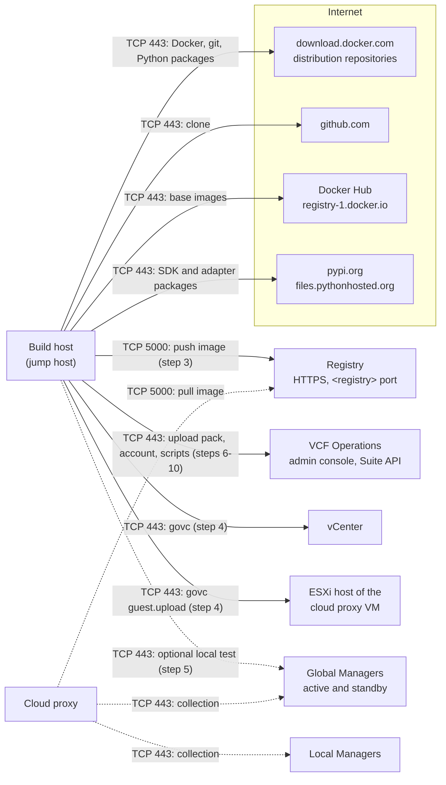

# Install guide

How to build the NSX Federation pack and install it in VCF Operations 9.1.1, with the machine each command
runs on. These are the steps used in the lab. Part 2 of the
[blog](https://sorinplaton.github.io/posts/nsx-federation-management-pack-install/) shows them with screenshots.

Version française : [INSTALL.fr.md](INSTALL.fr.md).

## Where things run

| Machine | Role |
| --- | --- |
| Build host | A Linux host with Docker, `git` and Python 3. It builds the pack and pushes the adapter image. In the lab it is the jump host, which also runs the registry |
| Registry | An image registry served over HTTPS that the cloud proxy can reach. The cloud proxy does not fall back to HTTP |
| Cloud proxy | The VCF Operations collector that runs the adapter container. It pulls the image from the registry |
| VCF Operations | Admin console (`https://<ops>/admin`) and product UI (`https://<ops>/`) |
| NSX | The Global Managers (active and standby) and the Local Managers of one federation |

## Network access

What the build host (the jump host in the lab) must reach, and the two flows of the cloud proxy that the
install depends on. Solid lines start at the build host; dashed lines are the cloud proxy's.



| From | To | Port | Used for |
| --- | --- | --- | --- |
| Build host | Internet (Docker and distribution repositories, GitHub, Docker Hub, PyPI) | TCP 443 | Installing the tools, cloning the repository, building the tooling and adapter images. Through a proxy if the site uses one |
| Build host | Registry | TCP 5000, or the registry port | Pushing the adapter image. Local when the registry runs on the build host, as in the lab |
| Build host | VCF Operations | TCP 443 | Admin console and product UI in a browser, and the Suite API for the scripts of steps 6 to 10 |
| Build host | vCenter of the cloud proxy VM | TCP 443 | `govc` guest operations of step 4. Not needed when the certificate is copied over SSH |
| Build host | ESXi host of the cloud proxy VM | TCP 443 | `govc guest.upload` sends the file to the ESXi host, not to vCenter |
| Build host | Global Managers | TCP 443 | Only for the optional test of step 5 |
| Cloud proxy | Registry | TCP 5000, or the registry port | Pulling the adapter image |
| Cloud proxy | Global Managers and Local Managers | TCP 443 | Collection |

Placeholders:

| Placeholder | Example |
| --- | --- |
| `IP` | `10.x.x.x`, the address of the build host that the cloud proxy reaches (see step 1) |
| `<ops>` | `ops.example.com` |
| `<gm1>`, `<gm2>` | cluster address of the active and of the standby Global Manager |
| `<version>` | `1.13.0` |

## Checklist

- [ ] 1. Prerequisites checked
- [ ] 2. Registry serves HTTPS
- [ ] 3. Pack built, image pushed, registry address in the pack checked
- [ ] 4. Cloud proxy trusts the registry certificate
- [ ] 5. Optional: collection tested without VCF Operations
- [ ] 6. Unsigned pack installed, switch turned off again
- [ ] 7. Account created, certificates accepted
- [ ] 8. Account "Collecting", metrics after three cycles
- [ ] 9. Optional: group per federation
- [ ] 10. Optional: alerts sent to email, a webhook or a ticketing tool

## 1. Prerequisites

- [ ] VCF Operations 9.1.1 with at least one cloud proxy in state `UP`.
- [ ] NSX 9.1 Federation. A read-only NSX account on every Global Manager and Local Manager; the built-in
      `audit` account works. A separate credential for the Local Managers is optional.
- [ ] Network: cloud proxy to every NSX manager on TCP 443, cloud proxy to the registry on its port, build
      host to the registry.
- [ ] Admin password of VCF Operations: the unsigned-pack switch is in the admin console.
- [ ] A change approval to turn on "Allow unsigned PAK installation" for the length of the install, if the
      organisation requires one. The pack is not signed by Broadcom (KB 415279).
- [ ] Build host tools: Docker Engine, `git` and Python 3 with `requests`, installed as below.

### Build host tools

*Run on: the build host.* Docker comes from the Docker repository rather than the distribution packages, so
that `docker build` uses BuildKit.

Ubuntu or Debian (on Debian, replace `ubuntu` with `debian` in both URLs):

```bash
sudo apt-get update
sudo apt-get install -y ca-certificates curl git python3 python3-requests
sudo install -m 0755 -d /etc/apt/keyrings
sudo curl -fsSL https://download.docker.com/linux/ubuntu/gpg -o /etc/apt/keyrings/docker.asc
sudo chmod a+r /etc/apt/keyrings/docker.asc
echo "deb [arch=$(dpkg --print-architecture) signed-by=/etc/apt/keyrings/docker.asc] \
https://download.docker.com/linux/ubuntu $(. /etc/os-release && echo "$VERSION_CODENAME") stable" \
  | sudo tee /etc/apt/sources.list.d/docker.list > /dev/null
sudo apt-get update
sudo apt-get install -y docker-ce docker-ce-cli containerd.io docker-buildx-plugin
```

RHEL, Rocky Linux or AlmaLinux 8 and later:

```bash
sudo dnf install -y dnf-plugins-core git python3 python3-requests
sudo dnf config-manager --add-repo https://download.docker.com/linux/rhel/docker-ce.repo
sudo dnf install -y docker-ce docker-ce-cli containerd.io docker-buildx-plugin
```

On both, start Docker. The `docker` commands of this guide carry `sudo`, so the build user does not have to
be in the `docker` group.

```bash
sudo systemctl enable --now docker
```

Check:

```bash
sudo docker run --rm hello-world
git --version
python3 --version         # 3.8 or later
python3 -c "import requests"
```

### The address of the build host

The commands of steps 2 to 4 read the address of the build host from one variable, `IP`. It is the address the
cloud proxy uses to reach the registry. Replace `10.x.x.x` with it, and set the variable again in every new
shell:

```bash
IP=10.x.x.x
```

## 2. Registry over HTTPS

Skip this step and step 4 if a registry (Harbor or other) already exists with a certificate from an authority
the cloud proxy trusts. In step 3, give `mp-build` and `repack.py` the address and the login of that registry
in place of `localhost:5000` and `$IP:5000`. The build host's Docker must trust that registry.

*Run on: the build host.* A `registry:2` container with a self-signed certificate:

```bash
IP=10.x.x.x
mkdir -p ~/fedmp-registry/certs && cd ~/fedmp-registry
openssl req -x509 -newkey rsa:2048 -nodes -days 825 \
  -keyout certs/registry.key -out certs/registry.crt -subj "/CN=fedmp-registry" \
  -addext "subjectAltName=IP:$IP,IP:127.0.0.1,DNS:localhost"

sudo docker run -d --name fedmp-registry --restart unless-stopped \
  -p $IP:5000:5000 -p 127.0.0.1:5000:5000 \
  -v registry-data:/var/lib/registry -v $PWD/certs:/certs:ro \
  -e REGISTRY_HTTP_TLS_CERTIFICATE=/certs/registry.crt \
  -e REGISTRY_HTTP_TLS_KEY=/certs/registry.key registry:2
```

The certificate also names `127.0.0.1` and `localhost`, and the registry also listens on the local address,
because step 3 pushes the image to `localhost:5000`.

Check. A new registry answers `{"repositories":[]}` until the first push:

```bash
curl --cacert ~/fedmp-registry/certs/registry.crt https://$IP:5000/v2/_catalog
```

## 3. Build the pack

*Run on: the build host.*

```bash
IP=10.x.x.x
git clone https://github.com/sorinplaton/vcf-ops-nsx-federation-mp.git
cd vcf-ops-nsx-federation-mp
sudo docker build -t fedmp-tooling tooling

sudo docker run --rm --network host -u $(id -u):$(getent group docker | cut -d: -f3) -e HOME=$PWD/.sdkhome \
  -v /var/run/docker.sock:/var/run/docker.sock -v $(which docker):/usr/bin/docker -v $PWD:$PWD -w $PWD/pack \
  fedmp-tooling mp-build --no-ttl -r localhost:5000/nsxfederation \
  --registry-username lab --registry-password lab
```

The result is `pack/build/NSXFederation_<version>.pak`.

The image is pushed to `localhost:5000`. Docker accepts the self-signed certificate of a registry on the local
address, so the build host needs no certificate folder of its own. The registry of step 2 has no login.
`mp-build` still asks for a user and a password, and any value works.

When the registry is given as `host:port` without a domain, `mp-build` writes Docker Hub into the pack. Write
the address the cloud proxy uses into the pack before the install:

```bash
python3 tools/repack.py pack/build/NSXFederation_<version>.pak $IP:5000 nsxfederation
```

Check that the image is in the registry:

```bash
curl --cacert ~/fedmp-registry/certs/registry.crt https://$IP:5000/v2/nsxfederation/tags/list
```

## 4. Cloud proxy trusts the registry certificate

Docker on the cloud proxy trusts a private registry whose certificate is in a folder named after the registry,
port included:

```
/etc/docker/certs.d/10.x.x.x:5000/ca.crt
```

*Run on: any host with `govc` and access to the vCenter that runs the cloud proxy VM.* SSH on the cloud proxy
can stay disabled: vCenter guest operations write the file with the appliance root account.

```bash
IP=10.x.x.x
export GOVC_URL=<vcenter> GOVC_USERNAME=<user> GOVC_PASSWORD='<password>' GOVC_INSECURE=1
VM=<cloud-proxy-vm-name>
govc guest.mkdir -vm "$VM" -l 'root:<proxy-root-password>' -p /etc/docker/certs.d/$IP:5000
govc guest.upload -vm "$VM" -l 'root:<proxy-root-password>' -f ~/fedmp-registry/certs/registry.crt \
  /etc/docker/certs.d/$IP:5000/ca.crt
```

*Or run on: the cloud proxy*, if SSH is enabled there: create the folder and copy `registry.crt` as `ca.crt`.

An upgrade or a redeploy of the cloud proxy can remove the file. Repeat this step after either one.

A registry moved to another address needs a new certificate (step 2), a rewritten pack (step 3) and a new
folder on the cloud proxy.

## 5. Optional: test a collection without VCF Operations

*Run on: the build host.* It needs to reach the NSX managers on TCP 443.

```bash
sudo docker run --rm --network host -v $PWD:/work -e GM_HOSTS=<gm1>,<gm2> \
  -e NSX_USER=audit -e NSX_PASSWORD='<password>' fedmp-tooling python tools/localrun.py
```

It prints the objects and metrics of one cycle. A failed call shows up here before it does in VCF Operations.

## 6. Install the unsigned pack

Both methods turn "Allow unsigned PAK installation" on for the upload and off again afterwards. The switch
applies to the whole VCF Operations instance.

### By hand

*Run in: a browser.*

1. Admin console `https://<ops>/admin`, Administrator Settings, Security Settings: activate "unsigned PAK
   installation".
2. Product UI: Administration, Integrations, Repository, add a pack.
3. Select `NSXFederation_<version>.pak`, tick "install even if already installed" and "Ignore the PAK file
   signature checking".
4. Upload, accept the warning about the unsigned file and wait for the install to finish.
5. Admin console: deactivate unsigned PAK installation. The console refuses the change while the install is
   running; try again once it has finished.

### Scripted

*Run on: the build host*, with `google-chrome`, `node` and Python `requests` installed. The scripts drive a
headless Chrome through calls that are internal to the VCF Operations UI. They are unsupported and can change
with any release.

```bash
export OPS_HOST=<ops> OPS_PW='<admin password>'
install/upi.sh enableUPI
install/install_unsigned.sh pack/build/NSXFederation_<version>.pak
```

Run `install_unsigned.sh` after `upi.sh`: the admin console login ends the product UI session, and the install
script logs in again. It turns the switch off however it ends. Exit code 0 means the install completed and the
switch is off.

Check: Administration, Integrations, Repository lists the NSX Federation pack with the new version.

## 7. Create the account

*Run in: the VCF Operations product UI*, Administration, Integrations, Accounts, add an account of type NSX
Federation.

- [ ] Global Manager addresses: `<gm1>,<gm2>`, the cluster address of the active and of the standby. One
      account per federation.
- [ ] Credential: the read-only NSX account. Add the Local Manager credential only if it differs.
- [ ] Collector: the cloud proxy that trusts the registry (step 4).
- [ ] Certificate trust: keep `enforce`, or choose `ca` when the managers have certificates signed by an
      internal CA. With `ca`, paste the CA certificates in "Trusted CA certificates (PEM)" and use addresses
      that the certificates name.
- [ ] Validate the connection and accept the Global Manager certificates. Without an accepted certificate,
      `enforce` collects nothing. An account created through the API has no accepted certificate; edit it in
      the UI, validate and accept, or use `ca`.
- [ ] The other settings can keep their defaults. [OPERATIONS.md](OPERATIONS.md) describes each one.

## 8. Check the collection

*Run in: the VCF Operations product UI.*

- [ ] Accounts tab: the account reaches "Collecting". If it stays `FAILED` with an empty message, the cloud
      proxy could not pull the image: check steps 2 and 4, and the registry log for
      `tls: bad certificate`.
- [ ] With a 5-minute interval, the data arrives over three cycles: objects and relationships first, then
      properties and events, then metrics after about ten minutes. Rates need one more cycle.
- [ ] The federation object lists no failed calls.

## 9. Optional: group per federation

*Run on: the build host, from the root of the repository.*

```bash
export OPS_HOST=<ops> OPS_PW='<admin password>'
python3 install/federation_groups.py                     # "NSX Federation - <federation>" for every federation
python3 install/federation_groups.py --federation '<federation>' --policy '<policy>'   # and assign a policy
```

- [ ] The group "NSX Federation - <federation>" lists the objects of that federation (Environment, Custom Groups).
      The script needs one collection with 1.13.0 or later; running it again updates the groups.

## 10. Optional: send the alerts

*Run on: the build host, from the root of the repository.* First create the outbound instance (email server,
webhook, ServiceNow, Slack, SNMP or log file) under Administration, Configurations, Outbound Settings.

```bash
python3 install/notification_rules.py --outbound '<outbound instance>'                    # immediate and critical
python3 install/notification_rules.py --outbound '<outbound instance>' --min-criticality warning \
        --group 'NSX Federation - <federation>' --name 'NSX Federation - <federation> warnings'
```

- [ ] The rule "NSX Federation - <outbound instance>" is listed under Alerts, Notifications. It sends new,
      updated and cancelled alerts, so a ticket also learns that the alert cleared.

## Upgrade

1. Build the new version (step 3) and install it (step 6).
2. Stop and start the account. Check that it reaches "Collecting"; start it a second time if it stays stopped.
3. Metrics return after three cycles, rates after four.

`install_unsigned.sh` deletes the alert, symptom and recommendation definitions that the new version no longer
ships. After a manual install, run `install/cleanup_content.py <pak> --delete` (see [OPERATIONS.md](OPERATIONS.md), Upgrade).

From a version before 1.9.0, the edge nodes, RTEP tunnels and sync channels are created again under a key based
on their NSX ID, and the old objects stop receiving data. `cleanup_content.py <pak> --legacy-objects --delete`
deletes them, with their history.
