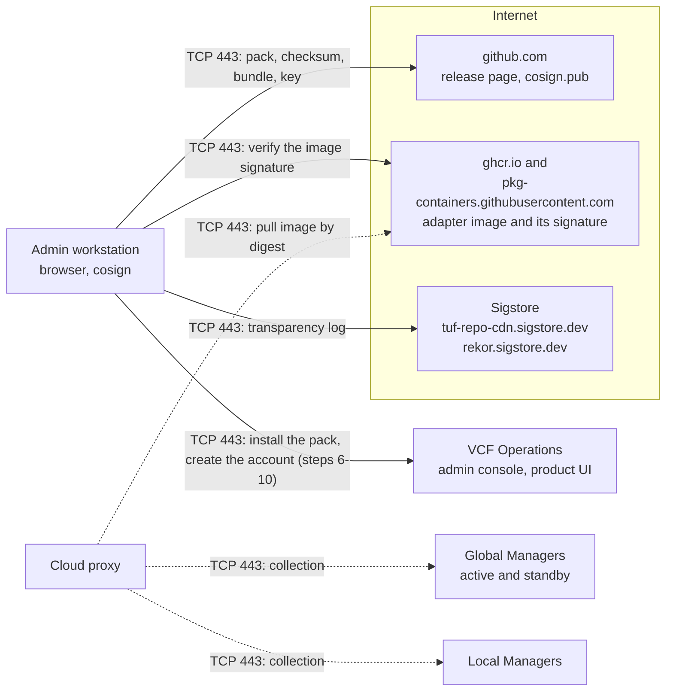
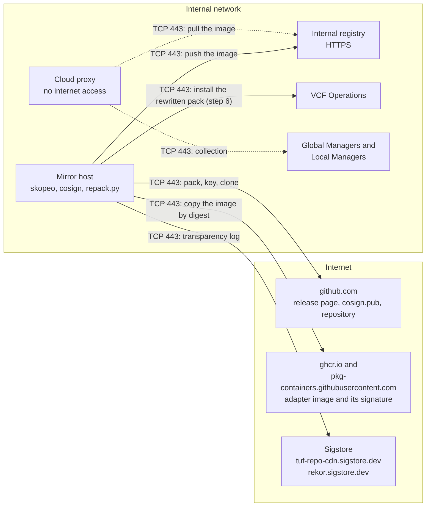

# Install guide

How to install the released NSX Federation pack in VCF Operations 9.1.1, with the machine each command runs on.
To build the pack from source, see [BUILD.md](BUILD.md). Part 2 of the
[blog](https://sorinplaton.github.io/posts/nsx-federation-management-pack-install/) shows the steps with
screenshots.

Version française : [INSTALL.fr.md](INSTALL.fr.md).

## Choose a path

| Path | Use when | Needs | Steps |
| --- | --- | --- | --- |
| [Option A: download the released pack](#option-a-download-the-released-pack) | The cloud proxy has internet access. The fastest way, nothing to build | The cloud proxy reaches `ghcr.io` and `pkg-containers.githubusercontent.com` on TCP 443 | Option A, then steps 6 to 10 |
| [Option A, mirror variant](#variant-mirror-the-image-to-an-internal-registry) | The cloud proxy has no internet access, or images must be scanned and served from an internal registry, and the released pack is used as it is. No build | A host that reaches both `ghcr.io` and the internal registry, and an internal registry served over HTTPS that the cloud proxy trusts | Option A with its mirror variant, then steps 6 to 10 |
| [Option B: build from source](BUILD.md) | The pack is modified or must be built from source, or a lab runs its own registry on the build host. It also fits a cloud proxy without internet access. The Harbor variant pushes the image to an existing Harbor in place of the small registry of step 2 | A build host with Docker, and a registry served over HTTPS that the cloud proxy trusts | Steps 1 to 5 in [BUILD.md](BUILD.md), or the Harbor variant in place of steps 2 to 4, then steps 6 to 10 |

Organisations that use JFrog Artifactory follow [CUSTOMER-INSTALL.md](CUSTOMER-INSTALL.md).

All paths install the same pack and meet again at step 6.

The `.pak` file holds the content of the pack (object model, alerts, dashboards) and the address of the adapter
image. The adapter itself is a container image that the cloud proxy pulls when the account starts. The image is
not inside the `.pak`: the cloud proxy downloads it with Docker from the registry the pack names, so that
registry has to be reachable from the cloud proxy, over HTTPS, with a certificate the cloud proxy trusts. If
the pull fails, the pack still installs, but the account never collects (step 8 shows the symptom). The paths
differ only in where that image comes from.

Every path needs "Allow unsigned PAK installation" for the length of the install. VCF
Operations looks for a Broadcom signature in a `.pak`, and this pack has none (KB 415279). The released pack is
signed with cosign by this project, which is a different signature: it lets the person who installs check where
the file comes from, and VCF Operations does not read it. The switch is therefore needed even for a pack whose
cosign signature was verified.

## Where things run

| Machine | Role |
| --- | --- |
| Build host | Option B only. A Linux host with Docker, `git` and Python 3. It builds the pack and pushes the adapter image. In the lab it is the jump host, which also runs the registry |
| Registry | Option A: `ghcr.io`, run by GitHub. Mirror variant: an internal registry. Option B: an image registry served over HTTPS that the cloud proxy can reach. The cloud proxy does not fall back to HTTP |
| Cloud proxy | The VCF Operations collector that runs the adapter container. It pulls the image from the registry |
| VCF Operations | Admin console (`https://<ops>/admin`) and product UI (`https://<ops>/`) |
| NSX | The Global Managers (active and standby) and the Local Managers of one federation |

## Network access

Open these flows before starting: a blocked one shows up late, as an account that stays `FAILED`. Option A and
its mirror variant have their own drawing in their sections. The flows of the build host (Option B) are in
[BUILD.md, Network access](BUILD.md#network-access).

With Option A, only the cloud proxy flows to `ghcr.io`, `pkg-containers.githubusercontent.com` and NSX are
needed, plus a browser that reaches VCF Operations. With the mirror variant, the cloud proxy reaches the
internal registry and NSX, and only the mirror host reaches the internet.

| From | To | Port | Used for |
| --- | --- | --- | --- |
| Admin workstation (Option A) or mirror host | `github.com` and `raw.githubusercontent.com` | TCP 443 | Downloading the pack, its checksum, its bundle, `cosign.pub` and cosign. The mirror host also clones the repository |
| Admin workstation (Option A) or mirror host | `ghcr.io` and `pkg-containers.githubusercontent.com` | TCP 443 | Verifying the signature of the image. The mirror host also copies the image from there |
| Admin workstation (Option A) or mirror host | Sigstore (`tuf-repo-cdn.sigstore.dev`, `rekor.sigstore.dev`) | TCP 443 | The transparency log, for the signature check only |
| Admin workstation (Option A) or mirror host | VCF Operations | TCP 443 | Installing the pack and creating the account (steps 6 to 10) |
| Mirror host | Internal registry | TCP 443, or the registry port | Mirror variant: pushing the copied image |
| Cloud proxy | Registry | TCP 5000, or the registry port | Option B and the mirror variant: pulling the adapter image |
| Cloud proxy | `ghcr.io` and `pkg-containers.githubusercontent.com` | TCP 443 | Option A: pulling the released adapter image. `ghcr.io` answers the registry calls and redirects the image layers to `pkg-containers.githubusercontent.com`. Through the site proxy if the cloud proxy uses one |
| Cloud proxy | Global Managers and Local Managers | TCP 443 | Collection |

Placeholders:

| Placeholder | Example |
| --- | --- |
| `$IP`, `$VERSION`, `$OPS_HOST` and the other variables | Values of the settings file `~/fedmp.env` ([The settings file](BUILD.md#the-settings-file)) |
| `<ops>` | The VCF Operations host name, in the browser steps |
| `<gm1>`, `<gm2>` | Cluster address of the active and of the standby Global Manager |

## Option A: download the released pack

Use this in place of steps 1 to 5 of [BUILD.md](BUILD.md) when the cloud proxy has internet access. It needs no
build host, no Docker and no registry of your own. When the cloud proxy has no internet access, or images must
come from an internal registry, add the [mirror variant](#variant-mirror-the-image-to-an-internal-registry)
after the signature checks.

Network flows of this path. Solid lines start at the admin workstation; dashed lines are the cloud proxy's. The
Sigstore flow is only for the signature check.



- [ ] VCF Operations 9.1.1 with at least one cloud proxy in state `UP`, which reaches `ghcr.io` and
      `pkg-containers.githubusercontent.com` on TCP 443, directly or through the site proxy. Firewall rules need
      both names: the image layers come from the second one. With the mirror variant, the cloud proxy reaches
      the internal registry instead.
- [ ] NSX 9.1 Federation and a read-only NSX account, as in [BUILD.md, step 1](BUILD.md#1-prerequisites).
- [ ] The cloud proxy reaches every NSX manager on TCP 443.
- [ ] Admin password of VCF Operations, and the change approval for the unsigned-pack switch if the
      organisation requires one.
- [ ] Pack downloaded, checksum verified, signatures verified (recommended).
- [ ] Mirror variant only: image copied to the internal registry, pack pointed at it.
- [ ] Then steps 6 to 10.

*Run on: any machine with a browser that reaches VCF Operations.* Download the pack and its checksum from the
[releases page](https://github.com/sorinplaton/vcf-ops-nsx-federation-mp/releases/latest), or with the commands
below. The last one computes the SHA-256 of the downloaded file and compares it with the published value.
Expected: `NSXFederation_1.13.0.pak: OK`. Anything else means the download is damaged or incomplete; download
it again.

```bash
curl -LO https://github.com/sorinplaton/vcf-ops-nsx-federation-mp/releases/download/v1.13.6/NSXFederation_1.13.0.pak
curl -LO https://github.com/sorinplaton/vcf-ops-nsx-federation-mp/releases/download/v1.13.6/NSXFederation_1.13.0.pak.sha256
sha256sum -c NSXFederation_1.13.0.pak.sha256
```

The pack names the image `ghcr.io/sorinplaton/nsxfederation` by digest, so the cloud proxy always runs the
image the pack was built with. The image is public: the cloud proxy pulls it without a login, and it trusts the
certificate of `ghcr.io` without step 4 of BUILD.md.

Optional check, *on the cloud proxy* if SSH is enabled there. It tells, before the install, whether the cloud
proxy can reach the two hosts the image comes from. Any HTTP code means the host is reachable (`401` and `400`
are the expected answers); `000` means it is not, and the account of step 8 would stay `FAILED`:

```bash
curl -s -o /dev/null -w '%{http_code}\n' https://ghcr.io/v2/
curl -s -o /dev/null -w '%{http_code}\n' https://pkg-containers.githubusercontent.com/
```

### Why the cloud proxy reaches the internet

The adapter is a container image that the cloud proxy pulls when the account starts. The `.pak` holds only the
content of the pack and the address of that image, as [Choose a path](#choose-a-path)
explains. With Option A, the pack names `ghcr.io`, so the cloud proxy downloads the image from the internet.

That download is the only internet traffic of the cloud proxy. It goes to `ghcr.io` and
`pkg-containers.githubusercontent.com` on TCP 443: `ghcr.io` answers the registry calls and redirects the
download of the image layers to the second host. Collection stays on the local network, between the adapter,
the NSX managers and VCF Operations, and no monitoring data leaves the site. The signature checks below run on
the machine that downloaded the pack, not on the cloud proxy.

The cloud proxy pulls the image the first time the account starts, and again after a redeploy or an upgrade of
the cloud proxy, because its local copy is gone. Plan for access whenever the adapter starts.

To keep the cloud proxy off the internet, use the
[mirror variant](#variant-mirror-the-image-to-an-internal-registry): a machine with internet access copies the
image once to an internal registry, the pack is pointed at that registry, and the cloud proxy then reaches only
that registry. [Option B](BUILD.md) gives the same result with a build of your own.

## Verify the signatures (recommended)

The pack and its adapter image are signed with [cosign](https://docs.sigstore.dev/cosign/) (Sigstore). The
checksum only proves that the download is complete; it sits next to the pack on the same release page, so
whoever could replace the pack there could replace the checksum too. The signatures prove that the pack and the
image come from this project, and that neither changed since. Verify both before the install, and again for
every new release.

From release `v1.13.3`, the release workflow on GitHub signs the pack and the images without a key ("keyless"):
the signature carries a certificate that names the workflow and the tag that built them, and the check compares
that name instead of a public key. Use the [keyless check](#keyless-check-releases-from-v1133). Releases up to
`v1.13.2` are signed with the project key only: use the [key-based check](#key-based-check-releases-up-to-v1140).

**Install cosign.** *Run on: the machine that downloaded the pack (Linux, x86-64).* One of the three methods
below; the last line prints the version and confirms that the install worked.

```bash
# Ubuntu or Debian
curl -LO https://github.com/sigstore/cosign/releases/download/v2.4.1/cosign_2.4.1_amd64.deb
sudo dpkg -i cosign_2.4.1_amd64.deb

# RHEL, Rocky Linux or AlmaLinux
curl -LO https://github.com/sigstore/cosign/releases/download/v2.4.1/cosign-2.4.1-1.x86_64.rpm
sudo rpm -ivh cosign-2.4.1-1.x86_64.rpm

# Any Linux: the single binary
curl -LO https://github.com/sigstore/cosign/releases/download/v2.4.1/cosign-linux-amd64
sudo install -m 0755 cosign-linux-amd64 /usr/local/bin/cosign

cosign version
```

The [cosign releases](https://github.com/sigstore/cosign/releases) also hold macOS and Windows builds and a
`cosign_checksums.txt` for the downloads. Without installing anything, Docker can run the same version:
`sudo docker run --rm -v $PWD:/w -w /w -u $(id -u) -e HOME=/tmp ghcr.io/sigstore/cosign/cosign:v2.4.1 <command>`.

### Keyless check (releases from v1.13.3)

Two checks: the pack, then the image the pack points to. Set the release once; the signature must name exactly
this repository, this workflow and this tag, issued by GitHub Actions. The release notes on GitHub show the same
values. The bundle of the pack is the `.sigstore.json` file of the release, which the `curl` line downloads.

The pack is a zip file that holds a second zip, `adapter.zip`, whose `.conf` file names the registry, the
repository and the digest of the image. The two `unzip` lines read the digest from there, and the last line asks
cosign to verify the signature stored next to that image on `ghcr.io`.

```bash
RELEASE=1.13.6
SIGNER="https://github.com/sorinplaton/vcf-ops-nsx-federation-mp/.github/workflows/release.yml@refs/tags/v$RELEASE"
ISSUER=https://token.actions.githubusercontent.com
curl -LO https://github.com/sorinplaton/vcf-ops-nsx-federation-mp/releases/download/v$RELEASE/NSXFederation_1.13.0.pak.sigstore.json

cosign verify-blob --certificate-identity "$SIGNER" --certificate-oidc-issuer "$ISSUER" \
  --bundle NSXFederation_1.13.0.pak.sigstore.json NSXFederation_1.13.0.pak
unzip -p NSXFederation_1.13.0.pak adapter.zip > /tmp/adapter.zip
DIGEST=$(unzip -p /tmp/adapter.zip '*.conf' | sed -n 's/^DIGEST=//p')
cosign verify --certificate-identity "$SIGNER" --certificate-oidc-issuer "$ISSUER" ghcr.io/sorinplaton/nsxfederation@$DIGEST
```

Replace `1.13.0` with the pack version in the file names of that release. Expected: `Verified OK`, then the list
of checks cosign made.

The commands reach the internet: `ghcr.io` for the image signature, and the Sigstore servers
(`tuf-repo-cdn.sigstore.dev`, `rekor.sigstore.dev`) for the public transparency log in which each signature is
recorded. A failed verification means the file or the image is not the one that was signed: do not install it.

### Key-based check (releases up to v1.14.0)

Releases up to `v1.13.2` are signed with the project key only. From `v1.13.3` to `v1.14.0`, key signatures are
added next to the keyless ones ([SECURITY.md](../SECURITY.md#supply-chain)). A key signature proves that the
pack and the image were produced by the holder of the private key of this project.

The public key is `cosign.pub`, at the root of this repository and on the release page. Take it from the
repository, and keep that copy for later releases: a key downloaded from the same place as the pack proves
less. The first command below fetches the key, the second the bundle, which is the signature of the pack.

```bash
curl -LO https://raw.githubusercontent.com/sorinplaton/vcf-ops-nsx-federation-mp/main/cosign.pub
curl -LO https://github.com/sorinplaton/vcf-ops-nsx-federation-mp/releases/download/v1.13.6/NSXFederation_1.13.0.pak.bundle
```

**Verify the pack.** Run it in the folder that holds the pack, the bundle and the key. cosign checks the
signature in the bundle against the file and the public key. Expected: `Verified OK`.

```bash
cosign verify-blob --key cosign.pub --bundle NSXFederation_1.13.0.pak.bundle NSXFederation_1.13.0.pak
```

**Verify the image the pack points to.** The first two lines read the digest from the pack, as in the keyless
check, and the third asks cosign to verify the signature stored next to that image on `ghcr.io`. Expected: "The
signatures were verified against the specified public key".

```bash
unzip -p NSXFederation_1.13.0.pak adapter.zip > /tmp/adapter.zip
DIGEST=$(unzip -p /tmp/adapter.zip '*.conf' | sed -n 's/^DIGEST=//p')
cosign verify --key cosign.pub ghcr.io/sorinplaton/nsxfederation@$DIGEST
```

The commands reach the same hosts as the keyless check. A failed verification means the file or the image is
not the one that was signed: do not install it.

### Optional: build provenance and SBOM (releases from v1.13.5)

From `v1.13.5`, the pack and both images also carry a SLSA build provenance attestation: a signed record of the
commit, the workflow and the runner that built them. The GitHub CLI checks it; it reaches `api.github.com`. The
adapter image also carries its SBOM as a signed attestation, which cosign checks and prints:

```bash
gh attestation verify NSXFederation_1.13.0.pak -R sorinplaton/vcf-ops-nsx-federation-mp \
  --signer-workflow sorinplaton/vcf-ops-nsx-federation-mp/.github/workflows/release.yml
gh attestation verify oci://ghcr.io/sorinplaton/nsxfederation@$DIGEST -R sorinplaton/vcf-ops-nsx-federation-mp
cosign verify-attestation --type cyclonedx --certificate-identity "$SIGNER" --certificate-oidc-issuer "$ISSUER" \
  ghcr.io/sorinplaton/nsxfederation@$DIGEST > /dev/null && echo "SBOM attestation: verified"
```

Expected: `Verification succeeded!` twice, then `SBOM attestation: verified`. The release also carries the Trivy
report of the adapter image, `NSXFederation_<version>.trivy.txt`.

Once the checksum and the signatures are good, install the pack with step 6, by hand or with the scripts, and
continue with steps 7 to 10. The scripts need a Linux host with a clone of this repository, the settings file
([BUILD.md, step 1](BUILD.md#the-settings-file)) and the tools listed in
[Tools for some steps](BUILD.md#tools-for-some-steps). With the mirror variant, do the variant below before
step 6.

## Variant: mirror the image to an internal registry

For an enterprise that does not let the cloud proxy reach the internet, or that scans every image before use,
copy the released image into an internal registry and point the released pack at it. No build host and no
SDK are needed, the cloud proxy depends on the internal registry only, and the image can be scanned there
before use. The image is copied bit for bit and keeps its digest, so it is still the image the project signed.

Network flows of this variant. Only the mirror host reaches the internet. The cloud proxy talks to the internal
registry and to NSX.



*Run on: a Linux host that reaches both `ghcr.io` and the internal registry*, called the mirror host here. It
needs [skopeo](https://github.com/containers/skopeo) (`sudo apt-get install -y skopeo` or `sudo dnf install -y skopeo`),
which copies an image from one registry to another, cosign (installed as above), and `git`, `python3`
and `unzip` from the distribution packages. The internal registry needs the same preparation as in
[Variant: an existing Harbor registry](BUILD.md#variant-an-existing-harbor-registry): a public project, an account that
can push to it, and a certificate the cloud proxy trusts.

Prepare the mirror host once. The clone brings `tools/repack.py`, and the settings file gives the commands the
address of the internal registry and the push account:

```bash
cd ~
git clone https://github.com/sorinplaton/vcf-ops-nsx-federation-mp.git
cp vcf-ops-nsx-federation-mp/install/fedmp.env.example ~/fedmp.env && chmod 600 ~/fedmp.env
nano ~/fedmp.env
```

In `~/fedmp.env`, remove the `#` in front of the four `HARBOR` lines and fill them in: `HARBOR` is the address
of the internal registry, `HARBOR_PROJECT` the project, `HARBOR_USER` and `HARBOR_PW` the account that can
push. The variables are named after Harbor, and the commands use them for any registry. Fill in `OPS_HOST` and
`OPS_PW` as well if the scripted install of step 6 will run from this host. The other lines can keep their
example values. [The settings file](BUILD.md#the-settings-file) describes the file and the line that loads it.

Then, in the folder that holds the downloaded pack:

1. Verify the signatures of the pack and the image, as in
   [Verify the signatures](#verify-the-signatures-recommended). Do it first: item 3 changes the pack, so its
   checksum and signature no longer match afterwards.
2. Copy the image by digest. The first lines read the digest from the pack again, so the block also works in a
   new shell. `--all` copies the image exactly as published, and `--preserve-digests` makes skopeo stop rather
   than change the digest the pack names:

   ```bash
   set -a; source ~/fedmp.env; set +a
   unzip -p NSXFederation_1.13.0.pak adapter.zip > /tmp/adapter.zip
   DIGEST=$(unzip -p /tmp/adapter.zip '*.conf' | sed -n 's/^DIGEST=//p')
   skopeo copy --all --preserve-digests --dest-creds "$HARBOR_USER:$HARBOR_PW" \
     docker://ghcr.io/sorinplaton/nsxfederation@$DIGEST \
     docker://$HARBOR/$HARBOR_PROJECT/nsxfederation:1.13.0
   ```

   To verify the image again from the internal registry later, copy its signature too, in the same shell:
   `cosign copy ghcr.io/sorinplaton/nsxfederation@$DIGEST $HARBOR/$HARBOR_PROJECT/nsxfederation` (needs
   `docker login $HARBOR` first).
3. Point the pack at the internal registry. `repack.py` rewrites the `REGISTRY` and `REPOSITORY` lines inside
   the pack, in place. Only the registry and the repository change; the digest stays. The two `unzip` lines
   print the result:

   ```bash
   set -a; source ~/fedmp.env; set +a
   python3 ~/vcf-ops-nsx-federation-mp/tools/repack.py NSXFederation_1.13.0.pak $HARBOR $HARBOR_PROJECT/nsxfederation
   unzip -p NSXFederation_1.13.0.pak adapter.zip > /tmp/adapter.zip
   unzip -p /tmp/adapter.zip '*.conf' | grep -E '^(REGISTRY|REPOSITORY|DIGEST)='
   ```

   Expected: `REGISTRY` is the internal registry, `REPOSITORY` is `/<project>/nsxfederation`, and `DIGEST` is the
   value of item 2.
4. Scan the image in the internal registry if the organisation requires it, then install the rewritten pack
   with step 6 and continue with steps 7 to 10. The cloud proxy needs only the internal registry, not `ghcr.io`.

## 6. Install the unsigned pack

Both methods turn "Allow unsigned PAK installation" on for the upload and off again afterwards. The switch
applies to the whole VCF Operations instance: while it is on, any unsigned pack can be installed, so keep that
time short and check at the end that it is off.

### By hand

*Run in: a browser.*

1. Admin console `https://<ops>/admin`, Administrator Settings, Security Settings: activate "unsigned PAK
   installation".
2. Product UI: Administration, Integrations, Repository, add a pack.
3. Select `NSXFederation_<version>.pak`, tick "install even if already installed" and "Ignore the PAK file
   signature checking".
4. Upload, accept the warning about the unsigned file and wait for the install to finish.
5. Admin console: deactivate unsigned PAK installation. The console refuses the change while the install is
   running; try again once it has finished.

### Scripted

*Run on: the build host.* With Option A or the mirror variant, any Linux host with a clone of this repository
and `~/fedmp.env` ([The settings file](BUILD.md#the-settings-file)) will do. The host needs Google Chrome, Node.js 22
or later ([Tools for some steps](BUILD.md#tools-for-some-steps)) and Python 3 with `requests`. The scripts drive a
headless Chrome through calls that are internal to the VCF Operations UI. They are unsupported and can change
with any release. That Chrome accepts the certificate of VCF Operations without checking it, so run the scripts
on a trusted network.

`upi.sh enableUPI` logs in to the admin console and turns the switch on. `install_unsigned.sh` uploads the
pack, waits for the install to finish, deletes the alert definitions an older version left behind, and turns
the switch off. Set `PAK` to the file to install: the line below is right for Option B; with Option A or the
mirror variant, give the full path of the downloaded or rewritten `.pak`.

```bash
set -a; source ~/fedmp.env; set +a
cd ~/vcf-ops-nsx-federation-mp
PAK=pack/build/NSXFederation_$VERSION.pak     # Option A: the path of the downloaded .pak
install/upi.sh enableUPI
install/install_unsigned.sh "$PAK"
```

`install_unsigned.sh` first checks the signatures with `install/verify_pak.sh`. A released pack with its
`.sigstore.json` next to it must verify, or nothing is installed; keep the bundle in the folder of the pack for
that. A pack without the bundle (a build of your own, or one rewritten by the mirror variant) is installed with a
notice. `FEDMP_VERIFY=1` requires the image check for any pack, and `FEDMP_VERIFY=0` skips the check. The check
uses `cosign` if it is installed, or the cosign image through Docker. `FEDMP_PAK_SHA256=<sha256>` also requires
the file to have that checksum, whatever `FEDMP_VERIFY` says: use it for a rewritten pack, whose checksum you
recorded yourself ([INSTALL-ENTERPRISE.md](INSTALL-ENTERPRISE.md), step 7).

Run `install_unsigned.sh` after `upi.sh`: the admin console login ends the product UI session, and the install
script logs in again. It turns the switch off however it ends, and stops the headless Chrome. Exit code 0 means
the install completed and the switch is off. A line `WARNING: orphan definitions were not all removed` means
only the clean-up after the install failed, usually on the certificate of VCF Operations (`OPS_CA` or
`OPS_INSECURE` in the settings file); run `python3 install/cleanup_content.py "$PAK" --delete` once that is
set. A line `WARNING: unsigned PAK installation is still enabled` means the script could not turn the switch
off: do it in the admin console.

To read the switch on its own, `install/upi.sh getUPIStatus`, then `install/chrome.sh stop`: `upi.sh` leaves
the headless Chrome, which holds the admin console session, running.

Check: Administration, Integrations, Repository lists the NSX Federation pack with the new version.

## 7. Create the account

The installed pack collects nothing by itself. An account tells VCF Operations which federation to read, with
which credential, and which cloud proxy runs the adapter. That cloud proxy pulls the image when the account
starts.

*Run in: the VCF Operations product UI*, Administration, Integrations, Accounts, add an account of type NSX
Federation.

- [ ] Global Manager addresses: `<gm1>,<gm2>`, the cluster address of the active and of the standby. One
      account per federation.
- [ ] Credential: the read-only NSX account. Add the Local Manager credential only if it differs.
- [ ] Collector: with Option A, a cloud proxy that reaches `ghcr.io` and
      `pkg-containers.githubusercontent.com`; with the mirror variant, a cloud proxy that trusts the internal
      registry; with Option B, the cloud proxy that trusts the registry
      ([BUILD.md, step 4](BUILD.md#4-cloud-proxy-trusts-the-registry-certificate)).
- [ ] Certificate trust: keep `enforce`, or choose `ca` when the managers have certificates signed by an
      internal CA. With `ca`, paste the CA certificates in "Trusted CA certificates (PEM)" and use addresses
      that the certificates name.
- [ ] Validate the connection and accept the Global Manager certificates. Without an accepted certificate,
      `enforce` collects nothing. An account created through the API has no accepted certificate; edit it in
      the UI, validate and accept, or use `ca`.
- [ ] The other settings can keep their defaults. [OPERATIONS.md](OPERATIONS.md) describes each one.

## 8. Check the collection

This is where the registry and certificate work of the earlier steps is proven: the cloud proxy pulls the
image, starts the adapter and reads NSX.

*Run in: the VCF Operations product UI.*

- [ ] Accounts tab: the account reaches "Collecting". If it stays `FAILED` with an empty message, the cloud
      proxy could not pull the image. Option A: check that the cloud proxy reaches `ghcr.io` and
      `pkg-containers.githubusercontent.com`. Mirror variant: check that the cloud proxy reaches the internal
      registry and trusts its certificate, and that the project is public. Option B: check steps 2 and 4 of
      [BUILD.md](BUILD.md), and the registry log for `tls: bad certificate`.
- [ ] With a 5-minute interval, the data arrives over three cycles: objects and relationships first, then
      properties and events, then metrics after about ten minutes. Rates need one more cycle. Objects without
      metrics in the first ten minutes are expected.
- [ ] The federation object lists no failed calls.

## 9. Optional: group per federation

The pack ships groups by area that hold the objects of every federation. This script adds one custom group per
federation, which is what a policy, a notification rule or a dashboard needs to apply to a single federation.

*Run on: the build host.* With Option A or the mirror variant, use the host of the scripted install of step 6.
The script reads the federations from VCF Operations through the Suite API and creates the groups. It never
deletes one.

```bash
set -a; source ~/fedmp.env; set +a
cd ~/vcf-ops-nsx-federation-mp
python3 install/federation_groups.py                     # "NSX Federation - <federation>" for every federation
python3 install/federation_groups.py --federation '<federation>' --policy '<policy>'   # and assign a policy
```

- [ ] The group "NSX Federation - <federation>" lists the objects of that federation (Environment, Custom Groups).
      The script needs one collection with 1.13.0 or later; running it again updates the groups.

## 10. Optional: send the alerts

Alerts stay inside VCF Operations until a notification rule sends them somewhere. This script creates that
rule for the alerts of the pack. It holds no mail server or ticketing credentials: those belong to the
outbound instance, which has to exist first.

*Run on: the build host*, or the host of the scripted install of step 6. First create the outbound instance
(email server, webhook, ServiceNow, Slack, SNMP or log file) under Administration, Configurations, Outbound
Settings. The first command sends the alerts of criticality immediate and critical. The second adds a rule for
warnings and above, limited to the group of one federation made in step 9. Running a command again with the
same rule name updates the rule.

```bash
set -a; source ~/fedmp.env; set +a
cd ~/vcf-ops-nsx-federation-mp
python3 install/notification_rules.py --outbound '<outbound instance>'                    # immediate and critical
python3 install/notification_rules.py --outbound '<outbound instance>' --min-criticality warning \
        --group 'NSX Federation - <federation>' --name 'NSX Federation - <federation> warnings'
```

- [ ] The rule "NSX Federation - <outbound instance>" is listed under Alerts, Notifications. It sends new,
      updated and cancelled alerts, so a ticket also learns that the alert cleared.

## Upgrade

An upgrade is a new install of the pack over the old one, followed by a stop and a start of the account.

1. Get the new pack, then install it (step 6).
   - Option A: download the pack of the new release and verify its signatures.
   - Mirror variant: do the same, then repeat items 2 and 3 of the variant. The new pack names a new image by
     its digest, so that image has to be copied and the new pack pointed at the internal registry.
   - Option B: update the clone with `cd ~/vcf-ops-nsx-federation-mp && git pull`, set `VERSION` in
     `~/fedmp.env` to the new version (as in `pack/manifest.txt`), then build the new version
     ([BUILD.md, step 3](BUILD.md#3-build-the-pack)).
2. Stop and start the account. Check that it reaches "Collecting"; start it a second time if it stays stopped.
3. Metrics return after three cycles, rates after four.

`install_unsigned.sh` deletes the alert, symptom and recommendation definitions that the new version no longer
ships. After a manual install, run `install/cleanup_content.py <pak> --delete` (see [OPERATIONS.md](OPERATIONS.md), Upgrade).

From a version before 1.9.0, the edge nodes, RTEP tunnels and sync channels are created again under a key based
on their NSX ID, and the old objects stop receiving data. `cleanup_content.py <pak> --legacy-objects --delete`
deletes them, with their history.

## What was tested

- Option B is the path used in the lab. [BUILD.md](BUILD.md#what-was-tested) lists what was tested there.
- The download and every command of [Verify the signatures](#verify-the-signatures-recommended), against the
  `v1.13.5` release.
- The signature commands (key, keyless, provenance and SBOM), against the `v1.13.6` release.
- The keyless check against `v1.13.3`, the first keyless release, on 2026-11-26.
- The provenance and SBOM checks against `v1.13.5`, the first release with these, on 2026-11-26.
- The mirror variant, in the lab against a local `registry:2`.

Not tested:

- The pull of the image from `ghcr.io` by the cloud proxy (Option A). The lab uses Option B.
- Whether the cloud proxy contacts `ghcr.io` at each restart of the account, with the image still on disk.
- The mirror variant against Harbor.
