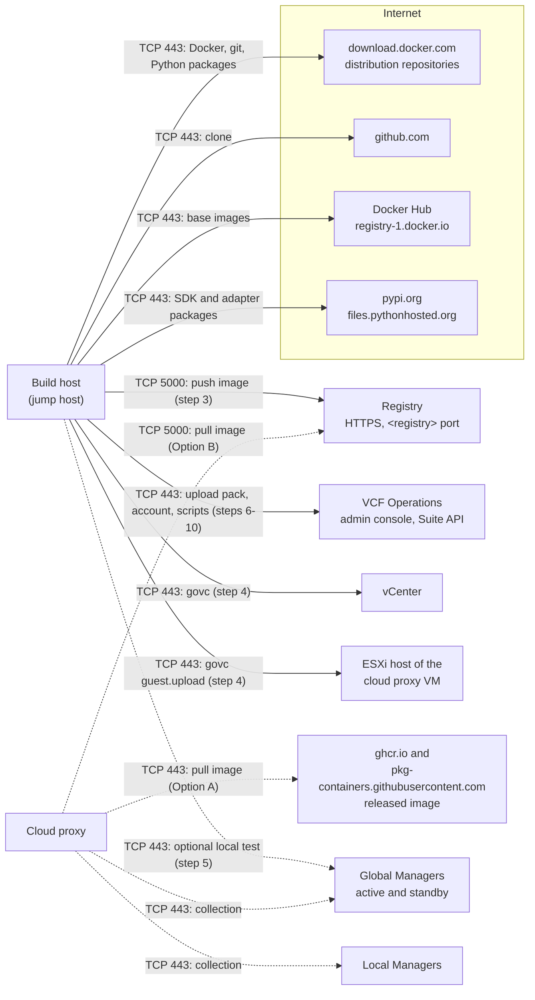

# Install guide

How to install the NSX Federation pack in VCF Operations 9.1.1, either from the released pack or from a
build of your own, with the machine each command runs on. These are the steps used in the lab. Part 2 of the
[blog](https://sorinplaton.github.io/posts/nsx-federation-management-pack-install/) shows them with screenshots.

Version française : [INSTALL.fr.md](INSTALL.fr.md).

## Choose an install path

The `.pak` file holds the content of the pack (object model, alerts, dashboards) and the address of the adapter
image. The adapter itself is a container image that the cloud proxy pulls when the account starts. The two
paths differ only in where that image comes from.

| | Option A: download the released pack | Option B: build your own |
| --- | --- | --- |
| Adapter image | Public, on `ghcr.io/sorinplaton/nsxfederation`, pulled by digest | Pushed by you to a registry of your own |
| Needs | The cloud proxy reaches `ghcr.io` and `pkg-containers.githubusercontent.com` on TCP 443 | A build host with Docker, and a registry served over HTTPS that the cloud proxy trusts |
| Steps | [Option A](#option-a-download-the-released-pack), then steps 6 to 10 | Steps 1 to 10, or the Harbor variant in place of steps 2 to 4 |
| Use when | The cloud proxy has internet access | The cloud proxy has no internet access, images must come from an internal registry, or the pack is modified |

Both paths install the same pack and need "Allow unsigned PAK installation" for the length of the install.

## Where things run

| Machine | Role |
| --- | --- |
| Build host | Option B only. A Linux host with Docker, `git` and Python 3. It builds the pack and pushes the adapter image. In the lab it is the jump host, which also runs the registry |
| Registry | Option A: `ghcr.io`, run by GitHub. Option B: an image registry served over HTTPS that the cloud proxy can reach. The cloud proxy does not fall back to HTTP |
| Cloud proxy | The VCF Operations collector that runs the adapter container. It pulls the image from the registry |
| VCF Operations | Admin console (`https://<ops>/admin`) and product UI (`https://<ops>/`) |
| NSX | The Global Managers (active and standby) and the Local Managers of one federation |

## Network access

What the build host (the jump host in the lab) must reach, and the flows of the cloud proxy that the install
depends on. Solid lines start at the build host and apply to Option B only; dashed lines are the cloud proxy's.
With Option A, only the cloud proxy flows to `ghcr.io` and to NSX are needed, plus a browser that reaches
VCF Operations.



| From | To | Port | Used for |
| --- | --- | --- | --- |
| Build host | Internet (Docker and distribution repositories, GitHub, Docker Hub, PyPI) | TCP 443 | Installing the tools, cloning the repository, building the tooling and adapter images. Through a proxy if the site uses one |
| Build host | Registry | TCP 5000, or the registry port | Pushing the adapter image. Local when the registry runs on the build host, as in the lab |
| Build host | VCF Operations | TCP 443 | Admin console and product UI in a browser, and the Suite API for the scripts of steps 6 to 10 |
| Build host | vCenter of the cloud proxy VM | TCP 443 | `govc` guest operations of step 4. Not needed when the certificate is copied over SSH |
| Build host | ESXi host of the cloud proxy VM | TCP 443 | `govc guest.upload` sends the file to the ESXi host, not to vCenter |
| Build host | Global Managers | TCP 443 | Only for the optional test of step 5 |
| Cloud proxy | Registry | TCP 5000, or the registry port | Option B: pulling the adapter image |
| Cloud proxy | `ghcr.io` and `pkg-containers.githubusercontent.com` | TCP 443 | Option A: pulling the released adapter image. `ghcr.io` answers the registry calls and redirects the image layers to `pkg-containers.githubusercontent.com`. Through the site proxy if the cloud proxy uses one |
| Cloud proxy | Global Managers and Local Managers | TCP 443 | Collection |

Placeholders:

| Placeholder | Example |
| --- | --- |
| `$IP`, `$VERSION`, `$OPS_HOST` and the other variables | Values of the settings file `~/fedmp.env` (step 1) |
| `<ops>` | The VCF Operations host name, in the browser steps |
| `<gm1>`, `<gm2>` | Cluster address of the active and of the standby Global Manager |

## Checklist

Option B. With Option A, use the checklist of [Option A](#option-a-download-the-released-pack).

- [ ] 1. Prerequisites checked
- [ ] 2. Registry serves HTTPS
- [ ] 3. Pack built, image pushed, registry address in the pack checked
- [ ] 4. Cloud proxy trusts the registry certificate
- [ ] 5. Optional: collection tested without VCF Operations
- [ ] 6. Unsigned pack installed, switch turned off again
- [ ] 7. Account created, certificates accepted
- [ ] 8. Account "Collecting", metrics after three cycles
- [ ] 9. Optional: group per federation
- [ ] 10. Optional: alerts sent to email, a webhook or a ticketing tool

## Option A: download the released pack

Use this in place of steps 1 to 5 when the cloud proxy has internet access. It needs no build host, no Docker
and no registry of your own. Not yet tested in the lab, which uses Option B.

- [ ] VCF Operations 9.1.1 with at least one cloud proxy in state `UP`, which reaches `ghcr.io` and
      `pkg-containers.githubusercontent.com` on TCP 443, directly or through the site proxy. Firewall rules need
      both names: the image layers come from the second one.
- [ ] NSX 9.1 Federation and a read-only NSX account, as in step 1.
- [ ] The cloud proxy reaches every NSX manager on TCP 443.
- [ ] Admin password of VCF Operations, and the change approval for the unsigned-pack switch if the
      organisation requires one.
- [ ] Pack downloaded, checksum verified, signatures verified (recommended).
- [ ] Then steps 6 to 10.

*Run on: any machine with a browser that reaches VCF Operations.* Download the pack and its checksum from the
[releases page](https://github.com/sorinplaton/vcf-ops-nsx-federation-mp/releases/latest), or:

```bash
curl -LO https://github.com/sorinplaton/vcf-ops-nsx-federation-mp/releases/download/v1.13.1/NSXFederation_1.13.0.pak
curl -LO https://github.com/sorinplaton/vcf-ops-nsx-federation-mp/releases/download/v1.13.1/NSXFederation_1.13.0.pak.sha256
sha256sum -c NSXFederation_1.13.0.pak.sha256
```

The pack names the image `ghcr.io/sorinplaton/nsxfederation` by digest, so the cloud proxy always runs the
image the pack was built with. The image is public: the cloud proxy pulls it without a login, and it trusts the
certificate of `ghcr.io` without a step 4.

Optional check, *on the cloud proxy* if SSH is enabled there. An answer of `401` means `ghcr.io` is reachable:

```bash
curl -s -o /dev/null -w '%{http_code}\n' https://ghcr.io/v2/
```

Then install the pack with step 6, by hand or with the scripts (the scripts need a clone of this repository and
the settings file of step 1), and continue with steps 7 to 10.

### Verify the signatures (recommended)

The pack and its adapter image are signed with [cosign](https://docs.sigstore.dev/cosign/) (Sigstore). The
checksum only proves that the download is complete; it sits next to the pack on the same release page. The
signatures prove that the pack and the image were produced by the holder of the private key of this project,
and that neither changed since. Verify both before the install, and again for every new release.

The public key is `cosign.pub`, at the root of this repository and on the release page. Take it from the
repository, and keep that copy for later releases: a key downloaded from the same place as the pack proves
less.

```bash
curl -LO https://raw.githubusercontent.com/sorinplaton/vcf-ops-nsx-federation-mp/main/cosign.pub
curl -LO https://github.com/sorinplaton/vcf-ops-nsx-federation-mp/releases/download/v1.13.1/NSXFederation_1.13.0.pak.bundle
```

**Install cosign.** *Run on: the machine that downloaded the pack (Linux, x86-64).* One of:

```bash
# Ubuntu or Debian
curl -LO https://github.com/sigstore/cosign/releases/download/v2.4.1/cosign_2.4.1_amd64.deb
sudo dpkg -i cosign_2.4.1_amd64.deb

# RHEL, Rocky Linux or AlmaLinux
curl -LO https://github.com/sigstore/cosign/releases/download/v2.4.1/cosign-2.4.1-1.x86_64.rpm
sudo rpm -ivh cosign-2.4.1-1.x86_64.rpm

# Any Linux: the single binary
curl -LO https://github.com/sigstore/cosign/releases/download/v2.4.1/cosign-linux-amd64
sudo install -m 0755 cosign-linux-amd64 /usr/local/bin/cosign

cosign version
```

The [cosign releases](https://github.com/sigstore/cosign/releases) also hold macOS and Windows builds and a
`cosign_checksums.txt` for the downloads. Without installing anything, Docker can run the same version:
`docker run --rm -v $PWD:/w -w /w -u $(id -u) -e HOME=/tmp ghcr.io/sigstore/cosign/cosign:v2.4.1 <command>`.

**Verify the pack.** Expected: `Verified OK`.

```bash
cosign verify-blob --key cosign.pub --bundle NSXFederation_1.13.0.pak.bundle NSXFederation_1.13.0.pak
```

**Verify the image the pack points to.** Read its digest from the pack, then verify it. Expected: "The
signatures were verified against the specified public key".

```bash
unzip -p NSXFederation_1.13.0.pak adapter.zip > /tmp/adapter.zip
DIGEST=$(unzip -p /tmp/adapter.zip '*.conf' | sed -n 's/^DIGEST=//p')
cosign verify --key cosign.pub ghcr.io/sorinplaton/nsxfederation@$DIGEST
```

Both commands reach the internet: `ghcr.io` for the image signature, and the Sigstore servers
(`tuf-repo-cdn.sigstore.dev`, `rekor.sigstore.dev`) for the public transparency log in which each signature is
recorded. A failed verification means the file or the image is not the one that was signed: do not install it.

### Variant: mirror the image to an internal registry

For an enterprise that does not let the cloud proxy reach the internet, or that scans every image before use,
copy the released image into an internal registry and point the released pack at it. No build host and no
SDK are needed, the cloud proxy depends on the internal registry only, and the image can be scanned there
before use. Tested in the lab against a local registry; not tested against Harbor.

*Run on: a Linux host that reaches both `ghcr.io` and the internal registry*, with
[skopeo](https://github.com/containers/skopeo) (`sudo apt-get install -y skopeo` or `sudo dnf install -y skopeo`)
and a clone of this repository for `tools/repack.py`. The internal registry needs the same preparation as in
[Variant: an existing Harbor registry](#variant-an-existing-harbor-registry): a public project, an account that
can push to it, and a certificate the cloud proxy trusts.

1. Verify the signatures of the pack and the image, as above. Do it first: step 3 changes the pack, so its
   checksum and signature no longer match afterwards.
2. Copy the image by digest. `--preserve-digests` keeps the digest the pack names:

   ```bash
   set -a; source ~/fedmp.env; set +a
   skopeo copy --preserve-digests --dest-creds "$HARBOR_USER:$HARBOR_PW" \
     docker://ghcr.io/sorinplaton/nsxfederation@$DIGEST \
     docker://$HARBOR/$HARBOR_PROJECT/nsxfederation:1.13.0
   ```

   To verify the image again from the internal registry later, copy its signature too:
   `cosign copy ghcr.io/sorinplaton/nsxfederation@$DIGEST $HARBOR/$HARBOR_PROJECT/nsxfederation` (needs
   `docker login $HARBOR` first).
3. Point the pack at the internal registry. Only the registry and the repository change; the digest stays:

   ```bash
   python3 ~/vcf-ops-nsx-federation-mp/tools/repack.py NSXFederation_1.13.0.pak $HARBOR $HARBOR_PROJECT/nsxfederation
   unzip -p NSXFederation_1.13.0.pak adapter.zip > /tmp/adapter.zip
   unzip -p /tmp/adapter.zip '*.conf' | grep -E '^(REGISTRY|REPOSITORY|DIGEST)='
   ```

   Expected: `REGISTRY` is the internal registry, `REPOSITORY` is `/<project>/nsxfederation`, and `DIGEST` is the
   value of step 2.
4. Scan the image in the internal registry if the organisation requires it, then install the pack with step 6.
   The cloud proxy needs only the internal registry, not `ghcr.io`.

## 1. Prerequisites

- [ ] VCF Operations 9.1.1 with at least one cloud proxy in state `UP`.
- [ ] NSX 9.1 Federation. A read-only NSX account on every Global Manager and Local Manager; the built-in
      `audit` account works. A separate credential for the Local Managers is optional.
- [ ] Network: cloud proxy to every NSX manager on TCP 443, cloud proxy to the registry on its port, build
      host to the registry.
- [ ] Admin password of VCF Operations: the unsigned-pack switch is in the admin console.
- [ ] A change approval to turn on "Allow unsigned PAK installation" for the length of the install, if the
      organisation requires one. The pack is not signed by Broadcom (KB 415279).
- [ ] Build host tools: Docker Engine, `git` and Python 3 with `requests`, installed as below.

### Build host tools

*Run on: the build host.* Docker comes from the Docker repository rather than the distribution packages, so
that `docker build` uses BuildKit.

Ubuntu or Debian (on Debian, replace `ubuntu` with `debian` in both URLs):

```bash
sudo apt-get update
sudo apt-get install -y ca-certificates curl git python3 python3-requests
sudo install -m 0755 -d /etc/apt/keyrings
sudo curl -fsSL https://download.docker.com/linux/ubuntu/gpg -o /etc/apt/keyrings/docker.asc
sudo chmod a+r /etc/apt/keyrings/docker.asc
echo "deb [arch=$(dpkg --print-architecture) signed-by=/etc/apt/keyrings/docker.asc] \
https://download.docker.com/linux/ubuntu $(. /etc/os-release && echo "$VERSION_CODENAME") stable" \
  | sudo tee /etc/apt/sources.list.d/docker.list > /dev/null
sudo apt-get update
sudo apt-get install -y docker-ce docker-ce-cli containerd.io docker-buildx-plugin
```

RHEL, Rocky Linux or AlmaLinux 8 and later:

```bash
sudo dnf install -y dnf-plugins-core git python3 python3-requests
sudo dnf config-manager --add-repo https://download.docker.com/linux/rhel/docker-ce.repo
sudo dnf install -y docker-ce docker-ce-cli containerd.io docker-buildx-plugin
```

On both, start Docker. The `docker` commands of this guide carry `sudo`, so the build user does not have to
be in the `docker` group.

```bash
sudo systemctl enable --now docker
```

Check:

```bash
sudo docker run --rm hello-world
git --version
python3 --version         # 3.8 or later
python3 -c "import requests"
```

### The settings file

The addresses, the names and the passwords the commands need are in one file, `~/fedmp.env`. The commands of
this guide then carry no address and no password. Clone the repository, copy the example, fill it in, and make
it readable by its owner only:

```bash
cd ~
git clone https://github.com/sorinplaton/vcf-ops-nsx-federation-mp.git
cp vcf-ops-nsx-federation-mp/install/fedmp.env.example ~/fedmp.env && chmod 600 ~/fedmp.env
nano ~/fedmp.env
```

| Variable | Used for |
| --- | --- |
| `IP` | The address of the build host that the cloud proxy uses to reach the registry (steps 2 to 4) |
| `VERSION` | The pack version, as in `pack/manifest.txt` |
| `OPS_HOST`, `OPS_PW` | VCF Operations and its admin password (steps 6 to 10) |
| `GOVC_URL`, `GOVC_USERNAME`, `GOVC_PASSWORD` | The vCenter that runs the cloud proxy VM (step 4) |
| `PROXY_VM`, `PROXY_ROOT_PW` | The name of the cloud proxy VM and its root password (step 4) |
| `GM_HOSTS`, `NSX_USER`, `NSX_PASSWORD` | The Global Managers and the read-only NSX account (step 5) |
| `HARBOR`, `HARBOR_PROJECT`, `HARBOR_USER`, `HARBOR_PW` | Only for the Harbor variant |

Each command block starts with the line that loads the file and exports its values:

```bash
set -a; source ~/fedmp.env; set +a
```

The file holds passwords. Keep it out of Git (`fedmp.env` is in `.gitignore`), and delete it or move it to a
vault once the install is done.

## 2. Registry over HTTPS

With an existing Harbor registry, skip steps 2 to 4 and follow
[Variant: an existing Harbor registry](#variant-an-existing-harbor-registry).

*Run on: the build host.* A `registry:2` container with a self-signed certificate:

```bash
set -a; source ~/fedmp.env; set +a
mkdir -p ~/fedmp-registry/certs && cd ~/fedmp-registry
openssl req -x509 -newkey rsa:2048 -nodes -days 825 \
  -keyout certs/registry.key -out certs/registry.crt -subj "/CN=fedmp-registry" \
  -addext "subjectAltName=IP:$IP,IP:127.0.0.1,DNS:localhost"

sudo docker run -d --name fedmp-registry --restart unless-stopped \
  -p $IP:5000:5000 -p 127.0.0.1:5000:5000 \
  -v registry-data:/var/lib/registry -v $PWD/certs:/certs:ro \
  -e REGISTRY_HTTP_TLS_CERTIFICATE=/certs/registry.crt \
  -e REGISTRY_HTTP_TLS_KEY=/certs/registry.key registry:2
```

The certificate also names `127.0.0.1` and `localhost`, and the registry also listens on the local address,
because step 3 pushes the image to `localhost:5000`.

Check. A new registry answers `{"repositories":[]}` until the first push:

```bash
curl --cacert ~/fedmp-registry/certs/registry.crt https://$IP:5000/v2/_catalog
```

## 3. Build the pack

*Run on: the build host.*

```bash
set -a; source ~/fedmp.env; set +a
cd ~/vcf-ops-nsx-federation-mp
sudo docker build -t fedmp-tooling tooling

sudo docker run --rm --network host -u $(id -u):$(getent group docker | cut -d: -f3) -e HOME=$PWD/.sdkhome \
  -v /var/run/docker.sock:/var/run/docker.sock -v $(which docker):/usr/bin/docker -v $PWD:$PWD -w $PWD/pack \
  fedmp-tooling mp-build --no-ttl -r localhost:5000/nsxfederation \
  --registry-username lab --registry-password lab
```

The result is `pack/build/NSXFederation_$VERSION.pak`.

The image is pushed to `localhost:5000`. Docker accepts the self-signed certificate of a registry on the local
address, so the build host needs no certificate folder of its own. The registry of step 2 has no login.
`mp-build` still asks for a user and a password, and any value works.

When the registry is given as `host:port` without a domain, `mp-build` writes Docker Hub into the pack. Write
the address the cloud proxy uses into the pack before the install:

```bash
python3 tools/repack.py pack/build/NSXFederation_$VERSION.pak $IP:5000 nsxfederation
```

Check that the image is in the registry:

```bash
curl --cacert ~/fedmp-registry/certs/registry.crt https://$IP:5000/v2/nsxfederation/tags/list
```

## 4. Cloud proxy trusts the registry certificate

Docker on the cloud proxy trusts a private registry whose certificate is in a folder named after the registry,
port included:

```
/etc/docker/certs.d/10.x.x.x:5000/ca.crt
```

*Run on: any host with `govc` and access to the vCenter that runs the cloud proxy VM.* SSH on the cloud proxy
can stay disabled: vCenter guest operations write the file with the appliance root account.

```bash
set -a; source ~/fedmp.env; set +a
govc guest.mkdir -vm "$PROXY_VM" -l "root:$PROXY_ROOT_PW" -p /etc/docker/certs.d/$IP:5000
govc guest.upload -vm "$PROXY_VM" -l "root:$PROXY_ROOT_PW" -f ~/fedmp-registry/certs/registry.crt \
  /etc/docker/certs.d/$IP:5000/ca.crt
```

*Or run on: the cloud proxy*, if SSH is enabled there: create the folder and copy `registry.crt` as `ca.crt`.

An upgrade or a redeploy of the cloud proxy can remove the file. Repeat this step after either one.

A registry moved to another address needs a new certificate (step 2), a rewritten pack (step 3) and a new
folder on the cloud proxy.

## Variant: an existing Harbor registry

Use this in place of steps 2 to 4 when the environment already has Harbor. This variant was not tested in the
lab, which uses the registry of step 2.

On Harbor, once:

- [ ] A project for the image, for example `nsxfederation`, set to public. The cloud proxy pulls the image
      without a login, so the image of a private project cannot be pulled.
- [ ] An account that can push to the project: a robot account with the push permission, or a user with the
      Developer role.
- [ ] Network: build host and cloud proxy to Harbor on TCP 443.

*Run on: the build host.* Its Docker must trust the certificate of Harbor. When the certificate comes from an
internal CA, or is self-signed, copy the CA certificate first:

```bash
set -a; source ~/fedmp.env; set +a
sudo mkdir -p /etc/docker/certs.d/$HARBOR
sudo cp harbor-ca.crt /etc/docker/certs.d/$HARBOR/ca.crt
```

Build the pack and push the image. `mp-build` logs in to Harbor with the account given on the command line. The
name of a robot account contains a `$`, so keep the single quotes around it in `fedmp.env`:

```bash
set -a; source ~/fedmp.env; set +a
cd ~/vcf-ops-nsx-federation-mp
sudo docker build -t fedmp-tooling tooling

sudo docker run --rm --network host -u $(id -u):$(getent group docker | cut -d: -f3) -e HOME=$PWD/.sdkhome \
  -v /var/run/docker.sock:/var/run/docker.sock -v $(which docker):/usr/bin/docker -v $PWD:$PWD -w $PWD/pack \
  fedmp-tooling mp-build --no-ttl -r $HARBOR/$HARBOR_PROJECT/nsxfederation \
  --registry-username "$HARBOR_USER" --registry-password "$HARBOR_PW"
```

Check the address in the pack. The registry has a domain name here, so `repack.py` should not be needed:

```bash
unzip -p pack/build/NSXFederation_$VERSION.pak adapter.zip > /tmp/adapter.zip
unzip -p /tmp/adapter.zip '*.conf' | grep -E '^(REGISTRY|REPOSITORY)='
```

Expected: `REGISTRY=harbor.example.com` and `REPOSITORY=/nsxfederation/nsxfederation`. If the pack names Docker
Hub instead, rewrite it:

```bash
python3 tools/repack.py pack/build/NSXFederation_$VERSION.pak $HARBOR $HARBOR_PROJECT/nsxfederation
```

The cloud proxy must trust the certificate of Harbor too. With a certificate from an authority it already
trusts, nothing more is needed. Otherwise do step 4 with the CA certificate of Harbor and the folder
`/etc/docker/certs.d/harbor.example.com/` (add `:<port>` to the folder name when Harbor does not listen on 443).

Then continue with step 5 or step 6.

## 5. Optional: test a collection without VCF Operations

*Run on: the build host.* It needs to reach the NSX managers on TCP 443.

```bash
set -a; source ~/fedmp.env; set +a
cd ~/vcf-ops-nsx-federation-mp
sudo docker run --rm --network host -v $PWD:/work -e GM_HOSTS -e NSX_USER -e NSX_PASSWORD \
  fedmp-tooling python tools/localrun.py
```

It prints the objects and metrics of one cycle. A failed call shows up here before it does in VCF Operations.

## 6. Install the unsigned pack

Both methods turn "Allow unsigned PAK installation" on for the upload and off again afterwards. The switch
applies to the whole VCF Operations instance.

### By hand

*Run in: a browser.*

1. Admin console `https://<ops>/admin`, Administrator Settings, Security Settings: activate "unsigned PAK
   installation".
2. Product UI: Administration, Integrations, Repository, add a pack.
3. Select `NSXFederation_<version>.pak`, tick "install even if already installed" and "Ignore the PAK file
   signature checking".
4. Upload, accept the warning about the unsigned file and wait for the install to finish.
5. Admin console: deactivate unsigned PAK installation. The console refuses the change while the install is
   running; try again once it has finished.

### Scripted

*Run on: the build host*, with `google-chrome`, `node` and Python `requests` installed. The scripts drive a
headless Chrome through calls that are internal to the VCF Operations UI. They are unsupported and can change
with any release.

```bash
set -a; source ~/fedmp.env; set +a
install/upi.sh enableUPI
install/install_unsigned.sh pack/build/NSXFederation_$VERSION.pak
```

Run `install_unsigned.sh` after `upi.sh`: the admin console login ends the product UI session, and the install
script logs in again. It turns the switch off however it ends. Exit code 0 means the install completed and the
switch is off.

Check: Administration, Integrations, Repository lists the NSX Federation pack with the new version.

## 7. Create the account

*Run in: the VCF Operations product UI*, Administration, Integrations, Accounts, add an account of type NSX
Federation.

- [ ] Global Manager addresses: `<gm1>,<gm2>`, the cluster address of the active and of the standby. One
      account per federation.
- [ ] Credential: the read-only NSX account. Add the Local Manager credential only if it differs.
- [ ] Collector: with Option A, a cloud proxy that reaches `ghcr.io`; with Option B, the cloud proxy that
      trusts the registry (step 4).
- [ ] Certificate trust: keep `enforce`, or choose `ca` when the managers have certificates signed by an
      internal CA. With `ca`, paste the CA certificates in "Trusted CA certificates (PEM)" and use addresses
      that the certificates name.
- [ ] Validate the connection and accept the Global Manager certificates. Without an accepted certificate,
      `enforce` collects nothing. An account created through the API has no accepted certificate; edit it in
      the UI, validate and accept, or use `ca`.
- [ ] The other settings can keep their defaults. [OPERATIONS.md](OPERATIONS.md) describes each one.

## 8. Check the collection

*Run in: the VCF Operations product UI.*

- [ ] Accounts tab: the account reaches "Collecting". If it stays `FAILED` with an empty message, the cloud
      proxy could not pull the image. Option A: check that the cloud proxy reaches `ghcr.io` and `pkg-containers.githubusercontent.com`. Option B: check
      steps 2 and 4, and the registry log for `tls: bad certificate`.
- [ ] With a 5-minute interval, the data arrives over three cycles: objects and relationships first, then
      properties and events, then metrics after about ten minutes. Rates need one more cycle.
- [ ] The federation object lists no failed calls.

## 9. Optional: group per federation

*Run on: the build host, from the root of the repository.*

```bash
set -a; source ~/fedmp.env; set +a
python3 install/federation_groups.py                     # "NSX Federation - <federation>" for every federation
python3 install/federation_groups.py --federation '<federation>' --policy '<policy>'   # and assign a policy
```

- [ ] The group "NSX Federation - <federation>" lists the objects of that federation (Environment, Custom Groups).
      The script needs one collection with 1.13.0 or later; running it again updates the groups.

## 10. Optional: send the alerts

*Run on: the build host, from the root of the repository.* First create the outbound instance (email server,
webhook, ServiceNow, Slack, SNMP or log file) under Administration, Configurations, Outbound Settings.

```bash
python3 install/notification_rules.py --outbound '<outbound instance>'                    # immediate and critical
python3 install/notification_rules.py --outbound '<outbound instance>' --min-criticality warning \
        --group 'NSX Federation - <federation>' --name 'NSX Federation - <federation> warnings'
```

- [ ] The rule "NSX Federation - <outbound instance>" is listed under Alerts, Notifications. It sends new,
      updated and cancelled alerts, so a ticket also learns that the alert cleared.

## Upgrade

1. Option A: download the pack of the new release and verify its signatures. Option B: build the new version (step 3). Then install it
   (step 6).
2. Stop and start the account. Check that it reaches "Collecting"; start it a second time if it stays stopped.
3. Metrics return after three cycles, rates after four.

`install_unsigned.sh` deletes the alert, symptom and recommendation definitions that the new version no longer
ships. After a manual install, run `install/cleanup_content.py <pak> --delete` (see [OPERATIONS.md](OPERATIONS.md), Upgrade).

From a version before 1.9.0, the edge nodes, RTEP tunnels and sync channels are created again under a key based
on their NSX ID, and the old objects stop receiving data. `cleanup_content.py <pak> --legacy-objects --delete`
deletes them, with their history.
