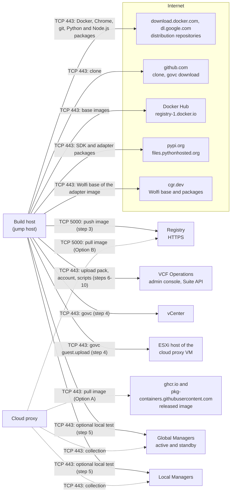
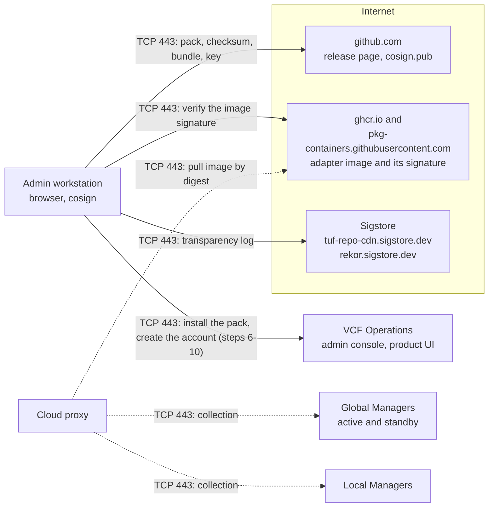
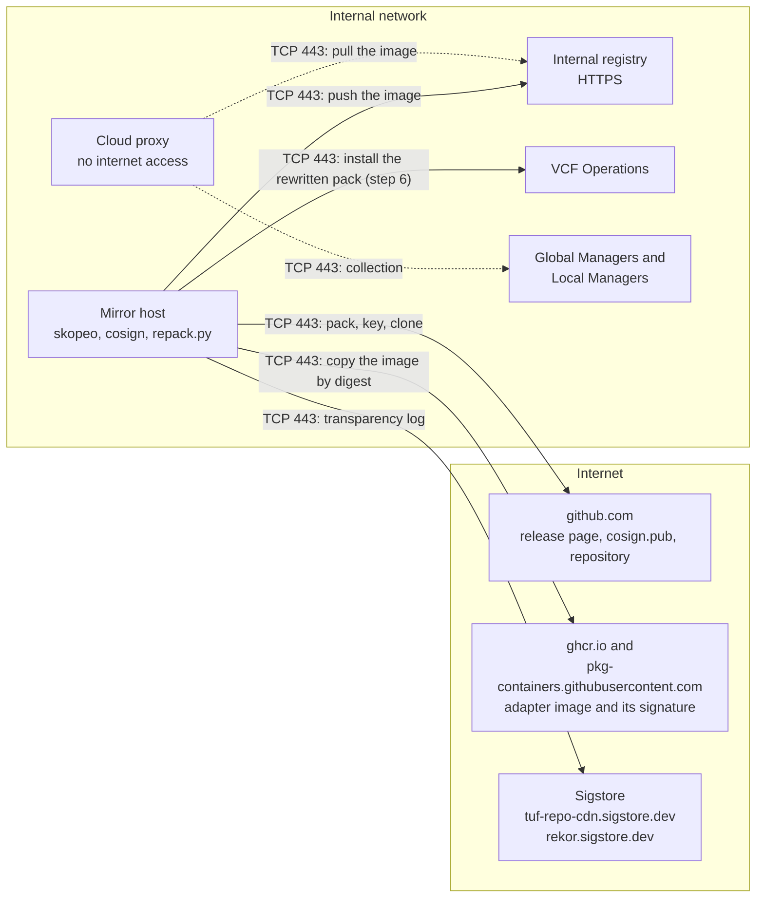

# Install guide

This guide describes how to install the NSX Federation pack in VCF Operations 9.1.1, from the released pack or
from a build of your own. It names the machine each command runs on. Option B is the path used in the lab. For
Option A, the commands that verify the signatures were run against the v1.13.7 release (key, keyless, provenance
and SBOM), and the mirror variant was tested against a local registry. Each section says what was not tested.
Part 2 of the [blog](https://sorinplaton.github.io/posts/nsx-federation-management-pack-install/) shows the
steps with screenshots.

Version française : [INSTALL.fr.md](INSTALL.fr.md).

## Choose an install path

There are five ways to get the pack and its adapter image in place:

- [Option A, download the released pack](#option-a-download-the-released-pack): the shortest path, for a site
  whose cloud proxy can reach `ghcr.io`. No build is needed.
- [Option A with the mirror variant](#variant-mirror-the-image-to-an-internal-registry): for a site whose cloud
  proxy has no internet access, or whose images must be scanned and served from an internal registry. No build is
  needed either.
- [Option B, build your own](#1-prerequisites): for someone who changes the pack, wants to build it from
  source, or runs a lab with its own registry on the build host.
- [The Harbor variant of Option B](#variant-an-existing-harbor-registry): the same build, with the image pushed
  to an existing Harbor in place of the small registry of step 2.
- [Enterprise install with Docker Hub and Artifactory](INSTALL-ENTERPRISE.md): for an organisation whose
  Artifactory pulls public images from Docker Hub. The pack and its adapter image come from Docker Hub through
  Artifactory, are checked, scanned and copied to a repository of approved images. This path has its own guide.

All paths install the same pack and meet again at step 6.

The `.pak` file holds the content of the pack (object model, alerts, dashboards) and the address of the adapter
image. The adapter itself is a container image that the cloud proxy pulls when the account starts. The image is
not inside the `.pak`: the cloud proxy downloads it with Docker from the registry the pack names. That registry
must therefore be reachable from the cloud proxy over HTTPS, with a certificate the cloud proxy trusts. If the
pull fails, the pack still installs, but the account never collects (step 8 shows the symptom). The paths
differ only in where that image comes from.

| | Option A: download the released pack | Option A, mirror variant | Option B: build your own |
| --- | --- | --- | --- |
| Adapter image | Public, on `ghcr.io/sorinplaton/nsxfederation`, pulled by digest | The released image, copied by you to an internal registry | Pushed by you to a registry of your own |
| Needs | The cloud proxy reaches `ghcr.io` and `pkg-containers.githubusercontent.com` on TCP 443 | A host that reaches both `ghcr.io` and the internal registry, and an internal registry served over HTTPS that the cloud proxy trusts | A build host with Docker, and a registry served over HTTPS that the cloud proxy trusts |
| Steps | [Option A](#option-a-download-the-released-pack), then steps 6 to 10 | [Option A](#option-a-download-the-released-pack) with its [mirror variant](#variant-mirror-the-image-to-an-internal-registry), then steps 6 to 10 | Steps 1 to 10, or the Harbor variant in place of steps 2 to 4 |
| Use when | The cloud proxy has internet access | The cloud proxy has no internet access, or images must be scanned and served from an internal registry, and the released pack is used as it is | The pack is modified or must be built from source, or a lab runs its own registry on the build host. It also fits a cloud proxy without internet access |

Every path needs the "Allow unsigned PAK installation" switch turned on for the length of the install. VCF
Operations looks for a Broadcom signature in a `.pak`, and this pack has none (KB 415279). The released pack
carries a different signature, made with cosign by this project: it lets the person who installs check where
the file comes from, and VCF Operations does not read it. The switch is therefore needed even for a pack whose
cosign signature was verified.

## Where things run

| Machine | Role |
| --- | --- |
| Build host | Option B only. A Linux host with Docker, `git` and Python 3. It builds the pack and pushes the adapter image. In the lab it is the jump host, which also runs the registry |
| Registry | Option A: `ghcr.io`, run by GitHub. Mirror variant: an internal registry. Option B: an image registry served over HTTPS that the cloud proxy can reach. The cloud proxy does not fall back to HTTP |
| Cloud proxy | The VCF Operations collector that runs the adapter container. It pulls the image from the registry |
| VCF Operations | Admin console (`https://<ops>/admin`) and product UI (`https://<ops>/`) |
| NSX | The Global Managers (active and standby) and the Local Managers of one federation |

## Network access

Open the flows listed in this section before starting: a blocked one shows up late, as a build that cannot
download a package or as an account that stays `FAILED`. The drawing below is Option B: what the build host
(the jump host in the lab) must reach, and the flows of the cloud proxy that the install depends on. Solid
lines start at the build host; dashed lines are the cloud proxy's. Option A and its mirror variant each have a
drawing in their own section, and the table covers all three paths.

With Option A, only the cloud proxy flows to `ghcr.io`, `pkg-containers.githubusercontent.com` and NSX are
needed, plus a browser that reaches VCF Operations. With the mirror variant, the cloud proxy reaches the
internal registry and NSX, and only the mirror host reaches the internet.



| From | To | Port | Used for |
| --- | --- | --- | --- |
| Build host | Internet (Docker, Google Chrome and distribution repositories, GitHub, Docker Hub, `cgr.dev` and the Wolfi package repository, PyPI) | TCP 443 | Installing the tools, cloning the repository, building the tooling and adapter images. Through a proxy if the site uses one |
| Build host | Registry | TCP 5000, or the registry port | Pushing the adapter image. Local when the registry runs on the build host, as in the lab |
| Build host | VCF Operations | TCP 443 | Admin console and product UI in a browser, and the Suite API for the scripts of steps 6 to 10 |
| Build host | vCenter of the cloud proxy VM | TCP 443 | `govc` guest operations of step 4. Not needed when the certificate is copied over SSH |
| Build host | ESXi host of the cloud proxy VM | TCP 443 | `govc guest.upload` sends the file to the ESXi host, not to vCenter |
| Build host | Global Managers and Local Managers | TCP 443 | Only for the optional test of step 5 |
| Admin workstation (Option A) or mirror host | `github.com` and `raw.githubusercontent.com` | TCP 443 | Downloading the pack, its checksum, its bundle, `cosign.pub` and cosign. The mirror host also clones the repository |
| Admin workstation (Option A) or mirror host | `ghcr.io` and `pkg-containers.githubusercontent.com` | TCP 443 | Verifying the signature of the image. The mirror host also copies the image from there |
| Admin workstation (Option A) or mirror host | Sigstore (`tuf-repo-cdn.sigstore.dev`, `rekor.sigstore.dev`) | TCP 443 | The transparency log, for the signature check only |
| Admin workstation (Option A) or mirror host | VCF Operations | TCP 443 | Installing the pack and creating the account (steps 6 to 10) |
| Mirror host | Internal registry | TCP 443, or the registry port | Mirror variant: pushing the copied image |
| Cloud proxy | Registry | TCP 5000, or the registry port | Option B and the mirror variant: pulling the adapter image |
| Cloud proxy | `ghcr.io` and `pkg-containers.githubusercontent.com` | TCP 443 | Option A: pulling the released adapter image. `ghcr.io` answers the registry calls and redirects the image layers to `pkg-containers.githubusercontent.com`. Through the site proxy if the cloud proxy uses one |
| Cloud proxy | Global Managers and Local Managers | TCP 443 | Collection |

Placeholders:

| Placeholder | Example |
| --- | --- |
| `$IP`, `$VERSION`, `$OPS_HOST` and the other variables | Values of the settings file `~/fedmp.env` (step 1) |
| `<ops>` | The VCF Operations host name, in the browser steps |
| `<gm1>`, `<gm2>` | Cluster address of the active and of the standby Global Manager |

## Checklist

This checklist covers Option B. With Option A or its mirror variant, use the checklist of
[Option A](#option-a-download-the-released-pack).

- [ ] 1. Prerequisites checked, build host tools installed, settings file filled in
- [ ] 2. Registry serves HTTPS
- [ ] 3. Pack built, image pushed, registry address in the pack checked
- [ ] 4. Cloud proxy trusts the registry certificate
- [ ] 5. Optional: collection tested without VCF Operations
- [ ] 6. Unsigned pack installed, switch turned off again
- [ ] 7. Account created, certificates accepted
- [ ] 8. Account "Collecting", metrics after three cycles
- [ ] 9. Optional: group per federation
- [ ] 10. Optional: alerts sent to email, a webhook or a ticketing tool

## Option A: download the released pack

Use Option A in place of steps 1 to 5 when the cloud proxy has internet access. It needs no build host, no
Docker and no registry of your own. When the cloud proxy has no internet access, or images must come from an
internal registry, add the [mirror variant](#variant-mirror-the-image-to-an-internal-registry) described at the
end of this section.

So far, the download and every command of "Verify the signatures" below have been tested, against the v1.13.7
release. The pull of the image from `ghcr.io` by the cloud proxy is not yet tested in the lab, which uses
Option B.

This path uses the network flows drawn below. Solid lines start at the admin workstation; dashed lines are the
cloud proxy's. The Sigstore flow is only for the signature check.



- [ ] VCF Operations 9.1.1 with at least one cloud proxy in state `UP`, which reaches `ghcr.io` and
      `pkg-containers.githubusercontent.com` on TCP 443, directly or through the site proxy. Firewall rules need
      both names: the image layers come from the second one. With the mirror variant, the cloud proxy reaches
      the internal registry instead.
- [ ] NSX 9.1 Federation and a read-only NSX account, as in step 1.
- [ ] The cloud proxy reaches every NSX manager on TCP 443.
- [ ] Admin password of VCF Operations, and the change approval for the unsigned-pack switch if the
      organisation requires one.
- [ ] Pack downloaded, checksum verified, signatures verified (recommended).
- [ ] Mirror variant only: image copied to the internal registry, pack pointed at it.
- [ ] Then steps 6 to 10.

*Run on: any machine with a browser that reaches VCF Operations.* Download the pack and its checksum from the
[releases page](https://github.com/sorinplaton/vcf-ops-nsx-federation-mp/releases/latest), or with the commands
below. The last command computes the SHA-256 of the downloaded file and compares it with the published value.
Expected: `NSXFederation_1.13.0.pak: OK`. Anything else means the download is damaged or incomplete; download
it again.

```bash
curl -LO https://github.com/sorinplaton/vcf-ops-nsx-federation-mp/releases/download/v1.13.7/NSXFederation_1.13.0.pak
curl -LO https://github.com/sorinplaton/vcf-ops-nsx-federation-mp/releases/download/v1.13.7/NSXFederation_1.13.0.pak.sha256
sha256sum -c NSXFederation_1.13.0.pak.sha256
```

The pack names the image `ghcr.io/sorinplaton/nsxfederation` by digest, so the cloud proxy always runs the
image the pack was built with. The image is public: the cloud proxy pulls it without a login, and it already
trusts the certificate of `ghcr.io`, so step 4 is not needed.

An optional check, run *on the cloud proxy* if SSH is enabled there, tells before the install whether the cloud
proxy can reach the two hosts the image comes from. Any HTTP code means the host is reachable (`401` and `400`
are the expected answers); `000` means it is not, and the account of step 8 would stay `FAILED`:

```bash
curl -s -o /dev/null -w '%{http_code}\n' https://ghcr.io/v2/
curl -s -o /dev/null -w '%{http_code}\n' https://pkg-containers.githubusercontent.com/
```

### Why the cloud proxy reaches the internet

The adapter is a container image that the cloud proxy pulls when the account starts. The `.pak` holds only the
content of the pack and the address of that image, as [Choose an install path](#choose-an-install-path)
explains. With Option A, the pack names `ghcr.io`, so the cloud proxy downloads the image from the internet.

That download is the only internet traffic of the cloud proxy. It goes to `ghcr.io` and
`pkg-containers.githubusercontent.com` on TCP 443: `ghcr.io` answers the registry calls and redirects the
download of the image layers to the second host. Collection stays on the local network, between the adapter,
the NSX managers and VCF Operations, and no monitoring data leaves the site. The signature checks below run on
the machine that downloaded the pack, not on the cloud proxy.

The cloud proxy pulls the image the first time the account starts, and again after a redeploy or an upgrade of
the cloud proxy, because its local copy is gone. Whether it also contacts `ghcr.io` at each restart of the
account, with the image still on disk, is not tested. Plan for access whenever the adapter starts.

To keep the cloud proxy off the internet, use the
[mirror variant](#variant-mirror-the-image-to-an-internal-registry): a machine with internet access copies the
image once to an internal registry, the pack is pointed at that registry, and the cloud proxy then reaches only
that registry. [Option B](#1-prerequisites) gives the same result with a build of your own.

### Verify the signatures (recommended)

From release `v1.13.3`, the release workflow on GitHub signs the pack and the images without a key ("keyless"):
the signature carries a certificate that names the workflow and the tag that built them, and the check compares
that name instead of a public key. [Keyless check](#keyless-check-releases-from-v1133) below gives the commands.
Releases up to `v1.13.2` are signed with the project key only, and releases from `v1.13.3` to `v1.14.0` carry
both signatures; the key-based check is described first.

The pack and its adapter image are signed with [cosign](https://docs.sigstore.dev/cosign/) (Sigstore). The
checksum only proves that the download is complete; it sits next to the pack on the same release page, so
whoever could replace the pack there could replace the checksum too. The signatures prove that the pack and the
image were produced by the holder of the private key of this project, and that neither changed since. Verify
both before the install, and again for every new release.

The public key is `cosign.pub`, at the root of this repository and on the release page. Take it from the
repository, and keep that copy for later releases: a key downloaded from the same place as the pack proves
less. The first command below fetches the key, the second the bundle, which is the signature of the pack.

```bash
curl -LO https://raw.githubusercontent.com/sorinplaton/vcf-ops-nsx-federation-mp/main/cosign.pub
curl -LO https://github.com/sorinplaton/vcf-ops-nsx-federation-mp/releases/download/v1.13.7/NSXFederation_1.13.0.pak.bundle
```

**Install cosign.** *Run on: the machine that downloaded the pack (Linux, x86-64).* Use one of the three methods
below; the last line prints the version and confirms that the install worked.

```bash
# Ubuntu or Debian
curl -LO https://github.com/sigstore/cosign/releases/download/v2.4.1/cosign_2.4.1_amd64.deb
sudo dpkg -i cosign_2.4.1_amd64.deb

# RHEL, Rocky Linux or AlmaLinux
curl -LO https://github.com/sigstore/cosign/releases/download/v2.4.1/cosign-2.4.1-1.x86_64.rpm
sudo rpm -ivh cosign-2.4.1-1.x86_64.rpm

# Any Linux: the single binary
curl -LO https://github.com/sigstore/cosign/releases/download/v2.4.1/cosign-linux-amd64
sudo install -m 0755 cosign-linux-amd64 /usr/local/bin/cosign

cosign version
```

The [cosign releases](https://github.com/sigstore/cosign/releases) also hold macOS and Windows builds and a
`cosign_checksums.txt` for the downloads. Without installing anything, Docker can run the same version:
`sudo docker run --rm -v $PWD:/w -w /w -u $(id -u) -e HOME=/tmp ghcr.io/sigstore/cosign/cosign:v2.4.1 <command>`.

**Verify the pack.** Run the command in the folder that holds the pack, the bundle and the key. cosign checks
the signature in the bundle against the file and the public key. Expected: `Verified OK`.

```bash
cosign verify-blob --key cosign.pub --bundle NSXFederation_1.13.0.pak.bundle NSXFederation_1.13.0.pak
```

**Verify the image the pack points to.** The pack is a zip file that holds a second zip, `adapter.zip`, whose
`.conf` file names the registry, the repository and the digest of the image. The first two lines read the
digest from there, and the third asks cosign to verify the signature stored next to that image on `ghcr.io`.
Expected: "The signatures were verified against the specified public key".

```bash
unzip -p NSXFederation_1.13.0.pak adapter.zip > /tmp/adapter.zip
DIGEST=$(unzip -p /tmp/adapter.zip '*.conf' | sed -n 's/^DIGEST=//p')
cosign verify --key cosign.pub ghcr.io/sorinplaton/nsxfederation@$DIGEST
```

Both commands reach the internet: `ghcr.io` for the image signature, and the Sigstore servers
(`tuf-repo-cdn.sigstore.dev`, `rekor.sigstore.dev`) for the public transparency log in which each signature is
recorded. A failed verification means the file or the image is not the one that was signed: do not install it.

#### Keyless check (releases from v1.13.3)

The keyless check runs the same two checks, with the identity of the release workflow in place of `cosign.pub`.
Set the release once, in the first line. The signature must name exactly this repository, this workflow and
this tag, with GitHub Actions as the issuer. The release notes on GitHub show the same values. The bundle of
the pack is the `.sigstore.json` file of the release.

```bash
RELEASE=1.13.7
SIGNER="https://github.com/sorinplaton/vcf-ops-nsx-federation-mp/.github/workflows/release.yml@refs/tags/v$RELEASE"
ISSUER=https://token.actions.githubusercontent.com
curl -LO https://github.com/sorinplaton/vcf-ops-nsx-federation-mp/releases/download/v$RELEASE/NSXFederation_1.13.0.pak.sigstore.json

cosign verify-blob --certificate-identity "$SIGNER" --certificate-oidc-issuer "$ISSUER" \
  --bundle NSXFederation_1.13.0.pak.sigstore.json NSXFederation_1.13.0.pak
unzip -p NSXFederation_1.13.0.pak adapter.zip > /tmp/adapter.zip
DIGEST=$(unzip -p /tmp/adapter.zip '*.conf' | sed -n 's/^DIGEST=//p')
cosign verify --certificate-identity "$SIGNER" --certificate-oidc-issuer "$ISSUER" ghcr.io/sorinplaton/nsxfederation@$DIGEST
```

In the file names, replace `1.13.0` with the pack version of that release. Expected: `Verified OK`, then the
list of checks cosign made. The commands reach the same hosts as the key-based check. They were tested against
`v1.13.3`, the first keyless release, on 2026-11-26.

#### Optional: build provenance and SBOM (releases from v1.13.5)

From `v1.13.5`, the pack and both images also carry a SLSA build provenance attestation: a signed record of the
commit, the workflow and the runner that built them. The GitHub CLI checks the attestation, and reaches
`api.github.com` to do so. The adapter image also carries its SBOM as a signed attestation, which cosign checks
and prints:

```bash
gh attestation verify NSXFederation_1.13.0.pak -R sorinplaton/vcf-ops-nsx-federation-mp \
  --signer-workflow sorinplaton/vcf-ops-nsx-federation-mp/.github/workflows/release.yml
gh attestation verify oci://ghcr.io/sorinplaton/nsxfederation@$DIGEST -R sorinplaton/vcf-ops-nsx-federation-mp
cosign verify-attestation --type cyclonedx --certificate-identity "$SIGNER" --certificate-oidc-issuer "$ISSUER" \
  ghcr.io/sorinplaton/nsxfederation@$DIGEST > /dev/null && echo "SBOM attestation: verified"
```

Expected: `Verification succeeded!` twice, then `SBOM attestation: verified`. The release also carries the Trivy
report of the adapter image, `NSXFederation_<version>.trivy.txt`. The commands were tested against `v1.13.5`,
the first release that carries these attestations, on 2026-11-26.

Once the checksum and both signatures are good, install the pack with step 6, by hand or with the scripts, and
continue with steps 7 to 10. The scripts need a Linux host with a clone of this repository, the settings file
of step 1 and the tools listed in [Tools for some steps](#tools-for-some-steps). With the mirror variant,
follow the next section before step 6.

### Variant: mirror the image to an internal registry

In an enterprise that does not let the cloud proxy reach the internet, or that scans every image before use,
copy the released image into an internal registry and point the released pack at it. No build host and no
SDK are needed, the cloud proxy depends on the internal registry only, and the image can be scanned there
before use. The image is copied bit for bit and keeps its digest, so it is still the image the project signed.
The variant was tested in the lab against a local `registry:2`, and not against Harbor.

In this variant, only the mirror host reaches the internet. The cloud proxy talks to the internal registry and
to NSX.



*Run on: a Linux host that reaches both `ghcr.io` and the internal registry*, called the mirror host here. It
needs [skopeo](https://github.com/containers/skopeo) (`sudo apt-get install -y skopeo` or `sudo dnf install -y skopeo`),
which copies an image from one registry to another, cosign (installed as above), and `git`, `python3`
and `unzip` from the distribution packages. The internal registry needs the same preparation as in
[Variant: an existing Harbor registry](#variant-an-existing-harbor-registry): a public project, an account that
can push to it, and a certificate the cloud proxy trusts.

Prepare the mirror host once. The clone brings `tools/repack.py`, and the settings file gives the commands the
address of the internal registry and the push account:

```bash
cd ~
git clone https://github.com/sorinplaton/vcf-ops-nsx-federation-mp.git
cp vcf-ops-nsx-federation-mp/install/fedmp.env.example ~/fedmp.env && chmod 600 ~/fedmp.env
nano ~/fedmp.env
```

In `~/fedmp.env`, remove the `#` in front of the four `HARBOR` lines and fill them in: `HARBOR` is the address
of the internal registry, `HARBOR_PROJECT` the project, `HARBOR_USER` and `HARBOR_PW` the account that can
push. The variables are named after Harbor, but the commands use them for any registry. Fill in `OPS_HOST` and
`OPS_PW` as well if the scripted install of step 6 will run from this host. The other lines can keep their
example values. [The settings file](#the-settings-file) describes the file and the line that loads it.

Then, in the folder that holds the downloaded pack:

1. Verify the signatures of the pack and the image, as above. Do it first: item 3 changes the pack, so its
   checksum and signature no longer match afterwards.
2. Copy the image by digest. The first lines read the digest from the pack again, so the block also works in a
   new shell. `--all` copies the image exactly as published, and `--preserve-digests` makes skopeo stop rather
   than change the digest the pack names:

   ```bash
   set -a; source ~/fedmp.env; set +a
   unzip -p NSXFederation_1.13.0.pak adapter.zip > /tmp/adapter.zip
   DIGEST=$(unzip -p /tmp/adapter.zip '*.conf' | sed -n 's/^DIGEST=//p')
   skopeo copy --all --preserve-digests --dest-creds "$HARBOR_USER:$HARBOR_PW" \
     docker://ghcr.io/sorinplaton/nsxfederation@$DIGEST \
     docker://$HARBOR/$HARBOR_PROJECT/nsxfederation:1.13.0
   ```

   To verify the image again from the internal registry later, copy its signature too, in the same shell:
   `cosign copy ghcr.io/sorinplaton/nsxfederation@$DIGEST $HARBOR/$HARBOR_PROJECT/nsxfederation` (needs
   `docker login $HARBOR` first).
3. Point the pack at the internal registry. `repack.py` rewrites the `REGISTRY` and `REPOSITORY` lines inside
   the pack, in place. Only the registry and the repository change; the digest stays. The two `unzip` lines
   print the result:

   ```bash
   set -a; source ~/fedmp.env; set +a
   python3 ~/vcf-ops-nsx-federation-mp/tools/repack.py NSXFederation_1.13.0.pak $HARBOR $HARBOR_PROJECT/nsxfederation
   unzip -p NSXFederation_1.13.0.pak adapter.zip > /tmp/adapter.zip
   unzip -p /tmp/adapter.zip '*.conf' | grep -E '^(REGISTRY|REPOSITORY|DIGEST)='
   ```

   Expected: `REGISTRY` is the internal registry, `REPOSITORY` is `/<project>/nsxfederation`, and `DIGEST` is the
   value of item 2.
4. Scan the image in the internal registry if the organisation requires it, then install the rewritten pack
   with step 6 and continue with steps 7 to 10. The cloud proxy needs only the internal registry, not `ghcr.io`.

## 1. Prerequisites

Steps 1 to 5 are for Option B. They prepare a build host, a registry and a pack built from the source.

- [ ] VCF Operations 9.1.1 with at least one cloud proxy in state `UP`.
- [ ] NSX 9.1 Federation. A read-only NSX account on every Global Manager and Local Manager; the built-in
      `audit` account works. A separate credential for the Local Managers is optional.
- [ ] Network: cloud proxy to every NSX manager on TCP 443, cloud proxy to the registry on its port, build
      host to the registry.
- [ ] Admin password of VCF Operations: the unsigned-pack switch is in the admin console.
- [ ] A change approval to turn on "Allow unsigned PAK installation" for the length of the install, if the
      organisation requires one. The pack is not signed by Broadcom (KB 415279).
- [ ] Build host tools: Docker Engine, `git`, `unzip` and Python 3 with `requests`, installed as below. For
      some steps, also `govc` (step 4), Node.js 22 or later and Google Chrome (scripted install of step 6).
- [ ] The settings file `~/fedmp.env`, filled in as below.

### Build host tools

*Run on: the build host.* Docker builds the tooling image and the adapter image, and runs the registry of
step 2. `git` clones the repository, `unzip` reads the pack, and the install scripts are written in Python with
the `requests` module. Docker comes from the Docker repository rather than the distribution packages, so that
`docker build` uses BuildKit. The Ubuntu commands of this section were run on a clean Ubuntu 26.04 host; the
RHEL ones were not tested in the lab.

On Ubuntu or Debian (on Debian, replace `ubuntu` with `debian` in both URLs), the block installs the base
packages, adds the signing key and the package source of Docker, then installs Docker from that source:

```bash
sudo apt-get update
sudo apt-get install -y ca-certificates curl git unzip python3 python3-requests
sudo install -m 0755 -d /etc/apt/keyrings
sudo curl -fsSL https://download.docker.com/linux/ubuntu/gpg -o /etc/apt/keyrings/docker.asc
sudo chmod a+r /etc/apt/keyrings/docker.asc
echo "deb [arch=$(dpkg --print-architecture) signed-by=/etc/apt/keyrings/docker.asc] \
https://download.docker.com/linux/ubuntu $(. /etc/os-release && echo "$VERSION_CODENAME") stable" \
  | sudo tee /etc/apt/sources.list.d/docker.list > /dev/null
sudo apt-get update
sudo apt-get install -y docker-ce docker-ce-cli containerd.io docker-buildx-plugin
```

RHEL, Rocky Linux or AlmaLinux 8 and later:

```bash
sudo dnf install -y dnf-plugins-core git unzip python3 python3-requests
sudo dnf config-manager --add-repo https://download.docker.com/linux/rhel/docker-ce.repo
sudo dnf install -y docker-ce docker-ce-cli containerd.io docker-buildx-plugin
```

On both, start Docker and have it start at every boot. The `docker` commands of this guide carry `sudo`, so the
build user does not have to be in the `docker` group.

```bash
sudo systemctl enable --now docker
```

Check the tools. The first command pulls a test image from Docker Hub and runs it, which proves that Docker
works and reaches the internet; it prints "Hello from Docker!". The last one prints nothing when `requests` is
installed:

```bash
sudo docker run --rm hello-world
git --version
python3 --version         # 3.8 or later
python3 -c "import requests"
```

### Tools for some steps

`govc` is the command-line client for vCenter. Step 4 uses it to copy the registry certificate into the cloud
proxy VM. Skip this install when that copy goes over SSH. The last line prints the version:

```bash
curl -fsSL "https://github.com/vmware/govmomi/releases/latest/download/govc_$(uname -s)_$(uname -m).tar.gz" \
  | sudo tar -C /usr/local/bin -xzf - govc
govc version
```

Node.js 22 or later and Google Chrome run the scripted install of step 6: the scripts drive a headless Chrome
from Node.js, and they use the WebSocket client that Node.js has built in from version 22. Skip both for the
install by hand. Ubuntu 26.04 ships Node.js 22; on an older release, take Node.js 22 from
[nodejs.org](https://nodejs.org/en/download):

```bash
sudo apt-get install -y nodejs
curl -fsSLO https://dl.google.com/linux/direct/google-chrome-stable_current_amd64.deb
sudo apt-get install -y ./google-chrome-stable_current_amd64.deb && rm google-chrome-stable_current_amd64.deb
node --version            # v22 or later
google-chrome --version
```

RHEL, Rocky Linux or AlmaLinux 9:

```bash
sudo dnf module install -y nodejs:22
sudo dnf install -y https://dl.google.com/linux/direct/google-chrome-stable_current_x86_64.rpm
```

### The settings file

The addresses, the names and the passwords the commands need are in one file, `~/fedmp.env`. The commands of
this guide then carry no address and no password, and can be pasted as they are. Clone the repository, copy the
example, fill it in, and make it readable by its owner only:

```bash
cd ~
git clone https://github.com/sorinplaton/vcf-ops-nsx-federation-mp.git
cp vcf-ops-nsx-federation-mp/install/fedmp.env.example ~/fedmp.env && chmod 600 ~/fedmp.env
nano ~/fedmp.env
```

| Variable | Used for |
| --- | --- |
| `IP` | The address of the build host that the cloud proxy uses to reach the registry (steps 2 to 4) |
| `VERSION` | The pack version, as in `pack/manifest.txt` |
| `OPS_HOST`, `OPS_PW` | VCF Operations and its admin password (steps 6 to 10) |
| `OPS_INSECURE` or `OPS_CA` | Only when VCF Operations has a certificate that the build host does not trust: `OPS_CA` names the CA file; `OPS_INSECURE=1` skips the check (lab only). Without either, the scripts of steps 6, 9 and 10 stop with `CERTIFICATE_VERIFY_FAILED` |
| `GOVC_URL`, `GOVC_USERNAME`, `GOVC_PASSWORD` | The vCenter that runs the cloud proxy VM (step 4) |
| `PROXY_VM`, `PROXY_ROOT_PW` | The name of the cloud proxy VM and its root password (step 4) |
| `GM_HOSTS`, `NSX_USER`, `NSX_PASSWORD` | The Global Managers and the read-only NSX account (step 5) |
| `HARBOR`, `HARBOR_PROJECT`, `HARBOR_USER`, `HARBOR_PW` | Only for the Harbor variant and the mirror variant. Commented out in the example: remove the `#` to use them |

Each command block that needs these values starts with the line that loads the file and exports them:

```bash
set -a; source ~/fedmp.env; set +a
```

`set -a` tells the shell to export every variable it sets from that point, `source` reads the file, and
`set +a` turns the export off again. Without the export, the values stay in the shell, and the
scripts and containers the commands start do not see them. The values last as long as the shell, so a new
terminal needs the line again, and a block pasted without it runs with empty addresses.

The file holds passwords. Keep it out of Git (`fedmp.env` is in `.gitignore`), and delete it or move it to a
vault once the install is done.

## 2. Registry over HTTPS

The cloud proxy needs a registry to pull the adapter image from, and it only pulls over HTTPS. This step starts
a small registry on the build host, with a certificate made for it. With an existing Harbor registry, skip
steps 2 to 4 and follow [Variant: an existing Harbor registry](#variant-an-existing-harbor-registry).

*Run on: the build host.* The registry is a `registry:2` container with a self-signed certificate. The
`openssl` command creates the key and a certificate valid for 825 days that names the address in `IP`. The
`docker run` command starts the registry with that certificate on port 5000, keeps the images in the Docker
volume `registry-data`, and restarts the container after a reboot:

```bash
set -a; source ~/fedmp.env; set +a
mkdir -p ~/fedmp-registry/certs && cd ~/fedmp-registry
openssl req -x509 -newkey rsa:2048 -nodes -days 825 \
  -keyout certs/registry.key -out certs/registry.crt -subj "/CN=fedmp-registry" \
  -addext "subjectAltName=IP:$IP,IP:127.0.0.1,DNS:localhost"

sudo docker run -d --name fedmp-registry --restart unless-stopped \
  -p $IP:5000:5000 -p 127.0.0.1:5000:5000 \
  -v registry-data:/var/lib/registry -v $PWD/certs:/certs:ro \
  -e REGISTRY_HTTP_TLS_CERTIFICATE=/certs/registry.crt \
  -e REGISTRY_HTTP_TLS_KEY=/certs/registry.key registry:2
```

The certificate also names `127.0.0.1` and `localhost`, and the registry also listens on the local address,
because step 3 pushes the image to `localhost:5000`.

Check the registry. The command calls the registry on the address the cloud proxy will use and accepts only the
certificate just created, so an answer proves both the listener and the certificate. A new registry answers
`{"repositories":[]}` until the first push:

```bash
set -a; source ~/fedmp.env; set +a
curl --cacert ~/fedmp-registry/certs/registry.crt https://$IP:5000/v2/_catalog
```

## 3. Build the pack

*Run on: the build host.* The first `docker build` makes `fedmp-tooling`, an image that holds the SDK tools.
The `docker run` then starts `mp-build` from that image. `mp-build` builds the adapter image with the Docker of
the host (through the mounted socket), pushes it to the registry of step 2 and writes the `.pak`. The container
runs with the ID of the current user and the group ID of `docker`, so it can use the socket, and the files it
writes in the clone belong to the build user. The build downloads the base images from Docker Hub, the Wolfi
base of the adapter image from `cgr.dev`, the Python package of that base from the Wolfi package repository,
and the Python packages from PyPI.

```bash
set -a; source ~/fedmp.env; set +a
cd ~/vcf-ops-nsx-federation-mp
sudo docker build -t fedmp-tooling tooling

sudo docker run --rm --network host -u $(id -u):$(getent group docker | cut -d: -f3) -e HOME=$PWD/.sdkhome \
  -v /var/run/docker.sock:/var/run/docker.sock -v $(which docker):/usr/bin/docker -v $PWD:$PWD -w $PWD/pack \
  fedmp-tooling mp-build --no-ttl -r localhost:5000/nsxfederation \
  --registry-username lab --registry-password lab
```

The result is `pack/build/NSXFederation_$VERSION.pak`.

`mp-build` starts the adapter for a test on `127.0.0.1:8080`. If that port is taken on the build host, the build
fails with `Bind for 127.0.0.1:8080 failed: port is already allocated`: add `-P 18080` (any free port) to the
`mp-build` options. The option moves only the test port; the pack still uses port 443 on the cloud proxy.

The image is pushed to `localhost:5000`. Docker accepts the self-signed certificate of a registry on the local
address, so the build host needs no certificate folder of its own. The registry of step 2 has no login.
`mp-build` still asks for a user and a password, and any value works.

When the registry is given as `host:port` without a domain, `mp-build` writes Docker Hub into the pack. The
cloud proxy would then look for the image on Docker Hub and the account would fail. `repack.py` opens the pack
and rewrites two lines of the adapter configuration, `REGISTRY` and `REPOSITORY`, in place; nothing else
changes. Run it before the install, to write into the pack the address the cloud proxy uses:

```bash
set -a; source ~/fedmp.env; set +a
cd ~/vcf-ops-nsx-federation-mp
python3 tools/repack.py pack/build/NSXFederation_$VERSION.pak $IP:5000 nsxfederation
```

Check the registry address in the pack. The two lines extract the adapter configuration and print the address
the cloud proxy will pull from:

```bash
set -a; source ~/fedmp.env; set +a
cd ~/vcf-ops-nsx-federation-mp
unzip -p pack/build/NSXFederation_$VERSION.pak adapter.zip > /tmp/adapter.zip
unzip -p /tmp/adapter.zip '*.conf' | grep -E '^(REGISTRY|REPOSITORY)='
```

Expected: `REGISTRY=<IP>:5000`, with the value of `IP`, and `REPOSITORY=/nsxfederation`.

Check that the image is in the registry. The answer names the repository `nsxfederation` and its tags:

```bash
set -a; source ~/fedmp.env; set +a
curl --cacert ~/fedmp-registry/certs/registry.crt https://$IP:5000/v2/nsxfederation/tags/list
```

## 4. Cloud proxy trusts the registry certificate

The certificate of step 2 is self-signed, so the cloud proxy refuses it until it is told to trust it. Without
this step the pull fails and the account stays `FAILED` (step 8). Docker on the cloud proxy trusts a private
registry whose certificate is in a folder named after the registry, port included. With the registry of
step 2, the file is:

```
/etc/docker/certs.d/$IP:5000/ca.crt
```

*Run on: the build host*, which has the settings file and the certificate. It needs `govc`
([Tools for some steps](#tools-for-some-steps)) and access to the vCenter that runs the cloud proxy VM. SSH on
the cloud proxy can stay disabled: vCenter guest operations write the file with the appliance root account.
The first command creates the folder in the VM, the second uploads the certificate as `ca.crt`:

```bash
set -a; source ~/fedmp.env; set +a
govc guest.mkdir -vm "$PROXY_VM" -l "root:$PROXY_ROOT_PW" -p /etc/docker/certs.d/$IP:5000
govc guest.upload -vm "$PROXY_VM" -l "root:$PROXY_ROOT_PW" -f ~/fedmp-registry/certs/registry.crt \
  /etc/docker/certs.d/$IP:5000/ca.crt
```

*Or run on: the cloud proxy*, if SSH is enabled there: create the folder and copy `registry.crt` as `ca.crt`.

The proof that the cloud proxy trusts the registry comes in step 8, when the account reaches "Collecting".

An upgrade or a redeploy of the cloud proxy can remove the file. Repeat this step after either one.

A registry moved to another address needs a new certificate (step 2), a rewritten pack (step 3) and a new
folder on the cloud proxy.

Without Harbor, skip the next section and continue with step 5, which is optional, or with step 6.

## Variant: an existing Harbor registry

Use the Harbor variant in place of steps 2 to 4 when the environment already has Harbor. The pack is built as
in step 3, and the image goes to Harbor. This variant was not tested in the lab, which uses the registry of
step 2.

Prepare Harbor once:

- [ ] A project for the image, for example `nsxfederation`, set to public. The cloud proxy pulls the image
      without a login, so the image of a private project cannot be pulled.
- [ ] An account that can push to the project: a robot account with the push permission, or a user with the
      Developer role.
- [ ] Network: build host and cloud proxy to Harbor on TCP 443.

In `~/fedmp.env`, remove the `#` in front of the four `HARBOR` lines and fill them in with the address of
Harbor, the project and the push account.

*Run on: the build host.* Its Docker must trust the certificate of Harbor, or the push fails with a
certificate error. When the certificate comes from an internal CA, or is self-signed, copy the CA certificate
first. `harbor-ca.crt` is that CA certificate in PEM format: get it from the team that runs Harbor and put it
in the current folder.

```bash
set -a; source ~/fedmp.env; set +a
sudo mkdir -p /etc/docker/certs.d/$HARBOR
sudo cp harbor-ca.crt /etc/docker/certs.d/$HARBOR/ca.crt
```

Build the pack and push the image. `mp-build` logs in to Harbor with the account given on the command line. The
name of a robot account contains a `$`, so keep the single quotes around it in `fedmp.env`:

```bash
set -a; source ~/fedmp.env; set +a
cd ~/vcf-ops-nsx-federation-mp
sudo docker build -t fedmp-tooling tooling

sudo docker run --rm --network host -u $(id -u):$(getent group docker | cut -d: -f3) -e HOME=$PWD/.sdkhome \
  -v /var/run/docker.sock:/var/run/docker.sock -v $(which docker):/usr/bin/docker -v $PWD:$PWD -w $PWD/pack \
  fedmp-tooling mp-build --no-ttl -r $HARBOR/$HARBOR_PROJECT/nsxfederation \
  --registry-username "$HARBOR_USER" --registry-password "$HARBOR_PW"
```

Check the address in the pack. The registry has a domain name here, so `repack.py` should not be needed:

```bash
set -a; source ~/fedmp.env; set +a
cd ~/vcf-ops-nsx-federation-mp
unzip -p pack/build/NSXFederation_$VERSION.pak adapter.zip > /tmp/adapter.zip
unzip -p /tmp/adapter.zip '*.conf' | grep -E '^(REGISTRY|REPOSITORY)='
```

Expected: `REGISTRY=harbor.example.com` and `REPOSITORY=/nsxfederation/nsxfederation`. If the pack names Docker
Hub instead, rewrite it:

```bash
set -a; source ~/fedmp.env; set +a
cd ~/vcf-ops-nsx-federation-mp
python3 tools/repack.py pack/build/NSXFederation_$VERSION.pak $HARBOR $HARBOR_PROJECT/nsxfederation
```

The cloud proxy must trust the certificate of Harbor too. With a certificate from an authority it already
trusts, nothing more is needed. Otherwise copy the CA certificate of Harbor to the cloud proxy, as step 4 does
for the registry of step 2. The folder is `/etc/docker/certs.d/harbor.example.com/` (add `:<port>` to the folder
name when Harbor does not listen on 443):

```bash
set -a; source ~/fedmp.env; set +a
govc guest.mkdir -vm "$PROXY_VM" -l "root:$PROXY_ROOT_PW" -p /etc/docker/certs.d/$HARBOR
govc guest.upload -vm "$PROXY_VM" -l "root:$PROXY_ROOT_PW" -f harbor-ca.crt \
  /etc/docker/certs.d/$HARBOR/ca.crt
```

Then continue with step 5 or step 6.

## 5. Optional: test a collection without VCF Operations

This test runs the adapter code once on the build host, against the real NSX managers, and prints what it
would send to VCF Operations. It finds a wrong address, a wrong password or a blocked port in a minute, before
the pack is installed. It only reads from NSX.

*Run on: the build host.* The build host needs to reach the NSX managers on TCP 443. `sudo` clears the
environment, so `--preserve-env` names the three variables it must keep, and each `-e NAME` without a value
passes that variable into the container:

```bash
set -a; source ~/fedmp.env; set +a
cd ~/vcf-ops-nsx-federation-mp
sudo --preserve-env=GM_HOSTS,NSX_USER,NSX_PASSWORD docker run --rm --network host -v $PWD:/work \
  -e PYTHONDONTWRITEBYTECODE=1 -e GM_HOSTS -e NSX_USER -e NSX_PASSWORD fedmp-tooling python tools/localrun.py
```

The command prints the objects and metrics of one cycle. A good run shows `error: None`, then a line `objects:`
with a count per kind (federation, Global Managers, locations and so on), then each object with its metrics and
properties. A failed call shows up here before it does in VCF Operations.

## 6. Install the unsigned pack

Both methods turn "Allow unsigned PAK installation" on for the upload and off again afterwards. The switch
applies to the whole VCF Operations instance: while it is on, any unsigned pack can be installed. Keep that
time short and check at the end that the switch is off.

### By hand

*Run in: a browser.*

1. Admin console `https://<ops>/admin`, Administrator Settings, Security Settings: activate "Allow unsigned
   PAK installation".
2. Product UI: Administration, Integrations, Repository, add a pack.
3. Select `NSXFederation_<version>.pak`, tick "install even if already installed" and "Ignore the PAK file
   signature checking".
4. Upload, accept the warning about the unsigned file and wait for the install to finish.
5. Admin console: deactivate "Allow unsigned PAK installation". The console refuses the change while the install is
   running; try again once it has finished.

### Scripted

*Run on: the build host.* With Option A or the mirror variant, any Linux host with a clone of this repository
and `~/fedmp.env` ([The settings file](#the-settings-file)) is suitable. The host needs Google Chrome, Node.js 22
or later ([Tools for some steps](#tools-for-some-steps)) and Python 3 with `requests`. The scripts drive a
headless Chrome through calls that are internal to the VCF Operations UI. These calls are unsupported and can
change with any release. The headless Chrome accepts the certificate of VCF Operations without checking it, so
run the scripts on a trusted network.

`upi.sh enableUPI` logs in to the admin console and turns the switch on. `install_unsigned.sh` uploads the
pack, waits for the install to finish, deletes the alert, symptom and recommendation definitions an older
version left behind, and turns the switch off. Set `PAK` to the file to install: the `PAK` line below is right
for Option B; with Option A or the mirror variant, give the full path of the downloaded or rewritten `.pak`.

```bash
set -a; source ~/fedmp.env; set +a
cd ~/vcf-ops-nsx-federation-mp
PAK=pack/build/NSXFederation_$VERSION.pak     # Option A: the path of the downloaded .pak
install/upi.sh enableUPI
install/install_unsigned.sh "$PAK"
```

`install_unsigned.sh` first checks the signatures with `install/verify_pak.sh`. A released pack with its
`.sigstore.json` next to it must verify, or nothing is installed; keep the bundle in the folder of the pack for
that. A pack without the bundle (a build of your own, or one rewritten by the mirror variant) is installed with a
notice. A `.sigstore.json` left next to a rewritten pack makes the check fail (`pack signature: FAILED`), because
it signs the original file: move it out of the folder first.

`FEDMP_VERIFY=1` requires the image check for any pack, and `FEDMP_VERIFY=0` skips the check. The check uses
`cosign` if it is installed, or the cosign image through Docker. `FEDMP_PAK_SHA256=<sha256>` also requires the
file to have that checksum, whatever `FEDMP_VERIFY` says: use it for a rewritten pack, whose checksum you
recorded yourself ([INSTALL-ENTERPRISE.md](INSTALL-ENTERPRISE.md), step 7).

Run `install_unsigned.sh` after `upi.sh`: the admin console login ends the product UI session, and the install
script logs in again. The install script turns the switch off however it ends, and stops the headless Chrome.
Exit code 0 means the install completed and the switch is off. A line
`WARNING: orphan definitions were not all removed` means only the clean-up after the install failed, usually on
the certificate of VCF Operations (`OPS_CA` or `OPS_INSECURE` in the settings file); run
`python3 install/cleanup_content.py "$PAK" --delete` once that variable is set. A line
`WARNING: unsigned PAK installation is still enabled` means the script could not turn the switch off: do it in
the admin console.

To read the switch on its own, run `install/upi.sh getUPIStatus`, then `install/chrome.sh stop`: `upi.sh` leaves
the headless Chrome running, and that Chrome holds the admin console session.

Check that Administration, Integrations, Repository lists the NSX Federation pack with the new version.

## 7. Create the account

The installed pack collects nothing by itself. An account tells VCF Operations which federation to read, with
which credential, and which cloud proxy runs the adapter. That cloud proxy pulls the image when the account
starts.

*Run in: the VCF Operations product UI*, Administration, Integrations, Accounts, add an account of type NSX
Federation.

- [ ] Global Manager addresses: `<gm1>,<gm2>`, the cluster address of the active and of the standby. Create
      one account per federation.
- [ ] Credential: the read-only NSX account. Add the Local Manager credential only if it differs.
- [ ] Collector: with Option A, a cloud proxy that reaches `ghcr.io` and
      `pkg-containers.githubusercontent.com`; with the mirror variant, a cloud proxy that trusts the internal
      registry; with Option B, the cloud proxy that trusts the registry (step 4).
- [ ] Certificate trust: keep `enforce`, or choose `ca` when the managers have certificates signed by an
      internal CA. With `ca`, paste the CA certificates in "Trusted CA certificates (PEM)" and use addresses
      that the certificates name.
- [ ] Validate the connection and accept the Global Manager certificates. Without an accepted certificate,
      `enforce` collects nothing. An account created through the API has no accepted certificate; edit it in
      the UI, validate and accept, or use `ca`.
- [ ] The other settings can keep their defaults. [OPERATIONS.md](OPERATIONS.md) describes each one.

## 8. Check the collection

This step proves that the registry and certificate setup of the earlier steps works: the cloud proxy pulls the
image, starts the adapter and reads NSX.

*Run in: the VCF Operations product UI.*

- [ ] Accounts tab: the account reaches "Collecting". If it stays `FAILED` with an empty message, the cloud
      proxy could not pull the image. Option A: check that the cloud proxy reaches `ghcr.io` and
      `pkg-containers.githubusercontent.com`. Mirror variant: check that the cloud proxy reaches the internal
      registry and trusts its certificate, and that the project is public. Option B: check steps 2 and 4, and
      the registry log for `tls: bad certificate`.
- [ ] With a 5-minute interval, the data arrives over three cycles: objects and relationships first, then
      properties and events, then metrics after about ten minutes. Rates need one more cycle. Objects without
      metrics in the first ten minutes are expected.
- [ ] The federation object lists no failed calls.

## 9. Optional: group per federation

The pack ships groups by area that hold the objects of every federation. The `federation_groups.py` script adds
one custom group per federation, so that a policy, a notification rule or a dashboard can apply to a single
federation.

*Run on: the build host.* With Option A or the mirror variant, use the host of the scripted install of step 6.
The script reads the federations from VCF Operations through the Suite API and creates the groups. It never
deletes a group.

```bash
set -a; source ~/fedmp.env; set +a
cd ~/vcf-ops-nsx-federation-mp
python3 install/federation_groups.py                     # "NSX Federation - <federation>" for every federation
python3 install/federation_groups.py --federation '<federation>' --policy '<policy>'   # and assign a policy
```

- [ ] The group "NSX Federation - <federation>" lists the objects of that federation (Environment, Custom Groups).
      The script needs one collection made with version 1.13.0 or later; running it again updates the groups.

## 10. Optional: send the alerts

Alerts stay inside VCF Operations until a notification rule sends them somewhere. The `notification_rules.py`
script creates that rule for the alerts of the pack. It holds no mail server or ticketing credentials: those
belong to the outbound instance, which has to exist first.

*Run on: the build host*, or the host of the scripted install of step 6. First create the outbound instance
(email server, webhook, ServiceNow, Slack, SNMP or log file) under Administration, Configurations, Outbound
Settings. The first command sends the alerts of criticality immediate and critical. The second adds a rule for
warnings and above, limited to the group that step 9 made for one federation. Running a command again with the
same rule name updates the rule.

```bash
set -a; source ~/fedmp.env; set +a
cd ~/vcf-ops-nsx-federation-mp
python3 install/notification_rules.py --outbound '<outbound instance>'                    # immediate and critical
python3 install/notification_rules.py --outbound '<outbound instance>' --min-criticality warning \
        --group 'NSX Federation - <federation>' --name 'NSX Federation - <federation> warnings'
```

- [ ] The rule "NSX Federation - <outbound instance>" is listed under Alerts, Notifications. It sends new,
      updated and cancelled alerts, so a ticket also learns that the alert cleared.

## Upgrade

An upgrade is a new install of the pack over the old one, followed by a stop and a start of the account.

1. Get the new pack, then install it (step 6).
   - Option A: download the pack of the new release and verify its signatures.
   - Mirror variant: do the same, then repeat items 2 and 3 of the variant. The new pack names a new image by
     its digest, so that image has to be copied and the new pack pointed at the internal registry.
   - Option B: update the clone with `cd ~/vcf-ops-nsx-federation-mp && git pull`, set `VERSION` in
     `~/fedmp.env` to the new version (as in `pack/manifest.txt`), then build the new version (step 3).
2. Stop and start the account. Check that it reaches "Collecting"; start it a second time if it stays stopped.
3. Metrics return after three cycles, rates after four.

`install_unsigned.sh` deletes the alert, symptom and recommendation definitions that the new version no longer
ships. After a manual install, run `install/cleanup_content.py <pak> --delete` (see
[OPERATIONS.md](OPERATIONS.md), Upgrade).

After an upgrade from a version before 1.9.0, the edge nodes, RTEP tunnels and sync channels are created again
under a key based on their NSX ID, and the old objects stop receiving data.
`cleanup_content.py <pak> --legacy-objects --delete` deletes the old objects, with their history.
