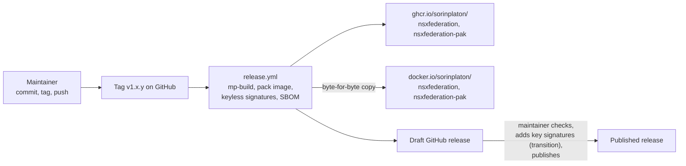

# Release guide (maintainer)

How a release is built, signed and published: the side of the install guides that users never see. Git is the
single source of truth. A tag `v<release>` starts the workflow `.github/workflows/release.yml`, which builds the
pack and the adapter image from that tag, publishes them on `ghcr.io` and Docker Hub, signs them, and creates a
draft GitHub release. Nobody pushes an image by hand. Users download the `.pak` from GitHub
([INSTALL.md, Option A](INSTALL.md#option-a-download-the-released-pack)) or pull it from Docker Hub through
their own registry ([INSTALL-ENTERPRISE.md](INSTALL-ENTERPRISE.md)).



## What a release contains

| Item | Where | Made by |
| --- | --- | --- |
| Adapter image | `ghcr.io/sorinplaton/nsxfederation@sha256:<digest>` and `docker.io/sorinplaton/nsxfederation`, same digest, public | `mp-build` in the workflow, then `skopeo copy --all` to Docker Hub |
| Pack image | `ghcr.io/sorinplaton/nsxfederation-pak:<release>` and `docker.io/sorinplaton/nsxfederation-pak:<release>`, same digest | `pak-image/Dockerfile` in the workflow: the `.pak` and `SHA256SUMS`, `FROM scratch` |
| Image signatures | Next to each image (tag `sha256-<digest>.sig`), and the Sigstore transparency log | `cosign sign`, keyless, in the workflow |
| `NSXFederation_<version>.pak` | GitHub release assets | `mp-build` |
| `NSXFederation_<version>.pak.sha256` | GitHub release assets | `sha256sum` |
| `NSXFederation_<version>.pak.sigstore.json` | GitHub release assets | `cosign sign-blob --bundle`, keyless |
| `NSXFederation_<version>.sbom.cdx.json` | GitHub release assets, and a signed attestation on the adapter image (`cosign attest --type cyclonedx`) | CycloneDX, from `pack/image-requirements.txt` |
| Build provenance (SLSA) | GitHub attestation store, and next to each image on `ghcr.io` | `actions/attest-build-provenance`, for the pack and both images |
| `NSXFederation_<version>.trivy.txt`, `.trivy.json` | GitHub release assets | Trivy scan of the adapter image; the build stops on a CRITICAL with a fix |
| `NSXFederation_<version>.pak.bundle`, `cosign.pub` | GitHub release assets, transition only | The maintainer, with the project key ([Transition](#transition-key-signatures-next-to-keyless-ones)) |

`<release>` is the tag without the `v`; `<version>` is the pack version of `pack/manifest.txt`. They differ when
a release changes only the documentation and keeps the pack of the previous one.

## Release with the workflow

### Once per repository

- [ ] **ghcr.io: let the workflow write to the existing package.** The `nsxfederation` package was created by
      hand, so the token of the workflow cannot push to it until the repository gets access. In a browser logged
      in as the owner: https://github.com/users/sorinplaton/packages/container/package/nsxfederation, Package
      settings, Manage Actions access, Add repository, `vcf-ops-nsx-federation-mp`, role **Write**. GitHub has
      no API for this on a personal account. `nsxfederation-pak` is created by the first run, already linked.
- [ ] **ghcr.io: make `nsxfederation-pak` public** after the first run: its Package settings, Danger Zone, Change
      visibility, Public. New packages start private.
- [ ] **Docker Hub.** Repositories `sorinplaton/nsxfederation` and `sorinplaton/nsxfederation-pak`, public. A
      Docker Hub personal access token with Read, Write, Delete (Delete is needed to update the repository
      description), stored as the Actions secret `DOCKERHUB_TOKEN`, and the namespace as the Actions variable
      `DOCKERHUB_NAMESPACE`. Typed at the prompt, never pasted elsewhere:

      ```bash
      gh secret set DOCKERHUB_TOKEN -R sorinplaton/vcf-ops-nsx-federation-mp
      gh variable set DOCKERHUB_NAMESPACE -R sorinplaton/vcf-ops-nsx-federation-mp -b sorinplaton
      ```

      Without the variable, the workflow skips Docker Hub and publishes on `ghcr.io` only. Turn on immutable
      tags on both Docker Hub repositories if the plan offers it.
- [ ] **Environment `release`.** Repository Settings, Environments: required reviewer = the maintainer, deployment
      branches and tags = tag `v*`. Store the Docker Hub token as a secret of this environment, so that no other
      job can read it, and delete the repository-level copy:

      ```bash
      gh secret set DOCKERHUB_TOKEN --env release -R sorinplaton/vcf-ops-nsx-federation-mp
      gh secret delete DOCKERHUB_TOKEN -R sorinplaton/vcf-ops-nsx-federation-mp
      ```
- [ ] **Rulesets.** Settings, Rules, Rulesets: "release tags" (`refs/tags/v*`: creation, update and deletion
      restricted, bypass for repository admins) and "main" (pull request required, checks `tests` and
      `dependencies` required, no force push, no deletion, admins may bypass only through a pull request).

### Each release

1. Commit the version in `pack/manifest.txt` (when the pack changes) and the `CHANGELOG.md` entry on `main`.
2. Tag and push: `git tag v<release> && git push origin v<release>`. Only a repository admin can push a `v*` tag.
3. Approve the run: the release job waits for the environment `release`. On the run page, Review deployments,
   tick `release`, Approve and deploy; or `gh run view <id>` shows the pending deployment.
   Follow the run: `gh run watch -R sorinplaton/vcf-ops-nsx-federation-mp`. The job stops at the first error;
   nothing is published as a release before the last step, and a failed run can be started again with
   `gh run rerun <id> --failed` once the cause is fixed.
4. Check the draft release: the assets, and the digests in its notes. The workflow already verified every
   signature against its own identity, the way [INSTALL-ENTERPRISE.md](INSTALL-ENTERPRISE.md#4-verify-the-signatures) does.
5. Transition only: add the key signatures (below).
6. Publish: `gh release edit v<release> --draft=false --latest`.
7. Update the release numbers in Option A and in the signature checks of `docs/INSTALL.md` and `docs/INSTALL.fr.md`, and commit.

On a pull request that changes `pack/`, `tooling/`, `pak-image/`, the build action or the workflow, the job `build`
runs the same build against a throwaway registry, with a read-only token. It pushes nothing and signs nothing; it
shows that the release still builds and that the adapter image has no CRITICAL vulnerability with a fix.

### Transition: key signatures next to keyless ones

Users of releases up to `v1.13.2` verify with `cosign.pub`. For releases up to and including `v1.14.0`, add the
key signatures to the draft, so that they can keep their check while they move to the keyless one. From the next
release on, skip this step, remove `cosign.pub` from the repository root with a `CHANGELOG.md` entry, and keep the
key folder only as long as older releases need to be signed again. The private key stays on
the maintainer machine; it is never given to GitHub. With `RELEASE`, `VERSION` and the adapter digest `DIGEST`
of the draft release:

```bash
mkdir -p /tmp/rel && cd /tmp/rel
gh release download v$RELEASE -R sorinplaton/vcf-ops-nsx-federation-mp -p "NSXFederation_$VERSION.pak"
sudo docker run --rm -u $(id -u):$(id -g) -e HOME=/tmp \
  -e COSIGN_PASSWORD="$(cat ~/.config/fedmp-signing/password)" \
  -v ~/.config/fedmp-signing:/k:ro -v $PWD:/w -w /w ghcr.io/sigstore/cosign/cosign:v2.4.1 \
  sign-blob --yes --key /k/cosign.key --bundle NSXFederation_$VERSION.pak.bundle NSXFederation_$VERSION.pak
cp ~/.config/fedmp-signing/cosign.pub .
gh release upload v$RELEASE -R sorinplaton/vcf-ops-nsx-federation-mp NSXFederation_$VERSION.pak.bundle cosign.pub
```

Then sign the adapter image with the key as in [step 5](#5-sign-the-image) of the manual release
(`ghcr.io/sorinplaton/nsxfederation@$DIGEST`).

## Manual release (fallback, and releases up to v1.13.2)

The steps below build, sign and publish from the maintainer machine with the project key. They were the release
process up to `v1.13.2`, and they remain the fallback when GitHub Actions cannot run. A manual release is not
signed keyless and is not copied to Docker Hub.

### 1. Once per maintainer machine

*Run on: the build host*, with Docker and the GitHub CLI `gh`.

- [ ] `gh` logged in as the repository owner, with the `write:packages` scope. `gh auth status` lists the scopes;
      add the scope with `gh auth refresh -h github.com -s write:packages`.
- [ ] The tooling image: `sudo docker build -t fedmp-tooling tooling` from a clone of the repository.
- [ ] The signing key in `~/.config/fedmp-signing/`: `cosign.key` (the private key, encrypted with a password),
      `password`, and `cosign.pub`. Folder mode 700, files 600 except `cosign.pub`. The private key and the
      password never go into Git, a release or a chat.
- [ ] A backup of that folder, kept apart from the build host (a password manager or an encrypted vault).
      Without the private key, a new release cannot be signed with the key users already trust.

Every cosign command below runs from the official image `ghcr.io/sigstore/cosign/cosign:v2.4.1`, so nothing is
installed on the host. `-u` and `HOME=/tmp` let it write its cache as the current user.

#### Creating the key pair (first release only, or after a key change)

```bash
mkdir -p ~/.config/fedmp-signing && chmod 700 ~/.config/fedmp-signing && cd ~/.config/fedmp-signing
openssl rand -base64 33 > password && chmod 600 password
sudo docker run --rm -u $(id -u):$(id -g) -v $PWD:/k -w /k -e COSIGN_PASSWORD="$(cat password)" \
  ghcr.io/sigstore/cosign/cosign:v2.4.1 generate-key-pair
chmod 600 cosign.key
```

Copy `cosign.pub` to the root of the repository and commit it.

### 2. Prepare the release

- [ ] The version in `pack/manifest.txt` and the `CHANGELOG.md` entry are committed on `main`.
- [ ] Tag the commit: `git tag v<version> && git push origin v<version>`.
- [ ] Build from a clean checkout of the tag, never from a working tree with local changes:

```bash
git worktree add --detach ~/fedmp-release v<version>
cd ~/fedmp-release
```

### 3. Build the pack and push the image

```bash
cd ~/fedmp-release
sudo docker run --rm --network host -u $(id -u):$(getent group docker | cut -d: -f3) -e HOME=$PWD/.sdkhome \
  -v /var/run/docker.sock:/var/run/docker.sock -v $(which docker):/usr/bin/docker -v $PWD:$PWD -w $PWD/pack \
  fedmp-tooling mp-build --no-ttl -P 18080 -r ghcr.io/sorinplaton/nsxfederation \
  --registry-username sorinplaton --registry-password "$(gh auth token)"

rm -f .sdkhome/.docker/config.json      # mp-build leaves the GitHub token there in clear text
```

`-P 18080` moves the port of the test container that `mp-build` starts during the build. The default, 8080, is
taken on the lab jump host (Guacamole). It does not change the pack, which still says `API_PORT=443`.

Read the image address and digest from the pack:

```bash
VERSION=$(sed -n 's/.*"version": "\(.*\)".*/\1/p' pack/manifest.txt)
PAK=pack/build/NSXFederation_$VERSION.pak
unzip -p $PAK adapter.zip > /tmp/adapter.zip
unzip -p /tmp/adapter.zip '*.conf' | grep -E '^(REGISTRY|REPOSITORY|DIGEST)='
DIGEST=$(unzip -p /tmp/adapter.zip '*.conf' | sed -n 's/^DIGEST=//p')
```

Expected: `REGISTRY=ghcr.io`, `REPOSITORY=/sorinplaton/nsxfederation`, and a `DIGEST`.

### 4. First release only: make the image public

GitHub creates a new package as private, and its API cannot change the visibility of a package owned by a
personal account. Once, in a browser logged in as the owner:

1. https://github.com/users/sorinplaton/packages/container/nsxfederation/settings
2. Danger Zone, Change visibility, Public, confirm with the package name.
3. Optional: connect the package to the repository, so that it shows on the repository page.

Later releases push new versions into the same package and stay public. Check that the image pulls without a
login (expected: `200`):

```bash
TOKEN=$(curl -s "https://ghcr.io/token?scope=repository:sorinplaton/nsxfederation:pull" | python3 -c 'import sys,json;print(json.load(sys.stdin)["token"])')
curl -s -o /dev/null -w '%{http_code}\n' -H "Authorization: Bearer $TOKEN" \
  -H 'Accept: application/vnd.oci.image.manifest.v1+json, application/vnd.docker.distribution.manifest.v2+json, application/vnd.oci.image.index.v1+json' \
  https://ghcr.io/v2/sorinplaton/nsxfederation/manifests/$DIGEST
```

### 5. Sign the image

cosign needs a registry login to push the signature next to the image. Give it a login file of its own, and
delete the file right after:

```bash
AUTH=$(mktemp -d) && chmod 700 $AUTH
printf '{"auths":{"ghcr.io":{"auth":"%s"}}}' "$(printf 'sorinplaton:%s' "$(gh auth token)" | base64 -w0)" > $AUTH/config.json

sudo docker run --rm -u $(id -u):$(id -g) -e HOME=/tmp -e DOCKER_CONFIG=/auth \
  -e COSIGN_PASSWORD="$(cat ~/.config/fedmp-signing/password)" \
  -v ~/.config/fedmp-signing:/k:ro -v $AUTH:/auth:ro ghcr.io/sigstore/cosign/cosign:v2.4.1 \
  sign --yes --key /k/cosign.key ghcr.io/sorinplaton/nsxfederation@$DIGEST

rm -rf $AUTH
```

Sign the digest, never a tag: a tag can be moved to another image, a digest cannot. The signature is also
written to the public Sigstore transparency log (`tlog entry created with index ...`). The entry shows the
digest and the public key, nothing secret.

### 6. Checksum and sign the pack

```bash
cd ~/fedmp-release/pack/build
sha256sum NSXFederation_$VERSION.pak > NSXFederation_$VERSION.pak.sha256

sudo docker run --rm -u $(id -u):$(id -g) -e HOME=/tmp \
  -e COSIGN_PASSWORD="$(cat ~/.config/fedmp-signing/password)" \
  -v ~/.config/fedmp-signing:/k:ro -v $PWD:/w -w /w ghcr.io/sigstore/cosign/cosign:v2.4.1 \
  sign-blob --yes --key /k/cosign.key --bundle NSXFederation_$VERSION.pak.bundle NSXFederation_$VERSION.pak
```

Sign the final `.pak`. Any later change to the file, including `tools/repack.py`, needs a new checksum and a new
signature.

### 7. Verify as a user would

With the public key only, the way [INSTALL.md](INSTALL.md#key-based-check-releases-up-to-v1140) tells users to do it.
Both must pass before the release is published:

```bash
cd ~/fedmp-release/pack/build
cp ~/.config/fedmp-signing/cosign.pub .
V="sudo docker run --rm -u $(id -u):$(id -g) -e HOME=/tmp -v $PWD:/w -w /w ghcr.io/sigstore/cosign/cosign:v2.4.1"
$V verify-blob --key cosign.pub --bundle NSXFederation_$VERSION.pak.bundle NSXFederation_$VERSION.pak   # Verified OK
$V verify --key cosign.pub ghcr.io/sorinplaton/nsxfederation@$DIGEST                                   # The signatures were verified ...
sha256sum -c NSXFederation_$VERSION.pak.sha256                                                         # OK
```

### 8. Publish the GitHub release

Create it as a draft, check it, then publish:

```bash
cd ~/fedmp-release/pack/build
gh release create v<version> --draft --verify-tag --title "<version>" --notes-file <notes.md> \
  NSXFederation_$VERSION.pak NSXFederation_$VERSION.pak.sha256 NSXFederation_$VERSION.pak.bundle cosign.pub
gh release edit v<version> --draft=false --latest
```

The notes name the image digest, the requirements (cloud proxy to `ghcr.io` and
`pkg-containers.githubusercontent.com` on TCP 443, unsigned-pack switch) and link to Option A. The release of
`v1.13.1` is the model.

Then:

- [ ] Download the assets from the published release and run step 7 on them once more.
- [ ] Update the version strings in Option A and in the signature checks of `docs/INSTALL.md` and `docs/INSTALL.fr.md` (release tag, file
      names) and commit.
- [ ] Remove the build checkout: `git worktree remove ~/fedmp-release`.

## If the private key is lost or exposed

1. Create a new key pair (step 1) and commit the new `cosign.pub`, with a `CHANGELOG.md` entry that says the key
   changed and from which release.
2. Sign the current release again with the new key: steps 5 and 6, then replace the `.bundle` and `cosign.pub`
   assets of the release with `gh release upload --clobber`.
3. If the key was exposed, say so in the release notes. Signatures made with the old key stay in the
   transparency log; users must stop trusting the old `cosign.pub`.
